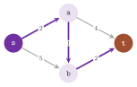
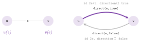

# 3. Graphs, items and maps {#ch-3}

We are concerned in this chapter with the few ideas on which all the headers
of the library are built, and which a reader needs before the data structures
of Part II and the algorithms of Part III. A graph is a set of items (nodes,
arcs and, if it is undirected, edges), which are handled by small value types,
visited by iterators and compared with the constant `INVALID`. Data are
attached to the items only through maps, i.e., objects that associate a value
with each item, and the requirements on a graph, a map or a heap are written
as concept classes, against which a type can be checked at compile time, and
the algorithms are classes that follow (with few exceptions) one pattern of
construction, execution and query. These ideas come from LEMON, whose design
is described in [Dezső, Jüttner and Kovács
2011](Z-bibliography.md#ref-DezsoJuttnerKovacs11Lemon), and abLEMON keeps them
unchanged. Section 3.1 gives a first complete program; sections 3.2 to 3.4
describe the items, the iterators and the maps, section 3.5 the concepts,
section 3.6 the algorithm classes, and section 3.7 the tolerances with which
the library compares numbers that may carry a rounding error, while section
3.8 collects the exercises. In all the chapters we write $D=(V,A)$ for a
digraph and $G=(V,E)$ for an undirected graph, with $n=|V|$ and $m=|A|$ (or
$m=|E|$), and $\delta^+(v)$ and $\delta^-(v)$ for the sets of the arcs that
leave and enter a node $v$.

## 3.1 A first program {#sec-3-1}

We begin with a program that builds the digraph of [Figure
3.1](03-mental-model.md#fig-3-1), with four nodes and five arcs, stores a cost
for each arc, and computes the shortest path from the node `s` to the node `t`
by the algorithm of Dijkstra (cf. [chapter 10](10-shortest-paths.md#ch-10)).
As all the programs of the manual, it is built and run by the tests of the
library; how to build a user program against an installed abLEMON is explained
in [chapter 2](02-installation.md#ch-2).

```cpp
--8<-- "examples/03-first-program.cc"
```

{#fig-3-1}

Each line of the program uses one of the ideas of this chapter. Its digraph is
a `ListDigraph` (cf. [chapter 4](04-graphs.md#ch-4)), which is empty when
constructed and grows by `addNode()` and `addArc(s, t)`. Each of these
functions returns a handle to the new item, i.e., a small object of type
`ListDigraph::Node` or `ListDigraph::Arc` that identifies the item within its
digraph (section 3.2). Since an arc has no field that a user could set, the
costs are the values of a `ListDigraph::ArcMap< int >`, a map that holds one
`int` for each arc of `g` and that is read and written by `cost[a]` (section
3.4). The algorithm is the class template `Dijkstra`, whose parameters are the
type of the digraph and the type of the map of the lengths; it is constructed
on the digraph and on the map, it runs from a source by `run(s)`, and its
results are read afterwards by queries such as `dist(t)` and `predNode(v)`
(section 3.6). In the last loop the path is followed backwards from `t` to the
source, because `predNode(v)` gives the node that precedes `v` on the shortest
path found, and the program prints the identifiers `3 2 1 0` that `g.id(v)`
returns for its nodes. Finally, the program checks that the distance of `t` is
5 and returns 1 otherwise; hence, a program of the manual that stops matching
the library makes the tests fail.

## 3.2 Items, identifiers and INVALID {#sec-3-2}

A digraph has two kinds of items, of the types `Node` and `Arc` nested in its
class. An undirected graph also has the type `Edge`: each edge $e$ has two end
nodes, `u(e)` and `v(e)`, and it is represented by two arcs of opposite
directions, which the graph creates and erases together with the edge. A
bipartite graph (`BpGraph`) is an undirected graph whose nodes are either red
or blue, and whose edges join a red node to a blue one; its types `RedNode`
and `BlueNode` derive from `Node`. All these types are handles. An object of
type `Node` does not contain a node but identifies one, typically by an
integer index, and it is "cheap" to copy, to compare and to store. We remark
that a handle is meaningful only together with its graph (the same index may
identify another node in another graph), and the graph is therefore passed
explicitly to each function that reads the structure, as in `g.source(a)` or
`g.id(v)`.

*The constant INVALID.* In `lemon/core.h` one finds the empty type `Invalid`
and its only object, `INVALID`. Indeed, each handle and each iterator converts
from `INVALID`, and comparing an item with `INVALID` reveals whether it
identifies an item at all. In this way an iteration ends (section 3.3), a
function such as `findArc()` of [chapter 4](04-graphs.md#ch-4) returns the
absence of a result, and an algorithm marks a node without a predecessor
(e.g., the source of a search has `predArc(s) == INVALID`). Also, the handles
have the operators `==`, `!=` and `<`, the last of which is an artificial
order (unrelated to the order of iteration) that only lets the handles be the
keys of ordered containers.

!!! note "abLEMON"
    A default-constructed handle (`ListDigraph::Node v;`) is `INVALID` in all
    the graph structures and adaptors of abLEMON, while in LEMON 1.3.1 its
    index was left indeterminate in most of them (and the maps copied that
    indeterminate value when they built their default values). Yet, the
    concepts still say that the default constructor leaves the value
    undefined; hence, a generic algorithm should assign `INVALID` explicitly
    instead of relying on it.

*Identifiers.* Each item has an integer identifier, `g.id(item)`, which is
unique among the items of its kind in the graph and does not change while the
item exists, while `g.nodeFromId(i)`, `g.arcFromId(i)` and `g.edgeFromId(i)`
give the item back, and `g.maxNodeId()`, `g.maxArcId()` and `g.maxEdgeId()`
give an upper bound on the identifiers in use. Identifiers are the indices of
the vectors that store the items and the values of the maps, and they are not
necessarily contiguous: a `ListDigraph`, e.g., keeps the identifiers of the
erased nodes on a free list and gives them to the next nodes added. An erased
node may thus become valid again, and the structures that allow erasing (the
`List` ones, and the `Smart` ones through their snapshots) have the function
`valid(item)`, which returns whether a handle identifies an item of the graph
at present. In fact, a bipartite graph also numbers the red and the blue nodes
separately. Thus, `g.id(RedNode)` is the index of a node among the red ones
(bounded by `g.maxRedId()`), and it usually differs from `g.id(Node)` of the
same node. Finally, the generic forms `g.maxId(Node())` and
`g.fromId(i, Node())`, with a dummy item that selects the kind, serve the
templates that work on any kind of item.

*Edges and arcs.* Each edge has an inherent orientation, from `u(e)` to
`v(e)`, given by the order in which its end nodes were passed to
`addEdge(u, v)`. Of the two arcs of an edge, the forward one goes from `u(e)`
to `v(e)` and the backward one from `v(e)` to `u(e)`. These arcs are
`g.direct(e, true)` and `g.direct(e, false)`, while `g.direct(e, w)` is the
arc of $e$ whose source is the node `w`. Also, `g.direction(a)` is `true` for
a forward arc and `g.oppositeArc(a)` is the other arc of the same edge. An
`Arc` converts to the `Edge` it represents (so that an edge map can be read
with an arc as its key), and `g.oppositeNode(w, e)` is the end of $e$ other
than `w`. In `ListGraph`, `SmartGraph` and `StaticGraph` the edge of
identifier $i$ is represented by the arcs of identifiers $2i+1$ (forward) and
$2i$ (backward), as [Figure 3.2](03-mental-model.md#fig-3-2) shows. Since the
other structures number their arcs in other ways, a program should usually use
`direct()` and `direction()` instead of this arithmetic. A loop, i.e., an edge
with $u(e)=v(e)$, also has two arcs, each of which leaves and enters the same
node.

{#fig-3-2}

In a bipartite graph the inherent orientation of each edge goes from its red
end to its blue end, which `g.redNode(e)` and `g.blueNode(e)` return, while
`g.red(v)` and `g.blue(v)` give the colour of a node and `g.asRedNode(v)`
converts a `Node` to a `RedNode` (returning `INVALID` if the node is blue).
Its variant `g.asRedNodeUnsafe(v)` omits the check, which makes it somewhat
faster, but it is correct only on red nodes and on `INVALID`; the functions of
the blue nodes are symmetric. Since an undirected graph is also a digraph
(with two arcs for each edge), any algorithm written for digraphs runs on it.
Furthermore, the function `undirected(g)` of `lemon/core.h` returns whether
the type of `g` is undirected; its value is selected at compile time from the
tag `UndirectedTag` that the undirected structures define.

## 3.3 Iterators and ranges {#sec-3-3}

Items are visited by iterators, which are nested classes of the graph.
`NodeIt`, `ArcIt` and `EdgeIt` visit all the nodes, arcs and edges; `OutArcIt`
and `InArcIt` visit the arcs that leave and enter a node, `IncEdgeIt` the
edges incident to a node, and, in a bipartite graph, `RedNodeIt` and
`BlueNodeIt` the nodes of one colour. An iterator derives from the handle of
the items it visits. Hence, we use it wherever a handle is expected, with no
dereferencing, and the usual loop is

```
for( ListDigraph::OutArcIt a( g , v ) ; a != INVALID ; ++a )
 total += cost[ a ];
```

in which the iterator is constructed on the graph (and on the node, for the
iterators of incident items), advanced by `++`, and compared with `INVALID`,
which it becomes after the last item. Each iterator also has a constructor
from the graph and an item, which continues the iteration from that item.

We call base node of an incidence iterator `it` the node on which it was
constructed; then `g.baseNode(it)` is the base node and `g.runningNode(it)`
the other end of the current item: for `OutArcIt` they are the source and the
target of the arc, for `InArcIt` the target and the source, and for
`IncEdgeIt` the node of the iterator and the opposite end of the edge. In an
undirected graph `OutArcIt` and `InArcIt` visit the arcs of the incident edges
in the two directions, whereas `IncEdgeIt` visits the edges. A loop is visited
twice by the first two, once for each of its arcs, and also twice by
`IncEdgeIt` in `ListGraph` and `SmartGraph`. Note that the order of iteration
is not specified by the concepts, and it differs between the structures (e.g.,
`ListDigraph` and `SmartDigraph` visit their nodes from the last added to the
first); a program should not depend on it.

For the range-based `for` of C++11, we also find in the graphs functions that
return a range of the same items, since a range is easier to pass to a loop or
to an algorithm than a pair of iterators. These are `g.nodes()`, `g.arcs()`,
`g.edges()`, `g.outArcs(v)`, `g.inArcs(v)`, `g.incEdges(v)` and, in a
bipartite graph, `g.redNodes()` and `g.blueNodes()`, so that one may write
`for (auto a : g.outArcs(v))`. A range holds a pair of wrapped iterators
(`LemonRangeWrapper1` and `LemonRangeWrapper2` of
`lemon/bits/stl_iterators.h`), which define the member types of an input
iterator, a dereference that returns the item, and a postfix `++`; hence, the
algorithms of the standard library that read an input range (e.g.,
`std::count_if` or `std::copy`) work on them too.

!!! note "abLEMON"
    The ranges come from the repository of LEMON after its release 1.3.1, and
    they are distributed for the first time in abLEMON. Their iterators define
    the member types of an input iterator directly, instead of deriving them
    from `std::iterator`, which C++17 deprecated.

Writing the names of the nested types becomes tedious in a function that uses
several of them, and `lemon/core.h` has macros that define them in the current
scope. `DIGRAPH_TYPEDEFS(Digraph)` defines `Node`, `NodeIt`, `Arc`, `ArcIt`,
`InArcIt` and `OutArcIt`, with the maps `BoolNodeMap`, `IntNodeMap`,
`DoubleNodeMap`, `BoolArcMap`, `IntArcMap` and `DoubleArcMap` of that type.
`GRAPH_TYPEDEFS(Graph)` adds `Edge`, `EdgeIt`, `IncEdgeIt` and three edge
maps, and `BPGRAPH_TYPEDEFS(BpGraph)` adds `RedNode`, `RedNodeIt`, `BlueNode`,
`BlueNodeIt` and their maps. Inside a template, where the graph type is a
dependent name, one writes `TEMPLATE_DIGRAPH_TYPEDEFS(GR)` (and its undirected
and bipartite counterparts), which inserts the keywords `typename` and
`template` that the compiler then requires. In abLEMON the types defined by
these macros are marked as possibly unused (with GCC and Clang, by the
attribute `unused`); hence, a function that uses only some of them compiles
without warnings. LEMON 1.3.1 turned the warning on unused local typedefs off
by a pragma, for the whole compilation of the user.

## 3.4 Maps {#sec-3-4}

A graph stores its structure and no other datum. A cost, a capacity, a flow, a
label or the distance computed by an algorithm is kept in a map, i.e., in an
object that has the types `Key` and `Value` and that offers
`operator[]( key )` to read a value, `set( key , value )` to write one, or
both (the concepts that make this precise are given in [chapter
6](06-maps.md#ch-6), together with the maps of `lemon/maps.h`). Each graph
structure provides the standard maps of its items, namely `NodeMap< V >`,
`ArcMap< V >`, `EdgeMap< V >` and, in a bipartite graph, `RedNodeMap< V >` and
`BlueNodeMap< V >`. Such a map stores a value of type `V` for each item of the
graph on which it is constructed, and `map[item]` reads and writes it in
$O(1)$ time. Furthermore, the map follows the changes of the graph, since the
graph informs its maps of each item added or erased (cf. [appendix
A](A-writing-graph-map.md#app-a)): a map constructed on `g` gets a slot for
each item added to `g` afterwards, whose value is `V()` (not the value given
to the constructor), and it drops the slot of each item erased. Of the two
constructors, `NodeMap( g )` value-initializes the values and
`NodeMap( g , value )` sets them all to `value`; we remark that the standard
maps can be neither copied nor assigned, and the values of one map are copied
into another by `mapCopy()` of [chapter 6](06-maps.md#ch-6).

An algorithm reads and writes its data through maps whose types are template
parameters; hence, any object with the right interface may be passed in place
of a standard map, which is often (but not always) the most convenient choice.
A length equal for all the arcs may be a `ConstMap`, and a cost may be
computed on the fly from two other maps by an arithmetic adaptor (e.g., their
difference). Also, a result may go to a map of the caller or to a `NullMap`,
which discards what is written to it. Our next program shows the items of an
undirected graph, the iterators, a map that follows the addition of an edge,
and a function template whose graph type is checked against the concept of
undirected graphs (cf. section 3.5).

```cpp
--8<-- "examples/03-items-maps.cc"
```

## 3.5 Concepts and their checking {#sec-3-5}

A function template of the library (an algorithm, a map adaptor, a copy
function) accepts any type that offers the operations it uses. These
operations are written down, once for each kind of object, as a concept class
in `lemon/concepts/`. A concept class is an archetype, which declares with
empty bodies the types and the functions that the concept requires (e.g.,
`concepts::Digraph` declares `Node`, `Arc`, the iterators, `source()`,
`target()`, `id()` and the maps); hence, a template that compiles with the
archetype uses only what the concept guarantees. Each concept class also
contains a nested template `Constraints< T >`, whose member function
`constraints()` exercises those operations on a candidate type `T`. Those of
the graphs (`concepts::Digraph`, `concepts::Graph` and `concepts::BpGraph`,
with the components of which they are made) are described in [chapter
4](04-graphs.md#ch-4). Those of the maps are in [chapter 6](06-maps.md#ch-6),
those of the heaps in [chapter 7](07-heaps.md#ch-7), and the others (paths,
maximum flows, minimum cost flows, minimum mean cycles) in the chapters of
their families.

Checking is done by two function templates of `lemon/concept_check.h`. A call
`checkConcept< Concept , T >()` takes the address of
`Concept::Constraints< T >::constraints`, which forces the compiler to
instantiate that function. If `T` lacks one of the operations the concept
requires, the compilation fails with an error that names it; at run time the
call does nothing. Its older form `function_requires< C >()` does the same for
a class `C` whose member `constraints()` is to be instantiated (a form that is
now rarely used). Both are empty when `NDEBUG` is defined (i.e., in an
optimized build without assertions), and in a debug build they cost only
compilation time. In the library, the tests check each graph structure, map
and heap against its concept (e.g., `test/digraph_test.cc` calls
`checkConcept< Digraph , ListDigraph >()`), and a user who writes a new
structure checks it in the same way ([appendix
A](A-writing-graph-map.md#app-a)). A generic function may also call
`checkConcept` on its template parameters, as `incidentWeight()` does in the
program of section 3.4, in which case a wrong argument is reported where the
function is called instead of deep inside its body. Finally, the object
`ignore_unused_variable_warning`, called with any arguments, silences the
warnings on the variables that a function `constraints()` declares and does
not use.

!!! note "abLEMON"
    `ignore_unused_variable_warning` is an object of a class with a variadic
    `operator()`, instead of a set of overloaded functions as in LEMON 1.3.1.
    Hence, an unqualified call to a function of the same name of another
    library is no longer made ambiguous by argument-dependent lookup on the
    types of `lemon`.

## 3.6 The algorithm classes {#sec-3-6}

Most algorithms of the library are class templates that share one pattern,
which we describe here on `Dijkstra` (of `lemon/dijkstra.h`, cf. [chapter
10](10-shortest-paths.md#ch-10)), while the chapters of Part III give the
template parameters, the defaults and the queries of each class, and they say
where a class departs from the pattern.

*Template parameters and traits.* The first parameters of the class are the
types of its input; thus, `Dijkstra< GR , LEN , TR >` takes the type `GR` of
the digraph (by default `ListDigraph`) and the type `LEN` of the map of the
lengths (by default `GR::ArcMap< int >`). Its last parameter `TR` is a traits
class, by default `DijkstraDefaultTraits< GR , LEN >`. It defines the other
types used by the algorithm (the heap with its cross reference map, the maps
of the predecessors, of the distances and of the processed nodes, the
operations on the lengths), each with a static function that creates an object
of that type; the lengths have the type `LEN::Value`, and the default heap is
a `BinHeap` on them.

*Named template parameters.* We remark that a traits class is rarely written
by hand, since each of its types can be replaced by a named template
parameter. This is a nested template of the algorithm class, whose member
`Create` is the class with that type replaced. For instance,
`Dijkstra< GR , LEN >::SetDistMap< M >::Create` is a `Dijkstra` that writes
the distances into a map of type `M`, which the caller passes by `distMap(m)`,
and `SetHeap< H , CR >` replaces the heap (cf. [chapter 7](07-heaps.md#ch-7)).
Named parameters can be chained, as in
`SetPredMap< P >::Create::SetDistMap< M >::Create`. A type replaced in this
way is not created by the algorithm, and the caller must give the object
before the first run.

*Execution.* A constructor takes the input objects (here the digraph and the
length map) by reference, and they must outlive the algorithm, while the maps
that the algorithm writes are created by it at the first run, unless the
caller has given them by the setter functions `predMap()`, `distMap()`,
`processedMap()` and `heap()`, each of which returns a reference to the
algorithm (and the calls can thus be chained). The simplest way to execute the
algorithm is `run(s)`, which computes the shortest paths from `s` to all the
nodes reachable from it, while `run(s, t)` stops as soon as `t` is processed
and returns whether `t` is reachable. For a finer control, `run(s)` is the
sequence `init()`, `addSource(s)`, `start()` of Algorithm 3.1, and these
functions may also be called one by one: `init()` resets the data of the
nodes, and `addSource(s, d)` adds a source with the initial distance `d` (zero
by default), and one may give several sources. Then `start()` runs the search
until the heap is empty, `start(t)` stops when `t` is processed, and
`start(nm)` stops at the first node `v` with `nm[v]` true that reaches the top
of the heap, which it returns (or `INVALID` if there is none). Between these
calls, `processNextNode()` performs one step and returns the node it
processed, `nextNode()` gives the node that the next step will process, and
`emptyQueue()` and `queueSize()` describe the heap.

<span id="alg-3-1"></span>**Algorithm 3.1** (The run of an algorithm class, on
Dijkstra).

```
run(s):
 1  init()                     reset the data of all the nodes
 2  addSource(s, 0)            put s in the heap with distance 0
 3  start():
 4    while not emptyQueue()
 5      v = processNextNode()  pop the node of least distance and
 6                             relax the arcs of delta+(v)
```

*Queries.* After a run the results are read by query functions, named after
the objects of the problem: `dist(v)`, `predArc(v)`, `predNode(v)` and
`path(t)` for the shortest paths, `reached(v)` and `processed(v)` for the
state of a node, and `distMap()` and `predMap()` for the maps. A query is
meaningful only after a run that reached the node (this is its precondition,
stated in the documentation of each function), and its value remains available
until the next `init()`.

*Function-type interface.* Some algorithms (among them `bfs()`, `dfs()` and
`dijkstra()`) also have a function that returns a "wizard" object, on which
the optional outputs are given by name before the run, as in

```
bool found = dijkstra( g , length ).distMap( d ).path( p ).run( s , t );
```

which writes the distances into `d` and the path from `s` to `t` into `p`.
Such a wizard constructs the algorithm for the run, together with the maps
that were not given, and destroys them afterwards. It is rather convenient in
simple cases, whereas the class gives access to the intermediate state and to
repeated runs. Our third program goes through the pattern, with a named
template parameter, the separate steps of a run with one and with two sources,
the queries, and the function-type interface.

```cpp
--8<-- "examples/03-algorithm-pattern.cc"
```

## 3.7 Tolerances and numeric traits {#sec-3-7}

An algorithm that works on floating-point data compares numbers that may carry
a rounding error, and a test such as `x == 0` or `a < b` then gives an answer
that depends on the last bits of the operands. In `lemon/tolerance.h` the
class template `Tolerance< T >` collects the comparisons that the algorithms
need. Each of them returns `true` only if the relation holds surely, i.e.,
even allowing for an error up to a threshold $\varepsilon$, as follows:

$$
\begin{array}{ll}
\texttt{less(a, b)}: & a+\varepsilon<b,\\
\texttt{different(a, b)}: & \texttt{less(a, b)} \lor \texttt{less(b, a)},\\
\texttt{positive(a)}: & \varepsilon<a,\\
\texttt{negative(a)}: & a<-\varepsilon,\\
\texttt{nonZero(a)}: & \texttt{positive(a)} \lor \texttt{negative(a)},
\end{array}
\tag{3.1}
$$

while `zero()` returns 0. Its general version is meant for exact types (the
integers, or a rational type), and its functions are static and compare
exactly, i.e., as in (3.1) with $\varepsilon=0$. Instead, the specializations
for `float`, `double` and `long double` hold an $\varepsilon$ in each object.
It is set by the constructor (as in `Tolerance< double > tol( 1e-8 )`) or by
`tol.epsilon( e )`, and read by `tol.epsilon()`; its default is $10^{-4}$,
$10^{-10}$ and $10^{-14}$, respectively (the last one being the `double` value
$10^{-14}$, widened). The static function `defaultEpsilon( e )` changes the
default for the objects constructed afterwards, everywhere in the program. Any
other type gets the general template, and a user who works with another
inexact type writes a specialization with the same functions.

We stress that the threshold is absolute, i.e., $\varepsilon$ in (3.1) does
not scale with the operands; hence, `Tolerance< double >` finds $10^{20}$ and
$10^{20}+10^5$ surely different (although their relative gap is $10^{-15}$),
and $10^{-12}$ and $2\cdot10^{-11}$ equal (although one is 20 times the
other). Its default suits, therefore, data of "moderate" magnitude, and the
algorithms that take a `Tolerance` (the maximum flow and minimum cut
algorithms, among others) have a function `tolerance()` by which the caller
sets one that fits the scale of the data. On the other hand, the minimum cost
flow algorithms keep tolerances of a different kind, which are relative to the
data unless the caller sets them (cf. [chapter
13](13-min-cost-flow.md#ch-13)). A short program shows both behaviors of the
threshold, the defaults, and the function `countNodes()` discussed at the end
of the section.

```cpp
--8<-- "examples/03-tolerance.cc"
```

*Numeric constants.* The "small" header `lemon/math.h` includes `<cmath>` and
defines, in the namespace `lemon`, the constants `E`, `LOG2E`, `LOG10E`,
`LN2`, `LN10`, `PI`, `PI_2`, `PI_4`, `SQRT2` and `SQRT1_2`, as `long double`
values written with 35 significant digits. It also defines `isNaN(v)`, which
tests `v != v`, and `round(r)`, which rounds to the nearest integer with the
halves away from zero. In abLEMON the constants are `inline constexpr` from
C++17 on (and `const` before), so that the C++20 module `lemon` can export
them.

*Traits of graphs and maps.* A user rarely includes `lemon/bits/traits.h`
directly; it holds the templates by which the library selects an
implementation at compile time from the properties of a type. Thus,
`ItemSetTraits< GR , Item >` gives, for a graph type and a kind of item, the
iterator (`ItemIt`), the map template (`Map< V >::Type`) and the notifier of
the items, and a template can be written once for nodes, arcs and edges. Also,
`MapTraits< M >` gives whether a map is a reference map and which types its
`operator[]` returns ([chapter 6](06-maps.md#ch-6)). Other templates detect
the tags that a structure may define: `NodeNumTag`, `ArcNumTag` and
`EdgeNumTag` mean that the structure counts its items in $O(1)$ time, and
`FindArcTag` and `FindEdgeTag` that it finds the arc between two nodes
directly; also, `BuildTag` means that it is built in one call from another
graph, and `UndirectedTag` that it is undirected. Typically, a counting
function of `lemon/core.h` is selected by these tags; indeed, `countNodes(g)`
calls `g.nodeNum()` on a structure with `NodeNumTag`, in $O(1)$ time, and
scans the nodes with `NodeIt` otherwise, in $O(n)$ time, and the other
utilities of [chapter 4](04-graphs.md#ch-4) (`countArcs()`, `findArc()`, the
copies) are selected in the same way, by `enable_if` on the tag.

## 3.8 Exercises {#sec-3-8}

<span id="ex-3-1"></span>**Exercise 3.1.** Modify the first program so that it
prints the nodes of the shortest path from `s` to `t` in the order in which
the path visits them, by `dijkstra.path(t)` and the path utilities of [chapter
8](08-auxiliary.md#ch-8) instead of the loop on `predNode()`. (The program
`manual/examples/03-first-program.cc` gives the distance against which to
check the result.)

<span id="ex-3-2"></span>**Exercise 3.2.** Write a function template that, for
any undirected graph `g` and edge map `w`, returns the edge of largest weight
incident to a node (or `INVALID` if the node is isolated), and check its graph
type by `checkConcept`; call it on a `ListGraph` and on a `SmartGraph`. (The
function `incidentWeight()` of `manual/examples/03-items-maps.cc` is a model.)

<span id="ex-3-3"></span>**Exercise 3.3.** Build a `ListGraph` with a loop and
two parallel edges, and count, for one of their end nodes, the items visited
by `OutArcIt`, `InArcIt` and `IncEdgeIt`. Explain the counts by the
representation of [Figure 3.2](03-mental-model.md#fig-3-2). (The test
`test/graph_test.cc` checks the degrees of such graphs.)

<span id="ex-3-4"></span>**Exercise 3.4.** Find three `double` values $a$, $b$
and $c$ such that `Tolerance< double >` finds $a$ equal to $b$ and $b$ equal
to $c$, but $a$ different from $c$; hence, the equality of (3.1) is not
transitive. Discuss what this implies for an algorithm that groups values by
equality. (The program `manual/examples/03-tolerance.cc` checks the
threshold.)

<span id="ex-3-5"></span>**Exercise 3.5.** Replace the length map of the
program of section 3.6 by a map of type
`ConstMap< SmartDigraph::Arc , double >` with value 1 (cf. [chapter
6](06-maps.md#ch-6)), so that `Dijkstra` computes the number of arcs of the
shortest paths, and check the result against a breadth-first search ([chapter
9](09-search.md#ch-9)). (The test `test/bfs_test.cc` shows the breadth-first
search.)
