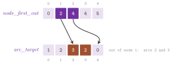
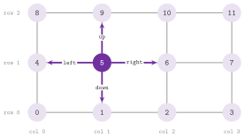
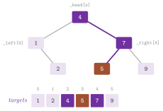

# 4. Graph structures {#ch-4}

We are concerned in this chapter with the classes that store a graph, and with
the utilities of `lemon/core.h` that count, find and copy its items. All of
them implement the concepts of [chapter 3](03-mental-model.md#ch-3); hence, an
algorithm written for a digraph runs on any of them. They differ in what they
allow after the construction (adding items, erasing them, nothing at all), in
the time of their operations and in the memory they take. One usually chooses
between a list-based structure, which allows any modification, a vector-based
one, which only grows, a static one, which is built once and is the most
compact, and an implicit one, which stores no item and computes the structure
of a full, grid or hypercube graph from the indices. Section 4.1 describes the
concepts and compares the structures in Table 4.1, and sections 4.2 to 4.6
give the structures family by family. Section 4.7 deals with the arc and edge
sets that share the nodes of another graph, section 4.8 with the functions and
classes that count the items and find the arcs between two nodes, and section
4.9 with the copies of a graph into another structure; the exercises are in
section 4.10. Their representations follow the textbook ones (cf. [Ahuja,
Magnanti and Orlin 1993, §2.3](Z-bibliography.md#ref-amo93networkflows) and
[Cormen et al. 2001, §22.1](Z-bibliography.md#ref-clrs01algorithms)):
adjacency lists, linked in the list-based and vector-based structures, and
stored contiguously (the "forward star" representation) in the static ones.

## 4.1 The graph concepts {#sec-4-1}

In `lemon/concepts/digraph.h` the class `concepts::Digraph` declares the items
`Node` and `Arc` and the iterators `NodeIt`, `ArcIt`, `OutArcIt` and
`InArcIt`, with their ranges. It also declares the functions `source()`,
`target()`, `id()`, `nodeFromId()`, `arcFromId()`, `maxNodeId()`,
`maxArcId()`, `oppositeNode()`, `baseNode()` and `runningNode()`, and the map
templates `NodeMap< T >` and `ArcMap< T >`. Note that a digraph cannot be
copied or assigned, since its copy constructor and assignment are private; it
is duplicated by the copies of section 4.9. The concept `concepts::Graph`, in
`lemon/concepts/graph.h`, adds the item `Edge`, the iterators `EdgeIt` and
`IncEdgeIt`, the functions `u()`, `v()`, `direction()`, `direct()`,
`oppositeArc()`, `edgeFromId()` and `maxEdgeId()`, the template
`EdgeMap< T >`, and the tag `UndirectedTag`; an undirected graph conforms to
`concepts::Digraph` too, with two arcs for each edge (cf. [chapter
3](03-mental-model.md#ch-3)). In `lemon/concepts/bpgraph.h`,
`concepts::BpGraph` adds the items `RedNode` and `BlueNode`, the iterators
`RedNodeIt` and `BlueNodeIt`, the maps `RedNodeMap< T >` and
`BlueNodeMap< T >`, and the functions `red()`, `blue()`, `asRedNode()`,
`asBlueNode()`, their unsafe variants, `redNode(e)`, `blueNode(e)`,
`maxRedId()` and `maxBlueId()`. All three concepts describe only the queries;
adding, erasing and clearing are not part of them, since some structures do
not offer them.

These concepts are assembled from components, the classes of
`lemon/concepts/graph_components.h`, which a structure or an algorithm may
also require separately. Each component exists in three versions, for
digraphs, graphs and bipartite graphs, and it takes as a template parameter
the component on which it is built (by default the base one):

-  `GraphItem< sel >`, the concept of a handle (default and copy construction,
  assignment, conversion from `INVALID`, `==`, `!=`, `<`), with a character
  `sel` that keeps the types of nodes, arcs and edges distinct.
-  `BaseDigraphComponent`, `BaseGraphComponent` and `BaseBpGraphComponent`,
  the items with `source()` and `target()` (and `u()`, `v()`, `direction()`,
  `direct()`, `oppositeArc()`, or the colours).
-  `IDableDigraphComponent` (and its graph and bipartite versions), the
  identifiers and the functions that invert them, which must be unique and
  immutable.
-  `IterableDigraphComponent`, the iterators, built on `GraphItemIt` (the
  concept of `NodeIt`, `ArcIt` and `EdgeIt`) and `GraphIncIt` (that of
  `OutArcIt`, `InArcIt` and `IncEdgeIt`), with the functions `first()`,
  `next()`, `firstOut()` and the others of the base classes.
-  `AlterableDigraphComponent`, the alteration notifiers, by which the
  structure informs its maps and other observers of each change (cf. [appendix
  A](A-writing-graph-map.md#app-a)).
-  `MappableDigraphComponent`, the map templates, each of which must conform
  to `GraphMap`, i.e., be a reference map constructed on the graph, with or
  without an initial value.
-  `ExtendableDigraphComponent`, `ErasableDigraphComponent` and
  `ClearableDigraphComponent`, the functions `addNode()` and `addArc()` (or
  `addEdge()`, `addRedNode()`, `addBlueNode()`), `erase()`, and `clear()`,
  each of which requires the alterable component.

Thus, `concepts::Digraph` is made of the base, idable, iterable and mappable
components. Besides it, the tests of the library check the components that
each structure offers in addition: e.g., `test/digraph_test.cc` checks
`ListDigraph` against the extendable, erasable, clearable and alterable
components, and `StaticDigraph` against the clearable one only. Table 4.1
lists the structures of the chapter with what they offer and what they cost.
Its memory column gives the number of `int` values that each node and each arc
take in the arrays of the structure (from the private structs `NodeT` and
`ArcT` of the base classes of `lemon/list_graph.h`, `lemon/smart_graph.h` and
`lemon/edge_set.h`, and from the arrays of the static structures), and
$d^+(v)$ and $d(v)$ are the out-degree and the degree of $v$.

<span id="tab-4-1"></span>**Table 4.1.** The graph structures.

| Structure | Concept | Changes | Counting | Memory per node / arc | `findArc(u, v)` |
|------------------|----------|-------------------|--------------|------------|---------------|
| `ListDigraph` | Digraph | add, erase, others | $O(n)$, $O(m)$ | 4 / 6 | $O(d^+(u))$ |
| `ListGraph` | Graph | add, erase, others | $O(n)$, $O(m)$ | 3 / 3 | $O(d(u))$ |
| `ListBpGraph` | BpGraph | add, erase, others | $O(n)$, $O(m)$ | 6 and a `bool` / 3 | $O(d(u))$ |
| `SmartDigraph` | Digraph | add, snapshot | $O(1)$ | 2 / 4 | $O(d^+(u))$ |
| `SmartGraph` | Graph | add, snapshot | $O(1)$ | 1 / 2 | $O(d(u))$ |
| `SmartBpGraph` | BpGraph | add, snapshot | $O(1)$ | 3 and a `bool` / 2 | $O(d(u))$ |
| `StaticDigraph` | Digraph | build | $O(1)$ | 2 / 4 | $O(d^+(u))$ |
| `StaticGraph` | Graph | build | $O(1)$ | 1 / 3 | $O(d(u))$ |
| `CompactDigraph` | Digraph | build | $O(1)$ | 1 / 1 | $O(d^+(u))$ |
| `FullDigraph`, `FullGraph`, `FullBpGraph` | Digraph, Graph, BpGraph | resize | $O(1)$ | none | $O(1)$ |
| `GridGraph`, `HypercubeGraph` | Graph | resize | $O(1)$ | none | $O(1)$ |
| `ListArcSet`, `ListEdgeSet` | Digraph, Graph | add, erase | $O(n)$, $O(m)$ | 2 / 6, 1 / 3 | $O(d^+(u))$ |
| `SmartArcSet`, `SmartEdgeSet` | Digraph, Graph | add | $O(n)$, $O(m)$ | 2 / 4, 1 / 2 | $O(d^+(u))$ |

In the table, "others" are the changes of the end nodes, the contraction and
the splitting of section 4.2, and "snapshot" means that the items added after
a snapshot can be removed (section 4.3). Also, "build" means that the
structure is built in one call and can be rebuilt (section 4.4), and "resize"
that the implicit structure changes its size, which clears its maps. Counting
is that of `countNodes()` and `countArcs()` (section 4.8), and the memory of
an undirected structure is given per arc, an edge having two. For the arc and
edge sets, the memory per node is that of the node map in which they keep the
heads of their lists (the nodes belong to the underlying graph), and their
arcs store the end nodes as handles of the underlying graph, which are counted
here as one `int` each.

## 4.2 List graphs {#sec-4-2}

In `lemon/list_graph.h` we find `ListDigraph`, `ListGraph` and `ListBpGraph`,
the structures that allow any modification. A `ListDigraph` keeps its nodes
and its arcs in two `std::vector`s. The nodes form a doubly linked list, and
so do the arcs out of each node and the arcs into each node, through indices
stored in the arcs. An erased node or arc is unlinked and put on a free list,
whose items are reused by the next additions; hence, the identifiers are the
positions in the vectors, bounded by the largest number of items that existed
at the same time. Adding a node or an arc costs $O(1)$ (amortized, because of
the growth of the vectors) and erasing an arc $O(1)$, while erasing a node
costs $O(d^+(v)+d^-(v))$, since the arcs at the node are erased first. The
nodes are visited from the last added to the first, and `ArcIt` follows the
lists of the arcs out of each node. Since the structure keeps no count of its
items, `countNodes()` and `countArcs()` take linear time.

In `ListGraph` each edge is stored as two arcs with consecutive indices
(cf. [Figure 3.2](03-mental-model.md#fig-3-2)), and each node keeps one doubly
linked list of the arcs that leave it. The arcs that enter a node are obtained
from this list as the opposites of those that leave it. The class
`ListBpGraph` adds to the nodes of `ListGraph` a colour, an index within the
colour (`id(RedNode)`, `id(BlueNode)`), and a doubly linked list for each
colour. Besides the functions of the concepts, the three classes have the
following ones, which keep the iterators valid unless it is said otherwise.

-  `addNode()` and `addArc(s, t)` (`addEdge(u, v)` in `ListGraph`, and
  `addRedNode()`, `addBlueNode()` and `addEdge(r, b)` in `ListBpGraph`),
  `erase(item)` for a node, an arc or an edge (which invalidates the iterators
  on the erased items), and `clear()`.
-  `valid(item)`, which returns whether a handle identifies an item at
  present; an erased item may become valid again after an addition that reuses
  its index.
-  `changeTarget(a, n)`, `changeSource(a, n)` and `reverseArc(a)` in
  `ListDigraph`, which move the ends of an arc and keep its identifier and its
  values in the maps. In the same way, `ListGraph` has `changeU(e, n)` and
  `changeV(e, n)`, and `ListBpGraph` has `changeRed(e, n)` and
  `changeBlue(e, n)`. The iterators along the lists that the arc leaves are
  invalidated (e.g., an `InArcIt` on `a` after `changeTarget()`).
-  `contract(u, v, r = true)` in `ListDigraph` and `ListGraph`, which moves
  the arcs (or edges) of `v` to `u` by the changes above and erases `v`. If
  `r` is `true`, the arcs between `u` and `v` are erased instead of becoming
  loops, while the loops that `u` already had are kept.
-  `split(n, connect = true)` in `ListDigraph`, which adds a node, moves to it
  the arcs out of `n`, and, if `connect` is `true`, adds an arc from `n` to
  it. Also, `split(a)` adds a node `w`, makes it the target of `a`, and adds
  an arc from `w` to the old target of `a`; both return the new node.
-  `reserveNode(n)` and `reserveArc(m)` (`reserveEdge(m)` in the undirected
  classes), which reserve the memory of the vectors before a large graph is
  built.

*Snapshots.* A nested class `Snapshot` saves the state of the graph and
restores it later, removing the items added in between. A snapshot is made by
the constructor `Snapshot(g)` or by `save(g)` (which replaces a previous one),
and it is used by `restore()`. It observes the notifiers of the graph
(cf. [appendix A](A-writing-graph-map.md#app-a)) and records the items added.
When one of them is erased, the snapshot removes it from its record, at a cost
linear in the number of items recorded. An item that existed before the
snapshot, instead, cannot be erased without consequences: its erasure detaches
the snapshot from the graph, after which `valid()` returns `false`. Also
`restore()` invalidates the snapshot, and a state cannot be restored twice
unless `save()` is called again. Furthermore, the other modifications
(`changeTarget()`, `reverseArc()`, `contract()`, `split()` and so on) are not
recorded, and they must not be used together with a snapshot. Our next program
goes through these functions on a `ListDigraph`.

```cpp
--8<-- "examples/04-list-graph.cc"
```

## 4.3 Smart graphs {#sec-4-3}

In `lemon/smart_graph.h` we find `SmartDigraph`, `SmartGraph` and
`SmartBpGraph`, which store their items in vectors and link the arcs of each
node in singly linked lists. They cannot erase an item, and in exchange they
are typically faster to build and somewhat smaller than the list-based ones
(Table 4.1). Their identifiers are the positions in the vectors, i.e., the
nodes and the arcs are numbered from 0 in the order of addition. The items are
counted in $O(1)$ time, since the structures have the tags `NodeNumTag`,
`ArcNumTag` and `EdgeNumTag` and the functions `nodeNum()`, `arcNum()` and
`edgeNum()` (and `redNum()`, `blueNum()` in `SmartBpGraph`). Besides the
functions of the concepts, they have `addNode()`, `addArc()` (or `addEdge()`,
`addRedNode()` and `addBlueNode()`), `valid()`, `clear()`, `reserveNode()` and
`reserveArc()` (or `reserveEdge()`). Also, `SmartDigraph` has
`split(n, connect = true)`, as in `ListDigraph`.

*Snapshots.* Items can be removed from a smart graph only by its `Snapshot`,
which records the numbers of nodes and arcs at `save(g)` (or at the
constructor `Snapshot(g)`). Its `restore()` erases the items with larger
indices, the last first, and notifies the maps of each of them; saving takes
$O(1)$ time, and restoring time linear in the number of items removed. Unlike
the snapshot of a list graph, this one does not observe the graph, and its
validity is not checked. Hence, a `restore()` after a `split()` of
`SmartDigraph`, or after a restore to an older snapshot, leaves the graph in
an inconsistent state, as the header warns.

## 4.4 Static graphs {#sec-4-4}

The headers `lemon/static_graph.h` and `lemon/compact_graph.h` define
`StaticDigraph`, `StaticGraph` and `CompactDigraph`, which are built in one
call and cannot be modified afterwards (but can be built again). They store
the arcs out of each node one after the other, in arrays with no pointer to
follow. Hence, they take less memory than the other structures, and they scan
the arcs out of a node contiguously, which is often (but not always) faster in
practice. Their nodes and arcs are numbered from 0, and `node(i)`, `arc(i)`
(`edge(i)` in `StaticGraph`) and `index(item)` convert between items and
indices, the index of an item being its identifier. Note that each class has
`nodeNum()` and `arcNum()` (and `edgeNum()`), in $O(1)$ time, `clear()`, and
two functions `build()`.

-  `build(g, nodeRef, arcRef)` copies any digraph `g` (any graph, for
  `StaticGraph`). It writes into the map `nodeRef` the image of each node,
  which it also reads, and into `arcRef` (or `edgeRef`) the image of each arc,
  for which a `NullMap` may be given if it is not needed (one
usually needs only the node references). The copies of section 4.9 call it, by
the tag `BuildTag`.
-  `build(n, begin, end)` builds the structure with `n` nodes from a range of
  `std::pair< int , int >`, the $k$-th pair $(i,j)$ giving the arc (or edge)
  of index $k-1$ from the node of index $i$ to that of index $j$.

Rebuilding a structure, or clearing it, clears the values of its maps.

*StaticDigraph.* Its arrays are those of [Figure 4.1](04-graphs.md#fig-4-1):
`node_first_out`, of $n+1$ entries, gives the first arc out of each node (the
arcs out of node $v$ being those from `node_first_out[v]` to
`node_first_out[v+1]-1`), and `arc_target` the target of each arc. Two more
arrays, `node_first_in` and `arc_next_in`, link the arcs into each node in a
list, and `arc_source` and `arc_next_out` complete the four `int` values of
each arc. Its `OutArcIt` is specialized: it walks the indices from the first
arc of the node to the last, with no array access per step. When the structure
is built from a list, the pairs must come in nondecreasing order of their
first element (a `LEMON_ASSERT` checks it, unless the assertions are disabled,
cf. [chapter 8](08-auxiliary.md#ch-8)), and the arcs keep the order of the
list; when built from a digraph, the nodes take the indices in the order of
the `NodeIt` of `g`, and the arcs out of each node are sorted (by the private
comparator `ArcLess` of the class) by the index of their target. Building from
a list takes $O(n+m)$ time, and from a digraph $O(n+\sum_v d^+(v)\log d^+(v))$
because of the sorting.

{#fig-4-1}

*StaticGraph.* This undirected counterpart of `StaticDigraph` represents the
edge of index $i$ by the arcs $2i+1$, from $u$ to $v$, and $2i$, from $v$ to
$u$, as `SmartGraph` does. Since the arcs out of each node are stored one
after the other, and the arcs into a node are the opposites of those out of
it, one array of positions serves both directions. It takes three `int` values
per arc (its target, its position, and the arc at each position) and one per
node, the first position of its arcs. Here the pairs of `build(n, begin, end)`
may come in any order; the edge $k-1$ has $u$ equal to the first element of
the $k$-th pair and $v$ to the second, and the arcs are placed by a counting
sort on their sources (Algorithm 4.1), in $O(n+m)$ time. A copy from a graph
numbers the nodes and the edges in the order of their iterators and then
builds from the list of the end nodes, also in linear time.

<span id="alg-4-1"></span>**Algorithm 4.1** (Building a StaticGraph from a
list of edges).

```
build(n, ends[0..m-1]):
 1  for each edge i:  target[2i] = u_i ; target[2i+1] = v_i
 2  first[0..n] = 0
 3  for each edge i:  first[u_i + 1]++ ; first[v_i + 1]++
 4  for v = 0 .. n-1: first[v+1] += first[v]      (prefix sums)
 5  fill[v] = first[v] for each node v
 6  for each arc a = 0 .. 2m-1:
 7    p = fill[source(a)]++ ,  source(a) = target[a xor 1]
 8    out[p] = a ;  pos[a] = p
```

Here the arcs out of node $v$ are `out[first[v]]` to `out[first[v+1]-1]`,
`nextOut(a)` is `out[pos[a]+1]` while it stays below `first[v+1]`, and
`nextIn(a)` is the opposite of `nextOut` on the opposite arc
(`lemon/static_graph.h`, `StaticGraphBase::build()`).

!!! note "abLEMON"
    `StaticGraph` is new in abLEMON (version 1.5.0): LEMON 1.3.1 had only the
    static digraph. Also, the copy constructor and the assignment of
    `StaticDigraph` are private, as those of the other structures, while in
    LEMON 1.3.1 the implicit ones copied the pointers to its arrays, which
    were then deleted twice.

*CompactDigraph.* It is a `StaticDigraph` without the arrays of the incoming
arcs and of the sources: it stores only `node_first_out` and `arc_target`,
i.e., one `int` per node and one per arc, and an `Arc` handle carries its
source together with its index. It is built as a `StaticDigraph` is (also
sorting the arcs by its own `ArcLess` when it copies a digraph). Its `InArcIt`
exists only to conform to `concepts::Digraph`, since with no index of the
incoming arcs it scans all the arcs: visiting the arcs into one node takes
$O(m)$ time, and into all the nodes $O(nm)$. Also, `arc(i)` (which is not
static here) finds the source of the arc by a binary search on
`node_first_out`, in $O(\log n)$ time. An algorithm that visits the incoming
arcs (e.g., one run on the reverse digraph of [chapter
5](05-adaptors.md#ch-5)) should use `StaticDigraph` instead.

!!! note "abLEMON"
    `CompactDigraph` comes from the repository of LEMON after its release
    1.3.1, and it is distributed for the first time in abLEMON, whose
    documentation also gives the cost of its `InArcIt`.

Our next program builds the three static structures from lists, copies a
`ListDigraph` into a `StaticDigraph` with one of its maps, and checks the
implicit graphs of the next two sections.

```cpp
--8<-- "examples/04-static-graphs.cc"
```

## 4.5 Full graphs {#sec-4-5}

In `lemon/full_graph.h` we find `FullDigraph`, `FullGraph` and `FullBpGraph`,
the complete graphs, which store only their sizes and compute all the rest
from the indices; they take $O(1)$ memory, and each of their functions takes
$O(1)$ time. `FullDigraph(n)` has the nodes $0,\dots,n-1$ and an arc from each
node to each node, loops included, i.e., $n^2$ arcs, the arc from $s$ to $t$
having the identifier $ns+t$. `FullGraph(n)` has an edge between each pair of
distinct nodes, i.e., $n(n-1)/2$ edges and no loop, and `FullBpGraph(r, b)`
has $r$ red nodes, $b$ blue ones, and the $rb$ edges between them, while the
default constructors give the empty graphs. Nodes are given by their index, as
`g(i)` (or `g.redNode(i)` and `g.blueNode(i)` in `FullBpGraph`), and
`index(v)` is the inverse; `g.arc(s, t)` and `g.edge(u, v)` give the arc and
the edge between two nodes, which are `INVALID` for $u=v$ in `FullGraph`, and
`findArc()` and `findEdge()` of section 4.8 use them, since the classes have
the tags `FindArcTag` and `FindEdgeTag`. Finally, `resize(n)` (or
`resize(r, b)`) changes the number of nodes; it notifies the maps that all the
items were erased and then that the new ones were built, and hence the values
of the maps are lost.

## 4.6 Grid and hypercube graphs {#sec-4-6}

The headers `lemon/grid_graph.h` and `lemon/hypercube_graph.h` define two more
implicit undirected graphs, with $O(1)$ memory, constant time counting and the
tags `FindArcTag` and `FindEdgeTag`.

*GridGraph.* `GridGraph(w, h)` has $wh$ nodes, the node $(i,j)$ in column
$i\in\{0,\dots,w-1\}$ and row $j\in\{0,\dots,h-1\}$ having the index $i+jw$,
and an edge between two nodes whose positions differ by 1 in one coordinate;
there are $2wh-w-h$ edges, the vertical ones first ([Figure
4.2](04-graphs.md#fig-4-2)), with the origin at the bottom left corner. The
node at a position is `g(i, j)` (whose range is checked by a `LEMON_DEBUG`,
i.e., only when `LEMON_ENABLE_DEBUG` is defined), and `col(v)`, `row(v)` and
`pos(v)`, a `dim2::Point< int >` (cf. [chapter 8](08-auxiliary.md#ch-8)), give
the position of a node, while `width()` and `height()` give the size. Also,
the arcs `right(v)`, `left(v)`, `up(v)` and `down(v)` leave $v$ in the four
directions, and they are `INVALID` on the border. Its read maps `IndexMap`,
`ColMap` and `RowMap`, returned by `indexMap()`, `colMap()` and `rowMap()`,
give the position, the column and the row of each node (e.g., for the
coordinates of a drawing), and `resize(w, h)` changes the size as in the full
graphs (we remark that the class has no default constructor).

{#fig-4-2}

*HypercubeGraph.* `HypercubeGraph(d)`, for $d\ge 1$ (which a `LEMON_ASSERT`
checks), has the $2^d$ nodes whose indices are the integers of $d$ bits, and
an edge between two nodes whose indices differ in exactly one bit, i.e.,
$d\,2^{d-1}$ edges. Since the indices are of type `int`, the largest dimension
is 26 on a platform with 32-bit `int`. Thus, the node of index $i$ is `g(i)`
and `index(v)` the inverse; `dimension()` is $d$, `dimension(e)` and
`dimension(a)` give the bit in which the end nodes of an edge or an arc
differ, `projection(v, k)` returns whether bit $k$ of the index of $v$ is one,
and `resize(d)` changes the dimension. Its nested read map
`HyperMap< T , BF = std::plus< T > >` is constructed on the graph, a range of
$d$ values $x_0,\dots,x_{d-1}$, an initial value `fv` (default 0) and a binary
function `bf`. It gives for each node the accumulation of `bf` over the values
of the bits that are one in its index, starting from `fv`; with the default
function it is $\texttt{fv}+\sum_{k:\,\text{bit }k=1}x_k$, which gives, e.g.,
the position of each node in a drawing of the hypercube from $d$ base vectors.

## 4.7 Arc sets and edge sets {#sec-4-7}

The header `lemon/edge_set.h` defines four structures that have their arcs (or
edges) on the nodes of another graph: `ListArcSet< GR >` and
`SmartArcSet< GR >`, which conform to `concepts::Digraph`, and
`ListEdgeSet< GR >` and `SmartEdgeSet< GR >`, which conform to
`concepts::Graph`. Their parameter `GR` is the type of the graph whose nodes
are shared, which may be a digraph or a graph. A set has the `Node` type of
`GR` and the nodes of `GR` (with their identifiers, iterators and notifier),
and only the arcs or edges belong to it; hence, several sets may be built on
one graph (e.g., the arcs of several commodities, or a sparse subgraph whose
arcs are not in the graph), and the node maps of `GR` serve all of them. A set
is constructed on the graph, `ListArcSet< GR > s( g )`, and it has
`addArc(s, t)` (or `addEdge(u, v)`), `clear()`, and the functions of its
concept; its counting is linear.

Both `List` sets link the arcs of each node in doubly linked lists, as
`ListDigraph` and `ListGraph` do, and they also have `erase(a)` (or
`erase(e)`) in $O(1)$ time. They observe the nodes of the underlying graph,
through a private node map of the nested class `NodesImpl`; when a node is
erased from it, they erase its arcs first, at a cost linear in their number.
The two `Smart` sets store the arcs in a vector with singly linked lists,
which is slightly faster, and cannot erase them. They observe the nodes too,
but an erased node that has an arc in the set invalidates the whole set, which
can no longer be used; their function `valid()` returns whether this has
happened. The program of section 4.9 builds a `ListEdgeSet` and a
`SmartArcSet` on a `ListDigraph`, and checks both behaviors.

## 4.8 Counting and finding arcs {#sec-4-8}

*Counting.* In `lemon/core.h`, the functions `countNodes(g)`, `countArcs(g)`,
`countEdges(g)`, `countRedNodes(g)` and `countBlueNodes(g)` return the number
of items of a kind. They call `nodeNum()`, `arcNum()`, `edgeNum()`, `redNum()`
or `blueNum()` in $O(1)$ time if the structure defines the corresponding tag
(`NodeNumTag`, `ArcNumTag`, `EdgeNumTag`; `NodeNumTag` also selects `redNum()`
and `blueNum()`), and count the items with an iterator otherwise, in linear
time, whereas `countItems< GR , Item >(g)` always iterates. The choice is made
at compile time by the helper classes `CountNodesSelector`,
`CountArcsSelector`, `CountEdgesSelector`, `CountRedNodesSelector` and
`CountBlueNodesSelector` of the internal namespaces of `lemon/core.h`,
specialized by `enable_if` on the tag, which a user does not call directly.
Similarly, `countOutArcs(g, v)`, `countInArcs(g, v)` and `countIncEdges(g, v)`
iterate on the arcs or edges at a node, in time linear in their number.

*Finding the arcs between two nodes.* A call
`findArc(g, u, v, prev = INVALID)` returns an arc from `u` to `v`, the first
one if `prev` is `INVALID` and the one after `prev` otherwise, or `INVALID` if
there is none; repeated calls, each with the previous result, enumerate the
parallel arcs. On a structure with the tag `FindArcTag` (the full, grid and
hypercube graphs) it calls `g.findArc()`, in $O(1)$ time, and on the others it
scans the arcs out of `u`, in $O(d^+(u))$ time. An iterator `ConArcIt< GR >`,
constructed as `ConArcIt< GR > a( g , u , v )`, wraps the same enumeration.
For undirected graphs, `findEdge(g, u, v, prev)` and `ConEdgeIt< GR >` find
the edges between `u` and `v` (in either orientation) by scanning the edges at
`u`, or in $O(1)$ time with `FindEdgeTag`; each loop at `u` is returned once
for $u=v$. The two functions dispatch on the tags through the internal classes
`FindArcSelector` and `FindEdgeSelector`.

*Look-up structures.* When many arcs are looked for in one digraph, three
classes of `lemon/core.h` answer faster than the scan, at the price of some
memory and of a preprocessing:

-  `ArcLookUp< GR >` builds, for each node, a binary search tree of the arcs
  out of it, keyed by the identifier of their target ([Figure
  4.3](04-graphs.md#fig-4-3)). Its constructor calls `refresh()`, which builds
  all the trees in $O(m\log\Delta)$ time, where $\Delta$ is the largest
  out-degree, and `refresh(v)` rebuilds the tree of one node in
  $O(d^+(v)\log d^+(v))$ time. A query `lookup(s, t)` returns an arc from `s`
  to `t`, or `INVALID`, in $O(\log d^+(s))$ time. It finds one arc only, and
  the structure is static: after a change of the digraph `refresh()` must be
  called (or `refresh(v)`, if only the arcs out of `v` changed) before the
  next query.
-  `AllArcLookUp< GR >` is an `ArcLookUp` that also links the arcs with the
  same source and target, and `lookup(s, t, prev)` enumerates them: the first
  in $O(\log d^+(s))$ time and each of the next ones in $O(1)$ time. It is
  static as well, and `refresh(v)` rebuilds the data of one node.
-  `DynArcLookUp< GR >` keeps a self-adjusting binary search tree, the splay
  tree of [Sleator and Tarjan
  1985](Z-bibliography.md#ref-sleator1985selfadjusting), for the arcs out of
  each node, and it observes the arcs of the digraph, so that it follows each
  addition and erasure with no refresh. A query `lookup(s, t, prev)` takes
  $O(\log d^+(s))$ amortized time, and, by the static optimality of splay
  trees, the total time of a sequence of queries is within a constant factor
  of that of the best static search tree for the frequencies of the sequence.
  However, as the header remarks, its constant factors are often larger than
  those of the two static classes, which are therefore preferable on a digraph
  that changes rarely.

In fact, the trees of `ArcLookUp` are perfectly balanced, since `refresh(v)`
sorts the arcs out of `v` (by its private comparator `ArcLess`) and makes the
middle one the root of each subtree (Algorithm 4.2); hence, a query follows at
most $\lceil\log_2(d^+(s)+1) \rceil$ arcs of the tree.

<span id="alg-4-2"></span>**Algorithm 4.2** (The search tree of ArcLookUp).

```
refresh(v):
 1  L = the arcs out of v, sorted by the id of their target
 2  head[v] = build(L, 0, |L|-1)          (INVALID if L is empty)
build(L, a, b):
 3  m = (a + b) / 2
 4  left[L[m]]  = build(L, a, m-1) if a < m, else INVALID
 5  right[L[m]] = build(L, m+1, b) if m < b, else INVALID
 6  return L[m]
lookup(s, t):
 7  e = head[s]
 8  while e != INVALID and target(e) != t:
 9    e = left[e] if t < target(e) else right[e]
10  return e
```

{#fig-4-3}

Our next program compares the four ways of finding an arc on a digraph with
parallel arcs, and shows that only `DynArcLookUp` sees a new arc before a
refresh.

!!! note "abLEMON"
    `AllArcLookUp::refresh()`, the variant without arguments, did not compile
    in LEMON 1.3.1, since it passed an arc to `refresh(Node)`; the test
    `graph_utils_test` calls it.

```cpp
--8<-- "examples/04-arc-lookup.cc"
```

## 4.9 Copying graphs {#sec-4-9}

Since a graph structure cannot be copied by its copy constructor, its
duplicate, possibly into a structure of another type, is made by the classes
`DigraphCopy< From , To >`, `GraphCopy< From , To >` and
`BpGraphCopy< From , To >` of `lemon/core.h`, or by the functions
`digraphCopy(from, to)`, `graphCopy(from, to)` and `bpGraphCopy(from, to)`,
which return such an object. Before running it one can request the following
data, each by a function that returns the object (and may thus be chained):

-  `nodeRef(map)`, a map with the nodes of `from` as keys, into which the copy
  writes the image of each node, and `nodeCrossRef(map)`, a map with the nodes
  of `to` as keys, into which it writes the original of each node; `arcRef()`,
  `arcCrossRef()`, `edgeRef()`, `edgeCrossRef()`, `redRef()`, `redCrossRef()`,
  `blueRef()` and `blueCrossRef()` do the same for the other kinds of items;
-  `nodeMap(fmap, tmap)`, which copies the values of the map `fmap` of `from`
  into the map `tmap` of `to`, item by item; `arcMap()`, `edgeMap()`,
  `redNodeMap()` and `blueNodeMap()` do the same for the other kinds of items;
-  `node(n, tn)`, which writes into `tn` the image of the node `n`, and
  `arc()`, `edge()`, `redNode()` and `blueNode()` likewise.

Then `run()` clears `to` and copies the structure, followed by the data that
were requested. Internally, each request is an object of one of the classes
`MapCopy`, `ItemCopy`, `RefCopy` and `CrossRefCopy` (derived from
`MapCopyBase`), and the structure is copied by `DigraphCopySelector`,
`GraphCopySelector` or `BpGraphCopySelector`, which call `build()` on a target
with `BuildTag`. Also, `GraphCopy` and `BpGraphCopy` compute the images of the
arcs (and `BpGraphCopy` those of the nodes, from the red and the blue ones) by
their private maps `ArcRefMap` and `NodeRefMap`. In `GraphCopy` the image of
an arc is the arc of the image of its edge whose source is the image of its
source (for a loop, the arc with the same `direction()`), so that the
orientation of each arc is kept even if the target structure orders the end
nodes of its edges differently.

<span id="alg-4-3"></span>**Algorithm 4.3** (DigraphCopy::run()).

```
run():
 1  nr = node map of from, ar = arc map of from      (local references)
 2  if To has BuildTag:  to.build(from, nr, ar)
 3  else:
 4    to.clear()
 5    for each node v of from:  nr[v] = to.addNode()
 6    for each arc a of from:   ar[a] = to.addArc(nr[source(a)], nr[target(a)])
 7  for each requested node datum:  copy it through nr
 8  for each requested arc datum:   copy it through ar
```

The copy takes $O(n+m)$ time for the structure plus the time of the maps that
were requested, except when the target is built by `build()`, whose cost is
that of section 4.4 (e.g., $O(n+\sum_v d^+(v)\log d^+(v))$ for a
`StaticDigraph`). The node references are always computed, because the arcs
need them.

!!! note "abLEMON"
    `DigraphCopy`, `GraphCopy` and `BpGraphCopy` hold the objects that copy
    the requested data, which their destructor deletes; in abLEMON they have a
    move constructor and no copy constructor, which `digraphCopy()` and the
    other functions use to return them by value. LEMON 1.3.1 copied them, and
    a copy that was not elided deleted those objects twice.

Our last program copies a `ListGraph` into a `SmartGraph` with the node
references, the cross references of the edges, an edge map and the image of
one arc, and then builds the arc and edge sets of section 4.7.

```cpp
--8<-- "examples/04-copy-and-sets.cc"
```

## 4.10 Exercises {#sec-4-10}

<span id="ex-4-1"></span>**Exercise 4.1.** Build a `ListDigraph` with $10^5$
nodes and $10^6$ random arcs, and measure the time of a loop that visits the
arcs out of each node, on it and on the `StaticDigraph` obtained by
`digraphCopy()`. Explain the difference by the storage of [Figure
4.1](04-graphs.md#fig-4-1). (The test `test/digraph_test.cc` checks that the
two structures have the same arcs.)

<span id="ex-4-2"></span>**Exercise 4.2.** Show that `contract(u, v)` of
`ListDigraph` with `r = true` erases the arcs between `u` and `v` but not the
loops that `u` already had, and write the sequence of calls that contracts `u`
and `v` and erases all the loops at `u`. (The program
`manual/examples/04-list-graph.cc` contracts two nodes.)

<span id="ex-4-3"></span>**Exercise 4.3.** Prove that Algorithm 4.1 places the
arcs out of each node in increasing order of their index, and that `nextIn()`
visits the arcs into a node in the same order as the `nextOut()` of their
opposites. (The test `test/graph_test.cc` checks a `StaticGraph` built from a
random graph with loops and parallel edges.)

<span id="ex-4-4"></span>**Exercise 4.4.** Give the number of nodes, edges and
arcs of `GridGraph(w, h)` and of `HypercubeGraph(d)`, prove the formulae of
section 4.6, and check them against `nodeNum()`, `edgeNum()` and `arcNum()`
for small sizes. (The program `manual/examples/04-static-graphs.cc` checks
some of them.)

<span id="ex-4-5"></span>**Exercise 4.5.** On a digraph with $n$ nodes and $m$
arcs, compare the total time of $q$ queries by `findArc()`, by `ArcLookUp`
(preprocessing included) and by `DynArcLookUp`, and find the values of $q$
above which each look-up structure becomes the faster choice. (The program
`manual/examples/04-arc-lookup.cc` and the test `test/arc_look_up_test.cc` use
the three structures.)

<span id="ex-4-6"></span>**Exercise 4.6.** Copy a `ListBpGraph` into a
`SmartBpGraph` with `bpGraphCopy()`, requesting the references of the red
nodes and a blue node map, and check that each edge keeps its red and its blue
end. (The test `test/graph_copy_test.cc` copies bipartite graphs.)
