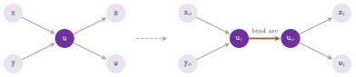

# 5. Graph adaptors {#ch-5}

We are concerned in this chapter with the classes of `lemon/adaptors.h`, which
present a digraph or a graph to an algorithm as if it were another one,
without copying it. The other structure may have fewer nodes or arcs, reversed
arcs or no orientation at all, split nodes, or only the arcs of positive
residual capacity of a flow. An adaptor stores a pointer to the adapted
structure (and, possibly, to some maps), and it answers each query of the
graph concepts of [chapter 4](04-graphs.md#ch-4) by one or more queries on
that structure; hence, building it costs $O(1)$ time and memory, while the
price is paid at each step of an iteration. Section 5.1 describes what the
adaptors have in common, sections 5.2 to 5.5 describe them one family at a
time (filters, orientation, residual digraph, node splitting), and section 5.6
collects the exercises.

## 5.1 Views of a graph {#sec-5-1}

Each adaptor of the header conforms to `concepts::Digraph` or to
`concepts::Graph` (cf. [chapter 3](03-mental-model.md#ch-3)). Therefore, it
can be passed to the algorithms of the library and to the functions of
`core.h`, and it can be adapted again: the test `test/adaptors_test.cc`
builds, e.g., `Undirector< const SplitNodes< Orienter< const GridGraph > > >`
and checks it against both concepts. Three properties are shared, in some
form, by all the classes of the chapter, and we state them once here.

*Constness and modification.* The first template parameter is the type of the
adapted structure, and it may be given as `const` (e.g.,
`ReverseDigraph< const ListDigraph >`). In that case the adaptor can be built
from a constant reference, and it offers no modifying function. Otherwise, the
adaptors that keep the item set of the adapted structure (`ReverseDigraph`,
`SubDigraph`, `SubGraph`, `FilterNodes`, `FilterArcs`, `FilterEdges`,
`Undirector` and `Orienter`) forward `addNode()`, `addArc()` (or `addEdge()`),
`erase()` and `clear()` to it, and one changes the adapted structure through
the adaptor. `ResidualDigraph` and `SplitNodes`, instead, take their digraph
as implicitly `const`, since an arc added to a residual digraph (or a node
added to a split digraph) has no meaning for the underlying one. Each adaptor
also has a creator function, i.e., `reverseDigraph()`, `subDigraph()`,
`subGraph()`, `filterNodes()`, `filterArcs()`, `filterEdges()`,
`undirector()`, `orienter()`, `residualDigraph()` and `splitNodes()`. It
returns the read-only version (the one on the `const` structure), with the
filter maps `const` or not as they are passed.

*Items.* The `Node` and `Arc` (and `Edge`) types of an adaptor are usually
convertible to and from those of the adapted structure, as the notes of the
header state class by class. For instance, a node of a `SubDigraph` is a node
of the digraph, and an edge of an `Undirector` is an arc of the digraph (the
exceptions are given where they occur). Hence, a map of the adapted structure
can be read with the items of the adaptor, which is how we use the maps in the
examples below.

*Maps and counting.* For the adaptors that keep the item set, the `NodeMap`,
`ArcMap` and `EdgeMap` of the adaptor are maps of the adapted structure, and
they store a value for each of its items (the hidden ones included).
`Undirector`, `ResidualDigraph` and `SplitNodes`, whose arcs are not arcs of
the digraph, build their arc maps from two maps of the digraph. Counting by
`countNodes()`, `countArcs()` and `countEdges()` takes constant time on
`ReverseDigraph`, `Undirector`, `Orienter` and `SplitNodes` when the adapted
structure counts in constant time. The filtering adaptors (and
`ResidualDigraph`, which is one of them) count by iterating, in linear time;
in fact, their tags `NodeNumTag` and `ArcNumTag` are `False`.

In general, the cost of an iteration on an adaptor is that of the iteration on
the adapted structure plus a constant amount of work per item visited (which
is rather small), with one exception which may matter in practice. A filtering
adaptor skips the hidden items one by one, since it has no list of the visible
ones; e.g., `firstOut()` of a node of a `SubDigraph` may visit all the arcs
that leave the node in the digraph before it finds a visible one. An algorithm
run on a filter that hides most of the items may therefore be (somewhat, or
much) slower than the same algorithm run on a copy made with `digraphCopy()`
(cf. [chapter 4](04-graphs.md#ch-4)). Of course, the copy costs time and
memory, and it does not follow the later changes of the filter.

The classes of the header are built on base classes that a user does not
instantiate, i.e., `DigraphAdaptorBase` and `GraphAdaptorBase` (which forward
each query to the adapted structure), `ReverseDigraphBase`, `SubDigraphBase`,
`SubGraphBase`, `UndirectorBase`, `OrienterBase` and `SplitNodesBase` (which
change the queries), completed by the extenders of `lemon/bits/`
(cf. [appendix A](A-writing-graph-map.md#app-a)); the maps of `Undirector` and
`SplitNodes` are built on their private classes `ArcMapBase` and
`NodeMapBase`, and the arc filters of `ResidualDigraph` are the functors
`ResForwardFilter` and `ResBackwardFilter` of the namespace `_adaptor_bits`.

## 5.2 Reversing and filtering {#sec-5-2}

`ReverseDigraph< DGR >` presents the digraph `DGR` with all its arcs reversed.
Its `source()` and `target()` are exchanged, the outgoing arcs of a node are
its incoming arcs in the digraph (and vice versa), `findArc(u, v)` looks for
an arc from `v` to `u` in the digraph, and `addArc(u, v)` adds the arc $(v,u)$
to it. Its constructor takes the digraph
(`explicit ReverseDigraph( DGR & digraph )`), and the adaptor counts in the
time of the digraph. One typically uses it to run a search backwards, e.g., to
find the nodes from which a target is reachable (as the example at the end of
section 5.3 does), or to compute the distances to a node by `Dijkstra` with
the same length map.

The filtering adaptors hide some of the items by means of `bool` maps, called
filters: an item is visible if and only if its filter value is `true`.
`SubDigraph< DGR, NF, AF >` filters both the nodes and the arcs of a digraph,
with a node map `NF` and an arc map `AF`, whose defaults are
`DGR::NodeMap< bool >` and `DGR::ArcMap< bool >`. An arc is visible when it is
enabled and both its ends are enabled. `SubGraph< GR, NF, EF >` does the same
for a graph, with an edge filter `EF` (by default `GR::EdgeMap< bool >`), and
an edge is visible when it and both its ends are enabled. Three specialized
filters keep a constant map, i.e., a `ConstMap` with the inlined value `true`
(cf. [§6.3](06-maps.md#sec-6-3)), in place of the filter they lack.
`FilterNodes< GR, NF >` works on a digraph or on a graph (it chooses the
concept from the `UndirectedTag` of `GR`), and it hides the nodes together
with the arcs or edges incident to them. `FilterArcs< DGR, AF >` hides arcs of
a digraph, and `FilterEdges< GR, EF >` hides edges of a graph (and both their
arcs); neither of the two hides a node.

Their constructors take the structure and references to the filters, which the
adaptor keeps by pointer, e.g.,
`SubDigraph( DGR & digraph, NF & node_filter, AF & arc_filter )` and
`FilterArcs( DGR & digraph, AF & arc_filter )`. Thus, the filters must outlive
the adaptor, and a value written directly into a filter is seen at once
through the adaptor. The same can be done through the adaptor itself.
`status(item, v)` sets the filter value of the item to `v` and `status(item)`
reads it, while `enable(item)` and `disable(item)` are `status(item, true)`
and `status(item, false)`; each of them costs one access to the filter map.
Building the filters (e.g., `DGR::ArcMap< bool > f( g, true )`, which shows
the whole digraph) is left to the caller, since only the caller knows which
items are to be seen.

A `SubDigraph` with an all-true node filter and a `FilterArcs` show the same
digraph; the difference is one of efficiency. The former checks the filter
values of the two ends of each arc it visits (the template flag `ch = true` of
`SubDigraphBase`), while the latter, whose node filter is the constant `true`,
checks only the arc filter. Note that `findArc()` and `findEdge()` of a filter
are those of the adapted structure followed by a scan of the arcs they return
until a visible one is found. Their cost is, hence, that of the adapted
structure times the number of hidden parallel arcs.

## 5.3 Changing the orientation {#sec-5-3}

`Undirector< DGR >` presents a digraph as an undirected graph. Each arc of the
digraph is an edge of the adaptor, with `u(e)` its source and `v(e)` its
target, and, as for the other graphs of the library, each edge also gives two
arcs: the forward one (`direction(a) == true`), oriented as the arc of the
digraph, and the backward one. The `Edge` type of the adaptor is the `Arc`
type of the digraph, while its `Arc` is a pair (arc of the digraph,
direction). The identifier of an arc is $2i+1$ for the forward arc and $2i$
for the backward one, where $i$ is the identifier of the arc in the digraph
(so that `maxArcId()` is $2\,$`maxArcId()`$\,+1$ of the digraph). Also,
`edgeNum()` is `arcNum()` of the digraph and `arcNum()` is twice as much, both
in the time of the digraph. The constructor takes the digraph, `addEdge(u, v)`
adds the arc $(u,v)$ to it, and the `ArcMap` of an `Undirector` keeps two arc
maps of the digraph, one per direction.

When an algorithm on the undirected graph needs an arc map and the data are on
the digraph, the nested class `Undirector< DGR >::CombinedArcMap< FW, BK >`
reads the forward arcs from the arc map `FW` and the backward ones from `BK`.
It is created by the static function `combinedArcMap(forward, backward)`, its
value type is that of `FW`, and it is a reference map when `FW` is one. For
instance, `Undirector< const G >::combinedArcMap( cost, cost )` gives an
undirected length (or capacity) taken from one arc map of the digraph.

`Orienter< GR, DM >` goes the other way, and it presents a graph as a digraph
in which each edge is an arc. The arc goes from `u(e)` to `v(e)` when the
direction map `DM` (a `bool` edge map, by default `GR::EdgeMap< bool >`) is
`true` on the edge, and from `v(e)` to `u(e)` otherwise. Its constructor takes
the graph and the direction map, which is kept by pointer, and `reverseArc(a)`
negates the direction of an arc by one write to the map. Furthermore,
`addArc(u, v)` adds an edge to the graph and sets its direction, so that the
new arc goes from `u` to `v`. Since the arcs of the adaptor are the edges of
the graph, `arcNum()` is `edgeNum()` of the graph. However, `firstOut()` and
`firstIn()` scan the incident edges of the node and skip those of the wrong
direction, i.e., they cost the degree of the node in the graph. The function
`checkCombiningAdaptors()` of `test/adaptors_test.cc` orients a grid by an
`Orienter`, splits its nodes and views the result through an `Undirector`.

The example below keeps the arcs of a digraph whose cost is at most a
threshold (by `FilterArcs`), and it counts the connected components of the
result through an `Undirector`, before and after enabling one more arc. It
then searches the digraph backwards through a `ReverseDigraph`.

```cpp
--8<-- "examples/05-filter-undirector.cc"
```

## 5.4 The residual digraph {#sec-5-4}

Let $G=(V,A)$ be a digraph, $u: A\to\mathbb{R}_+$ a capacity and $x$ a flow on
it, i.e., a vector with $0\le x_a\le u_a$ for each arc $a$. The residual
digraph of $x$ (cf. [Ahuja, Magnanti and Orlin 1993,
§2.4](Z-bibliography.md#ref-amo93networkflows)) has node set $V$ and arc set
$A_f\cup A_b$, where
$$
A_f=\{(i,j) : (i,j)\in A,\ x_{ij}<u_{ij}\},\qquad
A_b=\{(j,i) : (i,j)\in A,\ x_{ij}>0\}.
\tag{5.1}
$$
Each forward arc $(i,j)\in A_f$ has residual capacity $u_{ij}-x_{ij}$, and
each backward arc $(j,i)\in A_b$ has residual capacity $x_{ij}$. The union is
taken with multiplicity; thus, an arc of $G$ may give two arcs of the residual
digraph, and parallel arcs may appear (Figure 5.1). A directed path from $s$
to $t$ in the residual digraph is called an augmenting path. Sending along it
the "bottleneck", i.e., the smallest residual capacity of its arcs (i.e.,
increasing $x$ on the forward arcs and decreasing it on the backward ones)
gives a flow of larger value.

{#fig-5-1}

`ResidualDigraph< DGR, CM, FM, TL >` implements (5.1) as an adaptor. `DGR` is
the digraph (implicitly `const`), `CM` the capacity map (by default
`DGR::ArcMap< int >`, implicitly `const`), `FM` the flow map (by default
`CM`), which the adaptor may write, and `TL` the tolerance (by default
`Tolerance< CM::Value >`, cf. [chapter 3](03-mental-model.md#ch-3)). The
tolerance decides which arcs exist. A forward arc is there when
`tolerance.positive( cap[a] - flow[a] )` holds, and a backward arc when
`tolerance.positive( flow[a] )` holds; on floating-point data, an arc whose
residual capacity is below the epsilon of the tolerance is therefore hidden.
As the header notes, the class is a `SubDigraph` of an `Undirector` of the
digraph, whose arc filter is a `CombinedArcMap` of these two tests. Hence, an
arc of the adaptor is an arc of the `Undirector` (convertible to the arc of
the digraph it comes from), the adaptor counts in linear time, and its
iterations skip the arcs of zero residual capacity one by one. The constructor
is
```
ResidualDigraph( const DGR & digraph, const CM & capacity, FM & flow,
                 const TL & tolerance = Tolerance() );
```
and the members that are specific to the residual digraph follow.

-   `residualCapacity(a)` returns $u_a-x_a$ for a forward arc and $x_a$ for a
backward one.
-   `augment(a, v)` adds `v` to the flow of the original arc if `a` is
   forward,
and it subtracts `v` if `a` is backward. It writes the flow map by `set()`,
and it does not check that the result stays within the bounds.
-   `forward(a)` and `backward(a)` (static), on an arc of the adaptor, give
   its
direction. On an arc of the digraph, they return the forward or the backward
residual arc that corresponds to it, whether or not that arc is currently
visible.
-   `ResidualCapacity` is a read-only arc map of the adaptor whose value at an
arc is `residualCapacity(a)`. It is created by `residualCapacity()`, and its
value type is that of the capacity map.

The function `residualDigraph(digraph, capacity, flow)` returns the adaptor
with the default tolerance.

We remark that the augmenting path method of [Ford and Fulkerson
1956](Z-bibliography.md#ref-ford1956maximal) needs only the residual digraph,
and Algorithm 5.1 writes it with the classes of the library. The choice of a
shortest path, i.e., of a path found by a breadth-first search, is the rule of
[Edmonds and Karp 1972](Z-bibliography.md#ref-edmondskarp72theoretical).

<span id="alg-5-1"></span>**Algorithm 5.1** (Augmenting paths on the residual
digraph).
```
input:  digraph G, capacity u, feasible flow x (e.g., x = 0), nodes s, t
R := ResidualDigraph(G, u, x)
loop
  run Bfs on R from s, stopped at t
  if t is not reached then stop
  P := the path from s to t of the search
  delta := min { residualCapacity(a) : a in P }
  for each arc a of P: augment(a, delta)
end loop
output: x, a maximum flow; the nodes reached by the last search,
        the source side of a minimum cut
```

Clearly, the algorithm keeps $x$ feasible, since the flow of an arc changes by
at most its residual capacity. When it stops, the set $S$ of the nodes reached
by the last search contains $s$ but does not contain $t$, and no arc of the
residual digraph leaves it. Since $S$ is closed in this sense, each arc of $G$
from $S$ to $V\setminus S$ is saturated and each arc from $V\setminus S$ to
$S$ is empty, which proves the following classical statement.

<span id="thm-5-1"></span>**Theorem 5.1.** *A flow $x$ from $s$ to $t$ is
maximum if and only if its residual digraph has no path from $s$ to $t$. In
that case, the set $S$ of the nodes reachable from $s$ in the residual digraph
gives a cut whose capacity, $\sum_{(i,j)\in A:\,i\in S,\,j\notin S}u_{ij}$,
equals the value of $x$.*

For a proof, see [Ford and Fulkerson
1956](Z-bibliography.md#ref-ford1956maximal) and [Ahuja, Magnanti and Orlin
1993, §6.5](Z-bibliography.md#ref-amo93networkflows). With breadth-first
searches the number of augmentations is $O(nm)$ ([Edmonds and Karp
1972](Z-bibliography.md#ref-edmondskarp72theoretical)), where $n=|V|$ and
$m=|A|$. Each search costs $O(m)$ on the adaptor (the arcs of zero residual
capacity being skipped at a constant cost each), and Algorithm 5.1 thus runs
in $O(nm^2)$ time. The library has much faster maximum flow algorithms,
`Preflow` and `EdmondsKarp` (cf. [chapter 12](12-max-flow.md#ch-12)). In our
view, the adaptor is meant, rather, for the algorithms that search the
residual digraph of a flow already found, e.g., for a minimum cut, for the
cycles of a circulation, or for a shortest path of reduced costs. The example
below runs Algorithm 5.1, and it checks the value and the cut against
`Preflow`; the function `checkResidualDigraph()` of `test/adaptors_test.cc`
does the same on another digraph.

```cpp
--8<-- "examples/05-residual-augment.cc"
```

## 5.5 Splitting the nodes {#sec-5-5}

Several network problems (often, but not always, routing problems) put a bound
or a cost on the nodes (the number of paths through a node, the capacity of a
switch, the cost of a visit), while the algorithms of the library take them on
the arcs. The standard transformation (cf. [Ahuja, Magnanti and Orlin 1993,
§2.4](Z-bibliography.md#ref-amo93networkflows)) replaces each node $u$ by two
nodes $u_{in}$ and $u_{out}$, joined by the arc $(u_{in},u_{out})$ which
carries the data of the node. Each arc $(v,u)$ of the digraph then enters
$u_{in}$, and each arc $(u,w)$ leaves $u_{out}$ (Figure 5.2). It is easy to
check (and one can see it in Figure 5.2) that a path of the new digraph
through $(u_{in},u_{out})$ is a path of the old one through $u$, and
conversely.

{#fig-5-2}

`SplitNodes< DGR >` implements the transformation on the digraph `DGR`, which
is implicitly `const`. One has $2n$ nodes and $m+n$ arcs, i.e., the $m$
original arcs and the $n$ bind arcs. A node of the adaptor is a node of the
digraph with a flag (in or out), and it is convertible to the node of the
digraph. An arc, instead, is either an arc or a node of the digraph (a
`BiVariant`); hence, the arc type is not convertible to the arc of the digraph
in general (it converts to it when it is an original arc). The identifiers are
$2i$ for the in-node and $2i+1$ for the out-node, and $2i$ for an original arc
and $2i+1$ for the bind arc of a node, where $i$ is the identifier in the
digraph. `nodeNum()` and `arcNum()` are computed by `countNodes()` and
`countArcs()` of the digraph, i.e., in the time of the digraph. The static
members translate between the two structures, as follows.

-   `inNode(n)` and `outNode(n)`, on a node of the adaptor, return which of
   the
two it is; on a node of the digraph, they return its in-node or its out-node.
-   `origArc(a)` and `bindArc(a)` return whether an arc of the adaptor is an
original arc or a bind arc.
-   `arc(n)` returns the bind arc of a node of the digraph, and `arc(a)` the
arc of the adaptor that corresponds to an arc of the digraph.

One gives the data by two combining maps, nested in the class.
`CombinedNodeMap< In, Out >`, created by `combinedNodeMap(in_map, out_map)`,
reads the in-nodes from the node map `In` and the out-nodes from `Out`.
`CombinedArcMap< AM, NM >`, created by `combinedArcMap(arc_map, node_map)`,
reads the original arcs from the arc map `AM` and the bind arcs from the node
map `NM`. Their value types are those of `In` and `AM`, respectively. In this
way, one may turn a node capacity into the capacity of a bind arc. By Menger's
theorem ([Menger 1927](Z-bibliography.md#ref-menger1927allgemeinen)), the
largest number of $s$-$t$ paths with no inner node in common is then the value
of a maximum flow from $s_{out}$ to $t_{in}$, when each bind arc of an inner
node has capacity 1 (and each original arc a capacity of at least 1). The
example below computes it by `Preflow` on the adaptor.

```cpp
--8<-- "examples/05-split-nodes.cc"
```

## 5.6 Exercises {#sec-5-6}

<span id="ex-5-1"></span>**Exercise 5.1.** Write the type of the adaptor that
presents the subgraph of a `ListDigraph` induced by a set of nodes, with the
arcs reversed, to an algorithm that takes a `const` digraph. Say which of its
operations cost more than the corresponding operation of the digraph. The
functions `checkReverseDigraph()` and `checkSubDigraph()` of
`test/adaptors_test.cc` check the two adaptors separately.

<span id="ex-5-2"></span>**Exercise 5.2.** Modify
`examples/05-residual-augment.cc` so that each augmentation uses a path of
largest bottleneck capacity (a "widest" path) instead of a shortest one, and
compare the number of augmentations on a digraph with "large" capacities. The
value must still agree with `Preflow`.

<span id="ex-5-3"></span>**Exercise 5.3.** Prove that, at the end of Algorithm
5.1, the cut given by the nodes reached by the last search has capacity equal
to the value of the flow (Theorem 5.1). The example
`examples/05-residual-augment.cc` computes both and checks it.

<span id="ex-5-4"></span>**Exercise 5.4.** Starting from
`examples/05-split-nodes.cc`, use `SplitNodes` and a minimum cost flow
algorithm (cf. [chapter 13](13-min-cost-flow.md#ch-13)) to find $k$ paths from
$s$ to $t$ with no inner node in common and of least total length.

<span id="ex-5-5"></span>**Exercise 5.5.** Given an undirected graph and an
orientation of its edges in a `bool` edge map, use `Orienter` and an algorithm
for the strongly connected components (cf. [chapter
18](18-properties.md#ch-18)) to decide whether the orientation is strongly
connected. Then reverse one arc by `reverseArc()` and decide again, without
rebuilding anything; the function `checkOrienter()` of `test/adaptors_test.cc`
checks `reverseArc()`.
