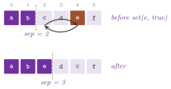

# 6. Maps {#ch-6}

We are concerned in this chapter with the maps of the library, i.e., with the
objects that associate a value with a key. Since the graphs store no data of
their own, maps are the only way in which data are attached to the nodes, arcs
and edges of a graph (cf. [chapter 3](03-mental-model.md#ch-3)). A map is any
type that offers the types `Key` and `Value` together with an `operator[]` (to
read) or a `set()` (to write); hence, besides the standard graph maps, which
store a value for each item, one can pass to an algorithm a map that computes
its values on demand, from other maps, from a function or from the graph.
Section 6.1 gives the concepts and section 6.2 the standard graph maps, as a
user sees them. Sections 6.3 to 6.6 describe the classes of `lemon/maps.h`
(the basic maps, the map adaptors, the maps tied to a graph and the iterable
maps), section 6.7 the functions that scan a map, and section 6.8 collects the
exercises.

## 6.1 The map concepts {#sec-6-1}

The header `lemon/concepts/maps.h` defines four concepts, as archetype classes
with a nested `Constraints` template that `checkConcept()` instantiates on a
candidate type (cf. [chapter 3](03-mental-model.md#ch-3)).
`concepts::ReadMap< K, T >` requires the types `Key` and `Value` and the
member `Value operator[]( const Key & ) const`. `concepts::WriteMap< K, T >`
requires the same types and `void set( const Key &, const Value & )`, and
`concepts::ReadWriteMap< K, T >` is both; finally,
`concepts::ReferenceMap< K, T, R, CR >` is a read-write map whose `operator[]`
returns a `Reference` (`R`), and a `ConstReference` (`CR`) on a constant map.
It declares the tag `typedef True ReferenceMapTag`, by which the library
recognizes it. Note that an algorithm reads a map only through `operator[]`
and `set()`, and the result of `operator[]` need not be a reference (in fact,
the adaptors of section 6.4 return their values by copy).

Two helpers make writing a map short. `MapBase< K, V >` is an empty base class
that only defines `Key` and `Value`, and the classes of `lemon/maps.h` derive
from it. `MapTraits< M >`, in `lemon/bits/traits.h`, gives the
`ReferenceMapTag` of any map type and the types `ReturnValue` and
`ConstReturnValue` that the map returns. These are references for a reference
map and values otherwise, and the adaptors use them to forward the reference
of the map they wrap.

!!! note "abLEMON"
    The archetypes of `lemon/concepts/maps.h` return a static buffer of the
    size and alignment of the value, instead of dereferencing the address
    `sizeof(Value)` as LEMON 1.3.1 did (which is undefined behavior, and which
    the optimizer flagged as an access out of bounds). The concepts are
    unchanged.

## 6.2 Graph maps {#sec-6-2}

Each graph structure of [chapter 4](04-graphs.md#ch-4) has the nested
templates `NodeMap< V >`, `ArcMap< V >` and, if it is undirected,
`EdgeMap< V >` (a bipartite graph also has `RedNodeMap< V >` and
`BlueNodeMap< V >`). They are reference maps, built by
`NodeMap( const Graph & g )`, which value-initializes the values, or by
`NodeMap( const Graph & g, const V & value )`. The graph keeps them up to
date, since each map registers itself as an observer of the alteration
notifier of the graph (cf. [appendix A](A-writing-graph-map.md#app-a)), and it
is told of each item added or erased. A key added after the construction of
the map receives the value `V()`, not the value given to the constructor, and
the value of an erased key is lost. The assignment operators of the standard
maps are private; one copies the values of a map into another by `mapCopy()`
(section 6.7).

The storage is chosen by `DefaultMap`, in `lemon/bits/default_map.h`. For
`bool`, the character types, the integer types, the floating-point types and
the pointers, it is a `VectorMap`, i.e., a `std::vector< V >` indexed by the
identifier of the item. For any other value type it is an `ArrayMap`, an array
allocated through `std::allocator`, whose capacity doubles (up to the first
power of two above the largest identifier) when an item with a larger
identifier is added. In both cases a lookup costs $O(1)$ and adding an item
costs $O(1)$ amortized, while the memory is proportional to the largest
identifier plus one, which may exceed the number of items after some erasures.

Each map also has three iterators, inherited from `MapExtender` (in
`lemon/bits/map_extender.h`). `MapIt` iterates on the items and dereferences
to a reference to their value, `ConstMapIt` dereferences to a constant
reference, and `ItemIt` only iterates on the items. The test
`test/maps_test.cc` uses `MapIt` and `ConstMapIt` on the maps of a
`ListDigraph`.

!!! note "abLEMON"
    `ArrayMap` constructs and destroys its values through
    `std::allocator_traits`, since C++20 removed the members `construct()` and
    `destroy()` of `std::allocator`. When it grows, it moves the values into
    the larger buffer by `std::move_if_noexcept()`, rather than copying them.

## 6.3 Basic maps {#sec-6-3}

The basic maps of `lemon/maps.h` need no graph. `NullMap< K, V >` reads `V()`
at each key and absorbs whatever is written to it. It is the map to pass (in
place of a real one) when an algorithm requires a map whose content is not
wanted (e.g., a predecessor map that the caller does not read).
`ConstMap< K, V >` reads one value at each key, given to the constructor
(`ConstMap( const V & v )`) or default-constructed, and it also absorbs the
writes; `setAll(v)` changes the value. Its specialization
`ConstMap< K, Const< V, v > >` carries the value in its type, as the template
argument of the tag `Const< T, v >`, so that the compiler may fold the read.
The filtering adaptors of [chapter 5](05-adaptors.md#ch-5), e.g., use
`ConstMap< Node, Const< bool, true > >` in place of the filter they lack.
`TrueMap< K >` and `FalseMap< K >` are the read-only constant maps of `true`
and `false`, and `IdentityMap< T >` reads the key (its key and value types are
both `T`).

`RangeMap< V >` is a `std::vector< V >` with integer keys in
$[0,\mathrm{size})$. It is built from a size and a value
(`RangeMap( int size = 0, const V & value = V() )`), from a `std::vector`, or
from another `RangeMap` whose value type converts to `V`, and
`resize(size, value)` changes its key set. It is a reference map, typically
used as the cross-reference map of a heap whose items are small integers
(cf. [chapter 7](07-heaps.md#ch-7)).

`SparseMap< K, V, Comp >` is a `std::map< K, V, Comp >`, with
`Comp = std::less< K >` by default, together with a default value for the keys
that are not stored. Its reads and writes cost $O(\log s)$, where $s$ is the
number of stored keys. One remark is in order here: the non-constant
`operator[]`, which returns a reference, inserts an absent key with the
default value, while the constant one does not. `setAll(v)` changes the
default value and erases the stored keys, and the class is not assignable (its
copy assignment is private). Each of these classes has a creator function with
the name of the class in lower case (`nullMap()`, `constMap()`,
`identityMap()`, `rangeMap()`, `sparseMap()`, `trueMap()` and `falseMap()`).

`LoggerBoolMap< IT, KEY >` is a write-only `bool` map. It copies each key set
to `true` to the output iterator `IT`, in the order of the writes, and it
ignores the keys set to `false`; `begin()` and `end()` return the first
iterator and the one after the last key written. The map is meant for the
algorithms that report a set by writing `true` once per item. For instance,
`dfs( g ).processedMap( loggerBoolMap( std::back_inserter( v ) ) ).run( s )`
stores the nodes in the order in which the search processes them. The key type
`KEY` is deduced from the iterator (from its `value_type`, or from that of its
container for an insert iterator), and the iterator must either be an inserter
or point to enough room. Being only writable, a `LoggerBoolMap` cannot serve
where a readable map is required, e.g., as the reached map of `Bfs`, `Dfs` or
`Dijkstra`.

## 6.4 Map adaptors and arithmetic {#sec-6-4}

A map adaptor is a map whose values are computed, at each read, from one or
two other maps. It stores references to the maps it combines (or copies of the
constants and functors it uses) and nothing else. Hence, building it costs
$O(1)$, and a read costs one or two reads of the underlying maps (which may,
in turn, be adaptors).

Two remarks apply to all the adaptors. First, they keep the maps by reference,
and the maps must therefore outlive them: a temporary map passed to a creator
function (e.g., `addMap( m, constMap< Node, int >( 1 ) )`) is destroyed at the
end of the full expression, and an adaptor that refers to it cannot be stored.
Second, most adaptors are read-only, since a write to a computed value has, in
general, no meaning; the exceptions are said explicitly. Table 6.1 lists them,
with `m`, `m1` and `m2` the adapted maps, `x` a key, `v` a constant and `f` a
functor. Each class has a creator function with the name of the class in lower
case (`composeMap()`, `addMap()`, `notWriteMap()`, and so on).

<span id="tab-6-1"></span>**Table 6.1.** The map adaptors of `lemon/maps.h`:
the value at a key and, when the adaptor is writable, the effect of
`set(x, y)`.

| Class | Value at `x` | Writes | Key and value types |
|----------------------------|----------------------------|-----------------|--------------------------|
| `ComposeMap< M1, M2 >` | `m1[m2[x]]` | no | key of `M2`, value of `M1` |
| `CombineMap< M1, M2, F, V >` | `f(m1[x], m2[x])` | no | key of `M1`, value `V` |
| `FunctorToMap< F, K, V >` | `f(x)` | no | `K`, `V` |
| `MapToFunctor< M >` | `m[x]`, also as `operator()` | no | those of `M` |
| `ConvertMap< M, V >` | `m[x]` converted to `V` | no | key of `M`, `V` |
| `ForkMap< M1, M2 >` | `m1[x]` | to `m1` and `m2` | those of `M1` |
| `AddMap`, `SubMap`, `MulMap`, `DivMap< M1, M2 >` | `m1[x]` $\circ$ `m2[x]` | no | those of `M1` |
| `ShiftMap< M, C >` | `m[x] + v` | no | those of `M` |
| `ShiftWriteMap< M, C >` | `m[x] + v` | `m.set(x, y - v)` | those of `M` |
| `ScaleMap< M, C >` | `v * m[x]` | no | those of `M` |
| `ScaleWriteMap< M, C >` | `v * m[x]` | `m.set(x, y / v)` | those of `M` |
| `NegMap< M >` | `-m[x]` | no | those of `M` |
| `NegWriteMap< M >` | `-m[x]` | `m.set(x, -y)` | those of `M` |
| `AbsMap< M >` | `m[x]` if `m[x] >= 0`, else `-m[x]` | no | those of `M` |
| `AndMap`, `OrMap< M1, M2 >` | `m1[x] && m2[x]`, `m1[x] \|\| m2[x]` | no | key of `M1`, `bool` |
| `NotMap< M >` | `!m[x]` | no | key of `M`, `bool` |
| `NotWriteMap< M >` | `!m[x]` | `m.set(x, !y)` | key of `M`, `bool` |
| `EqualMap`, `LessMap< M1, M2 >` | `m1[x] == m2[x]`, `m1[x] < m2[x]` | no | key of `M1`, `bool` |

In the four arithmetic adaptors $\circ$ is `+`, `-`, `*` and `/`, and the key
and value types of `M2` must convert to those of `M1`. The constant type `C`
of the shift and scale adaptors defaults to the value type of `M`.
`ScaleWriteMap` can be written only when the constant is not zero and `/` is
defined between the value and `C`. `ComposeMap` returns its value with the
`ConstReturnValue` of `M1` (by reference, when `M1` is a reference map), while
the others return by value.

`FunctorToMap` takes its key and value types from the members `argument_type`
and `result_type` of the functor when they are not given. Since lambdas (and
most modern functors) lack these members, `K` and `V` must then be given
explicitly, as in `functorToMap< int, double >( f )`; for a plain function
pointer `V (*)(K)`, an overload of `functorToMap()` deduces them. Conversely,
`MapToFunctor` defines `argument_type` and `result_type`, for the code that
still uses them.

One passes the adaptors to the algorithms like any other map. When the
algorithm is a class, its map type must be named, which the creator functions
do not do; in C++11 and later, `decltype` names it. In the example below, the
travel time of an arc is the quotient of a length map and a speed map, read by
`Dijkstra` through a `DivMap` and never stored.

!!! note "abLEMON"
    The value type of `CombineMap` defaults to the type that the functor
    returns on the values of the two maps, deduced by `decltype`. LEMON 1.3.1
    read the member `result_type` of the functor instead, which C++20 removed
    from the function objects of `<functional>` and which lambdas never had;
    thus, `combineMap( m1, m2, f )` now accepts a lambda.

```cpp
--8<-- "examples/06-map-adaptors.cc"
```

## 6.5 Maps of the items of a graph {#sec-6-5}

The maps of this section are tied to a graph, whose type `GR` is their first
template parameter, and most of them take the item type `K` (`GR::Node`,
`GR::Arc` or `GR::Edge`) as the second. They are of two kinds. Views compute
their value from the graph (and possibly from a map) at each read, while
look-up maps store a value per item together with an inverse structure that
finds the items by their value.

*Views.* `IdMap< GR, K >` reads the identifier `id()` of an item. This is
unique among the items of its kind, and it does not change while the item
exists (even if other items are erased). Its `operator()(id)`, and its nested
`InverseMap` (returned by `inverse()`), give the item with a given identifier,
through `fromId()` of the graph. `SourceMap< GR >` and `TargetMap< GR >` read
the source and the target of an arc, while `ForwardMap< GR >` and
`BackwardMap< GR >` read the arcs `direct(e, true)` and `direct(e, false)` of
an edge of an undirected graph. `PotentialDifferenceMap< GR, POT >` reads, at
an arc $(i,j)$, the difference $\pi_j-\pi_i$ of a node map of potentials
$\pi$; for a zero cost, it is the reduced cost of the arc up to the sign
convention (cf. [chapter 13](13-min-cost-flow.md#ch-13)). Each view has a
creator function, i.e., `idMap< K >( g )`, `sourceMap( g )`, `targetMap( g )`,
`forwardMap( g )`, `backwardMap( g )` and `potentialDifferenceMap( g, pot )`.

*Degree maps.* `InDegMap< GR >` and `OutDegMap< GR >` read the in-degree and
the out-degree of a node of a digraph in $O(1)$. They compute the degrees at
construction, in $O(n+m)$ time, and store them in a node map; then they
observe the arcs of the digraph, and update the degrees of the ends of each
arc added or erased. The update happens only through the notifications of the
graph; hence, as the header warns, the functions that change an arc without
adding or erasing it (e.g., `changeSource()`, `changeTarget()` and
`reverseArc()` of `ListDigraph`) leave the degrees wrong.

*Look-up maps.* `RangeIdMap< GR, K >` gives each item of its kind an
identifier in $[0,n_K)$, where $n_K$ is the number of items of the kind, and
it keeps the inverse in a `std::vector`. Hence, `operator()(id)` (and
`InverseMap::operator[]`) return the item with a given range identifier in
$O(1)$, and `size()` returns $n_K$. The identifiers follow the order of the
items at construction, and a new item takes the next one. When an item is
erased, the item with the largest identifier takes its identifier; the range
thus stays contiguous, but the identifiers may change (and they are usually
not those of `IdMap`). Furthermore, `swap(p, q)` exchanges the identifiers of
two items, by which one can impose any order.

`CrossRefMap< GR, K, V >` stores a value for each item, and it keeps a
`std::multimap` from the values to the items. Its `set(key, val)` costs
$O(c\log n)$, where $c$ is the number of items with the old value of the key,
since the loop that looks for the key among them recomputes the range of the
old value at each step. `operator()(val)`, or the `InverseMap`, returns one
item with the value (or `INVALID`) in $O(\log n)$. Also, `count(val)` returns
the number of items with a value, and `beginValue()` and `endValue()` delimit
a forward iterator (`ValueIt`) on the values, with multiplicity and in
increasing order. We remark that the inverse structure holds only the values
written by `set()`. On a newly built map, which reads `V()` at each item,
`count( V() )` is therefore zero. The map is meant for values that are all
different, or nearly so; when many items share a value, `IterableValueMap`
(section 6.6) is usually the better choice. Neither `CrossRefMap` nor
`IterableValueMap` is a reference map, i.e., their values are written only by
`set()`.

!!! note "abLEMON"
    The iterators `ValueIt` of `CrossRefMap` and `IterableValueMap` define
    their member types, instead of deriving from `std::iterator`, which C++17
    deprecated.

## 6.6 Iterable maps {#sec-6-6}

An iterable map stores a value for each item of a graph. Besides the reads and
writes of a map, it lists the items that have a given value, in time
proportional to their number. `IterableBoolMap` and `IterableIntMap` are
reference maps, whose `operator[]` returns a proxy object that writes through
`set()`; `IterableValueMap` is a read-write map, and the three classes are
kept up to date when items are added to or erased from the graph.

`IterableBoolMap< GR, K >` keeps the items in one vector, together with the
position of each item, and the items mapped to `true` are in the positions
before a separator, and those mapped to `false` after it (Figure 6.1).
`set(key, value)` moves the item across the separator, in $O(1)$, by swapping
it with the first item of the other side; `setAll(value)` moves only the
separator, also in $O(1)$, and `trueNum()` and `falseNum()` count the two
sides in $O(1)$. The iterators `TrueIt`, `FalseIt` and `ItemIt(map, value)`
list the items of one side in time proportional to their number, and so do the
ranges `trueKeys()`, `falseKeys()` and `items(value)` of the range-based `for`
loops. The constructor `IterableBoolMap( const GR & g, bool def = false )`
maps all the items to `def`, and an item added later is mapped to `false`.

{#fig-6-1}

`IterableIntMap< GR, K >` stores an integer per item, and it keeps a doubly
linked list of the items for each non-negative value, with the heads in a
vector indexed by the value. Thus, `set(key, value)` unlinks the item from the
list of its old value and links it at the head of the list of the new one;
this costs $O(1)$, apart from the changes of the vector of heads, which grows
to the new value plus one when the value exceeds its size, and shrinks when
the lists of the largest values become empty. `size()` returns the largest
value plus one, and `ItemIt(map, value)` and `items(value)` list the items
with a value. An item with a negative value is in no list, and it cannot be
listed. The constructor without a value sets all the values to $-1$, the one
with a value sets them to it, and an item added later reads $-1$. The memory
is $O(n_K + w)$, where $w$ is the largest value; the map is therefore meant
for rather "small" values. The proxy returned by `operator[]` offers the
integer operators (`++`, `--`, `+=`, `-=`, `*=`, and so on), each of which
goes through `set()`.

`IterableValueMap< GR, K, V >` does the same for any value type with an
`operator<`, and it keeps a linked list per value, with the heads in a
`std::map< V, K >` that holds only the values in use. Hence, `set(key, value)`
and `ItemIt(map, value)` cost $O(\log d)$, where $d$ is the number of distinct
values, and `beginValue()` and `endValue()` delimit a forward iterator on the
distinct values, in increasing order. The constructor maps all the items to a
value (by default `V()`), and an item added later reads `V()`.

!!! note "abLEMON"
    The nodes of the lists of `IterableIntMap` and `IterableValueMap`
    initialize their links to `INVALID` when they are created, which LEMON
    1.3.1 left indeterminate.

The records of the lists are the structures `IterableIntMapNode` and
`IterableValueMapNode` of the namespace `_maps_bits` (which also holds
`IteratorTraits`, by which `LoggerBoolMap` deduces its key type, and
`CombineValue`), and the degree maps of section 6.5 keep their degrees in a
private node map, `AutoNodeMap`, which sets the degree of a new node to zero;
none of these is meant to be used directly.

The iterable integer map is the natural data structure for the buckets of
degrees of the smallest-last ordering of [Matula and Beck
1983](Z-bibliography.md#ref-matula1983smallest). This is the order obtained by
removing, one at a time, a node of least degree in the graph that remains. The
largest degree met at a removal is the degeneracy of the graph, and the
running maximum of these degrees gives the core number of each node, i.e., the
largest $k$ such that the node belongs to a subgraph of minimum degree $k$.

<span id="alg-6-1"></span>**Algorithm 6.1** (Smallest-last ordering and core
numbers by an iterable integer map).
```
input:  graph G = (V, E)
deg := IterableIntMap on V, deg[v] := degree of v
k := 0;  d := 0
repeat |V| times
  while ItemIt(deg, d) == INVALID: d := d + 1
  u := ItemIt(deg, d)                  (a node of least current degree)
  k := max(k, d);  core[u] := k;  append u to the order
  deg.set(u, -1)                       (u leaves all the lists)
  for each edge (u, w) with deg[w] > 0: deg.set(w, deg[w] - 1)
  d := max(d - 1, 0)
output: the order (reversed, the smallest-last order), core, k
```

<span id="thm-6-1"></span>**Theorem 6.1.** *Algorithm 6.1 computes the core
numbers and the degeneracy $k$ of $G$ in $O(|V|+|E|)$ time.*

The correctness is proved in [Matula and Beck
1983](Z-bibliography.md#ref-matula1983smallest). As for the time, each `set()`
costs $O(1)$, since the values only decrease after the first assignment and
the vector of heads no longer grows, and there are $O(|V|+|E|)$ of them. Also,
the least current degree drops by at most one per removal, which justifies the
last step and bounds the increments of $d$ by $O(|V|)$ plus the largest
degree. The example below implements Algorithm 6.1 on a small graph, and then
it marks the nodes of the largest core in an `IterableBoolMap`, whose
`trueNum()` gives their number and whose `TrueIt` lists them.

```cpp
--8<-- "examples/06-degeneracy.cc"
```

## 6.7 Map utilities {#sec-6-7}

The functions at the end of `lemon/maps.h` scan the items of one kind of a
graph, the kind given by the key type of the map, and use the values of a map.
Each of them costs one pass over the items, i.e., $O(n_K)$ reads of the map,
plus the cost of the predicate or of the comparison.

-  `mapCopy(g, from, to)` writes `from[x]` into `to` for each item `x` of the
  kind of `to`. An edge map can thus be copied to an arc map of the same
  graph, since an arc converts to its edge, but not vice versa.
  `mapFill(g, map, val)` writes `val` at each item.
-  `mapCompare(g, m1, m2)` returns `true` if the two maps agree, by
  `operator==`, at each item of the kind of `m2`.
-  `mapMin(g, map)` and `mapMax(g, map)` return an item of least and of
  largest value, or `INVALID` on an empty item set. When there are ties (which
  may well happen on integer data), they return the first one met in the order
  of the item iterator. The variants with a third argument take a comparison
  functor in place of `std::less< V >`. `mapMinValue()` and `mapMaxValue()`
  return the value, and they require a non-empty item set.
-  `mapFind(g, map, val)` and `mapFindIf(g, map, pred)` return the first item
  whose value equals `val` (or satisfies `pred`), and `INVALID` if there is
  none. `mapCount(g, map, val)` and `mapCountIf(g, map, pred)` return the
  number of such items.

The example of section 6.4 uses `mapMin()`, `mapCountIf()`, `mapCopy()`,
`mapCompare()` and `mapMaxValue()`, and the test `test/maps_test.cc` checks
all of them.

## 6.8 Exercises {#sec-6-8}

<span id="ex-6-1"></span>**Exercise 6.1.** Write a map class, derived from
`MapBase`, whose value at an arc is the Euclidean length of the arc, computed
from a node map of coordinates. Check that it conforms to `concepts::ReadMap`
by `checkConcept()`. Then obtain the same map without writing a class, from
`SourceMap`, `TargetMap`, `ComposeMap` and `CombineMap`.

<span id="ex-6-2"></span>**Exercise 6.2.** In `examples/06-map-adaptors.cc`,
replace the `DivMap` by a `CombineMap` with a lambda, and the delay by a
`ShiftMap` of the `DivMap`; check that the distances do not change.

<span id="ex-6-3"></span>**Exercise 6.3.** Explain why the declaration
`AddMap< M, ConstMap< K, int > > m = addMap( length, constMap< K, int >( 1 ) );`
compiles, while a later read of `m` has undefined behavior, and correct it.

<span id="ex-6-4"></span>**Exercise 6.4.** Modify `examples/06-degeneracy.cc`
so that it colors the graph greedily in the smallest-last order, with at most
$k+1$ colors, and check the coloring.

<span id="ex-6-5"></span>**Exercise 6.5.** Use a `RangeIdMap` and its `swap()`
to number the nodes of an acyclic digraph in a topological order, and check
that each arc goes from a smaller to a larger range identifier. The test
`test/maps_test.cc` checks `swap()` after an erasure.
