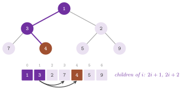
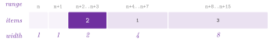

# 7. Heaps {#ch-7}

We are concerned in this chapter with the heaps of the library, i.e., with the
implementations of the abstract data type priority queue, which the algorithms
of Part III use to choose the next node to scan. A heap stores a set of items,
each with a priority. It gives the item of least priority, removes it, and
changes the priority of an item in the heap. The cost of these operations
differs (sometimes rather markedly) from one structure to another; hence, the
best choice depends on the mix of operations of the algorithm and on the type
of the priorities. Section 7.1 gives the interface common to all the heaps
(the concept `concepts::Heap`). Sections 7.2 to 7.4 describe the three
families of implementations, i.e., the implicit $d$-ary heaps, the linked
heaps and the heaps of integer priorities. Section 7.5 compares them and shows
how an algorithm is given a heap, and section 7.6 collects the exercises.

## 7.1 The heap concept {#sec-7-1}

The concept `concepts::Heap< PR, IM, CMP >` of `lemon/concepts/heap.h`
describes the interface. `PR` is the type of the priorities, `IM` a reference
map from the items to `int`, called the cross-reference map, and `CMP` a
functor that compares two priorities, by default `std::less< PR >`. The type
of the items is `IM::Key`; thus, the items are whatever the map takes as keys
(nodes, arcs, or integers with a `RangeMap`). Note that the heap uses the
cross-reference map to find an item in its storage. While an item is in the
heap, the map holds its position (a non-negative integer), and otherwise one
of the states of the enum `State`. These are `PRE_HEAP` ($-1$), if the item
has never been in the heap, and `POST_HEAP` ($-2$), if it has been in the heap
and has left it; `IN_HEAP` ($0$) is the value returned by `state()` for an
item in the heap. The map must hold `PRE_HEAP` for each item before the first
insertion, which is the precondition of the constructors
`explicit Heap( IM & map )` and `Heap( IM & map, const CMP & comp )`. Since
the heap keeps a reference to the map, the map must also outlive it.

The operations are the following, where $n$ is the number of items in the
heap; Table 7.1 gives their costs.

-   `size()` returns the number of items, and `empty()` returns whether it is
zero.
-   `push(i, p)` inserts the item `i`, which must not be in the heap, with
priority `p`.
-   `top()` and `prio()` return the item of least priority and its priority
(the heap must not be empty). With `std::greater` as `CMP`, they return the
item of largest priority.
-   `pop()` removes the item of least priority, whose state becomes
`POST_HEAP`, and `erase(i)` removes the item `i`, which must be in the heap.
-   `operator[](i)` returns the priority of the item `i`, which must be in the
heap.
-   `decrease(i, p)` and `increase(i, p)` change the priority of an item in
   the
heap to `p`, which must not be larger (respectively, smaller) than the current
one under `CMP`. The heaps do not check it.
-   `set(i, p)` changes the priority of `i` if it is in the heap, by
`decrease()` or `increase()` as the case may be, and it inserts `i` otherwise
(also when it is `POST_HEAP`).
-   `state(i)` returns the state of an item. `state(i, st)`, with `st` equal
   to
`PRE_HEAP` or `POST_HEAP`, erases the item if it is in the heap and then
writes `st` into the map (`IN_HEAP` is ignored).
-   `clear()` empties the heap without touching the map. To reuse the heap on
the same items, the caller must also reset the map to `PRE_HEAP`.

Two remarks on the cross-reference map are in order. First, the heaps write it
through `operator[]` (e.g., `state(i, st)` in all of them, `decrease()` of
`BinomialHeap`, and `push()` and `pop()` of `RadixHeap` and `BucketHeap`), and
therefore need a reference map, as their documentation says; the maps used in
practice (a graph map of `int` or a `RangeMap< int >`) are reference maps.
Second, the state `POST_HEAP` allows an algorithm such as `Dijkstra` to
distinguish a scanned node from an unreached one by one read of the map,
without a further map.

Besides the concept, `BinHeap`, `QuadHeap`, `DHeap`, `BucketHeap` and
`SimpleBucketHeap` have `push(pair)`, which takes a `std::pair< Item, Prio >`.
Also, `BinHeap`, `QuadHeap` and `DHeap` have `replace(i, j)`, which gives the
place and the priority of the item `i` (in the heap) to the item `j` (not in
the heap), in $O(1)$. The test `test/heap_test.cc` checks each heap against
the concept, by `checkConcept()`, and then by sorting, by increasing
priorities, and inside `Dijkstra`.

## 7.2 Implicit d-ary heaps {#sec-7-2}

A $d$-ary heap ([Johnson 1975](Z-bibliography.md#ref-johnson75heap)) is a
complete $d$-ary tree, stored level by level in a vector, whose items satisfy
the heap order: the priority of an item is not smaller than that of its
parent. With positions from $0$, the parent of position $i$ is
$\lfloor (i-1)/d \rfloor$, and its children are $di+1,\dots,di+d$. The binary
heap of [Williams 1964](Z-bibliography.md#ref-williams1964heapsort) is the
case $d=2$ (Figure 7.1). The cross-reference map holds the position of each
item, and each move of an item updates it.

{#fig-7-1}

All the operations reduce to the two procedures of Algorithm 7.1, which move
an item along a path of the tree until the heap order holds again.

<span id="alg-7-1"></span>**Algorithm 7.1** (Sifting in a $d$-ary heap).
```
bubbleUp(hole, (i, p)):           (the item i with priority p goes up)
  while hole > 0 and p < prio(parent(hole)):
    move the item of parent(hole) to hole;  hole := parent(hole)
  put (i, p) at hole
bubbleDown(hole, (i, p), n):      (the item i with priority p goes down)
  while hole has children among the positions 0 .. n-1:
    c := the child of least priority
    if not prio(c) < p: break
    move the item of c to hole;  hole := c
  put (i, p) at hole
push(i, p):    append a position n; bubbleUp(n, (i, p))
pop():         mark top POST_HEAP; bubbleDown(0, last item, n - 1)
decrease(i,p): bubbleUp(position of i, (i, p))
increase(i,p): bubbleDown(position of i, (i, p), n)
erase(i):      bubbleUp the last item into the position of i, then,
               if it did not move, bubbleDown it
```
Each `move` writes the new position into the cross-reference map.

A path from the root to a leaf has $\lceil\log_d(n(d-1)+1)\rceil$ levels.
Hence, `bubbleUp()` costs $O(\log_d n)$ comparisons, while `bubbleDown()`
costs $O(d\log_d n)$, since it compares the $d$ children at each level. The
degree $d$ thus trades the cost of `push()` and `decrease()` for that of
`pop()`. In an algorithm with many decreases per removal, as `Dijkstra` on a
dense digraph (with up to $m$ decreases and $n$ removals), a degree near
$\max(2, m/n)$ balances the two ([Johnson
1975](Z-bibliography.md#ref-johnson75heap)). Of course, a larger degree also
means fewer levels and fewer cache misses, which in practice often (but not
always) favours $d=4$ over $d=2$, even when the counts of comparisons do not.

The library has three classes of this family, all with the template parameters
`PR`, `IM` and `CMP` (by default `std::less< PR >`) and with both constructors
of the concept.

-   `BinHeap< PR, IM, CMP >`, in `lemon/bin_heap.h`, is the binary heap. It is
the default heap of `Dijkstra`, `BidirDijkstra`, `AStar` and
`MinCostArborescence`, and the heap of the matching algorithms.
-   `QuadHeap< PR, IM, CMP >`, in `lemon/quad_heap.h`, is the 4-ary heap (the
header calls it "fourary"), whose four children are compared by unrolled code.
-   `DHeap< PR, IM, D, CMP >`, in `lemon/dheap.h`, is the $d$-ary heap, with
the degree as the template parameter `D`, by default $16$. The header suggests
a power of two, which turns the divisions and multiplications of the positions
into shifts.

!!! note "abLEMON"
    `CapacityScaling` (cf. [chapter 13](13-min-cost-flow.md#ch-13)) keeps the
    nodes of its shortest path searches in a `QuadHeap`, where LEMON 1.3.1
    used a `BinHeap`.

## 7.3 Linked heaps {#sec-7-3}

The heaps of this section store the items in heap-ordered trees, linked by
indices. Two trees are joined in $O(1)$ by making the root of larger priority
a child of the other. Each of the three classes keeps one record per item in a
vector, indexed by the cross-reference map. The record stays after the item
leaves the heap (a flag records whether it is in), and it is reused when the
item comes back; hence, the memory is proportional to the number of distinct
items ever pushed since the last `clear()`. The three classes have the
template parameters `PR`, `IM` and `CMP` and both constructors of the concept.

*Fibonacci heaps.* `FibHeap< PR, IM, CMP >`, in `lemon/fib_heap.h`, is the
heap of [Fredman and Tarjan 1987](Z-bibliography.md#ref-fredman1987fibonacci).
The roots of its trees form a circular list, with a pointer to a root of least
priority. `push()` adds a root, and `decrease()` cuts the item from its parent
when the heap order breaks. The parent, if it had already lost a child, is cut
in turn (the cascading cut), and so on upwards. `pop()` removes the minimum,
moves its children to the list of the roots, and then consolidates the roots,
linking two roots of equal degree until all the degrees differ. This bounds
the degree of a node by $\log_\phi n$, with $\phi=(1+\sqrt5)/2$; in fact, the
code sizes its array of degrees by $\lfloor 2.08\ln N\rfloor+1$, with $N$ the
number of records, since $1/\ln\phi\approx 2.078$. Furthermore, `erase(i)`
cuts the item, makes it the minimum (in the words of a comment of the code,
"as if its prio would be -infinity"), and pops it, and `increase()` is
`erase()` followed by `push()`.

<span id="alg-7-2"></span>**Algorithm 7.2** (Decrease and pop in a Fibonacci
heap).
```
decrease(i, p):
  prio(i) := p;  q := parent(i)
  if q exists and p < prio(q):
    cut(i, q)                       (i becomes a root, unmarked)
    while q is not a root:          (cascading cut)
      if q is unmarked: mark q; stop
      r := parent(q);  cut(q, r);  q := r
  if p < prio(min): min := i
pop():
  remove min from the roots and add its children to them
  A[0 .. maxdeg] := none
  for each root r:                   (consolidation)
    while A[degree(r)] is a root s:
      link the one of larger priority under the other, call the result r
      A[degree(r) - 1] := none
    A[degree(r)] := r
  min := the root of least priority
```

<span id="thm-7-1"></span>**Theorem 7.1.** *In a Fibonacci heap, `push()`,
`top()` and `decrease()` cost $O(1)$ amortized time, and `pop()` and `erase()`
cost $O(\log n)$ amortized time.* See [Fredman and Tarjan
1987](Z-bibliography.md#ref-fredman1987fibonacci). The class follows the
analysis there, except that `increase()` is an erasure followed by an
insertion; it therefore costs $O(\log n)$ amortized. Accordingly, the header
warns that a heap with many increases and erasures is better a binary one.

*Pairing heaps.* `PairingHeap< PR, IM, CMP >`, in `lemon/pairing_heap.h`, is
the self-adjusting heap of [Fredman, Sedgewick, Sleator and Tarjan
1986](Z-bibliography.md#ref-fredman1986pairing), i.e., a single heap-ordered
tree in which each node keeps its children in a list. `push()` links the new
item with the root, and `decrease()` cuts the subtree of the item and links it
with the root. `pop()` removes the root and joins its subtrees in two passes:
it first links them in pairs from left to right, and then it links the results
from right to left into one tree (the two-pass pairing). The amortized costs
of `push()` and `pop()` are $O(1)$ and $O(\log n)$ ([Fredman et
al. 1986](Z-bibliography.md#ref-fredman1986pairing)). That of `decrease()` is
$o(\log n)$, namely $O(2^{2\sqrt{\log\log n}})$ ([Pettie
2005](Z-bibliography.md#ref-pettie2005towards)), and it cannot be $O(1)$ for
this kind of structure ([Fredman
1999](Z-bibliography.md#ref-fredman1999efficiency)). Yet, the pairing heap is
often reported to be as fast as a binary heap (or faster) on the decreases of
the shortest path algorithms.

*Binomial heaps.* `BinomialHeap< PR, IM, CMP >`, in `lemon/binomial_heap.h`,
is the heap of [Vuillemin 1978](Z-bibliography.md#ref-vuillemin1978data). It
is a list of binomial trees of distinct degrees, in increasing order of
degree, like the binary digits of $n$. `push()` merges a tree of one node into
the list, linking the trees of equal degree as in a binary addition, and then
it scans the roots for the minimum, in $O(\log n)$. `pop()` merges the
children of the minimum, reversed, into the list, also in $O(\log n)$.
`decrease()` moves the item up its tree by exchanging it with its parent, in
$O(\log n)$, and it updates the cross-reference map of each item it moves. The
item of least priority is kept, so that `top()` and `prio()` cost $O(1)$.

!!! note "abLEMON"
    `BinomialHeap` compares the priorities of the roots as priorities, where
    LEMON 1.3.1 compared them as `int` and truncated the fractional ones,
    taking for the minimum a root that was not; and `push()` looks for the
    minimum among the roots after the merge, since the merge may make the
    former minimum the child of a root of equal priority, after which `pop()`
    of LEMON 1.3.1 looped for ever (trac #646). The test `test/heap_test.cc`
    gives every comparison heap floating-point priorities with many ties, and
    the case of the ticket.

*Erasing an item.* In `PairingHeap`, `erase(i)` cuts the subtree of the item
and makes it the root over the rest, while in `BinomialHeap` it moves the item
up to the root of its tree; in both cases the item is then removed as the
minimum, and `increase()` calls `erase()` and `push()`. Hence, `erase()` does
not compare priorities at all, and it works for any priority type and any
`CMP`.

!!! note "abLEMON"
    In LEMON 1.3.1 the two classes decreased the priority of the item to
    `prio() - 1` and popped it, which needs a numeric priority type and
    removes the minimum in place of the item whenever `prio() - 1` does not
    compare smaller than `prio()` under `CMP`, i.e., with `std::greater`, or
    with priorities so large that $x - 1 = x$ (e.g., above $2^{53}$ in
    `double`); the test `heap_test` checks both cases for all the heaps.

## 7.4 Heaps of integer priorities {#sec-7-4}

When the priorities are integers and the sequence of the minima removed does
not decrease (as in `Dijkstra` with non-negative integer lengths), an array
indexed by the priority may do better than a comparison heap. The library has,
indeed, three such heaps. Their priority type is `int`, they have no
comparison functor, and their only constructor takes the map (plus the initial
minimum and capacity, for `RadixHeap`).

*Radix heaps.* `RadixHeap< IM >`, in `lemon/radix_heap.h`, is the one-level
radix heap of [Ahuja, Mehlhorn, Orlin and Tarjan
1990](Z-bibliography.md#ref-ahuja1990faster). The items are kept in boxes,
each a doubly linked list, whose ranges of priorities start at the current
minimum $m$ and have widths $1,1,2,4,8,\dots$ (Figure 7.2). Thus, box $k\ge1$
covers $2^{k-1}$ priorities, and $O(\log C)$ boxes cover a span of $C$
priorities. An item enters the box of its priority, and it then moves only
towards lower boxes (unless it is increased). When box $0$ is empty, `pop()`
(and also `top()` and `prio()`) takes the first non-empty box and finds its
minimum $m'$. It gives the boxes up to that one new ranges starting at $m'$,
and it redistributes the items of that box into them. Since that box covered
at most as many priorities as all the boxes below it, each of its items moves
to a lower box.

{#fig-7-2}

<span id="alg-7-3"></span>**Algorithm 7.3** (Removal from a radix heap).
```
pop():
  b := the first non-empty box                  (findFirst())
  if b > 0:                                     (moveDown())
    m' := the least priority in box b;  e := the end of box b
    for k = 0 .. b: min(k) := min(m' + (1 + 1 + 2 + ... up to k-1), e)
    move each item of box b down to the box of its priority
  remove an item of box 0 (all its items have priority m')
push(i, p) and decrease(i, p):
  extend the boxes upwards while p is beyond the last one
  put i in the box of p, searching downwards; if p is below the
  start of box 0, throw PriorityUnderflowError
```

Each box is a private record `RadixBox` (the start of its range, its width and
the head of its list), and each item a record with its links, its box and its
priority. The constructor
`RadixHeap( IM & map, int minimum = 0, int capacity = 0 )` creates the boxes
for the priorities from `minimum` to `minimum + capacity - 1`, and the heap
adds boxes when a larger priority arrives; `clear(minimum, capacity)` empties
it and creates the boxes again. The priorities must not go below the start of
box $0$. This is `minimum` at first and, once `top()`, `prio()` or `pop()` has
been called, the least priority in the heap at that moment. A `push()`,
`set()` or `decrease()` below it throws the exception
`RadixHeap< IM >::PriorityUnderflowError`, even if no item has been removed
yet. In `Dijkstra` with integer lengths in $[0,C]$, the priorities in the heap
lie in $[d,d+C]$, where $d$ is the last distance removed. For this case, the
analysis of [Ahuja et al. 1990](Z-bibliography.md#ref-ahuja1990faster) gives
the bound $O(m+n\log(nC))$ on the running time, $m$ and $n$ being the numbers
of arcs and nodes.

!!! note "abLEMON"
    The boxes of a `RadixHeap` stay contiguous: in LEMON 1.3.1, `moveDown()`
    gave the boxes before the first non-empty one ranges that could reach past
    the start of the next box, which still held its items, so that after an
    `increase()` an item could sit in a box before one with a smaller priority
    and be popped first (trac #681). On 20000 pseudo-random monotone sequences
    of operations the old code gave a wrong minimum in 18892, the present one
    in none; `test/heap_test.cc` has the case of the ticket and such a
    sequence checked against a sorted set.

*Bucket heaps.* `BucketHeap< IM, MIN >`, in `lemon/bucket_heap.h`, keeps a
doubly linked list of the items of each priority, with the heads in a vector
indexed by the priority (the buckets of [Dial
1969](Z-bibliography.md#ref-dial1969algorithm)), together with a pointer to
the bucket of the minimum. The priorities must be non-negative, since they
index the vector, which grows up to the largest priority plus one. `push()`,
`erase()`, `decrease()` and `increase()` cost $O(1)$, apart from the growth of
the vector. `top()`, `prio()` and `pop()` advance the pointer over the empty
buckets, and a `push()` or a `decrease()` below the pointer moves it back.
Hence, on a sequence of operations whose removed minima do not decrease, the
removals cost $O(n+C)$ in all, where $C$ is the largest priority.

With `MIN = false` the heap gives the item of largest priority, and the
pointer moves downwards; e.g., `MaxCardinalitySearch` uses
`BucketHeap< IM, false >` when its capacity map is the constant map
`ConstMap< Arc, Const< int, 1 > >`. The header states that the class "is not
intended to use as a Dijkstra heap". It works there (the test runs `Dijkstra`
with it), but its time and memory grow with the largest distance, rather than
with the number of nodes.

The items are private records `BucketItem` (the item, its priority and its two
links), kept contiguous in a vector: an erased record is replaced by the last
one, whose position is then updated in the cross-reference map.

`SimpleBucketHeap< IM, MIN >` is a reduced bucket heap, with singly linked
lists and a free list of records. It supports only `push()`, `top()`,
`prio()`, `pop()`, `size()`, `empty()`, `clear()` and `state(i)`; it has no
`erase()`, `decrease()`, `increase()` or `set()`, and it does not conform to
the concept. Its `operator[](i)` scans all the buckets, i.e., it costs
$O(n+C)$, and it returns $-1$ for an item that is not in the heap.

## 7.5 Choosing a heap {#sec-7-5}

Table 7.1 summarizes the costs, as they follow from the code and from the
analyses cited above; $n$ is the number of items in the heap, $d$ the degree
of a `DHeap`, and $C$ the span of the priorities.

<span id="tab-7-1"></span>**Table 7.1.** The costs of the heaps (am. =
amortized; "−" = not available).

| Heap | `push` | `top` | `pop` | `decrease` | `increase`, `erase` |
|--------------------|---------------|---------------|---------------|---------------|--------------------|
| `BinHeap` | $O(\log n)$ | $O(1)$ | $O(\log n)$ | $O(\log n)$ | $O(\log n)$ |
| `QuadHeap` | $O(\log_4 n)$ | $O(1)$ | $O(4\log_4 n)$ | $O(\log_4 n)$ | $O(4\log_4 n)$ |
| `DHeap` | $O(\log_d n)$ | $O(1)$ | $O(d\log_d n)$ | $O(\log_d n)$ | $O(d\log_d n)$ |
| `FibHeap` | $O(1)$ | $O(1)$ | $O(\log n)$ am. | $O(1)$ am. | $O(\log n)$ am. |
| `PairingHeap` | $O(1)$ | $O(1)$ | $O(\log n)$ am. | $o(\log n)$ am. | $O(\log n)$ am. |
| `BinomialHeap` | $O(\log n)$ | $O(1)$ | $O(\log n)$ | $O(\log n)$ | $O(\log n)$ |
| `RadixHeap` | $O(\log C)$ | $O(\log C)$ am. | $O(\log C)$ am. | $O(1)$ am. | $O(\log C)$, $O(1)$ |
| `BucketHeap` | $O(1)$ | $O(C)$ | $O(C)$ | $O(1)$ | $O(1)$ |
| `SimpleBucketHeap` | $O(1)$ | $O(C)$ | $O(C)$ | − | − |

For the radix heap, the amortized costs charge the downward movements of an
item between boxes (at most $O(\log C)$ for each item, between two increases)
to its insertion, and the scans of the boxes to the removal. An increase,
instead, moves the item upwards by at most $O(\log C)$ boxes. For the bucket
heaps, the costs of `top()` and `pop()` are worst case; on a monotone sequence
of operations, they add up to $O(n+C)$ in all (cf. section 7.4).

These bounds suggest a choice, which measurements on the instances of interest
should confirm. A binary or 4-ary heap is the safe default, since it is
simple, it has small constants and good locality, and it supports each
operation in logarithmic time with any priority type and comparison. A
Fibonacci or pairing heap may pay off when the decreases far outnumber the
removals and the heap is large; the counts of comparisons then favour it, but
the constants often do not. A radix heap or a bucket heap fits integer
priorities with a monotone sequence of minima and a "small" span $C$. Finally,
one should not use a pairing or a binomial heap for priorities without `-`, or
with a comparison other than `std::less`, when items are erased or increased
(section 7.3).

The algorithms of the library take the type of their heap from their traits
class, and they accept another one through a named template parameter
(cf. [chapter 3](03-mental-model.md#ch-3) and [chapter
10](10-shortest-paths.md#ch-10)). `SetStandardHeap< H, CR >` gives the heap
type `H` and the cross-reference type `CR` (by default
`Digraph::NodeMap< int >`), and the algorithm then creates both objects, as
`CR( digraph )` and `H( cr )`. `SetHeap< H, CR >` gives only the types, and
the objects are passed by the function `heap(h, cr)` before `run()`. For
instance,
```
Dijkstra< ListDigraph, ListDigraph::ArcMap< int > >
  ::SetStandardHeap< RadixHeap< ListDigraph::NodeMap< int > > >
  ::Create dijkstra( g, length );
```
runs `Dijkstra` on a radix heap. The example below solves one shortest path
problem with each heap of the library in this way, and compares the distances
with those of the default binary heap.

```cpp
--8<-- "examples/07-dijkstra-heaps.cc"
```

!!! note "abLEMON"
    `BidirDijkstra` and `AStar` (which LEMON 1.3.1 did not have) and
    `MinCostArborescence` take the type of their heap from their traits, and
    they accept another one through the named parameter `SetHeap`.

The second example uses the heaps directly. Each of them sorts one sequence of
priorities after some decreases and increases; then a `BinHeap` with
`std::greater` and a `BucketHeap` with `MIN = false` give the largest priority
first, and a `RadixHeap` throws on a priority below the last one removed.

```cpp
--8<-- "examples/07-heap-sort.cc"
```

## 7.6 Exercises {#sec-7-6}

<span id="ex-7-1"></span>**Exercise 7.1.** Prove that a path from the root to
a leaf of a $d$-ary heap of $n$ items has $\lceil\log_d(n(d-1)+1)\rceil$
levels, and derive the costs of the first three rows of Table 7.1.

<span id="ex-7-2"></span>**Exercise 7.2.** Extend `examples/07-heap-sort.cc`
with `DHeap` of degrees 2, 8 and 32, and with `std::greater` as the comparison
for each comparison heap except `PairingHeap` and `BinomialHeap`; then add
these two, call `erase()` on an item that is not the maximum, and observe the
limitation of section 7.3.

<span id="ex-7-3"></span>**Exercise 7.3.** On grid digraphs of growing size,
time `examples/07-dijkstra-heaps.cc` with each heap and with lengths in
$[1,9]$ and in $[1,10^6]$, and explain the ranking of `BucketHeap` and
`RadixHeap` in the two cases. The test `test/heap_test.cc` checks the
distances of each heap (function `dijkstraHeapTest()`).

<span id="ex-7-4"></span>**Exercise 7.4.** Show by an example that a
`RadixHeap` throws `PriorityUnderflowError` on a `push()` below the current
minimum after a call of `top()` with no removal, and explain why `Dijkstra`
never does it.

<span id="ex-7-5"></span>**Exercise 7.5.** Write the cross-reference map of a
heap whose items are the integers $0,\dots,k-1$ as a `RangeMap< int >`, and
reuse one heap for several sorts, resetting the map between them with
`state(i, PRE_HEAP)` instead of a new map. The function `heapSortTest()` of
`test/heap_test.cc` sorts with a `RangeMap`.
