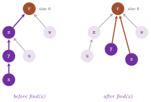
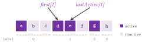

# 8. Paths and auxiliary structures {#ch-8}

This chapter collects the data structures and the tools that the algorithms of
Part III use internally, and that a program often needs around them. They are
the paths of `lemon/path.h` (with the concept of `lemon/concepts/path.h`), the
union-find structures of `lemon/unionfind.h`, the elevator of
`lemon/elevator.h`, the plane geometry of `lemon/dim2.h` and the radix sorts
of `lemon/radix_sort.h`; then come the random numbers of `lemon/random.h`, the
counters and timers of `lemon/counter.h` and `lemon/time_measure.h`, the
colours of `lemon/color.h`, and the exceptions, assertions and parser of the
command line of `lemon/error.h`, `lemon/assert.h` and `lemon/arg_parser.h`.
The first three are data structures whose costs matter for the algorithms
built on them, and we give them most of the chapter. We describe the others
rather more briefly, but with all their members, since the reader of a program
that uses them should find each call here.

## 8.1 Paths {#sec-8-1}

A path of a digraph $G=(N,A)$ is a sequence of arcs $(a_1,\dots,a_k)$ such
that the target of $a_i$ is the source of $a_{i+1}$ for $i=1,\dots,k-1$. Its
length, in the sense of the path classes, is the number $k$ of its arcs (the
length under a cost map is computed by the user,
cf. [§10.1](10-shortest-paths.md#sec-10-1)). The four path classes of abLEMON
store the sequence of arcs and no other data, i.e., they do not store the
nodes, they cannot give the source of a path of no arcs, and they do not check
that consecutive arcs are joined (which is left to the function
`checkPath()`). All four take the digraph type as their only template
parameter `GR`, and define the types `Digraph` and `Arc`.

Their common interface is made of a default constructor, a constructor and an
assignment from a path of any type (both implemented by `pathCopy()`),
`length()`, `empty()` and `clear()`. The arcs are read by `nth(n)` and by its
alias `operator[]`, by `front()` and `back()`, and by the iterator `ArcIt`,
which converts to `Arc` and runs from the first arc to `INVALID`; `nthIt(n)`
places an `ArcIt` on the $n$-th arc, and `arcs()` wraps `ArcIt` in a range for
the range-based `for` of C++11. The classes differ in how the arcs are stored,
which decides what can be done and at which cost (Table 8.1).

<span id="tab-8-1"></span>**Table 8.1.** The path classes of `lemon/path.h`
and the cost of their operations, for a path of $k$ arcs ("am." stands for
amortized, "no" for an operation that the class does not have).

| class | storage | `nth(i)` | `addFront`, `eraseFront` | `addBack`, `eraseBack` | `length()` | other |
|-------------|----------------|--------|------------|------------|--------|--------------|
| `Path` | two vectors | $O(1)$ | $O(1)$ am. | $O(1)$ am. | $O(1)$ | |
| `SimplePath` | one vector | $O(1)$ | no | $O(1)$ am. | $O(1)$ | |
| `ListPath` | doubly linked list | $O(i)$ | $O(1)$ | $O(1)$ | $O(k)$ | `splice`, `split` in $O(1)$ |
| `StaticPath` | one array | $O(1)$ | no | no | $O(1)$ | read only |

In `Path` the arcs added at the front are kept in one vector, in reverse
order, and those added at the back in another. When one of the two vectors is
empty and an arc must be erased from its end, half of the other vector is
moved into it. Hence, `eraseFront()` and `eraseBack()` cost $O(1)$ amortized
over any sequence of operations. `SimplePath` keeps one vector and grows only
at the back, which makes it somewhat faster than `Path` when the arcs are only
added at the back. A `ListPath` allocates one node per arc; hence, `nth()`
walks $i$ nodes and `length()` walks the whole list; however, it is the only
class that can be cut and joined in constant time, which is indeed the reason
to prefer it. Its member `spliceBack(tpath)` moves all the arcs of `tpath` to
the back of the path, and `spliceFront(tpath)` to its front, leaving `tpath`
empty; `splice(it, tpath)` inserts them before the arc of the iterator `it`
(at the back if `it` is `INVALID`). Conversely, `split(it, tpath)` moves the
arcs from `it` on into `tpath`, after clearing it (the clearing being the only
part that may cost more than $O(1)$). Finally, a `StaticPath` is an array of
exactly $k$ arcs, which can only be built from another path or assigned; it is
the most compact of the four, and usually the one to choose for storing many
paths. The bounds of Table 8.1 follow from the storage, except the amortized
one of `Path`, which needs an argument.

<span id="thm-8-1"></span>**Theorem 8.1.** *Starting from an empty `Path`,
any sequence of $q$ calls of `addFront()`, `addBack()`, `eraseFront()` and
`eraseBack()` takes $O(q)$ time.*

*Proof.* Let $f$ and $b$ be the numbers of arcs in the vector of the front and
in that of the back, and let $\Phi=|f-b|$, which is 0 at the start and never
negative. An addition, or an erasure from a vector that is not empty, takes
$O(1)$ time (amortized over the growth of the vector) and changes $\Phi$ by at
most 1. An erasure from an empty vector, say the front one, with $b=r\ge 1$
arcs in the other, erases the first arc of the back vector, moves the next
$\lfloor r/2\rfloor$ arcs into the front vector and shifts the remaining
$r-1-\lfloor r/2\rfloor$ down, in $O(r)$ time; afterwards $\Phi\le 1$, while
it was $r$ before. Hence, with a suitable constant $c$, the amortized cost
(the actual cost plus $c$ times the change of $\Phi$) of each call is $O(1)$.
The total actual cost is at most the total amortized cost, since $\Phi\ge 0$
at the end. $\square$

We remark that the copy assignment of each path class calls `pathCopy()`,
which clears the target before reading the source; hence, assigning a path to
itself (`p = p`) leaves it empty.

The concept `concepts::Path` of `lemon/concepts/path.h` states this common
interface (a path type, the copy from another path, `length()`, `empty()`,
`clear()`, `ArcIt` and `arcs()`), and the four classes conform to it. A second
concept, `concepts::PathDumper`, describes the objects that the search
algorithms of chapters 9 and 10 return from their queries `path()`. A path
dumper has `length()`, `empty()` and either an `ArcIt` or, when its type
`RevPathTag` is `True`, a `RevArcIt` that lists the arcs from the last to the
first. In the library, the dumpers are `PredMapPath` and `PredMatrixMapPath`
of `lemon/bits/path_dump.h`, which follow a map of predecessor arcs back from
a node, and therefore list the arcs in reverse. They are not meant to be kept,
but to be assigned to a path, as in `Path<ListDigraph> p = dijkstra.path(t);`
(note that an `ArcIt` built on the temporary that such a conversion creates
would point to a destroyed object).

All constructors and assignments of a path call `pathCopy(from, to)`. This
function checks at compile time that `from` is a path dumper, and then chooses
among four ways of copying. If `from` lists its arcs backwards (`RevPathTag`),
the arcs are added to the front of `to`, else to its back; and if `to` defines
the type `BuildTag` (as the four classes do), its member `build()` or
`buildRev()` fills it in one pass, after reserving the memory, in place of a
sequence of `addBack()` or `addFront()`. This choice is made by the helpers
`RevPathTagIndicator`, `BuildTagIndicator`, `PathCopySelector`,
`PathCopySelectorForward` and `PathCopySelectorBackward` of the namespace
`_path_bits`, which are not part of the interface. Also, `copyPath(to, from)`
is the same copy with the arguments in the opposite order, kept only for
compatibility with older programs.

Four other utilities read a path together with its digraph. The predicate
`checkPath(g, p)` is true if the target of each arc of `p` is the source of
the next one (an empty path being consistent), and `pathSource(g, p)` and
`pathTarget(g, p)` return the source of the first arc and the target of the
last one, or `INVALID` for an empty path. Next, the iterator
`PathNodeIt<Path>` lists the $k+1$ nodes of a consistent path from its source
to its target, given the digraph and the path in its constructor; a third
argument gives the node to start from, which is needed only for a path of no
arcs. Also, `pathNodes(g, p)` wraps this iterator in a range, and
`for (auto u : pathNodes(g, p))` then visits the nodes in order.

!!! note "abLEMON"
    The allocator of `ListPath` constructs and destroys its nodes through
    `std::allocator_traits`, since C++20 removed the members `construct()` and
    `destroy()` of `std::allocator` that LEMON 1.3.1 called; the paths
    therefore compile from C++11 to C++23. The alias `operator[]` of `nth()`
    and the ranges of `arcs()` and `pathNodes()` come from the development of
    LEMON after its release 1.3.1, which did not distribute them.

The program `manual/examples/08-paths.cc` (the test `manual_08_paths`) builds
a path at both ends and copies it into the other three classes. Then it splits
and splices a `ListPath`, lists the nodes of a path, and copies the path
dumper of a search of Dijkstra (cf. [§10.2](10-shortest-paths.md#sec-10-2))
into a `Path`.

## 8.2 Union-find structures {#sec-8-2}

A union-find structure maintains a partition of a finite set of items into
classes under two operations: the union of the classes of two items, and the
find of the class of an item, whose answer is a representative of the class,
the same for all its items. It is the structure behind Kruskal's algorithm
([§11.1](11-spanning.md#sec-11-1)), where the classes are the components of
the forest grown so far, and behind the blossoms of the weighted matching
algorithms of chapter 17. Each class is stored as a tree whose root is the
representative and whose other items point to their parents. A find walks from
the item to the root, and a union makes one root the child of the other. Two
rules keep the trees shallow: the union by size puts the root of the tree
with fewer items under the root of the other, and the path compression makes
the items met during a find point to the root (Figure 8.1).

{#fig-8-1}

<span id="lem-8-1"></span>**Lemma 8.1.** *With the union by size, a tree of
$s$ items has depth at most $\log_2 s$, whatever finds (with or without
compression) are made.*

*Proof.* The compression only shortens paths, and we may ignore it. An item
gets deeper only when the root of its tree is put under another root, by a
union with a tree at least as large; the tree that contains it then at least
doubles. Since a tree has at most $s$ items, this happens at most $\log_2 s$
times to each item. $\square$

<span id="thm-8-2"></span>**Theorem 8.2.** *With the union by size and the
path compression, any sequence of $n$ insertions and $m\ge n$ finds and
unions takes $O(m\,\alpha(m,n))$ time, where $\alpha$ is the inverse of
Ackermann's function, which is at most 4 for any $n$ that can be stored.*

*Proof sketch.* Each union costs $O(1)$ after its two finds, and a find costs
$O(1)$ plus the number of items whose parent it changes. One groups the items
by the logarithm of the size of their subtree, which by Lemma 8.1 grows along
each path to the root, and then the levels into blocks of exponentially
growing ranges, as many as the inverse of Ackermann's function allows. A
compression changes the parent of an item either for the last time in its
block, which is charged to the find (at most $\alpha(m,n)$ such items per
find), or to a parent in a strictly higher level of the same block, which is
charged to the item. The charges to the items of each block add up to $O(m)$
over the blocks. The bound was proved in [Tarjan
1975](Z-bibliography.md#ref-tarjan1975efficiency) for the union by rank, and
in [Tarjan and van Leeuwen 1984](Z-bibliography.md#ref-tarjan1984worst),
section 3, for the union by size and the other linking rules. A textbook
proof, for the union by rank, is in [Cormen et al. 2001,
§21.4](Z-bibliography.md#ref-clrs01algorithms). $\square$

In practice, the cost of an operation is usually a small constant, and one
may take it as such when choosing an algorithm.

All the classes of `lemon/unionfind.h` take as template parameter the type
`IM` of a map from items to integers. The items are the keys of `IM`
(typically the nodes, arcs or edges of a graph), and the map, given to the
constructor by reference, stores the index of each item in the internal
vectors. From then on the map belongs to the structure: writing into it
corrupts the structure, and each item must be added with `insert()` before it
is used in another operation.

`UnionFind<IM>` is the plain structure, with four operations and `clear()`.
Here `insert(a)` makes `a` a singleton class and returns its index, and
`find(a)` returns the index of the representative of the class of `a`, an
integer between 0 and the number of the items inserted, minus one (the index
that `insert()` returned for that item). A call
`join(a, b)` returns `false` if `a` and `b` are already in the same class, and
otherwise unites the two classes and returns `true`; `size(a)` is the number
of items of the class of `a`. Algorithm 8.1 gives `find()` and `join()` as the
code has them, $\mathit{parent}$ and $\mathit{size}$ being stored in one
vector of integers (a root holds its size, negated, and any other item the
index of its parent); Lemma 8.1 and Theorem 8.2 apply to it. Note that
`clear()` empties the vector but leaves the map, whose old values must not be
used before the items are inserted again.

<span id="alg-8-1"></span>**Algorithm 8.1** (Find and union in `UnionFind`).

```
find(x):
1  r := x
2  while r is not a root: r := parent(r)
3  while x != r: next := parent(x); parent(x) := r; x := next
4  return r

join(a, b):
1  ra := find(a); rb := find(b)
2  if ra = rb: return false
3  if size(ra) > size(rb): parent(rb) := ra; size(ra) := size(ra) + size(rb)
4  else:                   parent(ra) := rb; size(rb) := size(rb) + size(ra)
5  return true
```

Next, `UnionFindEnum<IM>` adds the enumeration of the classes and of the items
of each class, at the price of some memory and time per operation. Each class
keeps a circular doubly linked list of its items (its private records `ItemT`
and `ClassT`), and the classes are linked in a second list; it joins by size
and compresses the paths as `UnionFind` does. Its classes are identified by
integer ids rather than by representatives. Thus, `insert(item)` makes a new
class and returns its id, `insert(item, cls)` adds the item to the class
`cls`, `find(item)` returns the id of the class of the item, and `join(a, b)`
returns the id of the united class, or $-1$ if the two items were already
together. Also, `size(cls)` is the number of items of a class, and `item(cls)`
returns one of its items. This structure can also undo: `split(cls)` breaks a
class into singletons, and `erase(item)` removes an item from its class,
deleting the class if it becomes empty. Finally, `eraseClass(cls)` removes a
whole class, and `clear()` all of them. Its iterator `ClassIt` lists the ids
of the classes, and `ItemIt`, constructed from the structure and a class id,
lists the items of that class; both are compared with `INVALID` to stop.

<span id="thm-8-3"></span>**Theorem 8.3.** *In a `UnionFindEnum`, `insert()`,
`size()`, `item()` and `eraseClass()` take $O(1)$ time, `find()` and `join()`
the time of the finds of Theorem 8.2 plus $O(1)$, and `split(cls)` and
`erase(item)` $O(s)$, where $s$ is the size of the class. In an
`ExtendFindEnum`, all the operations take $O(1)$ time.*

*Proof.* A join links the two roots and splices the two circular lists, in
$O(1)$ after the finds. The split walks the list of the class once, making
each item a root of its own class, and the erasure makes the next item of the
list the root and walks the list once to point every other item to it, which
keeps the trees of depth one. The other operations of `UnionFindEnum` read or
relink a constant number of records. An `ExtendFindEnum` stores in each item
its class, which never changes; its other operations relink lists.
$\square$

We remark that `clear()` of `UnionFindEnum` empties the vector of the items
and the list of the classes, but neither the vector of the classes nor its
list of free records; hence, the records of the classes alive before the call
are never reused, which costs memory but no correctness.

`ExtendFindEnum<IM>` is the simplification of `UnionFindEnum` in which the
classes are never united. It has the same two forms of `insert()`, `find()`,
`item()`, `erase()`, `eraseClass()`, `clear()`, `ClassIt` and `ItemIt`, and no
`join()`, a class therefore growing only by insertion; in exchange, `find()`
reads the class of an item in $O(1)$ (Theorem 8.3). All three classes define
the types `ItemIntMap` (that is, `IM`) and `Item`.

`HeapUnionFind<V, IM, Comp>` attaches a priority of type `V` to each item and
keeps the item of least priority of each class, where `Comp` (by default
`std::less<V>`) decides what least means. It is stored as a $(2,16)$-tree
whose leaves are the items, with a tournament for the minimum on the internal
nodes, i.e., each internal node has between 2 and 16 children (the root
excepted) and stores the least priority of its subtree and its item. Besides
the union, it supports the split of a class into the classes it was made of,
which the blossoms of the weighted matching algorithms need. A call
`insert(item, prio)` makes a class of one item and returns its id, and
`find(item)` returns the id of the alive class of the item. A call
`join(begin, end)` unites the $k$ classes whose ids are in the range (at least
two) and returns the id of the new class, and `split(cls, out)` restores the
$k$ classes of which `cls` was made, and writes their ids into the output
iterator `out`.

<span id="thm-8-4"></span>**Theorem 8.4.** *In a `HeapUnionFind`, `insert()`
takes $O(1)$ time, `find()` and the changes of a priority $O(\log n)$, where
$n$ is the number of the items of the class, and `join()` and `split()` of $k$
classes $O(k\log n)$, where $n$ is the number of the items involved.*

*Proof sketch.* A tree whose internal nodes have at least two children has
height at most $\log_2 n$. A find walks from the leaf of the item to the root;
a decrease walks up from the leaf while the new priority beats the minimum of
the node, and an increase recomputes the minimum of the at most 16 children of
each ancestor whose minimum was the item; each of them is therefore
$O(\log n)$. A join hangs the trees of the $k$ classes on one another, in the
order of the range, under nodes of the right height, and splits a node into
two when it exceeds 16 children. This costs $O(\log n)$ per class joined; a
split cuts the tree along the paths of the $k$ subtrees that the join
recorded, and repairs the degrees and the minima along them (the private
members `repairLeft()` and `repairRight()`), with the same cost. The bounds
are those of the documentation of the class. The argument is the usual one for
the B-trees and their variants ([Cormen et al.
2001](Z-bibliography.md#ref-clrs01algorithms), chapter 18). $\square$

Priorities are read by `operator[](item)` and written by `set(item, prio)`,
`decrease(item, prio)` and `increase(item, prio)`, the last two requiring a
priority that is not larger, or not smaller, than the present one (and `set()`
choosing between them); the class defines `Value`, `Item`, `ItemIntMap` and
`Compare`. The least priority of a
class and its item are given by `classPrio(cls)` and `classTop(cls)`, and
`classRep(cls)` gives an item of the class that does not depend on the
priorities. Furthermore, `alive(cls)` is true if a class is not nested into
another one (only alive classes are returned by `find()`), and `trivial(cls)`
if it holds a single item directly. Its iterators are `ItemIt`, which lists
the items of a class, and `ClassIt`, which lists the alive classes, or,
constructed with a class id, the classes of which `cls` is made. Finally, the
structures `ItemT`, `ClassT`, `ItemNode` and `ClassNode` of the header are the
internal records of these classes.

The program `manual/examples/08-union-find.cc` (the test
`manual_08_union_find`) computes the components of a small graph with
`UnionFind`, counting the edges that close a cycle. It also enumerates them
with `UnionFindEnum`, and follows the minimum of a class of `HeapUnionFind`
through a join, a decrease and a split.

## 8.3 The elevator {#sec-8-3}

Push-relabel algorithms of maximum flow ([Goldberg and Tarjan
1988](Z-bibliography.md#ref-goldberg88newapproach); see chapter 12) keep a
label on each node, i.e., a lower bound on its distance to the sink in the
residual digraph, and a set of active nodes, those with a positive excess. At
each step they take an active node of highest label (in the variant that we
consider here), push its excess along the admissible arcs, and lift its label
when no arc is admissible. Furthermore, the gap heuristic of [Cherkassky and
Goldberg 1997](Z-bibliography.md#ref-cherkassky97implementing) moves to the
top all the nodes above a level that has become empty, since none of them can
reach the sink any longer. An elevator is the data structure that supports
these operations, each in (amortized) constant time. Two of them are in
`lemon/elevator.h`, `Elevator` and `LinkedElevator`, with the same interface;
`Preflow` and `Circulation` take the type of theirs from their traits class
(`Elevator` by default, another one by the named parameters `SetElevator` and
`SetStandardElevator`), and the fractional matchings of chapter 17 use a
`LinkedElevator`.

Both classes take as template parameters the type `GR` of the graph and the
type `Item` of the labelled items (`GR::Node`, `GR::Arc` or `GR::Edge`), and
the labels are the integers from 0 to `maxLevel()`. Its constructor
`Elevator(graph, max_level)` sets the largest label, and `Elevator(graph)`
takes it equal to the number of the items of the graph, as the flow algorithms
do. An `Elevator` stores the items in one array, ordered by label, with the
active items of each level before the inactive ones, and with two pointers per
level, to its first item and to its last active item (Figure 8.2). Hence,
activating, deactivating and lifting by one level are swaps of two places of
the array, and `onLevel(l)`, `emptyLevel(l)`, `aboveLevel(l)` and
`activesOnLevel(l)` are differences of pointers, computed in $O(1)$. A
`LinkedElevator` keeps one doubly linked list per level instead; it needs no
array of all the items, but it counts (somewhat slowly) the items of a level,
or above a level, by walking the lists.

{#fig-8-2}

The interface of the two classes has four groups of members. First, the
initialization lists the items level by level: `initStart()` begins it,
`initAddItem(i)` puts an item on the current level (level 0 at first),
`initNewLevel()` passes to the next level, and `initFinish()` ends it, the
items not listed being put on the top level, all inactive. Afterwards, the
level of an item is read by `operator[](i)` and its state by `active(i)`,
which `activate(i)` and `deactivate(i)` change (with the preconditions that
the item is inactive, or active, before the call).

Note that the highest active item, given by `highestActive()` (or `INVALID`),
has its level given by `highestActiveLevel()` (or $-1$); it is lifted by one
level by `liftHighestActive()`, to a given higher level by
`liftHighestActive(l)`, or to the top level, where it is deactivated, by
`liftHighestActiveToTop()`. Three similar operations exist for the active item
that `activeOn(l)` returns on a given level, namely `liftActiveOn(l)`,
`liftActiveOn(l, new_level)` and `liftActiveToTop(l)`, and
`lift(i, new_level)` lifts any active item. Finally, `liftToTop(l)` moves all
the items on level `l` and above to the top level and deactivates them (the
gap heuristic), and `activeFree(l)` is true if a level has no active item.
Also, `dirtyTopButOne(i)` moves an inactive item from the top level to the
level below it without updating the structure, and the documentation reserves
it to those who know what it is for. The costs of these operations follow
from the invariant of the array.

<span id="lem-8-2"></span>**Lemma 8.2.** *After `initFinish()` and after each
operation other than `dirtyTopButOne()`, the array of an `Elevator` holds the
items in nondecreasing order of level. For each level $l$, its items occupy
the places from $\mathit{first}(l)$ to $\mathit{first}(l+1)-1$, the active
ones before the others, the last active one at $\mathit{lastActive}(l)$; and
$\mathit{highest}$ is the highest level with an active item ($-1$ if none).*

*Proof.* The initialization lists the items level by level and puts the others
on the top level, all inactive. An activation swaps the item with the first
inactive item of its level and increments $\mathit{lastActive}$, and a
deactivation does the converse. A lift of an active item from level $l$ to
level $l'>l$ first moves it to the end of the active part of $l$. Then, for
each level from $l$ to $l'-1$, it moves the last item of that level (after its
active part has been shifted by one place) to the first place of the next one,
shifting the boundary $\mathit{first}$ of each level crossed by one place to
the left. The item lands in the first place of $l'$, among the active ones.
`liftToTop(l)` relabels all the items from level $l$ on and moves all the
boundaries of these levels to the first place of $l$. In each case
$\mathit{highest}$ is raised to a new active level, or lowered past the levels
left without active items. $\square$

<span id="thm-8-5"></span>**Theorem 8.5.** *In an `Elevator`, `activate()`,
`deactivate()` (apart from the lowering of $\mathit{highest}$), the queries
and `liftHighestActive()` take $O(1)$ time, a lift from level $l$ to level
$l'$ takes $O(l'-l)$, and `liftToTop(l)` takes $O(k+L)$, where $k$ is the
number of the items moved and $L$ the number of levels; the lowering of
$\mathit{highest}$ costs one step per level passed. In a `LinkedElevator`, the
activations and the lifts take $O(1)$ time (apart from the lowering of
$\mathit{highest}$), and `onLevel()`, `aboveLevel()` and `activesOnLevel()`
are proportional to the number of the items they count.*

*Proof.* By Lemma 8.2, each of the first operations swaps two places or reads
two boundaries, and a lift moves one item per level crossed. In a
`LinkedElevator`, each level is a doubly linked list with the active items at
its front. An activation or a lift relinks one item, and the counts walk the
lists. $\square$

!!! note "abLEMON"
    `Elevator` allocates one place more than the items of the graph, so that
    it may be constructed on a graph without items; in LEMON 1.3.1,
    `Circulation` read past its storage on an empty digraph through it.

We remark that the constructor with a given largest label may take a label
smaller than the number of the items, in which case the items not listed by
the initialization stay on the largest level. In a `LinkedElevator` the items
of the largest level are kept in no list, so that `onLevel()` and
`aboveLevel()` count only those below it, as the flow algorithms expect. Also,
`liftToTop(l)` of a `LinkedElevator` moves the items of the levels from $l+1$
up to the first empty one, which is what the gap heuristic needs (it calls it
on an empty level $l$, and the levels above are then without gaps), while
that of an `Elevator` moves all the items from level $l$ on. The two classes
define `Key` (the item) and `Value` (`int`), so that they can be read as maps
of the levels.

!!! note "abLEMON"
    In LEMON 1.3.1 the constructors with a largest label also took it as the
    number of the items, so that `Elevator(graph, max_level)` sized its
    storage and counted the items correctly only when the two were equal; and
    `LinkedElevator::lift(i, new_level)` updated the ends of the list of the
    new level, where it had to update those of the level that the item leaves,
    whenever the item was the first or the last of its list. The test
    `elevator_test` checks both.

## 8.4 Two-dimensional geometry {#sec-8-4}

In `lemon/dim2.h`, the namespace `dim2` holds the plane vectors and boxes that
the drawing function `graphToEps()` of chapter 21, the planar drawings of
chapter 18 and the generators of geometric instances use. A `dim2::Point<T>`
is a vector with the public coordinates `x` and `y` of type `T`. It is
constructed from two coordinates (the default constructor value-initializes
them) or converted from a `Point` of another coordinate type, and it has
`size()` (always 2), `operator[]` (0 for `x`, 1 for `y`) and `normSquare()`.
Its operators are the sum, the difference and the negation of vectors, the
product by a scalar on either side and the division by a scalar, the scalar
product `operator*` of two vectors, the comparisons `==` and `!=`, and the
forms `+=`, `-=`, `*=` and `/=`. Free functions `makePoint(x, y)`, `rot90(p)`,
`rot180(p)` and `rot270(p)` (the rotations in the positive direction) complete
it, together with the stream operators, which write `(x,y)` and read the same
form, with the parentheses and the comma optional.

A `dim2::Box<T>` is an axis-parallel rectangle, possibly empty. Its default
constructor makes an empty box, while the box of a point, of two corners
(bottom left and top right) or of four sides (left, bottom, right, top) is not
empty. The calls `add(p)` and `add(box)` enlarge it to contain a point or
another box, `operator&` intersects two boxes (the result being empty if they
do not overlap), and `inside(p)` is true if a point is in the closed box
(never for an empty box); `empty()` and `clear()` read and reset the
emptiness. Its corners and sides are read by `bottomLeft()`, `topRight()`,
`bottomRight()`, `topLeft()`, `bottom()`, `top()`, `left()` and `right()`, and
set by the members of the same names that take the new value; `width()` and
`height()` give the sizes. Values of an empty box are undefined, and the
setters require a box that is not empty; the stream operator `>>`, which reads
`((l,b),(r,t))`, gives the box of the two corners, which is not empty (in
LEMON 1.3.1 it set the corners by the setters, and therefore left an empty box
empty; the test `dim_test` reads one). Finally, the maps `XMap` and `YMap`
(read and write) and `ConstXMap`, `ConstYMap` and `NormSquareMap` (read only)
turn a map whose values are points into a map of their coordinates or of their
squared norm, and are made by `xMap()`, `yMap()` and `normSquareMap()`.

## 8.5 Radix sort {#sec-8-5}

Both radix sorts of `lemon/radix_sort.h` sort a range of items by an integer
key, given by a function object or a function `functor` applied to each item
(the identity if it is omitted). Their time is linear in the number of items
for a fixed size of the keys; hence, they are often worth trying in place of
`std::sort` when the keys are integers of a few bytes. Its key may be of any
signed or unsigned integer type, and its type is the one that `functor`
returns.

A call `radixSort(first, last, functor)` runs a quicksort whose pivots are the
powers of two. For a signed type, it first separates the items with a negative
key from the others. Then it finds the highest bit $b$ of the keys of each
part, partitions the part on bit $b$ by the swaps of the partition of
quicksort, then each half on bit $b-1$, and so on (Algorithm 8.2). It is not
stable, and it needs bidirectional iterators.

<span id="alg-8-2"></span>**Algorithm 8.2** (Radix sort by bit partitions,
`radixSort()`).

```
radixSort(R):                      R is a range, key(x) an integer
1  split R into R- (key < 0) and R+ (key >= 0) by swaps
2  for each part P in (R-, R+):
3     b := the highest bit in which the keys of P differ from 0 (from 1 in R-)
4     sort(P, b)

sort(P, b):
1  while b >= 0 and P has at least two items:
2     split P into P0 (bit b of the key is 0) and P1 (bit b is 1) by swaps
3     sort(P0, b - 1); P := P1; b := b - 1
```

<span id="thm-8-6"></span>**Theorem 8.6.** *`radixSort()` sorts the range in
nondecreasing order of the keys in $O(n\,(1+\log_2 c))$ time and with
$O(1+\log_2 c)$ extra space, where $n$ is the number of items and $c$ the
largest absolute value of a key.*

*Proof.* In two's complement, the negative keys precede the nonnegative ones,
and, within each of the two parts, the order of the keys is the order of the
bit strings of their lowest $b+1$ bits, since all the higher bits are equal
(to 1 in $R^-$, to 0 in $R^+$) by the choice of $b$ in step 3. The procedure
`sort(P, b)` sorts the items of $P$, whose keys agree on all the bits above
$b$, by these bit strings: by induction on $b$, after the split the keys of
$P_0$ precede those of $P_1$, and each part is sorted on the lower bits by the
recursive call or by the next round of the loop. Each item takes part in one
split per bit, from $b$ down, and a split is linear in its range; hence, the
time is $O(n)$ per bit, and there are at most $1+\log_2 c$ bits (one more for
the negative keys). The recursion is made only on $P_0$, with one bit less,
which bounds its depth. $\square$
A call `stableRadixSort(first, last, functor)` sorts by the bytes of the keys,
from the least significant to the most significant, with one counting pass per
byte. Each pass counts the items of each of the 256 values of the byte,
computes where the items of each value begin, and copies the items in that
order into a second buffer, which keeps the relative order of the items with
the same byte; on a signed type, the last pass puts the negative keys first.
It allocates a buffer of $2n$ items, into which it copies the range and
between whose two halves the passes alternate.

<span id="thm-8-7"></span>**Theorem 8.7.** *`stableRadixSort()` sorts the
range in nondecreasing order of the keys, keeps the relative order of the
items with equal keys, and takes $O(B\,(n+256))$ time, where $B$ is the number
of bytes of the type of the key (whatever the largest key).*

*Proof.* A counting pass on byte $j$ is stable: the items of each value of the
byte are copied in the order in which they are read. By induction on $j$,
after the pass on byte $j$ the items are sorted by their lowest $j+1$ bytes,
read as an unsigned number, with ties in the original order: the pass orders
them by byte $j$, and, being stable, keeps the order of the previous passes
among the items with the same byte $j$. For a signed type, the last pass
puts the values 128 to 255 of the top byte, i.e., those of the negative keys
in two's complement, before the values 0 to 127, which gives the order of the
signed keys. Each pass reads the items twice and the 256 counters once.
$\square$

We remark that the buffer is raw memory, obtained by `allocate()` of a
`std::allocator`, into which the items are copied by assignment and from which
they are never destroyed. Hence, the function is right only for the items of a
trivially copyable type (e.g., integers or plain structures), and
`radixSort()`, which sorts in place by swaps, is the one to use for the
others. Both functions have overloads for a plain function pointer, and both
accept a lambda. The signed or unsigned version of each is chosen at compile
time, from the type of the key, by the helpers `RadixSortSelector` and
`StableRadixSortSelector` of the namespace `_radix_sort_bits`.

!!! note "abLEMON"
    The type of the key is deduced with `decltype` from the call of `functor`,
    rather than read from its member `result_type`, which C++20 removed from
    the function objects of the standard library; a lambda or any other
    callable may therefore be passed, which LEMON 1.3.1 did not accept.

!!! note "abLEMON"
    In LEMON 1.3.1, `radixSort()` built the mask of the highest bit as the
    `int` expression `1 << max_digit`, which overflowed for the keys of a
    64-bit type that use more than 31 bits (and the sort then did not end),
    and shifted negative values to the left; the masks are now computed on the
    unsigned type of the keys, and the test `radix_sort_test` sorts keys of 64
    bits, the extremes of the type included.

## 8.6 Random numbers {#sec-8-6}

In `lemon/random.h`, abLEMON implements the Mersenne Twister of [Matsumoto and
Nishimura 1998](Z-bibliography.md#ref-matsumoto1998mersenne), a generator of
period $2^{19937}-1$ that is equidistributed in 623 dimensions for 32-bit
numbers. It comes in a 32-bit and a 64-bit version, which give different
sequences from the same seed. A class template `_random_bits::Random<Word>`
holds the interface, and three types instantiate it: `Random32` (the 32-bit
version), `Random64` (the 64-bit one) and `Random`, whose word is
`unsigned long`, i.e., 64 bits on Linux and macOS and 32 bits on Windows.
Thus, a program that must give the same numbers on all platforms should use
`Random32` or `Random64`. Its global object `rnd`, of type `Random`, is the
generator that the library and most programs use; it is constructed with a
fixed seed, and therefore gives the same sequence at each run until it is
seeded again. Other names of the namespace `_random_bits` are the
implementation: `RandomCore` holds the state and twists it, and
`RealConversion`, `IntConversion`, `BoolConversion`, `Mapping`, `Masker`,
`Shifting`, `ShiftMultiplier`, `Initializer` and `BoolProducer` turn words
into numbers of a given type.

A generator is seeded by its constructor or by `seed()`, from one number or
from a range of numbers, each converted to the word of the generator. Without
arguments, `seed()` reads four words from `/dev/urandom` by `seedFromFile()`
(except on Windows) and, if that fails, calls `seedFromTime()`, which seeds
from the process id and the time of day; both return `true` on success. A
copy, by construction or by assignment, copies the state, and the copy then
gives the same sequence from that point on. However, the constructor from a
number is a template on the type of the number, which also matches a generator
of the other word size: `Random64 r(r32)` does not copy `r32` but fails to
compile, since the state can only be copied between generators of the same
type.

Uniform numbers are given by several members. The call `real<T>()` returns a
number of type `T` (`double` by default) in $[0,1)$, and `operator()()`,
`operator()(b)` and `operator()(a, b)` a `double` in $[0,1)$, $[0,b)$ and
$[a,b)$. The call `integer(b)` and its alias `operator[](b)` return an integer
in $\{0,\dots,b-1\}$, of the type of `b`, and `integer(a, b)` one in
$\{a,\dots,b-1\}$. Also, `integer<T>()` and `uinteger<T>()` return an integer
uniform over the whole range of `T`, or over its nonnegative part (`int` and
`unsigned int` by default), and `boolean()` returns a fair bit, taken from a
buffer of the bits of one word.

Several other distributions are available (cf. the test
`test/random_test.cc`). The call `boolean(p)` is `true` with probability $p$,
and `gauss()` and `gauss(mean, std_dev)` are normal, by the polar form of the
method of [Box and Muller 1958](Z-bibliography.md#ref-box1958note) given by
[Marsaglia and Bray 1964](Z-bibliography.md#ref-marsaglia1964convenient). The
call `lognormal(n_mean, n_std_dev)` (or `lognormal(pair)`) returns the
exponential of a normal variable of the given parameters, and
`lognormalMD(mean, std_dev)` a lognormal variable of the given mean and
standard deviation, whose parameters `lognormalParamsFromMD()` computes. Next
come `exponential(lambda)` (of mean $1/\lambda$, with $\lambda=1$ by default),
`gamma(k)` for an integer shape (a sum of $k$ exponentials), `gamma(k, theta)`
for any positive shape (by rejection), `weibull(k, lambda)`, `pareto(k,
x_min)` and `poisson(lambda)`; the last is the method of [Knuth
1969](Z-bibliography.md#ref-knuth1969seminumerical). In the plane, `disc()` is
uniform on the unit disc (by rejection from the square). Next, `gauss2()`
gives the two normal coordinates of one step of the polar method, and
`exponential2()` gives the point $(-\ln S/S)\,(V_1,V_2)$ of the same step, a
rotationally symmetric distribution whose distance from the origin is
$-\ln S/\sqrt S$ with $S$ uniform on $(0,1)$. The two lemmas below justify
`gauss()` and `poisson()`, where $U_1,U_2,\dots$ are the independent uniform
numbers of $[0,1)$ that `real()` returns.

<span id="lem-8-3"></span>**Lemma 8.3.** *Let $V_1=2U_1-1$ and $V_2=2U_2-1$ be
drawn again until $S=V_1^2+V_2^2$ is in $(0,1)$, and let
$W=\sqrt{-2\ln S/S}$. Then $WV_1$ and $WV_2$ are independent standard normal
variables.*

*Proof.* The accepted point $(V_1,V_2)$ is uniform on the punctured unit disc;
in polar coordinates $(\sqrt S\cos\Theta,\sqrt S\sin\Theta)$, the angle
$\Theta$ is uniform on $[0,2\pi)$, the area $\pi S$ of the disc inside the
point is uniform, i.e., $S$ is uniform on $(0,1)$, and the two are
independent. The output is $(R\cos\Theta,R\sin\Theta)$ with
$R=\sqrt{-2\ln S}$, and $P(R>r)=P(S<e^{-r^2/2})=e^{-r^2/2}$. Hence, $R$ has
the density $re^{-r^2/2}$, and the output has the density
$\frac{1}{2\pi}e^{-(x^2+y^2)/2}$, the product of two standard normal
densities. $\square$

Thus, the two coordinates of `gauss2()` are independent, although the
documentation of the function states the contrary, and `gauss()` returns the
first of them. The case $S=0$, which `gauss()` and `gauss2()` do not exclude,
has probability $2^{-2b}$, where $b$ is the number of random bits of the
`double` that `real()` returns, and would give a NaN.

<span id="lem-8-4"></span>**Lemma 8.4.** *`poisson(lambda)` returns the least
$k\ge 0$ such that $U_1\cdots U_{k+1}<e^{-\lambda}$, which is a Poisson
variable of mean $\lambda$, after $k+1$ draws; its expected time is therefore
$O(1+\lambda)$.*

*Proof.* With $E_i=-\ln U_i$, which are independent exponential variables of
mean 1, the condition reads $E_1+\cdots+E_{k+1}>\lambda$; hence, $k$ is the
number of the points of a Poisson process of unit rate that fall in
$[0,\lambda]$, which is a Poisson variable of mean $\lambda$. The loop draws
one number per point and one more. $\square$

!!! note "abLEMON"
    The packages of abLEMON declare, next to the Boost Software License, the
    BSD-3-Clause notice of the Mersenne Twister that the header carries, and
    `rnd` is exported when the library is built as a DLL on Windows.

## 8.7 Counting and timing {#sec-8-7}

In `lemon/counter.h`, a few classes help to count events in a program under
development, e.g., the operations of an algorithm. A `Counter` has a title and
an output stream (`std::cerr` by default); it is changed by `++`, `--`, `+=`
and `-=`, read by its conversion to `int` and reset by `reset(c)`, and it
prints its title and value when it is destroyed. A `Counter::SubCounter`,
constructed on a parent counter with a title and a stream, counts in the same
way, prints its value when it is destroyed, and adds it to the parent at that
moment. A `Counter::NoSubCounter`, instead, prints no report and passes each
change to its parent at once; thus, replacing one with the other turns the
report of a phase on or off without touching the code that counts. Subcounters
can have subcounters, and `NoCounter` has the interface of `Counter` but
counts nothing; one can thus compile the counting of a program away by
changing one type.

Time is measured by `lemon/time_measure.h`. A `TimeStamp` holds five times,
i.e., the real time, the user and system times of the process and those of its
children, which `stamp()` reads from the operating system. Its constructor
`TimeStamp(NULL)` makes a stamp of the present moment, and the default
constructor one of zeros. Stamps can be added, subtracted and scaled,
`ellapsed()` gives the time passed since the stamp, and `realTime()`,
`userTime()`, `systemTime()`, `cUserTime()` and `cSystemTime()` read the five
values (the last two are not computed on Windows). Its stream operator prints
`u: ...s, s: ...s, cu: ...s, cs: ...s, real: ...s`; after
`TimeStamp::format(TimeStamp::SHORT)`, a setting global to all stamps, it
prints the real time and its relative difference from the total processor
time.

A `Timer` starts at its construction (unless it is constructed with `false`),
and is controlled by `start()`, `stop()`, `halt()`, `reset()` and `restart()`.
It counts the calls of `start()` and stops only after as many calls of
`stop()`, which allows one to time a recursive function, while `halt()` stops
it at once; `running()` returns the number of calls of `stop()` still needed.
Its times are read by the same five members as those of a stamp, or by its
conversion to `TimeStamp`, which printing it uses. A `TimeReport` is a `Timer`
that prints a title and its times when it is destroyed (unless `active(false)`
has been called), and `NoTimeReport` is the version that measures no time. The
granularity of the clocks is typically 10 ms (as the documentation warns),
which makes a single measure of a short function rather unreliable. For a
short function, `runningTimeTest(f, min_time, num, full_time)` calls `f` until
the number of calls reaches a power of two (1, 2, 4, ..., at most $2^{31}$)
at which the total real time exceeds `min_time` seconds (10 by default), and
returns the average time of one call; the number of calls and
the total time are written into the two optional pointers.

## 8.8 Colors {#sec-8-8}

The colours that `graphToEps()` uses are those of `lemon/color.h`. A `Color`
holds three components in $[0,1]$, read and set by `red()`, `green()` and
`blue()`, and set together by `set(r, g, b)`. Fifteen constants are defined in
the library: `WHITE`, `BLACK`, `RED`, `GREEN`, `BLUE`, `YELLOW`, `MAGENTA`,
`CYAN`, `GREY`, `DARK_RED`, `DARK_GREEN`, `DARK_BLUE`, `DARK_YELLOW`,
`DARK_MAGENTA` and `DARK_CYAN`. A `Palette` is a map from `int` to `Color`
that cycles through a list of colours. Its constructor takes `have_white`
(white first, `false` by default) and `num` (the number of colours, $-1$ by
default), and fills the list with the 26 colours of its default list (27 with
white), cut to `num` colours or repeated up to them. Then `operator[](i)` and
`set(i, c)` read and write the colour of `i` modulo `size()`, and `add(c)` and
`resize(s)` change the list. Finally, `distantColor(c)` returns the corner of
the colour cube farthest from `c`, and `distantBW(c)` returns black for a
light colour and white for a dark one, by the luminance of `c`.

## 8.9 Errors, assertions and the command line {#sec-8-9}

All exceptions of the library derive from `Exception` (`lemon/error.h`), a
class derived from `std::exception`, whose `what()` returns
`"lemon::Exception"`. An `IoError` is thrown when a file cannot be read or
written; it carries a message and a file name, set by its constructors or by
`message()` and `file()` and read by the members of the same names. A
`FormatError` is thrown by the readers of chapter 21 when the input is
malformed, and carries a line number too (`line()`, zero if unknown). The
`what()` of both composes the message, the file and the line, e.g.,
`lemon:FormatError: unknown section (in file 'g.lgf' at line 12)`. Other
headers derive further exceptions from `Exception`, e.g., the
`ArgParserException` described below.

In `lemon/assert.h`, the macro `LEMON_ASSERT(exp, msg)` checks the
preconditions of the library, and the user may use it as well. If `exp` is
false, it calls a handler with the file, the line, the function, the message
and the text of the expression; the default handler, `assert_fail_abort()`,
prints them on `std::cerr` and calls `std::abort()`. Assertions are enabled by
default, and disabled by `LEMON_DISABLE_ASSERTS` or by the standard macro
`NDEBUG`. Moreover, `LEMON_ASSERT_ABORT` selects the default handler
explicitly, and `LEMON_ASSERT_CUSTOM` the function named by
`LEMON_CUSTOM_ASSERT_HANDLER`, which must have the signature of
`assert_fail_abort()`. Defining both modes, or one of them together with
`NDEBUG` or `LEMON_DISABLE_ASSERTS`, is a compilation error, and the mode may
be changed within a translation unit by redefining the macros and including
the header again. Finally, `LEMON_DEBUG(exp, msg)` checks the internal
invariants of the algorithms; it works as `LEMON_ASSERT`, but it is disabled
unless `LEMON_ENABLE_DEBUG` is defined, since some of its checks are
expensive.

`ArgParser` (`lemon/arg_parser.h`) parses the command line of the tools of
chapter 22, and of any program. It is constructed on `argc` and `argv`, and
the options are declared without their leading `-`. Calls of `intOption()`,
`doubleOption()`, `boolOption()` and `stringOption()` declare an option with a
help string, a default value and a flag that makes it mandatory, and
`refOption()` declares one whose value is written directly into a variable of
the program. In the same way, `other(name, help)` documents the arguments that
are not options, `synonym(syn, opt)` adds another name of an option, and
`optionGroup(group, opt)` puts options into a group, for which
`onlyOneGroup(group)` and `mandatoryGroup(group)` require at most one, or at
least one, of its options. All these calls return the parser, and can
therefore be chained.

Then `parse()`, or its synonym `run()`, reads the arguments. An argument that
starts with `-` (and is not `-` alone) must be a declared option; a `bool`
option is set to `true` by its presence, and any other option takes the next
argument as its value, which must be read in full as a number for a numeric
option. Other arguments are collected in `files()`. Afterwards, `given(name)`
is true if an option appeared, and `operator[](name)` returns its value
through the proxy `RefType`, which converts to `int`, `double`, `bool` or
`std::string` after checking the type of the option with `LEMON_ASSERT` (an
integer option also converts to `double`); `commandName()` returns `argv[0]`.
Options `-help`, `--help` and `-h` print a summary of the options. On a
request of help, an unknown option, a missing or malformed value, or a
violated condition on the mandatory options and groups, the parser prints a
message and calls `exit(1)`. If `throwOnProblems()` has been called, it throws
instead an `ArgParserException`, whose `reason()` is `HELP`, `UNKNOWN_OPT` or
`INVALID_OPT`. Its records `GroupData` and `OtherArg` of the header hold the
groups and the help of the other arguments.

The program `manual/examples/08-utilities.cc` (the test
`manual_08_utilities`) uses an elevator, the two radix sorts, two generators
seeded alike and a box, a counter that writes into a string, a timer, and a
parser of a command line given as an array, and checks the result of each.

## 8.10 Exercises {#sec-8-10}

<span id="ex-8-1"></span>**Exercise 8.1.** Show that, if an erasure from an
empty end of a `Path` moved all the arcs of the other vector instead of half
of them, a sequence of $q$ calls made of $q/2$ calls of `addBack()` followed
by alternate calls of `eraseFront()` and `eraseBack()` would take
$\Theta(q^2)$ time, and explain which step of the proof of Theorem 8.1 fails.
(The test `test/path_test.cc` checks the four path classes.)

<span id="ex-8-2"></span>**Exercise 8.2.** Write a function that reverses a
path of a digraph into a path of the adaptor `ReverseDigraph` of chapter 5,
using `ListPath::spliceFront()`, and check the result with `checkPath()`;
compare it with a copy by `pathCopy()` and the iterator `ArcIt`.

<span id="ex-8-3"></span>**Exercise 8.3.** Compute the connected components of
a graph with `UnionFindEnum`, print the items of each class with `ClassIt` and
`ItemIt`, and compare the classes with those of `connectedComponents()` of
chapter 18. (The example `examples/08-union-find.cc` and the test
`test/unionfind_test.cc` use the same calls.)

<span id="ex-8-4"></span>**Exercise 8.4.** Measure with `runningTimeTest()`
the time of `radixSort()`, `stableRadixSort()` and `std::sort` on $10^6$
random keys drawn by `rnd.integer<int>()`, and then on keys drawn in
$\{0,\dots,255\}$; explain the two rankings by the costs of [§8.5](#sec-8-5).
(The test `test/radix_sort_test.cc` checks the two sorts.)

<span id="ex-8-5"></span>**Exercise 8.5.** Draw $10^5$ numbers by
`gamma(2.5, 2.0)` and by `pareto(3.0, 1.0)`, and compare their sample means
with the means $k\theta$ and $k x_{\min}/(k-1)$ of the two distributions. (The
test `test/random_test.cc` checks the generator.)

<span id="ex-8-6"></span>**Exercise 8.6.** Use a `Counter` with two
subcounters to count the comparisons and the swaps of an insertion sort, and
verify that the parent includes the counts of a `SubCounter` only after it is
destroyed, and those of a `NoSubCounter` at once. (The test
`test/counter_test.cc` exercises the counters.)
