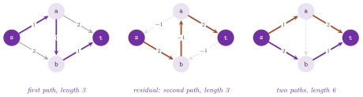

# 10. Shortest paths {#ch-10}

We are concerned in this chapter with the shortest paths of a digraph
$G=(N,A)$, with $n=|N|$ nodes and $m=|A|$ arcs, whose arcs have lengths
$\ell : A\to\mathbb{R}$. The library has five classes for them. `Dijkstra`
(`lemon/dijkstra.h`) computes the shortest paths from a set of sources when
the lengths are nonnegative, and `BidirDijkstra` and `AStar`
(`lemon/bidir_dijkstra.h`, `lemon/astar.h`) compute a shortest path between
two nodes, usually scanning much less of the digraph. `BellmanFord`
(`lemon/bellman_ford.h`) accepts negative lengths and detects the negative
cycles, and `Suurballe` (`lemon/suurballe.h`) finds $k$ arc-disjoint paths of
least total length between two nodes. We first state the problem and the
optimality conditions that all of them rely on ([§10.1](#sec-10-1)), and then
describe the classes in this order.

## 10.1 The problem and its optimality conditions {#sec-10-1}

We define the length of a path $P=(a_1,\dots,a_k)$ as
$\ell(P)=\sum_{i=1}^k \ell(a_i)$. Given a source $s$, the distance of a node
$v$ is
$$
d(v) \;=\; \min\{\,\ell(P) \;:\; P \text{ is a path from } s \text{ to } v\,\}, \tag{10.1}
$$
with $d(v)=+\infty$ if $v$ cannot be reached from $s$. This minimum exists
(and is attained by a path without repeated nodes) if no cycle of negative
length can be reached from $s$; otherwise, the distance of the nodes reachable
from such a cycle is $-\infty$, and a shortest walk does not exist. With
several sources $S$, each with an initial distance $d_0(s)$, the distance of
$v$ is the least value of $d_0(s)+\ell(P)$ over the sources $s$ and the paths
$P$ from $s$ to $v$. All the classes of this chapter find shortest paths by
maintaining tentative distances $d$ and a predecessor arc for each node, and
stop when the following conditions hold.

<span id="thm-10-1"></span>**Theorem 10.1.** *Let $d$ be finite on the nodes
reachable from $s$, with $d(s)=0$, and let it be the length of some path from
$s$ for each of them. Then $d$ is the distance (10.1) if and only if*
$$
d(v) \;\le\; d(u)+\ell(uv) \qquad \text{for each arc } uv \text{ with } u \text{ reachable}. \tag{10.2}
$$
*If, moreover, each node $v\neq s$ has a predecessor arc $uv$ with
$d(v)=d(u)+\ell(uv)$, the predecessor arcs form a tree of shortest paths.*

We refer to [Ahuja, Magnanti and Orlin 1993,
§5.2](Z-bibliography.md#ref-amo93networkflows) for the proof: summing (10.2)
along any path from $s$ to $v$ shows that no path is shorter than $d(v)$.
Equivalently, (10.2) means that the reduced lengths
$$
\ell_\pi(uv) \;=\; \ell(uv)+\pi(u)-\pi(v) \tag{10.3}
$$
are nonnegative for the potential $\pi=d$. Since
$\ell_\pi(P)=\ell(P)+\pi(u)-\pi(v)$ for any path $P$ from $u$ to $v$, a change
of the lengths into reduced lengths changes the length of all the paths
between two given nodes by the same amount, and keeps the shortest ones; we
shall use this fact for A* ([§10.3](#sec-10-3)) and for Suurballe's algorithm
([§10.5](#sec-10-5)). Also, the shortest path problem is the minimum cost flow
problem of [chapter 13](13-min-cost-flow.md#ch-13) in which one unit of flow
is sent from $s$ to each other node, and $d$ is an optimal potential of its
dual.

<span id="tab-10-1"></span>**Table 10.1.** The classes of this chapter, with
the lengths they accept and the cost of a run on a digraph of $n$ nodes and
$m$ arcs ($k$ is the number of paths of `Suurballe`).

| class | lengths | answers | time with the default heap |
|---------------|-------|----------------------------|----------------------------|
| `Dijkstra` | $\ge 0$ | all the distances from a set of sources | $O((n+m)\log n)$ |
| `BidirDijkstra` | $\ge 0$ | one path between two nodes | $O((n+m)\log n)$, usually much less |
| `AStar` | $\ge 0$ | one path between two nodes, with a heuristic | $O((n+m)\log n)$ with a consistent heuristic |
| `BellmanFord` | any | all the distances, or a negative cycle | $O(nm)$ |
| `Suurballe` | $\ge 0$ | $k$ arc-disjoint paths between two nodes | $O(k\,(n+m)\log n)$ |

## 10.2 Dijkstra's algorithm {#sec-10-2}

In the algorithm of [Dijkstra 1959](Z-bibliography.md#ref-dijkstra1959note),
the reached nodes that are not yet processed are kept in a heap, keyed by
their tentative distance. At each step it removes a node of least tentative
distance, declares its distance final, and relaxes its out-arcs, i.e., it
decreases the tentative distance of each target $v$ of an arc $uv$ to
$d(u)+\ell(uv)$ if this is smaller (Algorithm 10.1). With nonnegative lengths,
the nodes are processed in nondecreasing order of distance, and a node removed
from the heap cannot be reached later by a shorter path.

<span id="alg-10-1"></span>**Algorithm 10.1** (Dijkstra's algorithm,
`Dijkstra`).

```
init():
1  for each node v: pred(v) := INVALID; state(v) := PRE_HEAP
addSource(s, d0):
2  push s on H with priority d0
start():
3  while H is not empty:
4     u := the node of least priority in H; d(u) := its priority; pop u   [processed]
5     for each arc a = uv out of u:
6        if v was never in H: push v with priority d(u) + l(a); pred(v) := a
7        else if v is in H and d(u) + l(a) < priority(v):
8           decrease the priority of v to d(u) + l(a); pred(v) := a
```

<span id="thm-10-2"></span>**Theorem 10.2.** *If the lengths are nonnegative,
each node processed by Algorithm 10.1 has its distance from the sources as its
priority when it leaves the heap, and the predecessor arcs of the processed
nodes form a forest of shortest paths. The algorithm performs at most $n$
pushes and pops and at most $m$ decreases of a priority.*

A proof is in [Cormen et al. 2001,
§24.3](Z-bibliography.md#ref-clrs01algorithms); the bound on the operations
holds since each node enters the heap once and each arc is relaxed once, from
its source. Hence, the time depends on the heap (cf. [chapter
7](07-heaps.md#ch-7)): with the `BinHeap` of the default traits, all the
operations take $O(\log n)$ and the search takes $O((n+m)\log n)$, while a
`FibHeap` gives $O(m+n\log n)$ by its decreases in amortized $O(1)$ ([Fredman
and Tarjan 1987](Z-bibliography.md#ref-fredman1987fibonacci)). Note that the
Fibonacci bound is better only in theory for most digraphs of practical size,
the binary heap (or the 4-ary `QuadHeap`) being usually faster; with small
integer lengths, a `RadixHeap` or a `BucketHeap` is perhaps worth a try.

**Template parameters and traits.** `Dijkstra<GR, LEN, TR>` takes the digraph
type `GR` (`ListDigraph` by default), the type `LEN` of the map of the lengths
(by default `GR::ArcMap<int>`), whose `Value` is the type of the distances,
and the traits class `TR`, by default `DijkstraDefaultTraits<GR, LEN>`. These
traits give `OperationTraits`, i.e., the operations on the distances (by
default `DijkstraDefaultOperationTraits<Value>`, with the static `zero()` and
the members `plus()` and `less()` that are the sum and the comparison of the
type), and `HeapCrossRef` and `Heap`, i.e., a `NodeMap<int>` and a `BinHeap`
with `std::less`. They also give the three maps `PredMap` (a `NodeMap<Arc>`),
`DistMap` (a `NodeMap` of the distances) and `ProcessedMap` (a `NullMap`).
Named parameters `SetPredMap<T>`, `SetDistMap<T>`, `SetProcessedMap<T>` and
`SetStandardProcessedMap` change the maps as in [§9.1](09-search.md#sec-9-1).
Moreover, `SetHeap<H, CR>` sets the types of the heap and of its cross
reference map, both of which must then be given by `heap()`;
`SetStandardHeap<H, CR>` sets them for a heap that the algorithm can allocate
(one whose constructor takes the cross reference map, which takes the
digraph). Finally, `SetOperationTraits<T>` replaces the operations.

**Operations on the distances.** In the algorithm, the priority of a node is
computed by `plus()` and two priorities are compared by `less()`, the sources
starting from `zero()`. Other operations give other problems, provided that
the length of a path does not decrease when an arc is appended to it, which is
the property that Theorem 10.2 needs. For instance, `plus()` defined as the
maximum gives the paths of least bottleneck, i.e., the paths whose longest arc
is as short as possible, which the example at the end of this section
computes. Note that the heap still orders the priorities by the comparison of
its type (`std::less` in the default traits), which must agree with `less()`.

!!! note "abLEMON"
    `Dijkstra` (and `BellmanFord`, [§10.4](#sec-10-4)) keep an object of their
    operation traits class, default constructed or given by
    `operationTraits(ops)`, and call its members `plus()` and `less()`; hence,
    the operations may depend on the instance, e.g., on a tolerance stored in
    the object. In LEMON 1.3.1 they were static functions of the traits class.

**Interface.** Its constructor takes the digraph and the length map, and its
setters are `lengthMap(m)`, `operationTraits(ops)` (with the reader
`operationTraits()`), `predMap(m)`, `distMap(m)`, `processedMap(m)` and
`heap(hp, cr)`; the maps and the heap not given are allocated by `init()` and
deleted by the destructor. Its execution control is made of `init()`,
`addSource(s, dst)`, `processNextNode()`, `nextNode()`, `emptyQueue()` and
`queueSize()`, the three forms of `start()`, and `run(s)` and `run(s, t)`.

A call `addSource(s, dst)` adds a source with the initial distance `dst`
(`zero()` by default). It pushes `s` if it is not in the heap; if `s` is
already in the heap with a priority less than `dst`, it sets the priority to
`dst` and the predecessor of `s` to `INVALID`. This is the behavior that the
documentation describes, and it matters only if a source is added twice; we
remark that it raises the priority, and that a node already processed is
pushed again. The sources are therefore better added once each, after `init()`
and before `start()`. Then `start()` processes the nodes until the heap is
empty, while `start(t)` processes them until `t` is on the top of the heap,
then writes the distance of `t`, marks it processed and pops it without
relaxing its arcs; `run(s, t)` does `init()`, `addSource(s)` and `start(t)`,
and returns whether `t` was processed. Similarly, `start(nm)` stops when a
node with `nm` true is on the top of the heap, writes its distance and marks
it processed (in the `ProcessedMap`, while it stays in the heap), and returns
it, or returns `INVALID` if the heap empties first.

Its queries are `dist(v)`, `predArc(v)`, `predNode(v)`, `path(t)` (a path
dumper, cf. [§8.1](08-auxiliary.md#sec-8-1)), `distMap()`, `predMap()`,
`reached(v)` (whether $v$ has been in the heap) and `processed(v)` (whether it
has left it). The distance is written into the `DistMap` only when a node is
processed; hence, `dist(v)` is undefined for a node that is reached but not
processed, and for such a node, `currentDist(v)` returns its priority in the
heap, i.e., an upper bound on its distance that may still decrease.

**Function-type interface.** Finally, `dijkstra(g, length)` returns a
`DijkstraWizard`, whose named function parameters are `predMap(m)`,
`distMap(m)`, `processedMap(m)`, `path(p)` and `dist(d)`, and whose runs are
`run(s)` and `run(s, t)`. The latter returns whether `t` is reached and fills
the path and the distance, as in [§9.4](09-search.md#sec-9-4); the base class
`DijkstraWizardBase` holds the parameters.

The following program, first, runs Dijkstra's algorithm on a grid and checks
the distances against (10.2). Then it uses two sources, the function-type
interface and the operations of the least bottleneck. Finally, it compares the
results with those of the two point-to-point searches of the next section.

```cpp
--8<-- "examples/10-dijkstra.cc"
```

## 10.3 Shortest paths between two nodes {#sec-10-3}

When only the path from a source $s$ to a target $t$ is wanted,
`Dijkstra::run(s, t)` stops when $t$ is processed, but it still processes all
the nodes closer to $s$ than $t$. Both classes of this section usually scan
far fewer nodes. Both have nonnegative lengths, both answer any number of
queries with one object, each by a call `run(s, t)` that returns whether $t$
is reachable from $s$, and both give the result by `dist()` and `path()` (a
`lemon::Path`, empty when $s=t$). Their node maps are allocated once, by the
constructor; each run resets only the nodes that the previous run touched, and
its time is therefore proportional to the part of the digraph that it scans
(times the logarithm of the size of the heap). Their heap is a `BinHeap` by
default. The named parameter `SetHeap<H, CR>` replaces it by a heap of type
`H` with a cross reference map of type `CR` (a `NodeMap<int>` by default), as
in `SetHeap<FibHeap<int, IntNodeMap>>::Create`.

!!! note "abLEMON"
    `BidirDijkstra` and `AStar` are new in abLEMON (from trac #249 and #376 of
    LEMON), and take the type of their heap from a traits class
    (`BidirDijkstraDefaultTraits`, `AStarDefaultTraits`) through `SetHeap`.

**Bidirectional search.** `BidirDijkstra<GR, LEN, TR>` runs two searches of
Dijkstra ([Pohl 1971](Z-bibliography.md#ref-pohl1971bidirectional)), a forward
one from $s$ along the arcs and a backward one from $t$ against them, with
tentative distances $d_f$ and $d_b$. At each step it advances the search whose
least priority is smaller. Each arc $uv$ scanned by one search whose other end
has been seen by the other search gives a path from $s$ to $t$, of length
$d_f(u)+\ell(uv)+d_b(v)$, and the algorithm keeps the shortest one found, of
length $\mu$. It stops as soon as
$$
\min_{H_f} d_f \;+\; \min_{H_b} d_b \;\ge\; \mu, \tag{10.4}
$$
where $H_f$ and $H_b$ are the heaps of the two searches (Algorithm 10.2).

<span id="alg-10-2"></span>**Algorithm 10.2** (Bidirectional Dijkstra,
`BidirDijkstra::run(s, t)`).

```
1  if s = t: return true with the empty path
2  push s on Hf and t on Hb with priority 0; mu := +inf
3  while Hf and Hb are not empty:
4     if a path was found and min(Hf) + min(Hb) >= mu: stop
5     choose the search X with the smaller least priority, and Y the other one
6     u := pop the top of X
7     for each arc a of u (out-arcs if X is forward, in-arcs if backward), w its other end:
8        relax w in X with d_X(u) + l(a), as in Algorithm 10.1
9        if w has been seen by Y and d_X(u) + l(a) + d_Y(w) < mu:
10          mu := d_X(u) + l(a) + d_Y(w); meet := a
11 if no path was found: return false
12 path := the forward tree to meet, meet, the backward tree from meet
```

<span id="thm-10-3"></span>**Theorem 10.3.** *With nonnegative lengths, when
(10.4) holds the value $\mu$ is the distance from $s$ to $t$, and the path
built at line 12 has length $\mu$.*

Its proof is short. Let $\delta(x,y)$ be the distance from $x$ to $y$, and
suppose that a path $P$ from $s$ to $t$ has $\ell(P)<\mu$ when (10.4) holds.
Then each node $x$ of $P$ has $\delta(s,x)<\min_{H_f} d_f$ or
$\delta(x,t)<\min_{H_b} d_b$, i.e., it has been processed by one of the two
searches, with its final distance. Hence, $P$ has an arc $uv$ with $u$
processed by the forward search and $v$ by the backward one; the search that
processed the second of them scanned $uv$ and set
$\mu\le d_f(u)+\ell(uv)+d_b(v)\le\ell(P)$ at line 10, a contradiction. In
practice, the two searches meet roughly halfway; on a digraph in which the
number of nodes within distance $r$ grows quickly with $r$ (as in a road
network, roughly as $r^2$), they scan far fewer nodes than one search from
$s$. Its template parameters are `GR`, `LEN` (by default `GR::ArcMap<int>`)
and `TR` (by default `BidirDijkstraDefaultTraits<GR, LEN>`), and the backward
search needs the in-arcs of the digraph. Its internal record `Search` holds
the distances, the predecessors, the cross reference map and the heap of one
search.

**Search guided by a heuristic.** `AStar<GR, LEN, HM, TR>` runs a search of
Dijkstra from $s$ in which the priority of a node is its tentative distance
plus a heuristic value $h(v)$, an estimate of its distance $\delta(v,t)$ to
$t$, given by a node map of type `HM` with the value type of the lengths
([Hart, Nilsson and Raphael 1968](Z-bibliography.md#ref-hart1968formal)). The
search stops when $t$ is removed from the heap (Algorithm 10.3). Such a
heuristic is admissible if
$$
h(v) \;\le\; \delta(v,t) \qquad \text{for each node } v, \tag{10.5}
$$
and consistent if
$$
h(u) \;\le\; \ell(uv)+h(v) \qquad \text{for each arc } uv. \tag{10.6}
$$
A consistent heuristic with $h(t)=0$ is admissible, and with it the reduced
lengths $\ell(uv)-h(u)+h(v)$ (i.e., (10.3) with $\pi=-h$) are nonnegative.
Hence, A* is then Dijkstra's algorithm on the reduced lengths, which keep the
shortest paths, and it scans each node at most once. With a heuristic that is
everywhere zero, it is Dijkstra's algorithm stopped at $t$. The closer $h$ is
to $\delta(\cdot,t)$, the fewer nodes it scans; on a road network, the
straight-line distance to $t$ is a typical choice.

<span id="alg-10-3"></span>**Algorithm 10.3** (A*, `AStar::run(s, t)`).

```
1  g(s) := 0; push s on H with priority h(s)
2  while H is not empty:
3     u := pop the top of H; scanned := scanned + 1
4     if u = t: return true with the path of the predecessor arcs from s to t
5     for each arc a = uv out of u:
6        if v was never seen: g(v) := g(u) + l(a); pred(v) := a; push v with g(v) + h(v)
7        else if g(u) + l(a) < g(v):
8           g(v) := g(u) + l(a); pred(v) := a
9           decrease v to g(v) + h(v) if it is in H, else push it again
10 return false
```

<span id="thm-10-4"></span>**Theorem 10.4.** *If the lengths are nonnegative
and the heuristic is admissible, $g(t)$ is the distance from $s$ to $t$ when
$t$ is removed from the heap. If the heuristic is consistent, no node is
pushed again at line 9.*

We refer to [Hart, Nilsson and Raphael
1968](Z-bibliography.md#ref-hart1968formal) for the first statement; the
second follows from the remark on the reduced lengths above. With an
admissible heuristic that is not consistent, a node whose distance improves
after its scan is pushed again (line 9) and scanned again. Its query
`scanned()` returns the number of scans of the last run, a node scanned twice
being counted twice. Note that the heuristic must be admissible for the target
of each run; since the map is read through a reference, its values may be
changed between two runs with different targets. We remark that `AStar` has no
default for the type of the length map, and that its heap is ordered by the
priorities $g+h$.

## 10.4 The Bellman-Ford algorithm {#sec-10-4}

In the algorithm of [Bellman 1958](Z-bibliography.md#ref-bellman1958routing)
and [Ford 1956](Z-bibliography.md#ref-ford1956network), negative lengths are
allowed. It proceeds by rounds, each of which relaxes the out-arcs of the
nodes whose distance changed in the previous round, the active nodes
(Algorithm 10.4); with no negative cycle reachable from the sources, at most
$n-1$ rounds change a distance. Thus, the algorithm takes $O(nm)$ time in the
worst case, and much less in practice when the active nodes are few. If a
negative cycle is reachable from the sources, the rounds never end, and a
cycle of negative length appears among the predecessor arcs.

<span id="alg-10-4"></span>**Algorithm 10.4** (Bellman-Ford by rounds of the
active nodes, `BellmanFord`).

```
init(value):
1  for each node v: pred(v) := INVALID; d(v) := value
2  active := all the nodes if value < infinity, else none
addSource(s, d0):
3  d(s) := d0; add s to active
processNextWeakRound():
4  next := empty
5  for each node u in active, for each arc a = uv out of u:
6     if d(u) + l(a) < d(v): d(v) := d(u) + l(a); pred(v) := a; add v to next
7  active := next; return (active is empty)
start():         repeat processNextWeakRound() at most n - 1 times, until it returns true
checkedStart():  the same at most n times; return (active is empty)
```

`processNextWeakRound()` reads the current distance $d(u)$ at line 6, which
may already have been decreased in the same round. In `processNextRound()`,
instead, the distances of the active nodes are copied at the beginning of the
round and read from the copy, which keeps the rounds exact in the following
sense.

<span id="thm-10-5"></span>**Theorem 10.5.** *After $k$ calls of
`processNextRound()` from a single source $s$, $d(v)$ is the least length of a
path from $s$ to $v$ with at most $k$ arcs, for each node $v$; after $k$ calls
of `processNextWeakRound()`, $d(v)$ is at most that length. If no negative
cycle is reachable from $s$, the active set is empty after at most $n$ rounds
of either kind, and $d$ is then the distance (10.1).*

A proof is in [Ahuja, Magnanti and Orlin 1993,
§5.4](Z-bibliography.md#ref-amo93networkflows). Hence, `start()` performs at
most $n-1$ weak rounds and stops early when one changes no distance, and
`checkedStart()` performs at most $n$ and returns `false` if some node is
still active, which means that a negative cycle is reachable from the sources.
On the other hand, `limitedStart(num)` performs at most `num` exact rounds,
and computes the distances of the paths of at most `num` arcs (the predecessor
arcs, however, do not form such paths in general, as the documentation warns).
Also, `run(s)` and `run(s, num)` are `init()` and `addSource(s)` followed by
`start()` and `limitedStart(num)`.

Its other members are those of `Dijkstra`, with a few differences. Its
template parameters `GR`, `LEN` and `TR` default to `ListDigraph`,
`GR::ArcMap<int>` and `BellmanFordDefaultTraits<GR, LEN>`, and the named
parameters are `SetPredMap<T>`, `SetDistMap<T>` and `SetOperationTraits<T>`.
Its default operation traits `BellmanFordDefaultOperationTraits<V>` have,
besides `zero()`, `plus()` and `less()`, a static `infinity()`, the infinity
of `V` if it has one and its largest value otherwise; in the latter case
`plus()` returns the largest value if one of its terms is that value, and an
unreached node thus keeps its distance. The call `init(value)` gives all the
nodes the distance `value` (`infinity()` by default). If `value` is finite,
all the nodes are active; this computes the least lengths of the paths that
may start anywhere, and is the usual way of looking for a negative cycle
anywhere in the digraph (e.g., `init(0)` followed by `checkedStart()`). Then
`addSource(s, dst)` sets the distance of `s` to `dst` (`zero()` by default)
and makes it active.

Its queries are `dist(v)`, `predArc(v)`, `predNode(v)`, `path(t)`,
`distMap()`, `predMap()` and `reached(v)`, which is true if the distance of
$v$ is not `infinity()`. Furthermore, the iterator `ActiveIt`, and the range
`activeNodes()`, list the active nodes after the last round. Finally,
`negativeCycle()` follows the predecessor arcs back from the active nodes and
returns, as a `lemon::Path`, the first cycle of predecessor arcs that it
meets, or an empty path if it meets none. A cycle of predecessor arcs created
by the relaxations always has negative length ([Ahuja, Magnanti and Orlin
1993, §5.5](Z-bibliography.md#ref-amo93networkflows)). It may be called at any
time, e.g., after each round, and returns a cycle as soon as the predecessor
arcs reached from the active nodes contain one. The function
`bellmanFord(g, length)` returns a `BellmanFordWizard`, with the named
function parameters `predMap(m)`, `distMap(m)`, `path(p)` and `dist(d)`. Its
runs are `run(s)` and `run(s, t)`, the latter running `run(s)` in full and
then reading the path and the distance of `t`.

!!! note "abLEMON"
    `BellmanFord` keeps the maps it allocates in a `std::unique_ptr`, apart
    from the pointers through which it reads them, and a map given by the user
    is therefore never deleted; LEMON 1.3.1 could delete one. Like `Dijkstra`,
    it keeps an object of its operation traits, set by `operationTraits(ops)`
    and read by `operationTraits()`; the test `test/bellman_ford_test.cc` uses
    one whose comparison has a tolerance, for which an improvement within the
    tolerance is no improvement.

In the following program we compute the distances with negative lengths and
check them against (10.2). Then we compute the distances of the paths of at
most two arcs, and find a negative cycle.

```cpp
--8<-- "examples/10-bellman-ford.cc"
```

## 10.5 Arc-disjoint paths of least total length {#sec-10-5}

Given two nodes $s\neq t$ and an integer $k$, the problem is to find $k$ paths
from $s$ to $t$ that have no arc in common and the least total length. It is
the minimum cost flow problem
$$
\min\Big\{\sum_{a\in A}\ell(a)\,x_a \;:\; \sum_{a\in\delta^+(v)}x_a-\sum_{a\in\delta^-(v)}x_a = k\,[v=s]-k\,[v=t]\ \ \forall v\in N,\ \ x\in\{0,1\}^A\Big\}, \tag{10.7}
$$
where $\delta^+(v)$ and $\delta^-(v)$ are the arcs out of and into $v$, and
$[\cdot]$ is 1 if the condition holds and 0 otherwise. An optimal $x$ is the
union of $k$ arc-disjoint paths (and possibly of cycles of length zero, which
the decomposition below does not use). Note that the shortest path followed by
a second shortest path that avoids its arcs is not optimal in general; in
Figure 10.1, the shortest path $s,a,b,t$ leaves no second path at all. Thus,
the algorithm of [Suurballe
1974](Z-bibliography.md#ref-suurballe1974disjoint), in the form of [Suurballe
and Tarjan 1984](Z-bibliography.md#ref-suurballe1984quick), is the successive
shortest path algorithm for (10.7). At iteration $i$ it finds a shortest path
from $s$ to $t$ in the residual digraph of the flow $x$ of $i-1$ paths, which
has
$$
\text{an arc } uv \text{ of length } \ell(uv) \text{ for each } uv \text{ with } x_{uv}=0, \qquad \text{an arc } vu \text{ of length } -\ell(uv) \text{ for each } uv \text{ with } x_{uv}=1, \tag{10.8}
$$
and sends one unit of flow along it, i.e., it sets $x$ to 1 on its forward
arcs and to 0 on the arcs whose reverse it uses (Algorithm 10.5).

{#fig-10-1}

This residual digraph has negative lengths, but with the potentials $\pi$ kept
by the algorithm the reduced lengths (10.3) of its arcs are nonnegative, and
each path can therefore be found by Dijkstra's algorithm. After each search,
the potential of each node processed by it is increased by its distance minus
the distance of $t$, which keeps the reduced lengths of the residual arcs
nonnegative and those of the arcs of the new path zero.

<span id="alg-10-5"></span>**Algorithm 10.5** (Successive shortest paths with
potentials, `Suurballe::findFlow(t, k)`).

```
1  x := 0; pi := 0; i := 0
2  while i < k:
3     run Dijkstra from s on the residual digraph (10.8) with the reduced lengths (10.3),
      stopping when t leaves the heap
4     if t is not reached: stop
5     for each node v processed: pi(v) := pi(v) + dist(v) - dist(t)
6     push one unit along the path found: x := 1 on its forward arcs, 0 on the reversed ones
7     i := i + 1
8  return i
```

<span id="thm-10-6"></span>**Theorem 10.6.** *After $i$ iterations, $x$ is an
optimal solution of (10.7) with $k=i$, and*
$$
x_{uv}=0 \;\Rightarrow\; \ell_\pi(uv)\ge 0, \qquad x_{uv}=1 \;\Rightarrow\; \ell_\pi(uv)\le 0 \qquad \text{for each arc } uv. \tag{10.9}
$$
*If the loop stops at line 4, there are no $i+1$ arc-disjoint paths from $s$
to $t$.*

Conditions (10.9) are the complementary slackness conditions of (10.7), which
prove the optimality of $x$ (cf. [chapter 13](13-min-cost-flow.md#ch-13)); for
the proof that the algorithm maintains them, see [Suurballe and Tarjan
1984](Z-bibliography.md#ref-suurballe1984quick) or [Ahuja, Magnanti and Orlin
1993, §9.7](Z-bibliography.md#ref-amo93networkflows). Each iteration is one
search of Dijkstra (rather cheap, since it may stop at $t$), which gives
$O(k\,(n+m)\log n)$ time with the binary heap; the first one runs on the
lengths, since all the potentials are zero, and the potentials of the nodes
that it does not process stay zero. Then the paths are extracted from $x$ by
`findPaths()`, which follows from $s$ the arcs of unit flow not yet used, in
$O(km)$ time at most. Also, the node-disjoint version of the problem is solved
by the same class on the digraph of the adaptor `SplitNodes` of [chapter
5](05-adaptors.md#ch-5), in which each node is split into an arc of capacity
one.

**Interface.** `Suurballe<GR, LEN, TR>` takes the digraph type, the type of
the length map (by default `GR::ArcMap<int>`) and the traits class, by default
`SuurballeDefaultTraits<GR, LEN>`. These traits give `FlowMap` (an
`ArcMap<int>`), `PotentialMap` (a `NodeMap` of the lengths), `Path` (a
`lemon::Path`, or any path type with `addBack()`), and the `HeapCrossRef` and
the `Heap` (a `BinHeap`) of the internal searches; the named parameters
`SetFlowMap<T>`, `SetPotentialMap<T>`, `SetPath<T>` and `SetHeap<H, CR>`
change them. Its constructor takes the digraph and the lengths, which must be
nonnegative. The setters `flowMap(m)` and `potentialMap(m)` set the maps of
the flow and of the potentials (allocated otherwise).

A call `run(s, t, k)` is `init(s)` followed by `start(t, k)`, with $k=2$ by
default, and returns the number of paths found, i.e., $k$ if there are at
least $k$ arc-disjoint paths, and their largest number otherwise. In turn,
`start(t, k)` is `findFlow(t, k)` (Algorithm 10.5) followed by `findPaths()`.
If the paths from one source to many targets are needed, `fullInit(s)`
replaces `init(s)`: it runs one complete search of Dijkstra from `s` on the
lengths, which then serves as the first iteration of each subsequent
`start(t, k)`; each of them thus runs only $k-1$ searches, and returns 0
when `t` cannot be reached from `s`, as it does after `init(s)`.

!!! note "abLEMON"
    In LEMON 1.3.1, after `fullInit(s)`, `findFlow(t, k)` took the first path
    from the complete search without checking that `t` was reached, counted
    one path for a target that cannot be reached, and `findPaths()` then did
    not end; the test `suurballe_test` checks such a target.

Its queries are `totalLength()` (the length of the flow, computed in $O(m)$),
`flow(a)` and `flowMap()`, `potential(v)` and `potentialMap()` (an optimal
dual solution, i.e., potentials that satisfy (10.9) with the flow),
`pathNum()` and `path(i)` for $i$ from 0 to `pathNum()` $-1$.

In the last program of the chapter we solve the instance of Figure 10.1, check
that the two paths are arc-disjoint and that the flow and the potentials
satisfy (10.9), and look for a third path, which does not exist.

```cpp
--8<-- "examples/10-suurballe.cc"
```

## 10.6 Exercises {#sec-10-6}

<span id="ex-10-1"></span>**Exercise 10.1.** Show by an example that
Dijkstra's algorithm may give a wrong distance when one arc has a negative
length, although no cycle is negative, and check the example against
`BellmanFord`. (The test `test/dijkstra_test.cc` exercises the interface of
`Dijkstra`.)

<span id="ex-10-2"></span>**Exercise 10.2.** Compute the paths of least
bottleneck of a digraph with the operation traits of the example
`examples/10-dijkstra.cc`, and prove that Theorem 10.2 holds for them; then
show that the maximum of the arc lengths along a path is not decreased by
appending an arc, which is the property used.

<span id="ex-10-3"></span>**Exercise 10.3.** Compare the number of nodes
scanned by `Dijkstra::run(s, t)`, by `BidirDijkstra` and by `AStar` with the
Manhattan distance on a grid of $100\times 100$ nodes with random lengths at
least 1, for random pairs of nodes. (The test `test/point_to_point_test.cc`
checks the two point-to-point classes against `Dijkstra`, with heuristics that
are zero, exact, half the exact one, and admissible but not consistent.)

<span id="ex-10-4"></span>**Exercise 10.4.** Find a negative cycle anywhere in
a digraph by `init(0)` and `checkedStart()` of `BellmanFord`, and explain why
`init(0)` is equivalent to adding a new source joined to each node by an arc
of length zero. (The example `examples/10-bellman-ford.cc` and the test
`test/bellman_ford_test.cc` find negative cycles.)

<span id="ex-10-5"></span>**Exercise 10.5.** Use `Suurballe` on the digraph of
`SplitNodes` to find two node-disjoint paths of least total length, and verify
that they share no inner node. (The test `test/suurballe_test.cc` checks the
flow, the potentials and the paths.)

<span id="ex-10-6"></span>**Exercise 10.6.** Show that the potentials returned
by `Suurballe` after $k$ paths satisfy (10.9), and that $\pi(t)-\pi(s)$ is the
length, in the residual digraph (10.8), of the last path found, by running the
example `examples/10-suurballe.cc` with $k=1$ and $k=2$.
