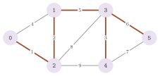
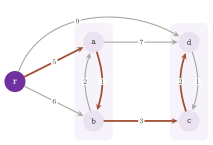

# 11. Spanning trees and arborescences {#ch-11}

We are concerned in this chapter with two problems of choosing a cheapest set
of arcs that connects the nodes of a graph. The first one is the minimum
spanning tree of an undirected graph, which `kruskal()` of `lemon/kruskal.h`
solves by Kruskal's algorithm on a union-find structure
([§8.2](08-auxiliary.md#sec-8-2)). Its directed counterpart, the second one,
is the minimum cost arborescence of a digraph rooted at a given node;
`MinCostArborescence` of `lemon/min_cost_arborescence.h` solves it by the
algorithm of Chu, Liu and Edmonds, and also gives an optimal dual solution,
which proves the optimality of the arborescence. The two problems look alike;
however, the greedy choice that solves the first is not enough for the second,
whose algorithm has to contract cycles (cf. Figure 11.2).

## 11.1 Minimum spanning trees {#sec-11-1}

Let $G=(N,E)$ be an undirected graph with $n=|N|$ nodes, $m=|E|$ edges and
costs $c : E\to\mathbb{R}$ on the edges, and let $N_1,\dots,N_p$ be the node
sets of its connected components. A *spanning forest* of $G$ is a set
$T\subseteq E$ of edges that contains no cycle and connects the nodes of each
$N_i$; it has $n-p$ edges, and it is a spanning tree when $G$ is connected
($p=1$). We consider the problem
$$
\min\Big\{\, c(T)=\sum_{e\in T} c(e) \;:\; T \text{ is a spanning forest of } G \,\Big\}, \tag{11.1}
$$
which, on a connected graph, is the minimum spanning tree problem, and on any
other graph is that of a minimum spanning tree of each component. For a
spanning forest $T$ and an edge $f\notin T$, the two ends of $f$ lie in the
same component, and we let $P_T(f)$ be the (unique) path of $T$ between them;
a loop $f$ has $P_T(f)=\emptyset$. For an edge $e\in T$, the forest
$T\setminus\{e\}$ splits the component of $e$ into two node sets, and we let
$C_T(e)$ be the set of the edges of $G$ with one end in each of them (the
*fundamental cut* of $e$). The two objects describe the same pairs of edges.

<span id="lem-11-1"></span>**Lemma 11.1.** *Let $T$ be a spanning forest,
$e\in T$ and $f\in E\setminus T$. Then $e\in P_T(f)$ if and only if
$f\in C_T(e)$, and, in this case, $T'=(T\setminus\{e\})\cup\{f\}$ is a
spanning forest with $c(T')=c(T)-c(e)+c(f)$.*

*Proof.* Let $U$ and $W$ be the two node sets into which $T\setminus\{e\}$
splits the component of $e$. If $f$ has one end in $U$ and one in $W$, the
path of $T$ between its ends must cross from $U$ to $W$, which only $e$ does;
hence, $e\in P_T(f)$. Conversely, if $e\in P_T(f)$, removing $e$ cuts this
path into a part in $U$ and a part in $W$, and the two ends of $f$ are
therefore on opposite sides. In this case, $T\setminus\{e\}$ has one component
more than $T$, and $f$ joins two of its components ($U$ and $W$); hence, $T'$
has no cycle and the same components as $T$, i.e., it is a spanning forest,
and its cost is obvious. $\square$

<span id="thm-11-1"></span>**Theorem 11.1.** *A spanning forest $T$ is optimal
for (11.1) if and only if*
$$
c(f) \;\ge\; c(e) \qquad \text{for each } f\notin T \text{ and each } e\in P_T(f), \tag{11.2}
$$
*or, equivalently, if and only if*
$$
c(e) \;\le\; c(f) \qquad \text{for each } e\in T \text{ and each } f\in C_T(e). \tag{11.3}
$$

*Proof.* By Lemma 11.1, (11.2) and (11.3) are the same set of inequalities,
written once by the edges out of the forest and once by the edges in it. If
(11.2) fails for some $f$ and $e\in P_T(f)$, the forest $T'$ of Lemma 11.1
costs $c(T)-c(e)+c(f)<c(T)$, and $T$ is not optimal. Conversely, let $T$
satisfy (11.3), and among the optimal forests let $T^*$ be one with the
largest $|T\cap T^*|$. If $T\neq T^*$, since both have $n-p$ edges, there is
an edge $e\in T\setminus T^*$. Its ends are joined by the path $P_{T^*}(e)$,
which, together with $e$, is a cycle; this cycle crosses the cut $C_T(e)$ once
through $e$, and must therefore cross it at least once more, through an edge
$f\neq e$ of $P_{T^*}(e)$. The only edge of $T$ in $C_T(e)$ is $e$; hence,
$f\notin T$, and $c(e)\le c(f)$ by (11.3). By Lemma 11.1 applied to $T^*$ and
the pair $f\in T^*$, $e\notin T^*$ (indeed $f\in P_{T^*}(e)$), the forest
$(T^*\setminus\{f\})\cup\{e\}$ costs at most $c(T^*)$, and is therefore
optimal, and it has one more edge in common with $T$ than $T^*$, a
contradiction. Thus, $T=T^*$ is optimal. $\square$

Kruskal's algorithm ([Kruskal
1956](Z-bibliography.md#ref-kruskal1956shortest)) builds a forest that
satisfies (11.2) greedily. It scans the edges in nondecreasing order of cost,
and keeps an edge if it joins two different components of the forest of the
edges kept so far, i.e., if it closes no cycle. The components are the classes
of a union-find structure on the nodes, and the test and the union are one
call of `join()` (Algorithm 11.1, where $\mathit{out}$ is the output of the
function and $\mathit{total}$ its value).

<span id="alg-11-1"></span>**Algorithm 11.1** (Kruskal's algorithm,
`kruskal()`).

```
1  if the costs are given as a map: list the pairs (e, c(e)) of all the edges
                                    and sort them by nondecreasing c(e)
2  make a union-find structure with one class {v} per node v; total := 0
3  for each pair (e, c(e)) in the order of the list, with e = uv:
4     if join(u, v):                    [u and v were in different classes]
5        out(e) := true; total := total + c(e)
6     else: out(e) := false
7  return total
```

<span id="thm-11-2"></span>**Theorem 11.2.** *If the list scanned by
Algorithm 11.1 holds every edge of $G$ in nondecreasing order of cost, the
edges $T$ with $\mathit{out}(e)=\mathit{true}$ form an optimal solution of
(11.1), and the value returned is $c(T)$. For a list in any other order (or
holding only some of the edges), $T$ is a spanning forest of the graph of the
edges of the list, i.e., one with no cycle and whose components are those of
that graph.*

*Proof.* At each step, the classes of the union-find structure are the node
sets of the components of the forest $(N,T)$ kept so far: this is true at the
start, and `join()` (Algorithm 8.1) unites the classes of $u$ and $v$ exactly
when the edge $uv$ is kept. An edge is kept only if its ends are in different
components, and therefore closes no cycle; an edge is discarded only if its
ends are already in the same component, which they remain. Hence, at the end,
$T$ has no cycle and connects the ends of each edge of the list, i.e., it is a
spanning forest of the graph of the list. If the list is sorted and complete,
let $f$ be a discarded edge. When it was scanned, its ends were joined by a
path of edges kept before it, which is $P_T(f)$ (a forest has one path between
two nodes) and whose edges cost at most $c(f)$, since they come earlier in the
list. Thus, (11.2) holds, and $T$ is optimal by Theorem 11.1. The value is the
sum of the costs of the kept edges, by step 5. $\square$

<span id="thm-11-3"></span>**Theorem 11.3.** *Algorithm 11.1 takes
$O(m\log m)$ time when the costs are given as a map, and
$O(n+m\,\alpha(m,n))$ time when they are given as a sorted list of $m$
pairs.*

*Proof.* Listing the pairs takes $O(m)$ and `std::sort` takes $O(m\log m)$.
The rest makes $n$ insertions and $m$ calls of `join()`, each made of two
finds and at most one union, which take $O(n+m\,\alpha(m,n))$ in all by
Theorem 8.2. Since $\alpha(m,n)\le\log m$ for $m\ge 2$, the sort dominates in
the first case. $\square$

Note that the loop scans all the edges of the list even after the forest is
complete, since the output receives a value for each of them; however, the
work after the last useful edge is only one `join()` per edge. Of course, when
the costs come already sorted (e.g., from a previous run), passing them as a
list saves the sort, which is usually the dominating cost.

**Interface.** Function `kruskal(g, in, out)` accepts various types for its
arguments, and returns the cost of the forest found, of the type of the costs.
Its graph `g` may be undirected, with the costs on its edges, or directed, in
which case the arcs are taken as edges (the union-find structure joins the
target and the source of each arc) and their direction is disregarded. Its
costs `in` may be given either (i) as a readable map on the edges (or arcs),
whose values are the costs, or (ii) as an STL container of pairs
`std::pair<GR::Edge, C>` (or `std::pair<GR::Arc, C>`), where `C` is the type
of the costs. In case (i), the function collects the pairs of each item and
its cost into a vector, and sorts it by cost with `std::sort`. In case (ii),
the pairs must already be sorted by nondecreasing cost, since no sort is done
(Theorem 11.2 gives what is computed otherwise), and an edge that is not in
the container receives no value in `out`.

Its output `out` may also be given in two ways. It may be (i) a writable map
on the edges with `bool` values, which receives `true` for the edges of the
forest and `false` for the others, each edge of the list being written once.
Alternatively, it may be (ii) an output iterator, e.g.,
`std::back_inserter(tree)`, into which the edges of the forest are copied in
the order in which they are found; the function wraps it in a `LoggerBoolMap`
(cf. [chapter 6](06-maps.md#ch-6)), which copies the keys set to `true` and
ignores the others. A second overload takes `out` by constant reference, so
that a temporary iterator may be passed. The choice among the forms is made at
compile time by the helper templates of the namespace `_kruskal_bits`, which
are not part of the interface: `KruskalValueSelector`, `KruskalInputSelector`,
`KruskalOutputSelector`, `SequenceInputIndicator`, `MapInputIndicator`,
`SequenceOutputIndicator`, `MapOutputIndicator`, `RemoveConst` and
`PairComp`. They take an input for a sequence if its `value_type` has a
`first_type`, and for a map if it has a type `Value`; an output is taken for a
sequence (an iterator) if it has a `value_type`, and for a map if it has a
`Value`.

Figure 11.1 shows the tree that the program of this section computes. Its
edges, sorted by cost, are kept in the order 1, 2, 3, 5, 6, while the edges of
cost 4, 7, 8 and 9 close cycles. Each of the latter costs at least as much as
every edge of the path of the tree between its ends, as (11.2) requires.

{#fig-11-1}

The program `manual/examples/11-kruskal.cc` (the test `manual_11_kruskal`)
computes the tree of Figure 11.1 twice, with a cost map in and a `bool` map
out, and then with a sorted vector of pairs in and an output iterator out. It
checks the cost, the number of edges and the condition (11.2), the latter by a
breadth-first search of the path of the tree between the ends of each edge out
of the tree, on the graph of the adaptor `FilterEdges` ([chapter
5](05-adaptors.md#ch-5)).

## 11.2 Minimum cost arborescences {#sec-11-2}

Let $G=(N,A)$ be a digraph with costs $c : A\to\mathbb{R}$, and let
$S\subseteq N$ be a nonempty set of *sources* (one root $r$ in the simplest
case), and $R\supseteq S$ the set of the nodes reachable from $S$. For
$X\subseteq N$, we write $\delta^-(X)$ for the set of the arcs with their
head in $X$ and their tail out of $X$ (so that a loop enters no set), and
$\delta^-(v)$ for $\delta^-(\{v\})$. An *arborescence* of $R$ rooted at $S$ is
a set $B$ of arcs with both ends in $R$ such that
$$
|B\cap\delta^-(v)|=1 \ \text{ for each } v\in R\setminus S, \qquad |B\cap\delta^-(s)|=0 \ \text{ for each } s\in S, \tag{11.4}
$$
and each node of $R$ is reachable from $S$ along the arcs of $B$. With one
source $r$, it is a spanning tree of $R$ whose arcs are directed away from
$r$, and with several it is a union of such trees, one per source, that
reaches all of $R$. We look for one of least cost $c(B)=\sum_{a\in B}c(a)$.
Choosing the cheapest arc entering each node, which would mirror the greedy
algorithm of the undirected case, may give cycles: in Figure 11.2, the
cheapest arcs entering $a$ and $b$ form the cycle $a,b,a$. The optimality of
an arborescence is proved instead by a family $\mathcal F$ of subsets of
$R\setminus S$ with a value $y_X$ on each set $X\in\mathcal F$ (a solution of
the dual of the linear program of the problem, [Edmonds
1967](Z-bibliography.md#ref-edmonds1967optimum)), through the *reduced costs*
$$
c'(a) \;=\; c(a) \;-\; \sum_{X\in\mathcal F \,:\, a\in\delta^-(X)} y_X \qquad (a\in A). \tag{11.5}
$$

<span id="lem-11-2"></span>**Lemma 11.2.** *Let $\mathcal F$ be a family of
nonempty subsets of $R\setminus S$ and $y:\mathcal F\to\mathbb R$ be such
that $y_X\ge 0$ for each $X\in\mathcal F$ with $|X|\ge 2$, and $c'(a)\ge 0$
for each arc $a$ with its tail in $R$ and its head in $R\setminus S$. Then
each arborescence $B'$ of $R$ rooted at $S$ has $c(B')\ge\sum_{X\in\mathcal
F}y_X$, and an arborescence $B$ attains this bound, and is therefore optimal,
if $c'(a)=0$ for each $a\in B$ and $|B\cap\delta^-(X)|=1$ for each
$X\in\mathcal F$.*

*Proof.* Summing (11.5) over the arcs of $B'$, and exchanging the two sums,
gives
$$
c(B') \;=\; \sum_{a\in B'} c'(a) \;+\; \sum_{X\in\mathcal F} y_X\,|B'\cap\delta^-(X)|.
$$
The first sum is nonnegative, since each arc of $B'$ has its tail in $R$ and,
by (11.4), its head in $R\setminus S$. For a singleton $X=\{v\}$, one has
$|B'\cap\delta^-(X)|=1$ by (11.4), whatever the sign of $y_X$. Let $X$ have
$|X|\ge 2$: its nodes are reachable from $S$ along $B'$, and
$X\cap S=\emptyset$. Hence, the first node of $X$ on such a path is entered by
an arc of $B'$ from out of $X$, i.e., $|B'\cap\delta^-(X)|\ge 1$, and
$y_X|B'\cap\delta^-(X)|\ge y_X$ since $y_X\ge 0$. Thus, $c(B')\ge\sum_X y_X$,
and under the two conditions of the statement both inequalities hold with
equality for $B$. $\square$

The algorithm of [Chu and Liu 1965](Z-bibliography.md#ref-chu1965shortest)
and [Edmonds 1967](Z-bibliography.md#ref-edmonds1967optimum) builds such a
pair $(B,y)$ by contraction (Algorithm 11.2). Each node, and later each
contracted set $X$, chooses the arc of least reduced cost that enters it; that
reduced cost becomes the dual variable $y_X$, and it is therefore subtracted,
by (11.5), from the reduced costs of all the arcs entering $X$, the chosen one
falling to zero. A cycle of chosen arcs is contracted into a new set, which
chooses in its turn, until a chosen arc comes from a node that is already
connected to a source. Then the contractions are expanded, the arc that enters
a contracted set from outside replacing the chosen arc of the node it enters,
while the other chosen arcs of the set stay.

{#fig-11-2}

The implementation grows these choices along a *path* of sets, kept as a stack
of *levels*. Each node is, at any moment, unreached, reached (i.e., in $R$ and
waiting to be processed), on the path, or processed. A level is a set $X$ of
nodes on the path, created with its dual variable $y_X$ (the $k$-th variable
created having index $k$). It is stored together with one arc $e_X(w)$ for
each reached or processed node $w\notin X$ with arcs into $X$, the one of
least reduced cost among them, and its reduced cost. The *chosen arc* $a_X$ of
$X$ is the arc of least reduced cost among the $e_X(w)$, and $\mathit{ord}(a)$
is the index of the set of which $a$ is the chosen arc ($-1$ for an arc chosen
by none). In Algorithm 11.2, $Q$ is the list of the reached nodes, in the
order in which they were reached, and $H$ is a heap of nodes.

<span id="alg-11-2"></span>**Algorithm 11.2** (Minimum cost arborescence by
contractions, `MinCostArborescence`).

```
init():         every node unreached, pred(v) := INVALID; no set, no dual variable;
                ord(a) := -1 and arborescence(a) := false for each arc a
addSource(s):   by a depth-first search from s, mark reached each unreached node
                that can be reached, and append it to Q; then mark s processed

processNextNode():
1  v := the last node of Q; remove it from Q
2  if v is reached:
3     a := prepare(v)
4     while source(a) is not processed:
5        u := source(a)
6        if u is on the path: a := contract(u)
7        else:                a := prepare(u)
8     finalize(a); empty the stack of the levels
9  return v

prepare(u):          [a new level X = {u}, at the top of the stack]
1  put u on the path
2  for each node w != u, reached, on the path or processed, with arcs into u:
      e_X(w) := an arc wu of least cost; its reduced cost := c(e_X(w))
3  a_X := the e_X(w) of least reduced cost; y_X := its reduced cost
4  subtract y_X from the reduced cost of each e_X(w); ord(a_X) := index of y_X
5  push the level X; return a_X

contract(u):         [the cycle closed by the chosen arc of the top level]
1  L := the level that contains u
2  pop L and all the levels above it; X := the union of their nodes
3  for each node w not in X with an arc stored in the popped levels:
      e_X(w) := the stored arc from w of least reduced cost
4  a_X := the e_X(w) of least reduced cost; y_X := its reduced cost
5  subtract y_X from the reduced cost of each e_X(w); ord(a_X) := index of y_X
6  push the level X; return a_X

finalize(a):         [expansion of the levels of the path]
1  t := target(a); pred(t) := a; insert t in H with key ord(a)
2  while H is not empty:
3     w := a node of least key in H; remove it from H; mark w processed
4     for each arc e = wz with ord(e) >= 0:
5        if z has never been in H: pred(z) := e; insert z in H with key ord(e)
6        else if z is in H and ord(e) < key(z): pred(z) := e; key(z) := ord(e)
7     arborescence(pred(w)) := true

start():  while Q is not empty: processNextNode()
run(s):   init(); addSource(s); start()
```

The steps are the private members `prepare()`, `contract()` and `finalize()`
of the class. The levels are its records `StackLevel` (with the arcs $e_X(w)$
as records `CostArc` of an arc and its reduced cost), and the dual variables
are its records `DualVariable`. The nodes on the path are stored in the order
in which they were put there, so that the nodes of a level, and of each dual
variable, are a range of that order (whose first element locates the level of
a node in step 1 of `contract()`). Note that step 2 of `prepare()` keeps the
cheapest of several parallel arcs from $w$, and skips the loops and the arcs
from unreached nodes. The theory needs three facts on a call of
`processNextNode()`; in Lemma 11.3, the reduced costs are those of (11.5) for
the family $\mathcal F$ of all the sets created so far.

<span id="lem-11-3"></span>**Lemma 11.3.** *Suppose that all the calls of
`addSource()` precede the first call of `processNextNode()`. Then the
following hold at each point of the execution. (i) The sets of $\mathcal F$
form a laminar family (any two are disjoint or nested), and the levels on the
stack are disjoint. (ii) For each level $X$ on the stack and each node $w$
with an arc stored in it, the stored reduced cost of $e_X(w)$ is its reduced
cost (11.5), which is the least reduced cost of the arcs from $w$ into $X$.
(iii) Every arc with its tail in $R$ and its head in $R\setminus S$ has
$c'(a)\ge 0$, and $y_X\ge 0$ for each $X\in\mathcal F$ with $|X|\ge 2$. (iv)
For each $X\in\mathcal F$, the chosen arcs of the sets of $\mathcal F$
strictly contained in $X$ have both ends in $X$, have indices smaller than
that of $X$, and connect the nodes of $X$ strongly; the chosen arc $a_X$ has
$c'(a_X)=0$, and enters no set of $\mathcal F$ other than $X$ and the sets
contained in $X$.*

*Proof.* We argue by induction on the steps, all statements holding trivially
before the first set is created. A new set is either a singleton $\{u\}$ of a
node $u$ that was only reached, and therefore in no set (`prepare()`), or the
union of the levels from $L$ to the top (`contract()`). In both cases it is
disjoint from the levels left on the stack and from the sets of the previous
calls (whose nodes are processed), and contains the sets of the levels it
replaces, which gives (i). For (ii), consider a level $X$ and an arc $e$ from
$w\notin X$ into $X$. After $X$ is created, the reduced cost of $e$ changes
only when a set is created that contains the head of $e$ and not $w$; by (i),
such a set contains $X$, and its creation pops $X$. Hence, the reduced costs
stored at the creation of $X$ (by step 4 of `prepare()`, or by step 5 of
`contract()`) stay exact while $X$ is on the stack. That they are computed
right at the creation follows from (ii) for the popped levels. Indeed, an arc
entering the union $X$ of step 2 of `contract()` from $w\notin X$ enters only
one of the popped levels, in which an arc from $w$ of least reduced cost is
stored; in `prepare()`, no set contains $u$ before, and the reduced costs are
the costs.

For (iii), the creation of $X$ subtracts $y_X$, the least reduced cost of the
arcs from the nodes of $R$ out of $X$ into $X$, from each of them. Hence, they
stay nonnegative, and no other reduced cost changes. The arcs from the nodes
that are not yet reached are excluded, but no node is reached after the first
call of `processNextNode()`; hence, all the arcs from $R$ are considered.
Since the stored reduced costs are nonnegative after their level is created,
the value $y_X$ of a contracted set, which is one of them, is nonnegative.

For (iv), consider the stack $L_0,\dots,L_t$ of the levels, from the bottom.
The chosen arc of $L_i$, for $i<t$, comes from a node of $L_{i+1}$: indeed,
$L_{i+1}$ was pushed by `prepare()` on the tail of that arc, and the later
contractions only enlarge $L_{i+1}$ (or pop $L_i$ too). Thus, when
`contract(u)` merges the levels $L_j,\dots,L_t$, with $u\in L_j$, the chosen
arcs of $L_j,\dots,L_{t-1}$ go from each level to the one below it, and that
of $L_t$ goes from $L_j$ to $L_t$. They form a cycle through the levels, all
inside $X$, created before $X$. Together with the induction hypothesis for the
levels, this shows that the chosen arcs of the sets strictly contained in $X$
are inside $X$, have smaller indices, and connect $X$ strongly. Finally, when
$a_X$ is chosen, its reduced cost becomes zero. Afterwards, by (i), a new set
that contains the head of $a_X$ contains $X$, and is created by a contraction
that merges $X$ with other levels, of which $a_X$ is then an inside arc by
what precedes. Hence, no later set is entered by $a_X$, and $c'(a_X)$ stays
zero. $\square$

<span id="lem-11-4"></span>**Lemma 11.4.** *When `finalize(a)` is called at
step 8 of `processNextNode()`, it marks processed all the nodes on the path,
and gives each of them an arc `pred` whose tail was processed before it. These
arcs are such that exactly one of these arcs enters each set created in the
same call of `processNextNode()`; all these arcs are chosen arcs.*

*Proof.* The arcs that `finalize()` follows have $\mathit{ord}\ge 0$, i.e.,
they are chosen arcs, whose heads are on the path (those of the previous calls
having been removed from $H$ for good, and the sources never entering it).
With the notation of the proof of Lemma 11.3, $a$ is the chosen arc of the top
level $L_t$, from a processed node. From its head, the chosen arcs inside
$L_t$ reach all of $L_t$ (Lemma 11.3 (iv)), that of $L_{t-1}$ leads into
$L_{t-1}$, and so on. Hence, all the nodes on the path enter $H$ and are
processed, each one with an arc `pred` whose tail is processed, and it remains
to count the arcs entering a set $X$ created in the call. An arc chosen for a
set strictly contained in $X$ has both ends in $X$ (Lemma 11.3 (iv)). Hence,
an arc with $\mathit{ord}\ge 0$ that enters $X$ from out of $X$ is the chosen
arc of $X$ or of a set containing $X$, created after $X$, and has an index at
least that of $X$. Let $x$ be the first node of $X$ removed from $H$: its arc
`pred` comes from out of $X$, since no node of $X$ was processed before. Let
$z$ be another node of $X$, and consider the moment at which $z$ is removed
from $H$. Since $x$ is processed and the chosen arcs inside $X$ connect $X$
strongly, there is such an arc from a processed node of $X$ to a node $z'$ of
$X$ not yet processed, and therefore in $H$, with a key smaller than the index
of $X$ (Lemma 11.3 (iv)). Since $z$ has the least key in $H$, its key is also
smaller than the index of $X$. Hence, the final `pred` of $z$, whose
$\mathit{ord}$ is that key, is not an arc entering $X$ from outside, and
exactly one arc `pred` enters $X$. $\square$

<span id="thm-11-4"></span>**Theorem 11.4.** *After `init()`, the calls
`addSource(s)` for the sources $s\in S$ and `start()`, the arcs `pred(v)` for
$v\in R\setminus S$ form a minimum cost arborescence $B$ of $R$ rooted at $S$.
The arborescence map is `true` on the arcs of $B$ only, and the dual variables
satisfy the conditions of Lemma 11.2 with $B$; hence, `dualValue()`
$=\sum_X y_X=c(B)=$ `arborescenceCost()`.*

*Proof.* Each node of $R\setminus S$ is appended to $Q$ when it is reached,
and is processed either when it is taken from $Q$ or, before, by `finalize()`
in the call of another node (Lemma 11.4). A source is processed by
`addSource()` and receives no arc, and no node out of $R$ is touched. Each
node $v\in R\setminus S$ gets its arc `pred(v)` when it is processed, from a
node processed before, and keeps it. Hence, $B$ satisfies (11.4), and the
order of processing shows that it has no cycle and that each node of $R$ is
reachable from $S$ along $B$, i.e., $B$ is an arborescence of $R$ rooted at
$S$. Each set of $\mathcal F$ is entered by exactly one arc of $B$: by Lemma
11.4, by one arc `pred` given in its own call, and by no arc given in a later
call, whose heads are disjoint from it. The arcs of $B$ are chosen arcs, which
have $c'=0$ by Lemma 11.3 (iv), and Lemma 11.3 (iii) gives the remaining
conditions of Lemma 11.2, which proves the optimality of $B$ and the equality
of the values. The map is set at step 7 of `finalize()`, once on each arc of
$B$ when its head is processed. $\square$

The hypothesis that the sources are all given before the first node is
processed is needed by Lemma 11.3 (iii): a node reached later may have arcs
into sets created before it was reached, whose reduced costs were never
reduced (and may be negative). Note also that the costs may have any sign:
only the dual variables of the singletons may be negative, and Lemma 11.2
does not need them nonnegative, since each singleton of $R\setminus S$ is
entered by one arc of every arborescence.

<span id="thm-11-5"></span>**Theorem 11.5.** *`init()` takes $O(n+m)$ time,
all the calls of `addSource()` take $O(n+m)$ in all, and `start()` takes
$O(n^2+m)$ time, with the binary heap of the default traits or with any heap
whose operations take $O(n)$ time.*

*Proof.* The first two bounds are clear: the search of `addSource()` marks
each node at most once, and scans the arcs out of a node only when it marks it
(or when it is a source). Each call of `prepare()` puts a new node on the
path, and therefore happens at most once per node of $R$; it takes
$O(|\delta^-(u)|+n)$ time, the second term for the at most $n$ arcs stored.
Each call of `contract()` pops at least two levels (the source of the chosen
arc of the top level is out of it) and pushes one. Hence, in a call of
`processNextNode()` that puts $k$ nodes on the path, at most $k-1$
contractions are made and at most $2k-1$ levels are created, each holding at
most $n$ arcs and popped at most once; locating the level of $u$ costs $O(k)$.
Summing over all the calls, the levels cost $O(n^2)$ and the arcs entering the
nodes $O(m)$. Finally, `finalize()` inserts each node of the path once in $H$
and removes it once, and scans the arcs out of it once; the decreases are at
most as many as the chosen arcs, i.e., the dual variables, at most $2n$ in
all. Hence, all the calls of `finalize()` take $O(n\log n+m)$ time with a
binary heap, and $O(n^2+m)$ with any heap of $O(n)$ operations. $\square$

Faster implementations, in $O(m+n\log n)$, exist ([Gabow et
al. 1986](Z-bibliography.md#ref-gabow1986efficient)), but the library does not
use them. Note that the dual solution makes the result somewhat easier to
check: the conditions of Lemma 11.2 can be verified arc by arc, and the sum of
the $y_X$ must equal the cost of the arborescence.

**Interface.** `MinCostArborescence<GR, CM, TR>` takes the digraph type `GR`,
the type `CM` of the cost map (by default `GR::ArcMap<int>`), and the traits
class `TR`, by default `MinCostArborescenceDefaultTraits<GR, CM>`. The cost
map is read once for each arc at each node that the arc enters (in step 2 of
`prepare()`), and once more by `arborescenceCost()`. The traits give the types
`Digraph`, `CostMap`, `Value` (the type of the costs), `ArborescenceMap` and
`PredMap`, with the functions `createArborescenceMap()` and `createPredMap()`
that allocate the two maps. The `ArborescenceMap` (by default an
`ArcMap<bool>`) receives `false` on each arc at `init()`, and then `true` once
on each arc of the arborescence; the `PredMap` is a `NodeMap<Arc>`. They also
give `HeapCrossRef` and `Heap`, i.e., a `NodeMap<int>` and a `BinHeap` on
integer keys, which `finalize()` uses for $H$. The named parameters
`SetArborescenceMap<T>` and `SetPredMap<T>` set the types of the two maps,
which must then be given by `arborescenceMap(m)` and `predMap(m)` (their
`create` functions assert). Similarly, `SetHeap<H, CR>` sets the type of the
heap and of its cross reference map (by default a `NodeMap<int>`), which the
algorithm constructs on the digraph with $-1$ as the value of each node. The
class also defines `Create`, the type itself, which the named parameters
produce.

!!! note "abLEMON"
    `MinCostArborescence` takes the type of its heap from its traits class,
    with the named parameter `SetHeap`; LEMON 1.3.1 used a `BinHeap` that
    could not be changed.

Its constructor takes the digraph and the cost map, and the setters
`arborescenceMap(m)` and `predMap(m)` return the object; the maps not given
are allocated by `init()` and deleted by the destructor. Its execution control
is made of `init()`, `addSource(s)`, `processNextNode()` (which returns the
node taken from $Q$, and must not be called on an empty $Q$), `queueSize()`,
`emptyQueue()`, `start()` and `run(s)`, which is `init()`, `addSource(s)` and
`start()`. A call `addSource(s)` marks the nodes reachable from `s`, and may
be repeated for several sources, before `start()` as Theorem 11.4 requires.
Despite the word "queue" of the documentation, $Q$ is a stack: the nodes are
taken in the reverse of the order in which they were reached.

Its queries on the arborescence are `arborescence(a)`, which is true if the
arc $a$ is the arc `pred` of its target, `arborescenceMap()`, `pred(v)`
(`INVALID` for a source and for an unreached node), `predMap()`, and
`arborescenceCost()`, computed in $O(m)$ from the arcs `pred`. Also,
`reached(v)` is true if $v$ is reachable from a source, and `processed(v)` if
it has been processed. Its queries on the dual solution are `dualNum()`, the
number of the dual variables (some of which may have value zero), and
`dualValue(k)` and `dualSize(k)`, the value and the number of nodes of the
$k$-th one; `dualValue()` is the sum of all of them, in $O(n)$. An iterator
`DualIt(mca, k)` lists the nodes of the $k$-th set, converts to `Node`, and is
compared with `INVALID` to stop. Finally, the function
`minCostArborescence(g, cost, source, arborescence)` runs the algorithm from
one source, writes the arborescence into the given `bool` arc map, and returns
its cost.

The program `manual/examples/11-arborescence.cc` (the test
`manual_11_arborescence`) solves the instance of Figure 11.2, reads the dual
solution through `DualIt`, checks the conditions of Lemma 11.2 arc by arc and
the equality of the primal and dual values, and calls the function-type
interface.

## 11.3 Exercises {#sec-11-3}

<span id="ex-11-1"></span>**Exercise 11.1.** Prove that Kruskal's algorithm is
also correct when the costs are scanned in nonincreasing order and an edge is
discarded, instead of kept, if the edges not yet discarded still connect its
ends (the reverse-delete algorithm), and check (11.3) on random graphs by the
method of the program `manual/examples/11-kruskal.cc`. (The test
`test/kruskal_test.cc` runs `kruskal()` with each form of input and output.)

<span id="ex-11-2"></span>**Exercise 11.2.** Compute a maximum spanning tree
with `kruskal()`, through a map that negates the costs (e.g., `negMap()` of
chapter 6), and explain by Theorem 11.1 why the greedy algorithm remains
correct.

<span id="ex-11-3"></span>**Exercise 11.3.** Run `kruskal()` on a digraph and
on the graph of the adaptor `Undirector` of the same digraph, and verify that
the two trees have the same cost.

<span id="ex-11-4"></span>**Exercise 11.4.** Give a digraph on which choosing
the cheapest arc entering each node, and then breaking each cycle at its most
expensive arc, does not give a minimum cost arborescence, and check the answer
of `MinCostArborescence` on it. (The test `test/min_cost_arborescence_test.cc`
checks the dual solution as the program `manual/examples/11-arborescence.cc`
does.)

<span id="ex-11-5"></span>**Exercise 11.5.** Use two sources with
`addSource()` and verify that the result is the cheapest union of two
arborescences rooted at them. Compare it with a single run from a new root
joined to the two sources by arcs of cost zero, and explain the equality of
the two costs by Lemma 11.2.
