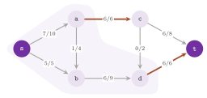

# 12. Maximum flows and circulations {#ch-12}

We are concerned in this chapter with the classes of `lemon/preflow.h`,
`lemon/edmonds_karp.h` and `lemon/circulation.h`. The first two compute a flow
of maximum value between two nodes of a digraph, together with a cut that
proves it maximum, and they share the interface of the concept in
`lemon/concepts/max_flow.h`. The third one finds a flow within lower and upper
bounds that meets given supplies, or a set of nodes that proves that no such
flow exists. Section 12.1 states the problem and the duality on which the
results of the chapter rest, sections 12.2 and 12.3 describe the two maximum
flow algorithms, section 12.4 the circulation algorithm, and section 12.5 the
tolerances and the concept that they share. We treat the minimum cost version
of the circulation problem in [chapter 13](13-min-cost-flow.md#ch-13), and the
minimum cuts of a graph with no source and no target in [chapter
15](15-min-cut.md#ch-15). The results of the chapter are stated in exact
arithmetic, i.e., for an integer value type or for data on which no rounding
occurs; section 12.5 describes what changes in floating point.

## 12.1 The problem and its dual {#sec-12-1}

Let $G=(V,A)$ be a digraph with $n$ nodes and $m$ arcs, let $cap:
A\rightarrow\mathbf{R}_{\geq 0}$ be the capacities of the arcs, and let $s\neq
t$ be two nodes, the source and the target. In the maximum flow problem one
looks for a flow $f: A\rightarrow\mathbf{R}$ that solves

$$
\begin{aligned}
\max\ & \sum_{sv\in A} f(sv) - \sum_{vs\in A} f(vs) \\
& \sum_{uv\in A} f(uv) = \sum_{vu\in A} f(vu) \qquad \forall u\in V\setminus\{s,t\} \\
& 0 \leq f(uv) \leq cap(uv) \qquad \forall uv\in A
\end{aligned}
\tag{12.1}
$$

where the objective, i.e., the net flow out of $s$, is the *value* of the
flow, and the equalities impose the conservation of the flow at the nodes
other than $s$ and $t$. A *cut* is a set $S\subset V$ with $s\in S$ and
$t\notin S$, whose capacity is

$$
cap(S) = \sum_{uv\in A,\ u\in S,\ v\notin S} cap(uv) .
\tag{12.2}
$$

For a flow $f$, the *residual digraph* has an arc $uv$ wherever
$f(uv)<cap(uv)$ and an arc $vu$ wherever $f(uv)>0$, with the residual
capacities

$$
r_f(uv) = cap(uv) - f(uv) , \qquad r_f(vu) = f(uv) ;
\tag{12.3}
$$

a path from $s$ to $t$ in it is an *augmenting path*, along which the flow may
be increased by the smallest residual capacity of its arcs. We call a set of
nodes *closed* (in the residual digraph of $f$) when no residual arc leaves
it. All the results of this chapter rest on the following classical theorem.

<span id="thm-12-1"></span>**Theorem 12.1.** *(Max-flow min-cut.) The value of
any feasible flow is at most the capacity of any cut. A feasible flow $f$ is
maximum if and only if its residual digraph has no path from $s$ to $t$; then
the set $S$ of the nodes that $s$ reaches in it is a cut with $cap(S)$ equal
to the value of $f$, and therefore a minimum cut.*

*Proof.* Summing the conservation constraints over the nodes of a cut $S$, in
which the terms of the arcs with both ends in $S$ cancel, one finds that the
value of $f$ equals $\sum_{u\in S,\,v\notin S} f(uv) - \sum_{u\notin S,\,v\in
S} f(uv)$, which is at most $cap(S)$ since $0\leq f\leq cap$. If an augmenting
path exists, increasing the flow along it by its smallest residual capacity,
which is positive, gives a feasible flow of larger value, and $f$ is not
maximum. If none exists, $t\notin S$; an arc $uv$ with $u\in S$ and $v\notin
S$ has $f(uv)=cap(uv)$, or $uv$ would be a residual arc out of $S$, and an arc
$vu$ entering $S$ has $f(vu)=0$, or $uv$ would be one. Hence, the value of $f$
equals $cap(S)$, which by the first part bounds the value of every flow.
$\square$

Thus, the answer of the two maximum flow classes can be checked by the user.
Both give, besides the flow and its value, a minimum cut through `minCut()`
and `minCutMap()`, and the capacity (12.2) of that cut, computed on the data,
must equal the value of the flow. Of course, the minimum cut need not be
unique, and the two classes need not give the same one; the following lemma,
which we use again for the certificates of [chapter
14](14-k-best-flows.md#ch-14), describes where the minimum cuts lie.

<span id="lem-12-1"></span>**Lemma 12.1.** *Let $f$ be a maximum flow,
$S_{\min}$ the set of the nodes that $s$ reaches in its residual digraph, and
$S_{\max}$ the set of the nodes that do not reach $t$ in it. A cut is minimum
if and only if it is closed in the residual digraph of $f$; every minimum cut
$S$ has $S_{\min}\subseteq S\subseteq S_{\max}$, and both $S_{\min}$ and
$S_{\max}$ are minimum cuts. Hence, the smallest and the largest minimum cuts
do not depend on the maximum flow chosen.*

*Proof.* As in the proof of Theorem 12.1, the value of $f$ equals $cap(S)$ for
a cut $S$ if and only if the arcs leaving $S$ are saturated and those entering
it are empty, i.e., if and only if $S$ is closed. A closed set that contains
$s$ contains every node that $s$ reaches, and its nodes reach no node outside
it, $t$ in particular; hence, $S_{\min}\subseteq S\subseteq S_{\max}$. The set
$S_{\min}$ is closed by definition, and $t\notin S_{\min}$ by Theorem 12.1.
The set $S_{\max}$ contains $s$ (otherwise $s$ would reach $t$) and does not
contain $t$; it is closed, since a residual arc from $u\in S_{\max}$ to a node
that reaches $t$ would let $u$ reach $t$. The last statement holds since the
minimum cuts are defined by the data only. $\square$

{#fig-12-1}

## 12.2 The push-relabel algorithm: Preflow {#sec-12-2}

### 12.2.1 Preflows and labels {#sec-12-2-1}

We begin with the class `Preflow`, which implements the push-relabel algorithm
of Goldberg and Tarjan ([Goldberg and Tarjan
1988](Z-bibliography.md#ref-goldberg88newapproach); see also [Cormen et al.
2001](Z-bibliography.md#ref-clrs01algorithms) and [Ahuja, Magnanti and Orlin
1993, chapter 7](Z-bibliography.md#ref-amo93networkflows)). This algorithm
does not keep a feasible flow during its course. It keeps instead a *preflow*,
i.e., a map $f$ within the bounds of (12.1) whose *excess* $e_f(u)=\sum_{vu\in
A} f(vu)-\sum_{uv\in A} f(uv)$ is nonnegative at the nodes other than $s$.
Together with it, it keeps integer *labels* $d(u)\in\{0,\ldots,n\}$ (the
levels of an `Elevator`, see [chapter 8](08-auxiliary.md#ch-8)) such that

$$
d(u) \leq d(v) + 1 \qquad \text{for each arc } uv \text{ of the residual digraph} .
\tag{12.4}
$$

A node $u\neq t$ of positive excess and of label below $n$ is *active*. A
*push* along a residual arc $uv$ with $d(v)<d(u)$ moves the smaller of
$e_f(u)$ and $r_f(uv)$ from $u$ to $v$; it is *saturating* if it empties the
arc, and *emptying* if it empties $u$. Note that the class pushes towards any
lower level, not only to the level just below, as the textbook rule does. A
*relabel* of an active node raises $d(u)$ to one more than the least label of
the heads of its residual arcs, or to $n$ if that is larger or if no residual
arc leaves $u$. The top level $n$ marks the nodes that cannot reach $t$, which
are never active; also, when a relabel leaves the old level of $u$ empty,
every node above that level is lifted to the top (the *gap* rule).

The implementation runs in two phases. In the first one the excess is pushed
towards $t$. At its end the excess of $t$ is the maximum flow value, and the
nodes at the top level form the source side of a minimum cut; however, some
excess may still be stranded at the nodes that cannot reach $t$. Hence, a
second phase sends that excess back to $s$, with labels computed from $s$ in
the same way, and it leaves a maximum flow. In both phases the active node of
highest label is processed first; in the first phase, however, the header
describes the rule as "a mixture of the highest label and the bound decrease
heuristics". After each sweep of $n$ selections of the highest active node,
the code makes $20n$ selections of an active node of the current level, or of
the nearest level below it that has one, without looking for the highest one
again. It starts a new sweep when no level at or below the current one has an
active node.

<span id="alg-12-1"></span>**Algorithm 12.1** (Preflow, first phase).

```
1  f := 0; d(u) := BFS distance from u to t over the arcs of positive
   capacity, n if none, and d(s) := n
2  f(sv) := cap(sv) for the arcs sv of positive capacity with d(v) < n
3  repeat: (n selections of the highest active node, then 20n selections
           from the current level downwards, as described above)
4      u := the selected active node; if none: stop
5      for each residual arc uv (out-arcs, then in-arcs), while e(u) > 0:
6          if d(v) < d(u): push min{ e(u), r(uv) } along uv
7      if e(u) > 0:
8          L := d(u); d(u) := min{ n, 1 + min{ d(v) : uv residual } }
9          if level L is now empty: lift every node above L to level n
10 return e(t) as the value, { u : d(u) = n } as the source side of the cut
```

Steps 1 and 2 are `init()`, and steps 3 to 9 are `startFirstPhase()`. In step
8 the minimum runs over the residual arcs left after the pushes of step 6,
which all go to nodes of level at least $d(u)$; hence, the new label exceeds
the old one. The following two lemmas prove the first phase correct.

<span id="lem-12-2"></span>**Lemma 12.2.** *During `startFirstPhase()`, $f$ is
a preflow, $d(t)=0$, $d(s)=n$, condition (12.4) holds for every residual arc,
the labels never decrease, and the levels below $n$ that hold a node are
$0,1,\ldots,h$ for some $h\leq n-2$.*

*Proof.* After `init()` the labels below $n$ are the distances of a breadth
first search from $t$, which never exceed $n-2$ since $s$ is not among the
nodes searched, and they form the levels $0,\ldots,h$ without gaps. Condition
(12.4) holds for the arcs of positive capacity, along which $d(u)\leq d(v)+1$;
the only arcs carrying flow, those out of $s$ saturated in step 2, give
residual arcs into $s$, whose label is the largest. A residual arc out of a
node of level $n$ goes to a node of level $n$, since it is either an
unsaturated arc out of $s$, whose head step 2 left at level $n$, or an arc out
of a node that the search did not reach, whose head the search did not reach
either. A push along $uv$ with $d(v)<d(u)$ may add the residual arc $vu$, for
which $d(v)\leq d(u)+1$; it moves at most $e_f(u)$ and at most $r_f(uv)$, and
$f$ stays a preflow. A relabel sets $d(u)\leq d(v)+1$ for every residual arc
$uv$ and raises $d(u)$, which keeps (12.4) on the arcs into $u$. When level
$L$ becomes empty, a residual arc out of a node $u$ above $L$ goes to a node
$v$ with $d(v)\geq d(u)-1\geq L$, hence above $L$, so that (12.4) still holds
after those nodes are moved to $n$. A relabel moves $u$ to at most $h+1$,
since some residual arc out of $u$ reaches a level at most $h$ unless the new
label is $n$; if the old level of $u$ becomes empty, the gap rule lifts $u$
too. Hence, the occupied levels below $n$ stay contiguous from 0, the level of
$t$, which is never relabeled. Since at most $n-1$ nodes lie below the top,
$h\leq n-2$: a relabel to level $n-1$ would leave $n$ levels occupied by $n-1$
nodes, unless the old level became empty, and then the gap rule lifts $u$ to
the top. $\square$

<span id="lem-12-3"></span>**Lemma 12.3.** *When `startFirstPhase()` ends, the
set $S$ of the nodes at level $n$ is a cut, no residual arc of the preflow
leaves it, and $e_f(t)=cap(S)$.*

*Proof.* The phase ends when no node is active, i.e., when every node below
level $n$ other than $t$ has a zero excess. We have $s\in S$ and $t\notin S$
by Lemma 12.2. A residual arc from $u\in S$ to $v\notin S$ would need $n\leq
d(v)+1$, i.e., $d(v)=n-1$, which Lemma 12.2 excludes. Hence, the arcs leaving
$S$ are saturated and those entering it are empty. The flow entering
$V\setminus S$, which is then $cap(S)$, equals the sum of the excesses of its
nodes, i.e., $e_f(t)$. $\square$

The second phase, `startSecondPhase()`, keeps the nodes of $V\setminus S$ at
level $n$ and gives to those of $S$ the distances of a breadth first search
towards $s$ over the residual arcs (level $n-1$ to those that do not reach
$s$); then it makes the same pushes and relabels from the active node of
highest label, $s$ taking the role of $t$.

<span id="alg-12-2"></span>**Algorithm 12.2** (Preflow, second phase).

```
1  d(u) := n for u not in S; for u in S, d(u) := BFS distance from u to s
   in the residual digraph, n - 1 if none
2  while some node u != s, t with d(u) < n has e(u) > 0:
3      u := an active node of highest label
4      push from u along residual arcs uv with d(v) < d(u), while e(u) > 0
5      if e(u) > 0: relabel u as in Algorithm 12.1 (steps 8 and 9)
6  return f, a maximum flow
```

<span id="thm-12-2"></span>**Theorem 12.2.** *(Correctness of Preflow.) After
`init()` and `startFirstPhase()`, `flowValue()` is the maximum flow value and
`minCut()` describes a minimum cut $S$ with $S_{\min}\subseteq S\subseteq
S_{\max}$ (Lemma 12.1). After `startSecondPhase()`, `flowMap()` is a maximum
flow and `minCut()` describes the same set $S$.*

*Proof.* Consider the second phase. A node of $S$ with positive excess reaches
$s$ in the residual digraph. Indeed, if the preflow is decomposed into paths
from $s$, cycles and paths from $s$ that end at nodes with excess, the reverse
of a path that ends at $u$ is a residual path from $u$ to $s$, which stays
within $S$ since no residual arc leaves $S$ (Lemma 12.3). The arguments of
Lemma 12.2, with $s$ in place of $t$, show that (12.4) holds throughout the
phase. Hence, the label of an active node is at most its residual distance to
$s$, i.e., at most $|S|-1<n$, no active node reaches the top, and the branches
that the code marks as a "calculation error" are never taken in exact
arithmetic. No push crosses the boundary of $S$, since the nodes of
$V\setminus S$ stay at level $n$ and have no excess; hence, the arcs between
$S$ and $V\setminus S$ keep their flows. By Theorem 12.3 below the phase ends,
with no active node, i.e., with a flow, whose value is the flow entering
$V\setminus S$, i.e., $cap(S)=e_f(t)$ by Lemma 12.3. By Theorem 12.1 this flow
is maximum and $S$ is a minimum cut, closed in its residual digraph, and Lemma
12.1 gives $S_{\min}\subseteq S\subseteq S_{\max}$. After the first phase
`minCut(u)` tests $d(u)=n$, and after the second phase $d(u)<n$, which holds
again for the nodes of $S$ and for no other. $\square$

We remark that $S$ need be neither the smallest nor the largest minimum cut:
on the path $s\rightarrow a\rightarrow b\rightarrow t$ with unit capacities,
e.g., the first phase leaves $a$ and $b$ below the top, so that
$S=\{s\}=S_{\min}$, while $S_{\max}=\{s,a,b\}$. In general $S$ depends on the
order of the operations.

<span id="thm-12-3"></span>**Theorem 12.3.** *(Running time of Preflow.) In
each phase there are at most $n^2$ relabels, at most $m(n+2)$ saturating
pushes and at most $n^2+nm(n+2)$ emptying pushes. Each selection of a node
costs $O(\Delta)$ time, where $\Delta$ is the largest number of arcs incident
to a node, since the code scans the arcs of the node from the first one;
hence, each phase takes $O(n^2m\Delta)$ time.*

*Proof.* Each label is at most $n$ and only grows (Lemma 12.2), so that each
node is relabeled at most $n$ times. Between two saturating pushes along the
same residual arc $uv$, a push along $vu$ must occur. The first push needs
$d(u)>d(v)$, the push along $vu$ a label of $v$ above the label of $u$ at that
time, and the second push a label of $u$ above that of $v$; hence, $d(u)$
grows by at least 2. Hence, there are at most $n/2+1$ saturating pushes along
each of the $2m$ residual arcs. Let $\Phi$ be the sum of the labels of the
active nodes. An emptying push makes $u$ inactive and may make active $v$,
whose label is smaller, and therefore it decreases $\Phi$ by at least 1. A
saturating push increases $\Phi$ by at most $n$, the relabels by the growth of
the labels, which sums to at most $n^2$, and a lift to the top only makes
nodes inactive. This gives the bound on the emptying pushes. A selection of a
node ends with an emptying push or with a relabel, and it scans at most the
arcs incident to the node. $\square$

The header states the worst case running time $O(n^2\sqrt{m})$, which is the
bound of the highest label rule implemented with a current arc for each node
([Cheriyan and Maheshwari 1989](Z-bibliography.md#ref-cheriyan1989analysis);
[Ahuja, Magnanti and Orlin 1993, chapter
7](Z-bibliography.md#ref-amo93networkflows)). The code keeps no current arc,
and its first phase is not the pure highest label rule; hence, the proof of
that bound does not carry over to it, and Theorem 12.3 is the bound that we
can prove for the class as it is. In practice the algorithm is usually the
fastest maximum flow method of the library, and the documentation of the
module recommends it "in most cases". We remark that the header warns against
infinite or very large capacities (e.g., the largest value of the type), since
the initial pushes of step 2 and the sums of the excesses at a node must fit
in the value type.

### 12.2.2 The interface {#sec-12-2-2}

`Preflow<GR, CAP, TR>` takes the type `GR` of the digraph, the type `CAP` of
the capacity map (by default `GR::ArcMap< int >`), and a traits class `TR`, by
default `PreflowDefaultTraits< GR , CAP >`. These traits define the types
`Digraph` and `CapacityMap`, the value type `Value` (that of `CAP`), the type
`FlowMap` of the flow map (`GR::ArcMap< Value >`), and the type `Elevator` of
the labels (`Elevator< GR , GR::Node >`, whose alternative is
`LinkedElevator`). They also define the static functions
`createFlowMap(digraph)` and `createElevator(digraph, max_level)` that
allocate the last two, and the type `Tolerance` (`Tolerance< Value >`) of the
comparisons. The class repeats these types as its own typedefs, together with
`Traits`, and its typedef `Create` is the class itself. One rarely sets the
traits directly. Instead, the named template parameters `SetFlowMap< T >`,
`SetElevator< T >` and `SetStandardElevator< T >` replace one type each,
through their member `Create`. With `SetFlowMap` and `SetElevator` the object
must be given by `flowMap()` or `elevator()` before `init()`, since the traits
that they make cannot create it (they assert); `SetStandardElevator`, instead,
makes a type that the class still allocates, from the digraph and the largest
level.

The constructor `Preflow(digraph, capacity, source, target)` stores the data
by reference; it does not check that the source differs from the target, as
the algorithm requires. The setters `capacityMap()`, `flowMap()`, `source()`,
`target()`, `elevator()` and `tolerance()` change the data, each returning the
object, and `elevator()` and `tolerance()` without arguments return a const
reference to the elevator and to the tolerance. A flow map or an elevator that
is not given is allocated by `init()` and released by the destructor. The
execution follows the pattern of [chapter 3](03-mental-model.md#ch-3).

-   `run()` is `init()`, `startFirstPhase()` and `startSecondPhase()`, and
`runMinCut()` is `init()` and `startFirstPhase()`, which suffice for the value
and for the minimum cut (Theorem 12.2).
-   `init()` starts from the zero flow, and `init(flowMap)` from a given map,
which must be at least a preflow: after copying the map, it returns `false` if
the excess of a node other than $s$ is negative beyond the tolerance;
otherwise it computes the labels by a breadth first search from $t$ over the
residual arcs, saturates the residual arcs out of $s$ (and empties the arcs
into it) towards the nodes that reach $t$, and returns `true`. It does not
check the bounds $0\leq f\leq cap$, which the caller must ensure.
-   `flowValue()` returns the excess of $t$, i.e., the maximum value already
after the first phase, while `flow(arc)` and `flowMap()` give a maximum flow
only after the second phase.
-   `minCut(node)` returns `true` if a node is on the source side of the
minimum cut found, and `minCutMap(map)` writes that side into a writable
`bool` node map, in $O(n)$ time; both are meaningful after the first or the
second phase (Theorem 12.2), and the header remarks that the two answers may
differ slightly with inexact computation.

A typical call, with a `bool` node map `cut`, is

```cpp
Preflow< ListDigraph > pf( g , cap , s , t );
pf.run();
pf.minCutMap( cut );
```

after which `pf.flowValue()` is the value. The program
`manual/examples/12-max-flow.cc` (the test `manual_12_max_flow`) solves the
network of Figure 12.1 with `Preflow` and `EdmondsKarp`, checks the value 12
against the capacity of the cut of each, and gives the maximum flow to a
second `Preflow`, after the capacity of the arc $(d,t)$ has grown from 6 to
10, whose first phase reaches the value 15.

!!! note "abLEMON"
    With a floating-point `Value`, `init(flowMap)` judges the excess of a node
    relative to the flow through the node, rather than against the absolute
    epsilon of the tolerance. Hence, the maximum flow of another `Preflow` on
    large capacities (e.g., of the order of $10^9$) is taken as a preflow,
    while LEMON 1.3.1 refused it because the rounding errors of the sums
    exceed that epsilon (trac #625). A program may then start from the maximum
    flow of a previous run after a change of the capacities, provided that the
    old flow is still a preflow for the new ones (e.g., after some capacities
    have grown).

## 12.3 Augmenting paths: EdmondsKarp {#sec-12-3}

Next, the class `EdmondsKarp` implements the algorithm of [Edmonds and Karp
1972](Z-bibliography.md#ref-edmondskarp72theoretical), i.e., the augmenting
path method of Ford and Fulkerson in which each augmenting path is a shortest
one (in the number of arcs) of the residual digraph.

<span id="alg-12-3"></span>**Algorithm 12.3** (Edmonds and Karp).

```
1  f := 0 (init()), or a given feasible flow (init(flowMap))
2  repeat:                                             (augment())
3      find by BFS from s a path P to t with the fewest arcs,
       along the residual arcs uv with r(uv) > 0
4      if there is none: stop, f is maximum
5      delta := min{ r(uv) : uv in P }
6      increase f along P by delta (decrease it on the backward arcs)
```

Steps 3 to 6 are one call of `augment()`, which returns `false` when no path
is found; `start()` repeats it until then, and `run()` is `init()` followed by
`start()`. The search of step 3 stops as soon as $t$ is reached. In our view,
the advantage of the class over `Preflow` lies in this control: between two
calls of `augment()` the flow is a feasible flow, whose value `flowValue()`
returns. One can then stop early, look at the intermediate flows, or
interleave the augmentations with some other work, as a teaching or a
debugging program may want.

<span id="thm-12-4"></span>**Theorem 12.4.** *(Edmonds and Karp.) Each call of
`augment()` that returns `true` keeps $f$ feasible and increases its value by
$\delta>0$; when it returns `false`, $f$ is maximum and the nodes that the
search reached form the cut $S_{\min}$ of Lemma 12.1. From any feasible flow,
at most $nm$ calls return `true`; hence, `start()` takes $O(nm^2)$ time.*

*Proof.* The first statement holds since $\delta$ is the smallest residual
capacity of the path, and the second is Theorem 12.1, the search having
visited every node that $s$ reaches. Let $\delta_f(v)$ be the number of arcs
of a shortest residual path from $s$ to $v$. An augmentation along a shortest
path $P$ removes from the residual digraph at least one arc of $P$, and it may
add the reverses of arcs of $P$, each of which goes from a node at distance
$k+1$ to one at distance $k$. Such arcs create no shorter path; hence,
$\delta_f(v)$ never decreases. An arc $uv$ of $P$ that an augmentation removes
(a *critical* arc) has $\delta_f(v)=\delta_f(u)+1$; it can be critical again
only after an augmentation along a path through $vu$, which needs
$\delta(u)=\delta(v)+1$ at that time, so that $\delta(u)$ has grown by at
least 2. Since a finite distance is below $n$, each of the $2m$ residual arcs
is critical at most $n/2$ times. Hence, there are at most $nm$ augmentations,
each of which costs $O(m)$ time for the search and the update. $\square$

The header gives the running time $O(nm^2)$, together with the advice to use
`Preflow` when only the maximum flow is wanted. We remark that the bound does
not depend on the capacities, and holds for real ones.

The template parameters are those of `Preflow`, with the traits
`EdmondsKarpDefaultTraits< GR , CAP >` (the types `Digraph`, `CapacityMap`,
`Value`, `FlowMap` with its creator `createFlowMap()`, and `Tolerance`) and
the single named parameter `SetFlowMap< T >`; the class has the same typedefs
and `Create`. The constructor `EdmondsKarp(digraph, capacity, source, target)`
asserts that $s\neq t$ (the setters `source()` and `target()` do not); the
setters `capacityMap()`, `flowMap()`, `source()`, `target()` and `tolerance()`
return the object, `tolerance()` without arguments returns the tolerance, and
the queries `flowValue()`, `flow(arc)`, `flowMap()`, `minCut(node)` and
`minCutMap(map)` are as in `Preflow`. The cut is that of the last search,
i.e., the set of the nodes reached from $s$ when `augment()` returned `false`,
which by Theorem 12.4 is $S_{\min}$. It is meaningful only after such a call:
after `init()` only, or after a call that returned `true`, the predecessors of
the search describe no cut. In the example of Figure 12.1 the minimum cut is
unique, and the program of section 12.2.2 finds it with both classes. Finally,
`init(flowMap)` starts from a given flow, and `checkedInit(flowMap)` is kept
as another name of the same function.

!!! note "abLEMON"
    `init(flowMap)` returns whether the map is a feasible flow, with the
    tolerance of the algorithm (conservation at the nodes other than $s$ and
    $t$, and $0\leq f\leq cap$ on the arcs), as `Preflow::init()` does; the
    flow is set in any case. In LEMON 1.3.1 it returned nothing, and only
    `checkedInit()` made the same checks.

## 12.4 Feasible circulations: Circulation {#sec-12-4}

### 12.4.1 The problem and its certificate {#sec-12-4-1}

Let $lower: A\rightarrow\mathbf{R}$ and $upper:
A\rightarrow\mathbf{R}\cup\{\infty\}$, with $lower\leq upper$, be bounds on
the flow of the arcs, and let $sup: V\rightarrow\mathbf{R}$ be signed supplies
(a node with $sup(u)>0$ supplies $sup(u)$ units, one with $sup(u)<0$ demands
$-sup(u)$). In the *network circulation problem* of the class `Circulation`
one looks for any $f$ such that

$$
\sum_{uv\in A} f(uv) - \sum_{vu\in A} f(vu) \geq sup(u) \quad \forall u\in V ,
\qquad lower(uv) \leq f(uv) \leq upper(uv) \quad \forall uv\in A .
\tag{12.5}
$$

The system can be feasible only if $\sum_{u\in V} sup(u)\leq 0$, since its
left-hand sides sum to zero; when the supplies sum to zero, the inequalities
hold as equalities, and (12.5) defines the feasible flows with supplies and
demands. One obtains the opposite inequalities (all the demands met, some
supply left) by reversing the arcs and negating the supplies, as the header
suggests, e.g., with the adaptor `ReverseDigraph` of [chapter
5](05-adaptors.md#ch-5) and the map `NegMap` of [chapter 6](06-maps.md#ch-6).
As a certificate of infeasibility the class gives a *barrier*, i.e., a set
$B\subseteq V$ whose supply exceeds what can leave it:

$$
\sum_{uv\in A,\ u\in B,\ v\notin B} upper(uv) - \sum_{uv\in A,\ u\notin B,\ v\in B} lower(uv) < \sum_{v\in B} sup(v) .
\tag{12.6}
$$

The theorem of Hoffman states that a barrier exists whenever (12.5) has no
solution. Let $sup'(u)=sup(u)-\sum_{uv\in A} lower(uv)+\sum_{vu\in A}
lower(vu)$ be the supplies net of the lower bounds, and let $x^+=\max\{x,0\}$
and $x^-=\max\{-x,0\}$. The proof uses the network $N$ that has the arcs of
$G$, with the capacities $upper-lower$, a source $\sigma$ with an arc to each
node $u$ of capacity $sup'(u)^+$, and an arc from each node $u$ to a target
$\tau$ of capacity $sup'(u)^-$. Let $P=\sum_{u\in V} sup'(u)^+$. A direct
expansion of (12.2), in which the lower bounds of the arcs inside $B$ cancel,
gives for each $B\subseteq V$

$$
P - cap(\{\sigma\}\cup B) = \sum_{v\in B} sup(v) - \sum_{uv\in A,\ u\in B,\ v\notin B} upper(uv) + \sum_{uv\in A,\ u\notin B,\ v\in B} lower(uv) ,
\tag{12.7}
$$

i.e., $B$ is a barrier if and only if $cap(\{\sigma\}\cup B)<P$.

<span id="thm-12-5"></span>**Theorem 12.5.** *(Hoffman.) The system (12.5) has
a solution if and only if no set $B\subseteq V$ satisfies (12.6).*

*Proof.* If $f$ solves (12.5), summing its inequalities over the nodes of $B$
gives $\sum_{v\in B} sup(v)\leq \sum_{u\in B,\,v\notin B} f(uv)-\sum_{u\notin
B,\,v\in B}f(uv)$, which is at most the left-hand side of (12.6). Conversely,
suppose that a maximum flow $x$ of $N$ from $\sigma$ to $\tau$ has value $P$,
i.e., saturates every arc out of $\sigma$. At each node $u$ the conservation
in $N$ gives $\sum_{uv\in A}x(uv)-\sum_{vu\in A}x(vu)=sup'(u)^+-x(u\tau)\geq
sup'(u)^+-sup'(u)^-=sup'(u)$, and $f=x+lower$ solves (12.5). Hence, if (12.5)
has no solution, the maximum flow value is below $P$, and by Theorem 12.1 some
cut $\{\sigma\}\cup B$ of $N$ has a capacity below $P$, which is finite (no
arc of infinite upper bound leaves $B$). By (12.7), $B$ satisfies (12.6).
$\square$

This is the circulation theorem of [Hoffman
1960](Z-bibliography.md#ref-hoffman1960some), which in the form with supplies
is the feasibility theorem of [Gale
1957](Z-bibliography.md#ref-gale1957theorem).

### 12.4.2 The algorithm and its interface {#sec-12-4-2}

`Circulation` is a push-relabel algorithm written directly for (12.5). In it,
the excess of a node is $e(u)=sup(u)$ plus the flow into it less the flow out
of it; hence, a node of positive excess is one whose inequality is violated. A
residual arc is an arc $uv$ with $f(uv)<upper(uv)$, or the reverse of an arc
$vu$ with $f(vu)>lower(vu)$, as in (12.3) with the bounds of (12.5). The flow
starts at the lower bounds (`init()`) or at a greedy choice (`greedyInit()`),
which sets each arc, in the order of the arcs, to the deficit $-e(v)$ of its
head $v$ at that moment, clipped to the bounds of the arc. All the nodes start
at level 0, and the active nodes are those of positive excess. A comment in
`init()` records that a global relabeling was tried and gave somewhat worse
running times on random digraphs.

<span id="alg-12-4"></span>**Algorithm 12.4** (Circulation).

```
1  set f by the greedy rule; e(u) := sup(u) + f(in(u)) - f(out(u))
2  d(u) := 0 for each node u
3  while some node has e(u) > 0:
4      u := an active node of highest level
5      push from u along residual arcs uv with d(v) < d(u), while e(u) > 0
6      if e(u) > 0:
7          if no residual arc leaves u: lift u to level n; L := n;
              return false
8          L := d(u); d(u) := 1 + min{ d(v) : uv residual }
9          if level L is now empty: return false
10 return true            (the barrier is { u : d(u) >= L } after false)
```

Steps 1 and 2 are `greedyInit()`, and steps 3 to 10 are `start()`.

<span id="thm-12-6"></span>**Theorem 12.6.** *(Correctness and running time of
Circulation.) `start()` ends after at most $n(n-1)$ relabels, $O(nm)$
saturating pushes and $O(n^2m)$ emptying pushes, i.e., in $O(n^2m\Delta)$ time
($\Delta$ as in Theorem 12.3). If it returns `true`, the flow satisfies (12.5)
and the barrier is empty; if it returns `false`, the barrier $\{u: d(u)\geq
L\}$ satisfies (12.6).*

*Proof.* The flow stays within the bounds, since the greedy rule clips each
value and a push moves at most the residual capacity, and (12.4) holds
throughout by the arguments of Lemma 12.2, all the labels being 0 at the
start. A push moves at most the excess of its tail; hence, a node whose excess
is nonnegative never gets a negative one, and a node with a negative excess
has never been active, so that it is still at level 0. The occupied levels are
$0,\ldots,h$: a relabel of $u$ sets $d(u)$ to one more than the level of a
node at a level at least $d(u)$, i.e., to at most $h+1$, and if the old level
becomes empty the algorithm stops. As long as it does not stop, each level up
to $h$ holds a node, so that $h\leq n-1$, and a relabel to $n$ would need one
node on each level, $u$ the only node of its old one, which step 9 catches.
Hence, while `start()` runs, the labels stay below $n$ and each node is
relabeled at most $n-1$ times; the counts of the pushes and the time follow as
in the proof of Theorem 12.3. If `start()` returns `true`, every excess is at
most zero, which is (12.5), and no node is at level $n$; hence, the barrier is
empty. If it returns `false` in step 9, a residual arc out of a node $u$ above
$L$ goes to a node $v$ with $d(v)\geq d(u)-1\geq L$, and level $L$ is empty;
hence, no residual arc leaves $B=\{u:d(u)\geq L\}$. In step 7 the barrier is
$\{u\}$, which no residual arc leaves either, since no other node is at level
$n$. In both cases the arcs leaving $B$ are at their upper bounds and those
entering it at their lower bounds, and therefore $\sum_{v\in B}e(v)$ is the
right-hand side less the left-hand side of (12.6). Every node of $B$ has a
nonnegative excess (the nodes of negative excess are at level 0, and if $L=0$
level 0 is empty), and $u$ a positive one; hence, (12.6) holds. $\square$

The header states no bound on the running time; Theorem 12.6 is the one that
the code satisfies. The template parameters of the class are `GR`, the lower
bound map `LM` (by default `GR::ArcMap< int >`), the upper bound map `UM` (by
default `LM`), the supply map `SM` (by default `GR::NodeMap< UM::Value >`),
whose value type is the `Value` of the algorithm, and the traits
`CirculationDefaultTraits< GR , LM , UM , SM >`. These define the types
`Digraph`, `LowerMap`, `UpperMap`, `SupplyMap`, `Value`, `FlowMap`, `Elevator`
and `Tolerance` and the creators `createFlowMap()` and `createElevator()`, as
those of `Preflow` do. Its named parameters `SetFlowMap< T >`, `SetElevator< T
>` and `SetStandardElevator< T >` are those of `Preflow`, and its constructor
`Circulation(graph, lower, upper, supply)` takes the three maps by reference,
which `lowerMap()`, `upperMap()` and `supplyMap()` change, while `flowMap()`,
`elevator()` and `tolerance()` are as in `Preflow`. In a debug build, `init()`
and `greedyInit()` check that no upper bound is below its lower bound. `run()`
is `greedyInit()` followed by `start()`, and it returns whether a feasible
circulation was found; in that case `flow(arc)` and `flowMap()` give it, and
otherwise `barrier(node)` and `barrierMap(map)` give the barrier (which is
empty after a feasible run). Two checkers verify an answer on the data:
`checkFlow()` tests the bounds exactly and the inequalities of (12.5) up to
the tolerance, and `checkBarrier()` tests (12.6) on the barrier found, with
the tolerance. In the latter, an upper bound out of the set that is infinite
(or so large that the sum would overflow) makes the test fail. The program
`manual/examples/12-circulation.cc` (the test `manual_12_circulation`) solves
a network of four nodes and then lowers the capacity of the arc $(b,d)$ from 4
to 1, after which the node $d$, which demands 3 units, can receive at most 2;
`run()` returns `false`, and the program checks (12.6) on the barrier.

!!! note "abLEMON"
    On a digraph without nodes `Circulation` read the first of no items of its
    elevator in LEMON 1.3.1; now the elevator holds one item more than the
    digraph has, and the empty digraph has the empty circulation.

## 12.5 Tolerances and the common interface {#sec-12-5}

All three classes compare the values of the flows through a `Tolerance< Value
>` (see [chapter 3](03-mental-model.md#ch-3)), which is set and read by
`tolerance()`. A residual capacity counts as positive only beyond the epsilon
of the tolerance, and so does an excess; also, a push empties the node unless
the residual capacity is less than the excess by more than the epsilon. For an
integer `Value` the comparisons are exact, and the theorems of this chapter
apply as stated. For a floating-point one the default epsilon of `Tolerance`
($10^{-10}$ for `double`) is absolute, which usually suits capacities of
moderate size, and a program with data of a rather different scale should set
another one. The theorems then hold only up to the rounding errors; this is
why the second phase of `Preflow` handles the cases that exact arithmetic
excludes. Indeed, the only comparison that is relative to the data is the one
of `Preflow::init(flowMap)` (cf. section 12.2.2).

`Preflow` and `EdmondsKarp` meet the concept `concepts::MaxFlow< GR , CAP >`
of `lemon/concepts/max_flow.h`, against which a class is checked by
`checkConcept` (see [chapter 3](03-mental-model.md#ch-3)). The concept
requires the member `Create` and the named parameter `SetFlowMap`, the
constructor from the digraph, the capacities, the source and the target, the
setters `capacityMap()`, `flowMap()`, `source()`, `target()` and
`tolerance()`, the type `Tolerance` and the getter `tolerance()`. It also
requires the two `init()` functions and `run()`, and the queries
`flowValue()`, `flow()`, `flowMap()`, `minCut()` and `minCutMap()`; a function
template written against these members accepts either class.

!!! note "abLEMON"
    The concepts of the maximum flow, minimum cost flow and minimum mean cycle
    classes are in `lemon/concepts` (`MaxFlow`, `MinCostFlow` and
    `MinMeanCycle`), where the classes of the library are held to them; in
    LEMON 1.3.1 they were defined inside the tests.

## 12.6 Exercises {#sec-12-6}

<span id="ex-12-1"></span>**Exercise 12.1.** Modify the program
`manual/examples/12-max-flow.cc` so that it stops `EdmondsKarp` after its
first augmenting path and prints the residual capacities (12.3) of the arcs.
Then check by hand that the value of the flow and the number of paths agree
with Algorithm 12.3. (The program counts the paths.)

<span id="ex-12-2"></span>**Exercise 12.2.** On the network of Figure 12.1,
add an arc that makes the sets $S_{\min}$ and $S_{\max}$ of Lemma 12.1 differ,
and compare `minCutMap()` of `Preflow` after `runMinCut()` with that of
`EdmondsKarp`; by Theorems 12.2 and 12.4, the first lies between the two sets
and the second is $S_{\min}$.

<span id="ex-12-3"></span>**Exercise 12.3.** Give `Preflow::init(flowMap)` a
map that is not a preflow (e.g., one unit more out of a node than into it),
and check that it returns `false`. Then repeat with capacities of the order of
$10^9$ in `double`, where the absolute epsilon of the tolerance would refuse a
true preflow. (Solved by `checkInitPreflowLarge()` in
`test/max_flow_test.cc`.)

<span id="ex-12-4"></span>**Exercise 12.4.** Write a function template that
takes a class meeting `concepts::MaxFlow`, runs it, and returns the capacity
(12.2) of its cut minus its value; instantiate it with both `Preflow` and
`EdmondsKarp`. (The concept is checked in `test/max_flow_test.cc`.)

<span id="ex-12-5"></span>**Exercise 12.5.** Solve a problem with the opposite
inequalities of (12.5), i.e., all the demands met and some supply left, by
`Circulation` on a `ReverseDigraph` with a `NegMap` of the supplies, and
verify the answer with `checkFlow()`. (The class is tested in
`test/circulation_test.cc`.)

<span id="ex-12-6"></span>**Exercise 12.6.** Prove the identity (12.7) by
expanding the capacity of the cut $\{\sigma\}\cup B$, and check it, together
with (12.6), on the barrier of the second network of
`manual/examples/12-circulation.cc`.
