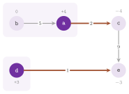

# 14. Certificates and the k best flows {#ch-14}

We now turn to what the library gives besides one optimal flow. When a minimum
cost flow problem has no optimal flow, the four algorithms of [chapter
13](13-min-cost-flow.md#ch-13) give a certificate of the answer, i.e., a set
of nodes that proves it infeasible or a cycle that proves it unbounded, which
a program can check on the data. They can also give several such certificates,
in a definite order. When the problem has an optimal flow, the class
`KBestFlows` of `lemon/k_best_flows.h` gives the $k$ integer flows of least
cost, and the class `KBestExtremeFlows` of `lemon/k_best_extreme_flows.h`
gives the $k$ vertices of least cost of the polyhedron of the flows, together
with distinct optimal potentials. Section 14.1 treats the certificates of
infeasibility and section 14.2 those of unboundedness, both implemented in
`lemon/bits/mcf_certificate.h`; sections 14.3 and 14.4 describe the two
classes of the $k$ best flows, and section 14.5 the alternative optimal
potentials. We keep the notation of [section 13.1](13-min-cost-flow.md#ch-13):
the GEQ form (13.1), the reduced costs (13.3), and the residual network of a
flow.

!!! note "abLEMON"
    The content of this chapter is new with respect to LEMON 1.3.1, which gave
    no certificate and no other flow than an optimal one: `infeasibleCut()`
    and `unboundedCycle()` appeared in version 1.6.0, `infeasibleCuts()`,
    `disjointInfeasibleCuts()`, `unboundedCycles()`, `KBestFlows` and
    `KBestExtremeFlows` in version 1.7.0, the alternative optimal potentials
    in version 1.8.0, and their method `PIVOTS`, the cuts of `NetworkSimplex`
    taken from its last tree, the ties of `infeasibleCuts()` and the single
    run of Howard's algorithm in `unboundedCycles()` in version 1.9.0.

## 14.1 Certificates of infeasibility {#sec-14-1}

### 14.1.1 Violated sets {#sec-14-1-1}

For a set $N'\subseteq V$ of nodes, the *violation* of $N'$ under GEQ is its
supply less what can leave it:

$$
viol(N') = \sum_{u\in N'} sup(u) - \sum_{uv\in A,\ u\in N',\ v\notin N'} upper(uv) + \sum_{uv\in A,\ u\notin N',\ v\in N'} lower(uv) ,
\tag{14.1}
$$

where no arc out of $N'$ may have an infinite upper bound (such a set would
prove no infeasibility). Under LEQ the same holds with $-sup$ in place of
$sup$ and the arcs taken backwards, i.e., the demand of $N'$ less what can
enter it. A set of positive violation clearly proves (13.1) infeasible, since
its supply cannot leave it, and the converse holds too.

<span id="thm-14-1"></span>**Theorem 14.1.** *(Gale, Hoffman.) Problem (13.1)
is infeasible if and only if some set $N'$ has $viol(N')>0$. Moreover, let
$sup'$ be the supplies net of the lower bounds, with $P$ the sum of their
positive values. Consider the network that joins a source $\sigma$ to each
node $u$ with $sup'(u)>0$ by an arc of capacity $sup'(u)$, each node $u$ with
$sup'(u)<0$ to a target $\tau$ by an arc of capacity $-sup'(u)$, and that
gives each arc $uv$ the capacity $upper(uv)-lower(uv)$. Then, for each cut
$\{\sigma\}\cup N'$ of this network, $viol(N') = P - cap(\{\sigma\}\cup N')$;
hence, the largest violation is $P$ minus the value of a maximum flow, and the
source side of a minimum cut, without $\sigma$, is a set of largest
violation.* Its first part is the feasibility theorem of [Gale
1957](Z-bibliography.md#ref-gale1957theorem) and [Hoffman
1960](Z-bibliography.md#ref-hoffman1960some) (Theorem 12.2 in [chapter
12](12-max-flow.md#ch-12)); the identity follows by expanding the capacity of
the cut, in which the lower bounds of the arcs inside $N'$ cancel.

### 14.1.2 The interface {#sec-14-1-2}

After a `run()` that returned `INFEASIBLE`, the four classes give three kinds
of certificates, all as sets of nodes of the digraph, and all empty after any
other answer.

-   `infeasibleCut()` returns one set $N'$ with $viol(N')>0$.
-   `infeasibleCuts(k)` returns the $k$ sets of largest violation, in the
   order
of their violations, at most $k$ and only those that prove the problem
infeasible.
-   `disjointInfeasibleCuts()` returns sets of positive violation that are
pairwise disjoint, with no arc between any two of them.

Each set is checked on the data as they were given, by (14.1), before it is
returned. In floating point the check requires the violation to exceed both
the tolerance on the flows and the round-off of the sum, i.e., the default
epsilon of `Tolerance` times one plus the sum of the absolute values of the
terms of (14.1). When the violation does not exceed them, no set is returned;
hence, a set that only round-off makes violated is never given as a
certificate. `NetworkSimplex` gives its sets under the supply type, i.e., by
(14.1) with the arcs reversed and the supplies negated under LEQ; the other
three classes use the GEQ form. In all of them the sets are computed and
checked on the data as they are when the function is called, which must
therefore be those of the last `run()` (the supply type included).

If it proves the answer, the set of `infeasibleCut()` is the one that the
algorithm has at hand when it finds no feasible flow, at no further cost. It
is the set of all the nodes when the supplies sum to the wrong sign (positive
under GEQ, negative under LEQ). Otherwise, it depends on the class:

-   `NetworkSimplex` takes it from its last tree, whose potentials under the
costs of the first phase (one on the artificial arcs that should carry no
flow, zero on the others) are an optimal solution of the dual of the first
phase; so is the indicator of each level set of them, i.e., the nodes whose
potential is at least, or at most, a value, and the first level set that
proves the answer is kept;
-   `CostScaling` and `CycleCanceling` take the nodes above the level that the
push-relabel algorithm of their starting flow leaves empty, together with the
node it was lifting, from which no residual arc leaves ([section
13.5](13-min-cost-flow.md#ch-13));
-   `CapacityScaling` takes the nodes that its last search for a shortest
augmenting path reached from a node with excess without finding a deficit,
from which no residual arc leaves.

If that set does not prove the answer (which may happen, although rarely, in
floating point), the class falls back on a set of largest violation, by one
maximum flow of `Preflow` on the network of Theorem 14.1. Thus,
`infeasibleCut()` usually costs no more than the run, and one maximum flow at
most; we remark that one can therefore call it without concern even on "large"
problems.

In turn, the sets of `disjointInfeasibleCuts()` are the weakly connected
components of the set of `infeasibleCut()` whose violation is positive, in the
order of their violations. Since no arc joins two of them, their violations
sum to at least that of the set. Note that they depend on the set that the
class has at hand. In the example of section 14.1.4, `NetworkSimplex` gives a
set of violation 4, whose two components are violated, while the other three
classes give a set of violation 2, which is a single component.

### 14.1.3 The k most violated sets {#sec-14-1-3}

We find the sets of `infeasibleCuts(k)` by the partition of [Lawler
1972](Z-bibliography.md#ref-lawler72kbest), applied to the cuts of the network
of Theorem 14.1 as in [Hamacher, Picard and Queyranne
1984](Z-bibliography.md#ref-hamacher1984finding). Here the space of the sets
is split into *parts*, in each of which some nodes are fixed in the set and
some out of it. As in Theorem 14.1, the best set of a part is found by a
maximum flow in which a fixed node is joined to the source or to the target by
an arc that no minimum cut may contain, and its violation bounds from above
those of all the sets of the part. Once the best set of a part is given, the
part is split by its free nodes in turn. The $j$-th child keeps the first
$j-1$ of them as they are in the set, and takes the $j$-th one out of the set
if the set has it, in otherwise.

<span id="alg-14-1"></span>**Algorithm 14.1** (The k most violated sets).

```
1  root part: no node fixed; solve it by one maximum flow (Theorem 14.1)
2  give the sets that tie for the largest violation, from the residual
   digraph of that flow (the closed sets, see below), up to k of them
3  while fewer than k sets are given:
4      p := the part of largest bound (its own violation, or that of its
           parent if it is not solved yet)
5      if p is not solved: solve it, from the maximum flow of its parent;
           if its best set is not violated, drop p; continue
6      give the best set of p (unless already given); remove p
7      for each free node u_j of p, j = 1, 2, ...:
8          add the child that fixes u_1 .. u_{j-1} as in the set of p and
           u_j opposite to it, with the bound of p, not solved
```

Two devices keep the number of maximum flows rather small. First, a child
waits in the list with the violation of its parent as a bound, and its best
set is computed only when it is the most promising part. Hence, a maximum flow
is made only for the parts that might hold one of the $k$ sets, rather than
for each child of each set given. Second, the maximum flow of a part is a
preflow of each of its children, whose capacities are only larger (one more
fixed node adds capacity on one arc from the source or to the target). Hence,
`Preflow::init(flowMap)` starts each child from the flow of its parent
([chapter 12](12-max-flow.md#ch-12)). In the worst case, as the header states,
a set costs at most $n$ maximum flows, although typically far fewer are made,
since most children are never solved.

In step 2 the ties come from a result of [Picard and Queyranne
1980](Z-bibliography.md#ref-picard1980structure): the minimum cuts of a
network are the sets closed in the residual digraph of any maximum flow (no
residual arc leaves them) that contain the source but not the target. In other
words, they are the unions of closures of strongly connected components of
that digraph. Also, the function `closedSets()` finds them from the maximum
flow of the root, by adding the closure of one component at a time, breadth
first, starting from the closure of the source. The partition then skips them
instead of finding each of them again by a maximum flow of its own.

### 14.1.4 An example {#sec-14-1-4}

Figure 14.1 shows a problem of five nodes, in which the node $a$ must send 4
units on an arc of capacity 2, and $d$ must send 3 units on one of capacity 1,
while $b$, with no supply, can only feed $a$. The sets $\{a\}$, $\{a,b\}$ and
$\{d\}$ have violation 2, and the sets $\{a,d\}$ and $\{a,b,d\}$ have
violation 4, the largest; hence, the four best sets of `infeasibleCuts(4)`
have the violations 4, 4, 2 and 2.

{#fig-14-1}

Our program solves the problem of Figure 14.1, and the unbounded problem of
section 14.2, with the four classes, and it checks each certificate against
the data. For `infeasibleCuts()` it checks positive violations (14.1) in a
nonincreasing order and distinct sets, and for `disjointInfeasibleCuts()`
pairwise disjoint sets with no arc between them. In the unbounded case it
checks closed cycles of negative cost, made of arcs of infinite capacity.

```cpp
--8<-- "examples/14-certificates.cc"
```

## 14.2 Certificates of unboundedness {#sec-14-2}

A run returns `UNBOUNDED` only on a feasible problem with a directed cycle
whose arcs have infinite upper bounds and whose cost is negative; along such a
cycle the flow may grow without limit while the cost decreases ([section
13.1](13-min-cost-flow.md#ch-13)). After such a run the four classes give two
kinds of certificates, both empty after any other answer.

-   `unboundedCycle()` returns one such cycle, as the vector of its arcs in
   the
direction of the flow.
-   `unboundedCycles(k)` returns at most $k$ such cycles, pairwise
arc-disjoint, in the order of their mean costs.

In `NetworkSimplex` the cycle is the one of the pivot that it could not
perform, i.e., its entering arc and the path of the tree between the two ends
of it, unless that path goes through an artificial arc. In that case, and
always in the other three classes, the cycle is found by the algorithm of
Bellman and Ford on the arcs of infinite upper bound, run from a virtual node
joined to all the others. After each round the graph of the predecessors is
searched for a cycle, which has a negative cost if it exists ([Tarjan
1983](Z-bibliography.md#ref-tarjan1983data)), and the search gives up after
$4n+4$ rounds. In floating point the cycle is returned only if its cost is
negative beyond the round-off.

One might think of the cycle of least total cost as the natural choice for
several cycles, but it is NP-hard to find, since it would decide whether a
digraph is Hamiltonian (cf. Exercise 14.3). Instead, the cycles of
`unboundedCycles(k)` are those of minimum mean cost, which are the most
negative per arc. Howard's algorithm (class `HowardMmc`, [chapter
16](16-min-mean-cycle.md#ch-16)), run on the arcs of infinite upper bound,
ends on each strongly connected component with a policy whose cycle has the
minimum mean of the component ([Dasdan
2004](Z-bibliography.md#ref-dasdan04experimental)); the class gives these
cycles through `componentCycleNum()` and `componentCycle()`.

<span id="alg-14-2"></span>**Algorithm 14.2** (Arc-disjoint negative cycles).

```
1  C := empty; T := the arcs of infinite upper bound
2  while |C| < k and T is not empty:
3      run Howard's algorithm on the arcs of T
4      for each strongly connected component, take its cycle of minimum
       mean if that mean is negative beyond the round-off
5      if none: stop
6      add them to C by increasing mean, up to k; remove their arcs from T
7  sort C by mean; return C
```

Note that the cycles of one run are node-disjoint, and those of later runs use
only the arcs not yet taken; hence, the cycles are arc-disjoint, and the first
one has the minimum mean of all. A cycle of a later run may have a smaller
mean than some of an earlier one (never than the first one), which is why step
7 sorts them. Since one run of Howard's algorithm gives the cycles of all the
components, the algorithm runs again only when fewer than $k$ cycles were
found.

{#fig-14-2}

In the problem of Figure 14.2, the four nodes form one strongly connected
component of the arcs of infinite capacity, whose cycle of minimum mean is
$(r,s,r)$, of cost $-2$ and mean $-1$. A second run on the arcs left finds
$(p,q,r,p)$, of cost $-1$ and mean $-1/3$, and `unboundedCycles(3)` gives
these two cycles, as the program of section 14.1.4 checks. The arc $(q,p)$
closes with $(p,q)$ a cycle of cost $-12$, but its capacity is finite; hence,
it bounds the flow on that cycle, and it never appears in a certificate.

## 14.3 The k best integer flows: KBestFlows {#sec-14-3}

### 14.3.1 The algorithm {#sec-14-3-1}

We now describe the class `KBestFlows`, which finds the $k$ integer flows of
least cost of (13.1), in the order of their costs: first an optimal flow, then
the other optimal flows, if any, and then the suboptimal ones. Its algorithm
is the one of [Hamacher 1995](Z-bibliography.md#ref-hamacher95kbestflows),
which rests on the following property of the integer flows.

<span id="thm-14-2"></span>**Theorem 14.2.** *(Hamacher.) Let $f$ be a flow of
least cost in a set of integer flows defined by integer bounds on the arcs.
Then a second best flow of the set is obtained from $f$ by sending one unit
along a cycle of least cost of the residual network of $f$ (an arc together
with its reverse not being a cycle).* Indeed, the difference between $f$ and a
second best flow is an integer circulation of the residual network, which
decomposes into cycles, each of nonnegative cost; one unit along any of them
gives a flow of the set that is no costlier than the second best one. For a
proof see [Hamacher 1995](Z-bibliography.md#ref-hamacher95kbestflows).

Then the set of all the integer flows is split as in the partition of [Lawler
1972](Z-bibliography.md#ref-lawler72kbest), on an arc where the best flow and
the second best flow differ, i.e., the first arc of the cycle. On one side the
flow of the arc keeps its value in the best flow, which remains the best of
that side; on the other it takes the value of the second best flow, which
becomes the best of that side. Hence, the next flow of the sequence is the
cheapest of the second best flows of the sides.

<span id="alg-14-3"></span>**Algorithm 14.3** (K best integer flows).

```
1  f_1 := an optimal flow (NetworkSimplex, or initFlow()); if none: return
2  S := { (bounds of the problem, f_1) }; compute the second best of it
3  for i = 2, ..., k:
4      (B, f) := the set of S whose second best flow g is the cheapest;
       if no set has one: stop
5      f_i := g; let a be the first arc of the cycle from f to g
6      B' := B with lower(a) := f(a) + 1 (if g(a) > f(a)),
             or with upper(a) := f(a) - 1 (if g(a) < f(a))
7      B  := B with the flow of a fixed to f(a)
8      add (B', g) to S; compute the second best flows of (B, f), (B', g)
```

In `secondBest()`, the second best flow of a set is found as follows. First,
the potentials of the residual network of the best flow of the set are
computed by the algorithm of Bellman and Ford, from a virtual node joined to
all the others. Since the best flow of the set leaves no cycle of negative
cost, the reduced costs are nonnegative. Then, for each node $v$, the
algorithm of Dijkstra computes the shortest paths from $v$ on the reduced
costs, and for each residual arc $(u,v)$ the cycle of least cost through it is
the arc and a shortest path from $v$ back to $u$. When that path is just the
reverse of the arc, which is not a cycle, one more search is made without the
reverse arc. Hence, as stated in the header, the $k$-th flow takes
$O(nm\log n)$ time after the $(k-1)$-th, and $O(m^2\log n)$ at worst. Of
course, the sequence does not depend on the algorithm that found the first
flow, but for the order of the flows of equal cost.

### 14.3.2 The interface {#sec-14-3-2}

`KBestFlows<GR, V, C>` takes the type of the digraph, the number type `V` of
the flows, of the bounds and of the supplies (by default `int`), and the
number type `C` of the costs (by default `V`). Its constructor takes the
digraph, whose nodes and arcs it numbers at once; the digraph must not change
afterwards. Until they are given, the bounds are 0 and infinite, the costs 1
and the supplies 0. Its setters, each returning the object, are the following
ones:

-   `lowerMap(map)`, `upperMap(map)`, `costMap(map)` and `supplyMap(map)`,
which copy the data as in [chapter 13](13-min-cost-flow.md#ch-13), an upper
bound that is infinite or the largest value of `Value` meaning no bound;
-   `initFlow(map)`, an optimal flow to start from, which must be optimal for
the data given, and after which no minimum cost flow algorithm is run;
-   `tolerances(flow, cost)`, the tolerances of [section
13.3](13-min-cost-flow.md#ch-13) given to the `NetworkSimplex` that finds the
optimal flow, a negative value leaving them to the data; `flowTolerance()` and
`costTolerance()` return those in use.

Then `run(k)` finds the flows and returns their number, which is less than $k$
if the problem has fewer integer flows, and zero if it has no optimal flow (it
is infeasible or unbounded). Its queries are `flowNum()`, the number of flows
of the last run, `totalCost(i)`, `flow(i, arc)` and `flowMap(i, map)`, for the
$i$-th flow, where the first one is the flow 0. The constraints are of the GEQ
form: by an arc of no cost and no upper bound into each node, an extra node
supplies the demand that the flow leaves unmet. Both the bounds and the
supplies must be integer, also with a floating-point `V` (whose values are
then integer ones), since the flows differ from each other by whole units.
Also, an infinite upper bound is allowed only if no cycle of negative cost is
made of arcs of infinite upper bound, or the problem has no optimal flow. We
remark that the comparisons of the search for the second best flows are exact
on such data.

## 14.4 The k best extreme flows: KBestExtremeFlows {#sec-14-4}

### 14.4.1 Vertices, bases and the ranking of Murty {#sec-14-4-1}

Next, the class `KBestExtremeFlows` finds the $k$ vertices of least cost of
the polyhedron of the flows of (13.1), in the order of their costs: first an
optimal vertex, then the other optimal ones, if any, and then those whose cost
exceeds the optimum by at most a given gap. As the header remarks, these are
the flows that a Lagrangian or a Benders decomposition may want several of,
since each vertex gives a different (sub)gradient, while a flow inside a face
gives a convex combination of those of its vertices. A flow is a vertex if and
only if the arcs strictly within their bounds (the *free* arcs) form a forest;
a *basis* of a vertex is a spanning tree that contains its free arcs, the
other arcs being at a bound. A vertex is *degenerate* when it has more than
one basis, i.e., when its free arcs do not span the nodes.

Its algorithm is the ranking of the extreme points of [Murty
1968](Z-bibliography.md#ref-murty68ranking), which rests on the fact that the
next vertex in the order of cost is adjacent to one of the vertices already
given. Adjacency means here one pivot of the network simplex method away from
one of their bases, i.e., along the cycle that a nonbasic arc closes with the
tree, saturated. Candidates wait in a priority queue by their costs, and the
bases of a degenerate vertex, which the pivots of zero amount reach, are all
expanded.

<span id="alg-14-4"></span>**Algorithm 14.4** (Ranking of the vertices).

```
1  x_1 := an optimal flow, made a vertex; T_1 := a basis of it
2  Q := { (cost(x_1), the basis T_1) }
3  while Q is not empty and fewer than k vertices are given:
4      take from Q the candidate of least cost; stop if beyond the gap
5      make its basis (one pivot from the expanded basis it came from)
6      skip it if the basis was already expanded
7      if the basis limit is reached: exact := false; stop
8      give its vertex if it is new
9      for each nonbasic residual arc r of the basis:
10         c := the cost after the pivot of r (if its cycle is bounded)
11         put (c, r) in Q, unless c exceeds the gap
12 if not exact: sort the vertices given by cost
```

A candidate is kept in the queue only as its cost, with the index of the
expanded basis and of the arc of its pivot; the basis it leads to is made only
when it leaves the queue. Thus, the memory is $O(n+m)$ for each basis
expanded. Each pivot takes $O(n)$ time, and each basis $O(nm)$ for all its
pivots (or $O(n(n+m))$, as the documentation of `basisLimit()` puts it).

As in `KBestFlows`, the first vertex is the optimal flow that `NetworkSimplex`
finds, or the one given by `initFlow()`, which need not be a vertex. It is
made a vertex by `purify()`: while the free arcs close a cycle, the cycle is
saturated in a direction in which it is bounded, the direction in which the
cost does not grow being tried first. At an optimal flow such a cycle has a
reduced cost of zero, and the cost of the flow does not change.

### 14.4.2 Degeneracy and the limits on the bases {#sec-14-4-2}

A degenerate vertex may have very many bases, and network problems are often
highly degenerate. For instance, a vertex of a shortest path problem, i.e., a
path whose other basic arcs carry no flow, has as many bases as there are
spanning trees containing the path, and the ranking expands all those it
meets. Two limits bound this work, and `exact()` returns whether a run stayed
within them.

-   `basisLimit(limit)` sets the largest number of bases a run expands, by
default 1000. When it is reached the run stops; the flows given are still
distinct vertices in the order of their costs, but they may not be the $k$
best ones.
-   `vertexBasisLimit(limit)` sets the largest number of bases of one vertex
that a run expands, by default no limit (a value of 0). A basis counts only if
one of its pivots leads to another vertex, so that the bases whose pivots are
all degenerate do not take the place of one that is not. With a positive
limit, the bases of a vertex beyond it are not expanded, and the degenerate
pivots of its last basis are not taken. The flows given are then distinct
vertices in the order of their costs, the first one optimal and the others
adjacent to the bases expanded, but they may not be the $k$ best ones.

When a limit has acted, a vertex reached only through a basis left out may
have come after one of larger cost; hence, the flows are sorted by their costs
at the end (step 12). Thus, `exact()` returns `false` when the last run
stopped at `basisLimit()`, or left out a basis or a pivot for
`vertexBasisLimit()`.

### 14.4.3 The cycles of least reduced cost {#sec-14-4-3}

With `method(CYCLES)` the class enumerates no basis, and thus avoids the
expansion of the many bases of a degenerate vertex. Starting from the optimal
vertex and from potentials optimal for it, it first finds the other optimal
vertices. A residual arc of zero reduced cost closes a cycle of zero reduced
cost if and only if its ends are in the same strongly connected component of
the open residual arcs of zero reduced cost, and the cycle is then found from
its head along those arcs. Each such cycle, saturated and made a vertex, gives
an optimal vertex, from which the same is done again. Then, from each optimal
vertex and for each arc at one of its bounds, the cycle of least reduced cost
through the arc, saturated and made a vertex, gives a vertex of larger cost.
Only the arcs at a bound are tried, since the free arcs of a vertex make no
cycle; they are tried in the order of their reduced costs, which bound from
below those of their cycles, until one reaches the reduced cost of the last
cycle kept.

<span id="alg-14-5"></span>**Algorithm 14.5** (Vertices by the cycles of least
reduced cost).

```
1  x := an optimal vertex; pi := optimal potentials (Bellman-Ford)
2  O := (x); for each vertex y of O, in turn, while fewer than k:
3      for each arc r at a bound of y with reduced cost 0 whose ends lie
       in one strongly connected component of the zero arcs:
4          close r by a path of zero reduced cost (Dijkstra on zero arcs)
5          saturate the cycle, make it a vertex z; if new, give z, add to O
6  K := empty (kept candidates, at most 2 (k - given))
7  for each vertex y of O, for each arc r at a bound of y,
       by increasing reduced cost while it is below the worst kept:
8      c := rc(r) + shortest path from head(r) to tail(r) (Dijkstra,
            stopped at the end or at the bound)
9      if c > 0: saturate the cycle, make it a vertex z; keep (c, z)
10 give the vertices of K in the order of their costs, up to k
```

With this method, too, the flows are distinct vertices in the order of their
costs, the optimal ones first, but those of larger cost are only some of the
vertices one cycle away from an optimal one; hence, `exact()` is always
`false` with this method. According to the header, each optimal vertex costs
at most $O(nm\log n)$ time, and the method needs $O(km+pn)$ memory for the $p$
trees of shortest paths made.

!!! note "abLEMON"
    Since version 1.8.1 the method `CYCLES` tries only the arcs at a bound of
    a vertex, finds the cycles of zero reduced cost through the strongly
    connected components of the arcs of zero reduced cost, and tries the other
    cycles by increasing reduced cost of their arc, each path being looked for
    by a Dijkstra's algorithm stopped at its end or at the bound. The vertices
    of larger cost kept are those of the cycles of least reduced cost, while
    in version 1.7.0 they were those of least cost.

### 14.4.4 The interface {#sec-14-4-4}

`KBestExtremeFlows<GR, V, C>` has the template parameters, the constructor,
the setters `lowerMap()`, `upperMap()`, `costMap()`, `supplyMap()` and
`tolerances()`, and the queries `flowTolerance()`, `costTolerance()`,
`flowNum()`, `totalCost(i)`, `flow(i, arc)` and `flowMap(i, map)` of
`KBestFlows`; its `initFlow(map)` takes an optimal flow that need not be a
vertex. Its tolerances are given to the `NetworkSimplex` that finds the
optimal flow, and they are also used in its own comparisons. A flow within the
tolerance on the flows of a bound is at the bound, and a reduced cost within
the tolerance on the costs of zero is zero. The method is set by `method(m)`,
with `RANKING` (the default) or `CYCLES`, and the limits by `basisLimit()` and
`vertexBasisLimit()`, and `run(k, gap)` finds at most $k$ vertices, and a
negative `gap`, the default, sets no limit on the excess of their cost over
the optimum. It returns the number of vertices found, which is less than $k$
if the problem has fewer vertices within the gap, and zero if it has no
optimal flow; `exact()` returns whether the run was exact. Its constraints are
of the GEQ form, with an extra node as in `KBestFlows`.

Our last program solves a problem of four nodes and five arcs, small enough to
enumerate all its integer flows. It has 5 integer flows, of costs 5, 6, 6, 7
and 8, of which 4 are vertices (the flow of cost 7, the midpoint of the
vertices of costs 6 and 8, has four free arcs, which make a cycle).
`KBestFlows` gives the 5 costs in order, and `RANKING` gives the 4 costs of
the vertices with `exact()` true. Then `CYCLES` gives the optimal vertex and
two more, and finally the program checks the potentials of section 14.5.

```cpp
--8<-- "examples/14-k-best.cc"
```

## 14.5 Alternative optimal potentials {#sec-14-5}

By Theorem 13.1, potentials are optimal if and only if, together with an
optimal flow $f$, they satisfy (13.4); for the GEQ form with the extra node,
this means that the reduced cost of each open residual arc of $f$ is
nonnegative. These potentials form a polyhedron (up to a constant, which the
class fixes by making the potential of the extra node zero), which has, in
general, many vertices: an optimal flow that is degenerate in the primal has
several optimal potentials. A program may want several of them, e.g., distinct
dual solutions for a sensitivity analysis, or different cuts in a
decomposition (somewhat as for the extreme flows of section 14.4).
`runPotentials(k)` finds at most $k$ distinct vertices of that polyhedron, and
returns their number (zero if the problem has no optimal flow);
`potentialNum()` and `potential(i, node)` read them, and the first ones are
the potentials 0. Two potentials that differ by a constant are the same, and
two within the tolerance on the costs of each other are the same too.

One sets the method by `potentialMethod(m)`. With `PATHS`, the default, the
potentials are computed from potentials $\pi$ optimal for the optimal vertex
of section 14.4. They are $\pi+d_s$ and $\pi-d'_s$, for each node $s$ in turn,
where $d_s$ are the distances from $s$ and $d'_s$ the distances to $s$ in the
residual network of the flow on the reduced costs (one Dijkstra's algorithm
each), the nodes not reached taking the largest distance. Each of them is the
vertex of the dual polyhedron given by the tree of the shortest paths, whose
arcs have zero reduced cost under it.

With `PIVOTS` the potentials are the vertices reached from that of the optimal
vertex by the pivots of the dual simplex method, breadth first. In a tree of
arcs of zero reduced cost, an arc whose opposite residual arc is closed (an
arc at a bound, i.e., a degenerate arc of the primal) leaves. Then the side of
its tail is raised until an arc into it reaches a zero reduced cost and
enters, and the potentials change if the step is not zero.

<span id="alg-14-6"></span>**Algorithm 14.6** (Optimal potentials by dual
pivots).

```
1  pi := optimal potentials for the optimal vertex (Bellman-Ford)
2  while the tree of zero reduced cost from the root misses some nodes:
       raise the nodes it misses by the least reduced cost of an arc
       entering them
3  P := (pi); for each pi' of P, in turn, while fewer than k:
4      build the tree of zero reduced cost under pi'
5      for each tree arc r whose opposite residual arc is closed:
6          raise the side of the tail of r by the least reduced cost of
           an open arc entering it
7          if the step is positive: add the new potentials to P if new
```

Step 2 first makes $\pi$ a vertex: the arcs from the extra node to the nodes
are always open, so that one of them enters any set of missed nodes. According
to the header, each vertex costs $O(nm)$ time with this method.

!!! note "abLEMON"
    `runPotentials()` appeared in version 1.8.0 with the method `PATHS`, and
    `potentialMethod(PIVOTS)` in version 1.9.0.

## 14.6 Exercises {#sec-14-6}

<span id="ex-14-1"></span>**Exercise 14.1.** Prove the identity of Theorem
14.1 by expanding the capacity of the cut $\{\sigma\}\cup N'$, and use it to
compute by hand the largest violation in the problem of Figure 14.1. (The
program `manual/examples/14-certificates.cc` checks the violations of the sets
it receives.)

<span id="ex-14-2"></span>**Exercise 14.2.** Enumerate all the subsets of the
nodes of a random infeasible problem with eight nodes, compute their
violations by (14.1), and compare the $k$ largest with `infeasibleCuts(k)` of
the four classes. (Solved by the battery `test/min_cost_flow_battery_test.cc`,
which checks the $k$ best sets against the enumeration of all the subsets.)

<span id="ex-14-3"></span>**Exercise 14.3.** Show that the cycle of least
total cost among the cycles of negative cost decides whether a digraph has a
Hamiltonian cycle (give each arc the cost $-1$ and look for a cycle of cost
$-n$), and explain why Algorithm 14.2 uses the mean cost instead. (The
certificates are checked by `checkCertificates()` in
`test/min_cost_flow_test.cc`.)

<span id="ex-14-4"></span>**Exercise 14.4.** Change the capacities of the
example of section 14.4.4 and check, by the enumeration of the program, that
`KBestFlows` still gives all the integer flows in order. (Solved by
`checkAgainstEnumeration()` in `test/k_best_flows_test.cc`.)

<span id="ex-14-5"></span>**Exercise 14.5.** Build a shortest path problem on
a complete digraph of six nodes, as a minimum cost flow problem with one unit
of supply, and run `KBestExtremeFlows` with `basisLimit(10)`; observe
`exact()`, and then raise the limit or set `vertexBasisLimit(1)`. (The extreme
flows are checked against an enumeration by
`checkExtremeAgainstEnumeration()`, and the limit cases by
`checkLimitCases()`, in `test/k_best_flows_test.cc`.)

<span id="ex-14-6"></span>**Exercise 14.6.** Verify that the potentials of
`runPotentials()` satisfy (13.4) with any optimal flow, not only with the one
they were computed from, and that both methods give vertices of the polyhedron
of the optimal potentials. (Solved by `checkPotentials()` in
`test/k_best_flows_test.cc`, and in part by `manual/examples/14-k-best.cc`.)
