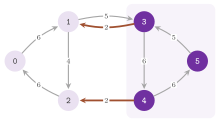

# 15. Minimum cuts {#ch-15}

We are concerned in this chapter with the cuts of minimum capacity of a graph
taken as a whole, i.e., with the nonempty proper subsets of the nodes whose
boundary has the least capacity, when no source and no sink are fixed in
advance. Between two given nodes, a minimum cut is the dual of a maximum flow,
and we refer to [chapter 12](12-max-flow.md#ch-12) for it. Three classes of
abLEMON solve these problems, all in the group [Minimum Cut
Algorithms](https://dmeoli.github.io/abLEMON/group__min__cut.html): `HaoOrlin`
(`lemon/hao_orlin.h`) for a digraph, `NagamochiIbaraki`
(`lemon/nagamochi_ibaraki.h`) for an undirected graph, and `GomoryHu`
(`lemon/gomory_hu.h`), which builds a tree from which the minimum cut between
any two nodes of an undirected graph can be read. Section 15.1 states the
problems and the facts on which the algorithms rest, sections 15.2 to 15.4
describe the algorithms, with their correctness and their complexity, and the
classes that implement them, and section 15.5 compares them.

## 15.1 The problems {#sec-15-1}

Let $D=(V,A)$ be a digraph with $n=|V|\geq 2$ nodes, $m=|A|$ arcs and
nonnegative capacities $c:A\rightarrow\mathbb{R}_+$. For $X\subseteq V$ we
write $\delta^+(X)$ and $\delta^-(X)$ for the arcs that leave and that enter
$X$, and $c(F)$ for the sum of the capacities of a set $F$ of arcs. A *cut* is
a set $X$ with $\emptyset\neq X\subsetneq V$, and the *minimum cut* of $D$ is
the value

$$\lambda(D)\;=\;\min\{\,c(\delta^+(X))\;:\;\emptyset\neq X\subsetneq V\,\}\tag{15.1}$$

together with a set that attains it, which we call a minimum cut as well. For
two distinct nodes $s$ and $t$, a set $X$ with $s\in X$ and $t\notin X$ is an
$s$-$t$ cut, and the minimum $s$-$t$ cut $\lambda(s,t)$ is the least capacity
$c(\delta^+(X))$ of such a set. By the max-flow min-cut theorem
([Theorem 12.1](12-max-flow.md#thm-12-1)) it equals the value of a maximum
flow from $s$ to $t$. For an undirected graph $G=(V,E)$ with capacities on the
edges, $\delta(X)$ is the set of the edges with one end in $X$ and the other
outside, and $\lambda(G)$ and $\lambda(s,t)$ are defined as above with
$c(\delta(X))$ in place of $c(\delta^+(X))$. In this case the cut function is
symmetric, i.e., $c(\delta(X))=c(\delta(V\setminus X))$, and hence
$\lambda(s,t)=\lambda(t,s)$. With unit capacities $\lambda(G)$ is the edge
connectivity of $G$, i.e., the least number of edges whose removal disconnects
it; the documentation of the library mentions this use first, as a test of the
"reliability" of a network.

Our first fact shows that $n-1$ minimum $s$-$t$ cuts in each direction are
enough to find $\lambda(D)$, and it is the starting point of the algorithm of
Hao and Orlin.

<span id="thm-15-1"></span>**Theorem 15.1.** *Let $r\in V$ be any node. Then*

$$\lambda(D)\;=\;\min\Big\{\,\min_{t\neq r}\lambda(r,t)\,,\;\min_{t\neq r}\lambda(t,r)\,\Big\}.\tag{15.2}$$

*Proof.* A cut $X$ that contains $r$ is an $r$-$t$ cut for any node $t\notin
X$, and hence $c(\delta^+(X))\geq\lambda(r,t)$; a cut that does not contain
$r$ is a $t$-$r$ cut for any node $t\in X$, and hence
$c(\delta^+(X))\geq\lambda(t,r)$. Conversely, each $s$-$t$ cut is a cut, and
therefore each term of the right-hand side of (15.2) is at least
$\lambda(D)$. $\square$

For an undirected graph the two halves of (15.2) coincide, and the second can
be dropped; we use this in section 15.2.2. The second fact, due to [Gomory and
Hu (1961)](Z-bibliography.md#ref-gomory1961multi), is that the $n(n-1)/2$
values $\lambda(s,t)$ of an undirected graph take at most $n-1$ distinct
values, and that one tree stores them together with a minimum cut for each
pair. It rests on the following inequality.

<span id="lem-15-1"></span>**Lemma 15.1.** *Let $G=(V,E)$ be an undirected
graph with nonnegative capacities, and let $x_0,x_1,\ldots,x_k$ be nodes of
$G$ with $x_0\neq x_k$. Then
$\lambda(x_0,x_k)\geq\min_{1\leq i\leq k}\lambda(x_{i-1},x_i)$, where a term
with $x_{i-1}=x_i$ is taken as $+\infty$.*

*Proof.* Let $X$ be a minimum $x_0$-$x_k$ cut. Since $x_0\in X$ and
$x_k\notin X$, there is an index $i$ such that $x_{i-1}\in X$ and $x_i\notin
X$; then $X$ is an $x_{i-1}$-$x_i$ cut, and
$\lambda(x_0,x_k)=c(\delta(X))\geq\lambda(x_{i-1},x_i)$. $\square$

<span id="thm-15-2"></span>**Theorem 15.2.** *Let $G=(V,E)$ be an undirected
graph with nonnegative capacities. There is a tree $T=(V,F)$, with a weight
$w(f)$ on each edge $f\in F$, such that for any two distinct nodes $s$ and $t$
the value $\lambda(s,t)$ is the least weight $w(f)$ of an edge $f$ on the path
of $T$ from $s$ to $t$, and the two components of $T-f$ are the two sides of a
minimum $s$-$t$ cut of $G$.*

*Proof.* Algorithm 15.3 of section 15.4 constructs, by Theorem 15.7, a tree
$T$ and weights $w$ such that, for every edge $f=v\,p(v)$ of $T$, the
component of $T-f$ that contains $v$ is a minimum $v$-$p(v)$ cut of $G$ of
capacity $w(f)$. Let $s=x_0,x_1,\ldots,x_k=t$ be the path of $T$ from $s$ to
$t$, and let $f$ be an edge of least weight on it. By Lemma 15.1 and since
each $w(x_{i-1}x_i)$ equals $\lambda(x_{i-1},x_i)$, one has
$\lambda(s,t)\geq w(f)$. Conversely, the component of $T-f$ that contains one
end of $f$ contains exactly one of $s$ and $t$, since $f$ lies on their path.
Hence, it is an $s$-$t$ cut (or a $t$-$s$ cut) of capacity $w(f)$, which
proves $\lambda(s,t)\leq w(f)$ and that this component is a minimum cut
between $s$ and $t$. $\square$

Such a tree is called a *Gomory-Hu tree*, and it is usually not unique. We
remark that its edges need not be edges of $G$, and that even when they are
(as in Figure 15.2) their weights are usually not the capacities of $G$,
which only bound them from below, since an edge lies in every cut that
separates its ends. Also, $\lambda(G)$ is the weight of the lightest edge of
$T$, and the at most $n-1$ distinct weights of $T$ are all the values
$\lambda(s,t)$.

## 15.2 The Hao-Orlin algorithm {#sec-15-2}

### 15.2.1 The method {#sec-15-2-1}

Theorem 15.1 requires $2(n-1)$ maximum flows, each of which costs
$O(n^2\sqrt{m})$ with the highest-label preflow push-relabel method of
[Goldberg and Tarjan (1988)](Z-bibliography.md#ref-goldberg88newapproach) (see
[chapter 12](12-max-flow.md#ch-12)). [Hao and Orlin
(1994)](Z-bibliography.md#ref-hao1994faster) observed that the minimum cuts
from a node $r$ to all the other nodes can be found in the time of one such
computation. To this aim the sinks are taken one after the other, and a node
that has been the sink becomes a source; the preflow and most labels of one
computation then remain valid at the start of the next one.

We recall the terms of [chapter 12](12-max-flow.md#ch-12). A *preflow* is a
map $f:A\rightarrow\mathbb{R}$ with $0\leq f\leq c$ whose *excess*
$e(v)=f(\delta^-(v))-f(\delta^+(v))$ is nonnegative at every node that is not
a source. The *residual digraph* $D_f$ has an arc $(u,v)$ for each arc
$(u,v)\in A$ with $f(u,v)<c(u,v)$ (a forward arc, of residual capacity
$c(u,v)-f(u,v)$), and also an arc $(v,u)$ for each arc $(u,v)\in A$ with
$f(u,v)>0$ (a backward arc, of residual capacity $f(u,v)$). To *push* $\theta$
along a residual arc means to increase the flow on its arc by $\theta$ if it
is forward, and to decrease it if it is backward, so that $\theta$ units of
excess move from its tail to its head. To *saturate* it means to push its
whole residual capacity. The node set is split, at any moment, into the
sources $S$, the *awake* nodes $W$, among which lies the current sink $t$, and
a stack of *dormant* sets $R_1,\ldots,R_q$ ($R_q$ on top). Each awake node $v$
has a *label* $d(v)$, a nonnegative integer, and the labels are *valid* if
$d(u)\leq d(w)+1$ for every residual arc $(u,w)$ with $u,w\in W$. Instead of
relabelling the nodes from which the current sink can no longer be reached,
the algorithm puts them aside in a new dormant set, which it brings back when
$W$ has been exhausted. An awake node other than $t$ with a positive excess is
*active*.

<span id="alg-15-1"></span>**Algorithm 15.1** (Hao-Orlin, the cuts that
contain $r$).

```
 1  S <- {r}; f <- 0; lambda <- +inf; saturate every arc (r, v) with
    c(r, v) > 0
 2  for each node u not in S and not yet reached, in the order of the
    node iterator: search the nodes that reach u by arcs of positive
    capacity, avoiding r and the nodes already reached, and label them
    by their distance to u; the first search makes W, every later one a
    dormant set put under the previous ones; t <- the node from which
    the first search started
 3  loop
 4    while W - {t} has an active node, take an active v of highest label:
 5      push from v along the residual arcs (v, w), w in W, d(w) = d(v) - 1
 6      if e(v) > 0 still:
 7        if v is alone in its label: the nodes of W of label >= d(v)
          become a new dormant set on top of the stack (a gap)
 8        else if v has no residual arc into W: {v} becomes a new dormant
          set on top of the stack
 9        else d(v) <- 1 + min{ d(w) : (v, w) residual, w in W }
10    if e(t) < lambda then lambda <- e(t); X <- V - W
11    S <- S + {t}; W <- W - {t}; saturate the residual arcs out of t
12    if W is empty: stop if the stack is empty, else W <- the dormant
      set on top of the stack, which leaves the stack
13    t <- a node of W of lowest label
```

Step 4 is the highest-label rule of the generic method, and steps 7 to 9
replace its relabelling. In `findMinCutOut()` of `lemon/hao_orlin.h` the
labels are positions in a list of buckets, i.e., of lists of nodes of equal
label (`_first`, `_last`, `_next`, `_prev`). The awake set and the dormant
sets are lists of buckets (`_sets`, whose last element is $W$), and the active
nodes come first in their bucket. Step 9 moves $v$ into the bucket just above
the lowest one that it can reach, which it creates if there is none. Step 10
compares the new cut with the best one by an exact `<`, while the tests that
an arc is residual and that an excess is left go through the tolerance
(section 15.2.2). The invariants of the algorithm are stated by the next
lemma.

<span id="lem-15-2"></span>**Lemma 15.2.** *At the beginning of each
iteration of the loop of step 4, and at step 10, (i) $f$ is a preflow whose
excess is nonnegative outside $S$; (ii) no residual arc goes from $S$ to a
node outside $S$, and no residual arc goes from a dormant set $R_i$ to $W$ or
to a dormant set $R_j$ with $j>i$; (iii) the labels of $W$ are valid, and they
form a set of consecutive integers.*

*Proof.* We first check the three properties after step 2. The pushes of step
1 make a preflow with $e(r)\leq 0$ and saturate the arcs out of $r$, which is
(i) and the first part of (ii). A node $u'$ of a later search with an arc
$(u',w)$ of positive capacity to a node $w$ found by an earlier search would
have been reached by that search, since $w$ reaches the start of it. As $f$ is
still zero outside the arcs out of $r$, this is the second part of (ii), with
the dormant sets stacked so that the later searches lie below. In each search
an arc $(u',w)$ of positive capacity gives $d(u')\leq d(w)+1$, since the
search reaches $u'$ at most one layer after $w$, and the layers are
consecutive, which is (iii).

We now check that each step preserves them. A push of step 5 moves excess
from $v$ to $w$, both awake, and it creates at most the residual arc $(w,v)$,
with $d(w)=d(v)-1\leq d(v)+1$; hence (i) to (iii) hold. At step 7 the
pushes of step 5 have saturated every residual arc from $v$ to a node of label
$d(v)-1$, and $v$ is the only node of label $d(v)$. Validity then shows that
no residual arc goes from a node of label at least $d(v)$ to a node of $W$ of
smaller label. Hence, the new dormant set has no residual arc into what
remains of $W$, and the older dormant sets have none into it, since they had
none into $W$. At step 8 the same holds for $\{v\}$ by the test itself, and
the label of $v$ stays occupied by the other nodes of its bucket. At step 9,
the minimum is taken over nodes of label at least $d(v)$ (those of label
$d(v)-1$ are no longer reachable), and the label of $v$ increases. Validity is
kept for the arcs out of $v$ by the choice of the minimum and for the arcs
into $v$ since the label grows. The new label is at most one more than the
largest label of $W$, while the old one stays occupied, since $v$ is not
alone in it. At step 11 the saturation removes every residual arc out of $t$
and adds excess only to nodes outside $S$, while the residual arcs that it
creates enter $t$, which is now in $S$. This keeps (i) and (ii), and removing
$t$ from the lowest label keeps (iii). At step 12, $W$ is empty, and the set
$R_q$ on top of the stack receives no residual arc from the sets below it nor
from $S$. Its labels, which no step has changed while it was dormant, are
valid and consecutive, since no residual arc between two of its nodes has
changed either (pushes stay inside $W$, and the saturations of step 11 only
touch arcs incident to $t$). $\square$

The value of a cut is read at step 10 from the excess of the sink, and the
next lemma shows that it is the best one among the cuts that contain the
current sources and leave out the current sink.

<span id="lem-15-3"></span>**Lemma 15.3.** *At step 10, let $X=V\setminus W$.
Then $c(\delta^+(X))=e(t)$, $S\subseteq X$ and $t\notin X$, and every set $Y$
with $S\subseteq Y$ and $t\notin Y$ satisfies $c(\delta^+(Y))\geq e(t)$.*

*Proof.* The sources are not awake, and $t$ is, which gives $S\subseteq X$ and
$t\notin X$. Since no node of $W$ other than $t$ is active at step 10, the
excess of $W$ is $e(t)$, and therefore
$e(t)=f(\delta^+(X))-f(\delta^-(X))$. By Lemma 15.2(ii) no residual arc goes
from $X$ to $W$, i.e., every arc of $\delta^+(X)$ has $f=c$ and every arc of
$\delta^-(X)$ has $f=0$; hence, $e(t)=c(\delta^+(X))$. Now let $Y$ contain $S$
and not $t$. Summing the excesses over $Y$ gives
$f(\delta^+(Y))-f(\delta^-(Y))=-\sum_{v\in Y}e(v)=\sum_{v\notin Y}e(v)$, since
the excesses of all the nodes add up to zero. Every node outside $Y$ is
outside $S$, and therefore has a nonnegative excess by Lemma 15.2(i), and $t$
is one of them; hence,
$c(\delta^+(Y))\geq f(\delta^+(Y))\geq f(\delta^+(Y))-f(\delta^-(Y))\geq
e(t)$. $\square$

<span id="thm-15-3"></span>**Theorem 15.3.** *Algorithm 15.1 terminates, and
at the end $\lambda=\min\{c(\delta^+(X)):r\in X\subsetneq V\}$ and $X$ is
a set that attains this minimum.*

*Proof.* We first show that the loop of step 4 ends for a fixed sink. While
the sink does not change, the labels are positions above the bucket of $t$,
and they never decrease: step 9 increases a label, and steps 7 and 8 only
remove nodes from $W$. By Lemma 15.2(iii) they are less than $|W|\leq n$, and
hence steps 7 to 9 occur at most $n^2$ times. Between two of them, every
iteration empties the active node $v$ of highest label $h$ and makes active
only nodes of label $h-1$. Hence, the pair formed by the highest label of an
active node and the number of active nodes of that label decreases
lexicographically, and it can do so at most $n^2$ times in a row. Each
iteration scans the arcs of $v$ once, and the loop therefore ends. Then every
node other than $r$ becomes the sink exactly once, since step 11 moves the
sink to $S$, step 12 refills $W$ from the stack, and the algorithm stops when
$W$ and the stack are empty, i.e., when $S=V$. Let $t_1,\ldots,t_{n-1}$ be the
sinks in this order and $S_k=\{r,t_1,\ldots,t_{k-1}\}$ the sources while
$t_k$ is the sink. Each set stored at step 10 contains $r$ and not the sink,
and its capacity is the stored value by Lemma 15.3. Conversely, let $X$
contain $r$, with $X\neq V$, and let $k$ be the least index with
$t_k\notin X$; then $S_k\subseteq X$, and Lemma 15.3 gives
$c(\delta^+(X))\geq e(t_k)\geq\lambda$. $\square$

For the cuts that do not contain $r$ one runs the same algorithm on the
reverse digraph (the searches of step 2 follow the arcs forward, the pushes go
backwards along them), and the stored set is then the awake set $W$ of step
10, which contains the sink but not $r$. By Theorem 15.3 applied to the
reverse digraph, its value is $\min\{c(\delta^+(X)):r\notin X\neq\emptyset\}$,
and by Theorem 15.1 the better of the two phases is $\lambda(D)$.

<span id="thm-15-4"></span>**Theorem 15.4.** *Each phase of Algorithm 15.1, as
implemented in `lemon/hao_orlin.h`, runs in $O(n^2\sqrt{m})$ time.*

*Proof sketch.* The argument of [Hao and Orlin
(1994)](Z-bibliography.md#ref-hao1994faster) bounds the work of a whole phase
by that of a single run of the push-relabel method. With labels counted from
a fixed origin instead of from the bucket of the current sink, a node is
relabelled $O(n)$ times in the phase, and there are $O(nm)$ saturating pushes,
while the scans of the arcs cost $O(nm)$ in all. The creation of the dormant
sets and their return to $W$ are paid by the relabellings and by the $n-1$
changes of the sink. The pushes that do not saturate their arc are counted by
the potential argument of Cheriyan and Maheshwari for the highest-label rule
(given for the maximum flow problem in [Ahuja, Magnanti and Orlin 1993,
§7.8](Z-bibliography.md#ref-amo93networkflows)). It bounds them by
$O(n^2\sqrt{m})$, and this term dominates. $\square$

The header also states the bound $O(nm)$ for unit capacities, and [Hao and
Orlin (1994)](Z-bibliography.md#ref-hao1994faster) give the bound
$O(nm\log(n^2/m))$ for a version with dynamic trees, which is not the one
implemented.

### 15.2.2 The class HaoOrlin {#sec-15-2-2}

The class is declared as
`template< typename GR , typename CAP = typename GR::template ArcMap< int > ,
typename TOL = Tolerance< typename CAP::Value > > class HaoOrlin`,
where `GR` is the digraph type, `CAP` a readable arc map of capacities of any
numeric type, and `TOL` the tolerance of the comparisons; there are no named
template parameters, and no traits class. Its public types are `Digraph`,
`CapacityMap` and `Tolerance` (the value type `CAP::Value`, which
`minCutValue()` returns, has no public name in the class). Its constructor
`HaoOrlin(graph, capacity, tolerance = Tolerance())` stores references to the
digraph and to the capacities, and `tolerance(tol)` and `tolerance()` set and
read the tolerance afterwards. An execution starts with `init()`, which takes
the first node of the node iterator of the digraph as $r$, or with
`init(source)`, which takes the given one; both allocate the structures of the
algorithm and set the stored value to the largest value of the capacity type.
Then `calculateOut()` runs the phase of Algorithm 15.1 (the cuts with $r$
inside) and `calculateIn()` the other one (the cuts with $r$ outside), in
either order, and one may also call only one of them. Also, `run()` and
`run(s)` call `init()` (respectively `init(s)`), `calculateOut()` and
`calculateIn()`.

Each phase replaces the stored cut only if it finds one of strictly smaller
value. Hence, by Theorem 15.3, after `calculateOut()` the stored cut is a
minimum one among the sets that contain $r$, and after both phases it is a
minimum cut of the digraph (Theorem 15.1). The results are read by
`minCutValue()`, which returns the value, and by `minCutMap(cutMap)`, which
also returns it after writing into a writable `bool` node map the
characteristic vector of the set $X$ of (15.1), i.e., of the side whose
leaving arcs have the least capacity. The digraph must have at least two
nodes, since a cut is a nonempty proper subset of them, and `init()` asserts
it with `LEMON_ASSERT` (which checks nothing when `NDEBUG` or
`LEMON_DISABLE_ASSERTS` is defined).

In this class the tolerance decides which arcs exist for the algorithm and
which nodes are active. An arc whose capacity (or residual capacity) is not
positive for the tolerance is ignored by the initial searches and by the
pushes, a push empties the node when the residual capacity is not less than
its excess, and a node keeps being processed while its excess is nonzero for
the tolerance. We recall that `Tolerance< CAP::Value >` is exact by default on
integer types, while on floating-point ones it compares with the absolute
epsilon of the library (i.e., $a<b$ is $a+\varepsilon<b$) (see [chapter
3](03-mental-model.md#ch-3)). With an inexact tolerance Lemma 15.3 holds only
up to the excesses that are left on the nodes as zero.

!!! note "abLEMON"
    The constructor and `tolerance()` are as in LEMON 1.3.1. In abLEMON,
    however, the test that a node still has an excess goes through the
    tolerance (`nonZero()`) instead of a comparison with an exact zero, so
    that on floating-point capacities a residue of rounding no longer keeps a
    node active. Furthermore, `init()` states and asserts the precondition of
    at least two nodes, on fewer of which LEMON 1.3.1 read an empty list.

On an undirected graph one may run `HaoOrlin` on the digraph `Undirector<GR>`
of [chapter 5](05-adaptors.md#ch-5), with the capacities of the original
edges. By Theorem 15.1 and the symmetry of the cut function, `init()`
followed by `calculateOut()` is then enough (the test `test/hao_orlin_test.cc`
runs both phases on an `Undirector`). The digraph of Figure 15.1 has, as its
minimum cut with node 0 inside, the set $\{0,1,2\}$, of value 5, whereas its
minimum cut is $X=\{3,4,5\}$, of value 4, which only the second phase finds.
The program `manual/examples/15-hao-orlin.cc` (the test
`manual_15_hao_orlin`) runs the two phases one at a time from node 0 on this
digraph, and then `run()`. It checks each value against the enumeration of
the $2^6-2$ cuts.

{#fig-15-1}

## 15.3 The Nagamochi-Ibaraki algorithm {#sec-15-3}

### 15.3.1 Maximum adjacency orderings {#sec-15-3-1}

On an undirected graph, [Nagamochi and Ibaraki
(1992)](Z-bibliography.md#ref-nagamochi1992computing) find $\lambda(G)$
without any flow, by orderings of the nodes that certify a lower bound on
$\lambda(u,v)$ for many pairs at once. We assume in this section that $G$ has
no loops and no parallel edges (the algorithm merges the parallel edges, and a
loop is in no cut), and for a node $u$ and a set $B\subseteq V$ we write
$c(u,B)$ for the capacity of the edges between $u$ and the nodes of $B$. An
ordering $v_1,\ldots,v_n$ of the nodes is a *maximum adjacency ordering* if
$v_1$ is arbitrary and each $v_j$, $j\geq 2$, maximizes the adjacency
$c(v,V_{j-1})$ among the nodes $v\notin V_{j-1}$, where
$V_k=\{v_1,\ldots,v_k\}$. For an edge $e=v_iv_j$ with $i<j$ we write
$q(e)=c(v_j,V_i)$; this is the adjacency of $v_j$ just after $v_i$ has been
ordered, i.e., the key of $v_j$ in the priority queue when $e$ is scanned.
Given a cut $X$, we call $v_k$, $k\geq 2$, *active* for $X$ if $v_{k-1}$ and
$v_k$ lie on different sides of $X$, and we write $\delta_k(X)$ for the edges
of $\delta(X)$ with both ends in $V_k$. The next two lemmas follow the
argument of [Stoer and Wagner (1997)](Z-bibliography.md#ref-stoer1997simple).

<span id="lem-15-4"></span>**Lemma 15.4.** *In a maximum adjacency ordering,
every node $v_k$ active for a cut $X$ satisfies
$c(v_k,V_{k-1})\leq c(\delta_k(X))$.*

*Proof.* By induction on the active nodes, in their order. For the first
active node $v_k$, the nodes $v_1,\ldots,v_{k-1}$ lie on the same side, and
$v_k$ on the other; hence, every edge between $v_k$ and $V_{k-1}$ is in
$\delta_k(X)$. Let now $v_k$ be active and let $v_a$, $a<k$, be the previous
active node. When $v_a$ was ordered, $v_k$ was not yet, and therefore
$c(v_k,V_{a-1})\leq c(v_a,V_{a-1})\leq c(\delta_a(X))$, by the maximality of
the ordering and by the induction hypothesis. The nodes $v_a,\ldots,v_{k-1}$
lie on the same side (there is no active node between $a$ and $k$), and $v_k$
on the other, since it is active; hence, the edges between $v_k$ and
$V_{k-1}\setminus V_{a-1}$ are in $\delta_k(X)$, and they are not in
$\delta_a(X)$, which only has edges inside $V_a$. Adding up,
$c(v_k,V_{k-1})=c(v_k,V_{a-1})+c(v_k,V_{k-1}\setminus V_{a-1})\leq
c(\delta_k(X))$. $\square$

<span id="lem-15-5"></span>**Lemma 15.5.** *In a maximum adjacency ordering,
every edge $e=v_iv_j$ with $i<j$ satisfies $\lambda(v_i,v_j)\geq q(e)$. In
particular, the edge between $v_n$ and the node of $V_{n-1}$ ordered last
among its neighbours has $q(e)=c(\delta(v_n))$.*

*Proof.* Let $X$ be a cut that separates $v_i$ from $v_j$, and let
$v_a,\ldots,v_i$ be the longest run of consecutive nodes of the ordering that
ends at $v_i$ and lies on the side of $v_i$. If $a=1$, all of $V_i$ lies on
the side opposite to $v_j$, and $q(e)=c(v_j,V_i)\leq c(\delta(X))$. Otherwise
$v_a$ is active, and $v_j$ was not yet ordered when $v_a$ was; hence, by the
maximality of the ordering and by Lemma 15.4,
$c(v_j,V_{a-1})\leq c(v_a,V_{a-1})\leq c(\delta_a(X))$. The edges between
$v_j$ and $v_a,\ldots,v_i$ are in $\delta(X)$ and not in $\delta_a(X)$, since
$v_j\notin V_a$; adding up,
$q(e)=c(v_j,V_{a-1})+c(v_j,V_i\setminus V_{a-1})\leq c(\delta(X))$. Since $X$
is arbitrary, $\lambda(v_i,v_j)\geq q(e)$. For the second part, the key of
$v_n$ after the last of its neighbours has been ordered is $c(v_n,V_{n-1})$,
which is $c(\delta(v_n))$. $\square$

It follows that an edge with $q(e)$ not smaller than the value $\mu$ of a cut
already found can be contracted: a cut that separates its ends has capacity at
least $\lambda(v_i,v_j)\geq q(e)\geq\mu$, and it is not better than the one at
hand. Each phase of the algorithm computes one ordering and takes as $\mu$ the
least capacity of a prefix $V_k$, $1\leq k<n$, of the ordering (these are
cuts, and their capacities are computed while the ordering is built, by
$c(\delta(V_k))=c(\delta(V_{k-1}))+c(\delta(v_k))-2c(v_k,V_{k-1})$). Then it
contracts the edges with $q(e)\geq\mu$, i.e., it merges their two ends into
one node, merges the parallel edges so created by adding their capacities, and
drops the loops.

<span id="alg-15-2"></span>**Algorithm 15.2** (Nagamochi-Ibaraki).

```
 1  skip the loops and merge the parallel edges;
    lambda <- min_v c(delta(v)); X <- that {v}
 2  if lambda = 0: stop
 3  repeat
 4    build a maximum adjacency ordering v_1, ..., v_n' of the current
      nodes from the first one, with q(e) for every edge e
 5    if it does not reach every node: X <- the original nodes of
      the nodes reached; lambda <- 0; stop
 6    mu <- min{ c(delta(V_k)) : 1 <= k < n' }, attained at V_k
 7    if mu < lambda: lambda <- mu; X <- the original nodes of V_k
 8    contract the edges e with q(e) >= mu
 9  until a single node is left
```

In the class, steps 1 and 2 are `init()`, and steps 4 to 9 are one call of
`processNextPhase()`. In `lemon/nagamochi_ibaraki.h` the keys of the ordering
are kept in a heap that maximizes them, and the value $q(e)$ is stored on the
edge (`cut`) when it is scanned. The original nodes merged into a node are
kept in a linked list (`_next_rep`), which steps 5 and 7 follow to write the
cut. Step 5 detects a disconnected graph, whose cut of value 0 is the
connected component of the first node. Step 8 scans the edges of each current
node, and the edges of a node merged into it are appended to its list, so that
they are scanned in the same step. An edge built by merging two parallel edges
keeps the value $q$ of the edge that was already incident to the node, which
may leave it uncontracted until the next phase. In abLEMON the comparisons of
steps 1, 2 and 7 go through the tolerance, while those of steps 6 and 8 are
exact.

<span id="thm-15-5"></span>**Theorem 15.5.** *With exact comparisons,
Algorithm 15.2 applied to a graph with at least two nodes terminates after at
most $n-1$ phases, and at the end $X$ is a minimum cut of $G$ and
$\lambda=\lambda(G)$.*

*Proof.* Each cut of the current graph, expanded to the original nodes merged
into its nodes, is a cut of $G$ of the same capacity, since the merged
parallel edges carry the sum of the capacities and the dropped loops join
nodes of the same side. We show that after each step the stored $X$ is a cut
of $G$ of capacity $\lambda$. We also show that either $\lambda=\lambda(G)$ or
a minimum cut of $G$ is still a cut of the current graph, i.e., separates no
two original nodes merged into one node. This holds after step 1, where
nothing has been merged, and at the stop of step 2, since no cut has a
negative capacity. If step 5 stops, the nodes reached form a union of
connected components of the current graph, i.e., a cut of value 0, which is
minimum. After step 7 one has $\lambda\leq\mu$; at step 8, by Lemma 15.5,
every cut of the current graph that separates the ends of a contracted edge
has capacity at least $q(e)\geq\mu\geq\lambda$. Hence, if a minimum cut of $G$
of value less than $\lambda$ was a cut of the current graph, it separates the
ends of no contracted edge and remains a cut of the contracted graph;
otherwise $\lambda=\lambda(G)$. When a single node is left, no cut of $G$ is a
cut of the current graph, and therefore $\lambda=\lambda(G)$. Finally, at step
6 the prefix $V_{n'-1}$ has $c(\delta(V_{n'-1}))=c(\delta(v_{n'}))$, and hence
$\mu\leq c(\delta(v_{n'}))$. By Lemma 15.5 the last edge scanned into $v_{n'}$
has $q(e)=c(\delta(v_{n'}))\geq\mu$; since step 8 scans every current edge, at
least one edge is contracted in each phase, which merges two nodes. $\square$

<span id="thm-15-6"></span>**Theorem 15.6.** *`init()` runs in $O(n+m)$ time,
and a phase in $O(m\log n)$ time with the default binary heap and in
$O(m+n\log n)$ time with a Fibonacci heap; hence, `run()` takes
$O(nm\log n)$ and $O(nm+n^2\log n)$ time, respectively.*

*Proof.* Step 1 scans each edge from its two ends once, and the parallel edges
are found by remembering, for each neighbour of the node being scanned, the
last edge built towards it (`curr_arc`). A phase inserts and removes each
current node once in the heap, and increases the key of a node once for each
edge scanned, i.e., at most $m$ times. With a binary heap each of these
operations costs $O(\log n)$, and with a Fibonacci heap the $n$ removals cost
$O(\log n)$ amortized each and the increases $O(1)$ amortized each
([chapter 7](07-heaps.md#ch-7)). Steps 5 to 7 cost $O(n)$, and step 8 handles
each edge of a merged node once, in $O(m)$. By Theorem 15.5 there are at most
$n-1$ phases. $\square$

The header adds that with unit capacities a bucket heap gives $O(nm)$. We
remark, however, that the merged edges no longer have unit capacities. Also,
the test of the library runs only the binary heap and the Fibonacci heap.

### 15.3.2 The class NagamochiIbaraki {#sec-15-3-2}

The class is declared as
`template< typename GR , typename CM = typename GR::template EdgeMap< int > ,
typename TR = NagamochiIbarakiDefaultTraits< GR , CM > >
class NagamochiIbaraki`,
where `GR` is an undirected graph type, `CM` a readable edge map of
capacities, and `TR` the traits class. Its public types are `Traits`, `Graph`,
`CapacityMap`, `Value` (the value type of the capacities), `Heap` and
`HeapCrossRef`, and `Create`, the class itself, as in every class with named
template parameters ([chapter 3](03-mental-model.md#ch-3)). The default traits
`NagamochiIbarakiDefaultTraits< GR , CM >` define `Value`, `Graph`,
`CapacityMap`, the cross reference `HeapCrossRef` (i.e.,
`GR::NodeMap< int >`), the heap
`BinHeap< Value , HeapCrossRef , std::greater< Value > >`, a binary heap that
maximizes the keys, and the functions that allocate them:
`createCapacityMap(graph)`, which fails with an assertion (the capacities must
be given to the constructor), `createHeapCrossRef(graph)` and
`createHeap(crossref)`.

There are two constructors: `NagamochiIbaraki(graph, capacity)` takes the
graph and the capacities, while `NagamochiIbaraki(graph)` is meant for the
named template parameter `SetUnitCapacity`, whose traits allocate a constant
map of value 1 on the edges; e.g., `NagamochiIbaraki< G
>::SetUnitCapacity::Create ni(g)` computes the edge connectivity of `g`.
Furthermore, the class declares the named parameters `SetHeap< H , CR >` and
`SetStandardHeap< H , CR >`, where `H` is a heap that maximizes the keys and
`CR` its cross reference, a node map of `int` by default. With
`SetStandardHeap` the algorithm constructs the cross reference on the graph
and the heap on the cross reference, while with `SetHeap` they must be handed
to the algorithm by `heap(hp, cr)` before `init()` (otherwise `init()` fails
with an assertion). The function `heap(hp, cr)` takes objects of the types
`Heap` and `HeapCrossRef` of the class, and it may also be used with the other
traits, in which case the class uses the given objects instead of allocating
its own. For instance, a Fibonacci heap of `std::greater< Value >` gives the
bounds of the second case of Theorem 15.6.

!!! note "abLEMON"
    In LEMON 1.3.1 the two named parameters did not compile, since the
    function that allocates the structures passes the graph to the
    `createHeapCrossRef()` of their traits, which took an `int`, and their
    default cross reference was a `RangeMap< int >`; the test
    `nagamochi_ibaraki_test` now runs both with a Fibonacci heap.

In the execution, `init()` builds the internal copy of the graph and makes
steps 1 and 2. Then `processNextPhase()` makes one phase and returns `true`
when the algorithm has finished (and again at every later call), `start()`
calls it until then, and `run()` is `init()` followed by `start()`;
`tolerance(tol)` and `tolerance()` set and read the `Tolerance< Value >` of
the comparisons. As for the results, `minCutValue()` returns the value of the
best cut found so far, which after `init()` is already the capacity of a cut
(the lightest star of a node) and at the end is $\lambda(G)$ by Theorem 15.5.
Similarly, `minCutMap(cutMap)` writes the characteristic vector of one side
of that cut into a writable `bool` node map, and returns its value. The graph
must have at least two nodes, a precondition that the header does not state:
on one node the stored set is the whole node set, of value 0. Also, the header
warns that the value type must hold the cut values of the graph, since their
sums may otherwise overflow, and notes that the capacities are supposed to be
integer. With floating-point capacities the result rests on the tolerance and
on the exact comparisons of steps 6 and 8, and the tests of the library cover
only integer capacities. On the graph of Figure 15.2 the algorithm finds the
value 3 (section 15.4.2 names the program that runs it phase by phase).

!!! note "abLEMON"
    `tolerance()` is new in abLEMON. LEMON 1.3.1 compared the cut values
    exactly, whereas abLEMON compares through the tolerance the stars of step
    1, the value 0 that ends step 2, and the update of step 7.

## 15.4 Gomory-Hu trees {#sec-15-4}

### 15.4.1 The construction {#sec-15-4-1}

Gomory and Hu's original construction ([Gomory and Hu
1961](Z-bibliography.md#ref-gomory1961multi)) computes $n-1$ maximum flows on
graphs obtained by contracting parts of $G$. [Gusfield
(1990)](Z-bibliography.md#ref-gusfield1990very) showed that a tree with the
properties of Theorem 15.2 can be obtained by $n-1$ maximum flows on the
original graph, if the cuts are kept in a rooted tree that is rearranged after
each flow. This second construction is the one of `lemon/gomory_hu.h`; there
each node $v$ other than the root $r$ has a parent $p(v)$ and a weight $w(v)$,
the weight of the edge $v\,p(v)$ of the tree, and the nodes are processed in
the order of the node iterator.

<span id="alg-15-3"></span>**Algorithm 15.3** (Gomory-Hu tree, the
construction of Gusfield).

```
 1  r <- the first node; p(v) <- r for every v != r
 2  for each node v != r, in the order of the node iterator:
 3    compute a minimum cut X between v and p(v), v in X, and its
      value f, by Preflow on G
 4    w(v) <- f
 5    for each u != v with u in X and p(u) = p(v): p(u) <- v
 6    if p(p(v)) is defined and lies in X:
 7      u <- p(v); p(v) <- p(u); p(u) <- v; w(v) <- w(u); w(u) <- f
 8  number the nodes so that every node comes after its parent
```

Step 3 is a call of `Preflow::runMinCut()` with the tolerance of the class,
and $X$ is the source side given by `minCut()`. Step 7 makes $v$ the parent of
its former parent when the cut puts its grandparent on its side: $v$ takes the
place of $p(v)$ under the grandparent, with the weight that $p(v)$ had, and
$p(v)$ hangs from $v$ with the weight $f$. Step 8 computes the numbering by
which the queries climb the two paths of the tree towards their common
ancestor. The correctness of the construction rests on the fact that minimum
cuts can be chosen so that they do not cross. We state it for the cut
function $\kappa(Y)=c(\delta(Y))$ of $G$. We recall that it is *submodular*,
i.e., $\kappa(Y)+\kappa(Z)\geq\kappa(Y\cap Z)+\kappa(Y\cup Z)$ for any two
sets $Y$ and $Z$ (an edge counted on the right is counted at least as many
times on the left).

<span id="lem-15-6"></span>**Lemma 15.6.** *Let $X$ be a minimum $s$-$t$ cut
of $G$, and let $u\neq v$ be two nodes of $X$. Then there is a minimum cut
between $u$ and $v$ contained in $X$.*

*Proof.* Let $Y$ be a minimum $u$-$v$ cut. If $t\in Y$, we replace $Y$ by
$V\setminus Y$, which by the symmetry of $\kappa$ is a minimum $v$-$u$ cut,
and in both cases $t\notin Y$ and $Y$ contains one of $u$ and $v$ but not the
other. Then $X\cap Y$ separates $u$ from $v$ and is contained in $X$, while
$X\cup Y$ contains $s$ and not $t$, and therefore
$\kappa(X\cup Y)\geq\kappa(X)$. By submodularity,
$\kappa(X\cap Y)\leq\kappa(X)+\kappa(Y)-\kappa(X\cup Y)\leq\kappa(Y)$, i.e.,
$X\cap Y$ is a minimum cut between $u$ and $v$. $\square$

<span id="thm-15-7"></span>**Theorem 15.7.** *At the end of Algorithm 15.3,
for every node $v\neq r$ the nodes of the subtree of $v$ in the tree of the
parents form a minimum $v$-$p(v)$ cut of $G$, of capacity $w(v)$; hence, by
the proof of Theorem 15.2, the tree with the edges $v\,p(v)$ and the weights
$w(v)$ is a Gomory-Hu tree.*

*Proof sketch.* This is the theorem of [Gusfield
(1990)](Z-bibliography.md#ref-gusfield1990very) on his cut-tree method, and
the proof is an induction on the iterations of step 2. After the iteration of
$v$, every processed node $u$ has $w(u)=\lambda(u,p(u))$, and the cuts that
the processed nodes have produced can be taken pairwise non-crossing. The
induction step rests on Lemma 15.6, which shows that the minimum cut of step
3 can be taken so that it does not cross those of the nodes processed before.
Steps 5 and 7 then rearrange the tree so that each subtree is the side of the
cut of its root. The details, and the proof that the arbitrary minimum cut
returned by the maximum flow is enough, are in [Gusfield
(1990)](Z-bibliography.md#ref-gusfield1990very); the Gomory-Hu theorem, with
the uncrossing of Lemma 15.6, is also in [Schrijver (2003),
§15.4](Z-bibliography.md#ref-schrijver03combinatorial). $\square$

The queries of the class climb the tree with the numbering of step 8, which
we call $o(v)$ (it is $0$ for the root, and larger for a node than for its
parent), and the next lemma shows that the climb meets the common ancestor.

<span id="lem-15-7"></span>**Lemma 15.7.** *Consider the procedure that starts
from two nodes $s$ and $t$ and, while the two current nodes differ, replaces
the one of larger number $o$ by its parent. It stops at the nearest common
ancestor $a$ of $s$ and $t$, after $h(s)+h(t)-2h(a)$ steps, where $h$ is the
depth in the tree, and the edges that it climbs form the path of the tree
from $s$ to $t$.*

*Proof.* If the current nodes $x\neq y$ have $o(x)<o(y)$, then $y$ is not an
ancestor of $x$, since an ancestor has a smaller number. Hence, the nearest
common ancestor of $x$ and $y$ is a proper ancestor of $y$, and it does not
change when $y$ is replaced by its parent. Each step decreases $h(x)+h(y)$ by
one, and the procedure stops when $x=y$, i.e., at the common ancestor; the
edges climbed are those from $s$ and from $t$ up to it. $\square$

<span id="thm-15-8"></span>**Theorem 15.8.** *`run()` takes the time of
$n-1$ calls of `Preflow::runMinCut()` plus $O(n^2)$, i.e., $O(n^3\sqrt{m})$.
Let $h$ be the height of the tree. Then `minCutValue(s, t)` takes $O(h)$ time,
and `minCutMap(s, t, cutMap)` and the constructors of the two iterators take
$O(nh)$ time, which is $O(n^2)$ in the worst case.*

*Proof.* Steps 5 to 7 scan the nodes once per iteration, in $O(n)$, and step 8
climbs from each node to the first numbered ancestor and numbers the nodes on
the way, in $O(n)$ in all. Each maximum flow costs $O(n^2\sqrt{m})$ by the
bound of the highest-label preflow algorithm ([Ahuja, Magnanti and Orlin
1993, §7.8](Z-bibliography.md#ref-amo93networkflows)). By Lemma 15.7
`minCutValue()` makes at most $2h$ steps. Then `minCutMap()` finds the
lightest edge of the path in the same way, and writes the side of each node by
climbing from it to the root or to the lower end of that edge. Since the nodes
met on the way are not marked, each climb costs up to $h$, and the $n$ climbs
up to $nh$. $\square$

### 15.4.2 The class GomoryHu {#sec-15-4-2}

The class is declared as
`template< typename GR ,
typename CAP = typename GR::template EdgeMap< int > > class GomoryHu`,
where `GR` is an undirected graph type and `CAP` a readable edge map of
capacities (the constructor checks the `ReadMap` concept on it). Its public
types are `Graph`, `Capacity` and `Value`, and it has no traits class. Its
constructor `GomoryHu(graph, capacity)` stores the references,
`tolerance(tol)` and `tolerance()` set and read the `Tolerance< Value >` given
to the maximum flows, and `run()` executes Algorithm 15.3 (there is no public
`init()`). One reads the tree by `predNode(v)`, the parent of $v$ (`INVALID`
for the root), and by `predValue(v)`, the weight of the edge between $v$ and
its parent (undefined for the root, where it is in fact the largest value of
`Value`). Also, `rootDist(v)` returns the number $o(v)$ of step 8: $0$ for the
root, and for any other node a number larger than that of its parent,
distinct for distinct nodes, i.e., an order of the tree from the root, not the
distance from it.

A minimum cut between two nodes is read by `minCutValue(s, t)`, which climbs
the two paths of the tree to their common ancestor and returns the least
weight met (Lemma 15.7 and Theorem 15.2). In the same way `minCutMap(s, t,
cutMap)` finds the lightest edge of the path, writes `true` on the side of $s$
and `false` on the other side into a readable and writable `bool` node map,
and returns the value. For $s=t$, `minCutValue()` returns the largest value of
`Value`, whereas `minCutMap()` (and hence the iterators below) must not be
called, since it then writes a map at the node `INVALID`. A cut can also be
listed by two iterators. `MinCutNodeIt(gomory, s, t, side = true)` lists the
nodes of the side of $s$ (or those of the other side if `side` is `false`).
Similarly, `MinCutEdgeIt(gomory, s, t, side = true)` lists the edges of the
cut, each once, as the arc that leaves the side of $s$ (or enters it if `side`
is `false`); the latter converts to both `Arc` and `Edge`. Each constructor
calls `minCutMap()` on a node map that the iterator holds, at the cost of
Theorem 15.8, and the postfix increments return a `Node` (respectively an
`Arc`) instead of an iterator. Since a minimum cut need not be unique,
`MinCutNodeIt(gomory, s, t, true)` and `MinCutNodeIt(gomory, t, s, false)` may
list different nodes, whereas `MinCutNodeIt(gomory, s, t, true)` and
`MinCutNodeIt(gomory, s, t, false)` together list each node once. The graph
must have at least one node, since `run()` writes the maps of the class at the
first node, which on an empty graph is `INVALID`.

!!! note "abLEMON"
    `tolerance()` is new in abLEMON. LEMON 1.3.1 gave its maximum flows the
    default tolerance of the value type, while abLEMON gives them the one set
    on the class.

{#fig-15-2}

On the graph of Figure 15.2 the tree is the path $0,1,2,4,3,5$ with the
weights $5,7,3,6,6$; hence, e.g., $\lambda(0,5)=3$ and $\lambda(1,2)=7$. The
program `manual/examples/15-undirected-cuts.cc` (the test
`manual_15_undirected_cuts`) computes the minimum cut of this graph by
`NagamochiIbaraki`, one phase at a time, and then its Gomory-Hu tree. It
checks the value of the cut against the enumeration of all the cuts. For each
of the 15 pairs of nodes, it also checks the value read from the tree against
a maximum flow, the sides given by `minCutMap()`, and the sum of the
capacities listed by `MinCutEdgeIt`.

## 15.5 Choosing an algorithm {#sec-15-5}

For a digraph `HaoOrlin` is the only class of the chapter, and it is arguably
also the natural choice when one needs the best cut on a given side of a node
(the stored cut after `calculateOut()`). For the minimum cut of an undirected
graph, `NagamochiIbaraki` uses no flow, and its phases may be far fewer than
$n-1$, since all the edges with $q(e)\geq\mu$ are contracted at once. On the
other hand, `HaoOrlin` with the first phase only, on the `Undirector`, has the
bound of a single maximum flow (Theorem 15.4), against the $O(nm\log n)$ of
Theorem 15.6. Which of the two is faster typically depends on the instance,
and neither the headers nor the works cited here give a rule that settles it
in general. `GomoryHu` costs $n-1$ maximum flows. It pays off when the cuts of
"many" pairs of nodes are needed, since each value is then read from the tree
in $O(h)$ time, whereas for the cut of one pair (or of a "few" pairs) a
maximum flow of [chapter 12](12-max-flow.md#ch-12) is cheaper.

## 15.6 Exercises {#sec-15-6}

<span id="ex-15-1"></span>**Exercise 15.1.** Check Theorem 15.1 on the
digraph of Figure 15.1 by computing $\lambda(0,t)$ and $\lambda(t,0)$ with
`Preflow` for every $t\neq 0$ and comparing the least of them with
`HaoOrlin::minCutValue()` (the program `manual/examples/15-hao-orlin.cc` gives
the value 4).

<span id="ex-15-2"></span>**Exercise 15.2.** Show that, on the digraph
`Undirector<GR>` of an undirected graph, the value stored after
`calculateOut()` is already $\lambda(G)$, and verify it on the graph of
`test/hao_orlin_test.cc`, whose test runs both phases.

<span id="ex-15-3"></span>**Exercise 15.3.** Compute the edge connectivity of
the graph of Figure 15.2 with
`NagamochiIbaraki< SmartGraph >::SetUnitCapacity::Create`, and check the cut
it gives by counting its edges (the fourth block of
`test/nagamochi_ibaraki_test.cc` does the same on another graph).

<span id="ex-15-4"></span>**Exercise 15.4.** Print the value `minCutValue()`
of `NagamochiIbaraki` on the graph of Figure 15.2 after `init()` and after
each call of `processNextPhase()`. Explain why the sequence is nonincreasing,
and why its first value is the lightest star of a node (5, at node 0).

<span id="ex-15-5"></span>**Exercise 15.5.** Using only `predNode()` and
`predValue()` of `GomoryHu`, count the distinct values among the
$\lambda(s,t)$ of a graph, and deduce from Theorem 15.2 that there are at most
$n-1$ of them; check the values against `minCutValue(s, t)` for each pair, as
`test/gomory_hu_test.cc` does against `Preflow`.

<span id="ex-15-6"></span>**Exercise 15.6.** Show that the sum of the
capacities listed by `MinCutEdgeIt(gomory, s, t)` equals `minCutValue(s, t)`,
and that the nodes listed by `MinCutNodeIt` with `side` true and false
partition $V$ (both facts are checked by `test/gomory_hu_test.cc`, the first
also by `manual/examples/15-undirected-cuts.cc`).
