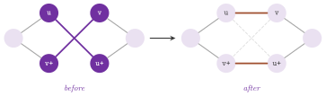

# 19. Travelling salesman and maximum clique {#ch-19}

This chapter describes two families of algorithms for NP-hard problems, for
which the library mostly offers heuristics. The first family consists of the
five tour construction and improvement methods for the symmetric Travelling
Salesman Problem (TSP) of `nearest_neighbor_tsp.h`, `greedy_tsp.h`,
`insertion_tsp.h`, `christofides_tsp.h` and `opt2_tsp.h`, which share one
interface ([§19.1](19-tsp-clique.md#sec-19-1) to
[§19.4](19-tsp-clique.md#sec-19-4)). The second consists of the two algorithms
for the maximum clique problem of `grosso_locatelli_pullan_mc.h` and
`tomita_seki_mc.h`, an iterated local search and an exact branch and bound
([§19.5](19-tsp-clique.md#sec-19-5) to [§19.7](19-tsp-clique.md#sec-19-7)).
None of these classes takes a tolerance or uses the named template parameters
of [chapter 3](03-mental-model.md#ch-3): the TSP classes are parameterized by
the type of the cost map, and the clique classes by the type of the graph.

## 19.1 The symmetric travelling salesman problem {#sec-19-1}

We are concerned with an undirected complete graph $K_n=(V,E)$, $|V|=n$, whose
edges carry a cost $c:E\to\mathbb{R}$, and with the problem of finding a
Hamiltonian cycle (a *tour*) of least cost, i.e.,

$$
\min \Big\{ \sum_{i=0}^{n-1} c(v_{\pi(i)}, v_{\pi(i+1 \bmod n)}) \;:\; \pi \text{ a permutation of } \{0,\dots,n-1\} \Big\} . \tag{19.1}
$$

The cost is *metric* when it satisfies the triangle inequality
$c(u,w)\le c(u,v)+c(v,w)$ for all $u,v,w$. The documentation of the group
states that the TSP classes are intended for metric costs, and that on other
costs they may give worse tours; this is a statement on quality, since no
class checks the inequality and each of them returns a tour whatever the costs
are. Of course, (19.1) is NP-hard, and without the triangle inequality it
cannot be approximated within any constant factor unless P = NP. With it, the
best guarantee among the classes of the library is the factor $3/2$ of
Christofides' algorithm (Theorem 19.1).

All five classes run on a `FullGraph` ([chapter 4](04-graphs.md#ch-4)), the
complete undirected graph in which `edge(u, v)` finds the edge between two
nodes in constant time, and they have the same interface, which we describe
once. The class template takes one parameter `CM`, the type of the cost map,
i.e., a readable edge map of `FullGraph`; its value type is exported as
`Cost`, and the map type as `CostMap`. The constructor takes the graph and the
cost map and keeps references to them, which must therefore live as long as
the object.

A call of `run()` computes a tour and returns its cost, which `tourCost()`
gives again afterwards. Then `tourNodes()` returns a constant reference to the
`std::vector< FullGraph::Node >` of the nodes in the order of the tour,
`tourNodes(out)` copies this sequence through an output iterator, and
`tour(path)` clears a path structure ([chapter 8](08-auxiliary.md#ch-8)) and
fills it with the $n$ arcs of the tour. The last of these arcs goes from the
last node of the sequence back to the first. The returned cost is recomputed
at the end as the sum of the $n$ edges of the sequence, and hence it agrees
with `tourNodes()` up to the order of the floating-point sums. The degenerate
graphs are handled alike by all the classes: with no node the tour is empty
and costs 0, with one node it consists of that node and costs 0, and with two
nodes it visits both and costs twice their edge.

## 19.2 Tour construction heuristics {#sec-19-2}

We now describe the four classes that build a tour from scratch, ordered by
the effort they spend. In the notation of (19.1), $T$ is the current partial
tour or path, $d(w,T)=\min_{t\in T} c(w,t)$ is the distance of a node $w$ from
it, and

$$
\delta(u,v;w) = c(u,w) + c(w,v) - c(u,v) \tag{19.2}
$$

is the increase of cost when $w$ is inserted between the consecutive nodes $u$
and $v$ of $T$.

### 19.2.1 Nearest neighbor {#sec-19-2-1}

Our first class, `NearestNeighborTsp< CM >`, implements the nearest neighbor
heuristic in the variant that grows a path at both of its ends. It starts from
an edge of minimum cost, found by `mapMin()` over all the edges; at each step
it appends to the end whose nearest unvisited node is nearer, until the path
contains all the nodes. The closing edge then turns the path into a tour.

<span id="alg-19-1"></span>**Algorithm 19.1** (Nearest neighbor, two-ended).

```
1  let {n1, n2} be an edge of minimum cost; P := (n1, n2)
2  while |P| < n:
3      e1 := cheapest edge from n1 to an unvisited node   (kept until invalid)
4      e2 := cheapest edge from n2 to an unvisited node   (kept until invalid)
5      if c(e1) < c(e2): prepend the other end w of e1 to P; n1 := w
6      else:             append the other end w of e2 to P; n2 := w
7  close P with the edge {n2, n1}
```

Note that the candidate edge of an end is searched again only when it has been
used, or when its other end has just been reached from the opposite end (lines
3 and 4). Thus, each step scans at most two stars of $n-1$ edges, and the
algorithm runs in $O(n^2)$ time, as the header states. In practice the tours
are usually "reasonable", but on special instances they may be very bad. For
metric costs, [Rosenkrantz, Stearns and Lewis
1977](Z-bibliography.md#ref-rosenkrantz1977analysis) proved that a nearest
neighbor tour costs at most $(\lceil\log_2 n\rceil+1)/2$ times the optimal
value, and gave instances on which the ratio exceeds $\log_2(n+1)/3+4/9$.
Their analysis, however, concerns the classical one-ended variant, which
differs from the one of the library.

### 19.2.2 Greedy edge selection {#sec-19-2-2}

Next, `GreedyTsp< CM >` builds a tour by the greedy matching heuristic. It
sorts all the edges by nondecreasing cost and scans them; an edge is kept when
both of its ends have degree at most one among the edges already kept and it
does not close a cycle, which a union-find structure on the nodes ([chapter
8](08-auxiliary.md#ch-8)) detects. After $n-1$ edges have been kept they form
a Hamiltonian path, whose two ends of degree one are joined to close the tour.

<span id="alg-19-2"></span>**Algorithm 19.2** (Greedy).

```
1  sort the edges by nondecreasing cost
2  F := {}; each node is a singleton of the union-find structure
3  for each edge {u, v} in that order, until |F| = n - 1:
4      if deg_F(u) <= 1 and deg_F(v) <= 1 and join(u, v) merges two sets:
5          F := F + {u, v}
6  join the two nodes of degree one of F
```

According to the header, the running time is $O(n^2)$. We remark, however,
that line 1 applies `std::sort` to the $n(n-1)/2$ edges of the complete graph,
which makes the worst case $O(n^2\log n)$; the scan of lines 3 to 5 costs
$O(n^2\,\alpha(n))$. As for the nearest neighbor method, the tours are usually
short but may be very bad in special cases.

### 19.2.3 Insertion {#sec-19-2-3}

In `InsertionTsp< CM >` one maintains a subtour $T$, initially of two nodes,
and inserts the other nodes one at a time, each at the position that minimizes
(19.2). The node that enters next is decided by one of the four selection
rules of the enumeration `SelectionRule`, passed to `run(rule)`; the default
is `FARTHEST`.

| Rule | Initial subtour | Node selected at each step | Time |
|--------------------|----------------------------|----------------------------|--------|
| `NEAREST` | ends of an edge of minimum cost | an unvisited $w$ of least $d(w,T)$ | $O(n^2)$ |
| `FARTHEST` (default) | ends of an edge of maximum cost | an unvisited $w$ of largest $d(w,T)$ | $O(n^2)$ |
| `CHEAPEST` | ends of an edge of minimum cost | the unvisited $w$ and position of least $\delta(u,v;w)$ | $O(n^3)$ |
| `RANDOM` | ends of an edge of minimum cost | an unvisited node drawn uniformly by the global `rnd` | $O(n^2)$ |

<span id="tab-19-1"></span>**Table 19.1.** The selection rules of
`InsertionTsp`, as `init()` and the selection functors of the header implement
them.

<span id="alg-19-3"></span>**Algorithm 19.3** (Insertion).

```
1  T := the two ends of the initial edge of the rule (Table 19.1)
2  for each unvisited w: d(w) := d(w, T)              (NEAREST, FARTHEST)
                         or best (delta, position)    (CHEAPEST)
3  repeat n - 2 times:
4      select w by the rule; remove it from the unvisited nodes
5      insert w between the consecutive u, v of T of least delta(u, v; w)
6      update d(x) := min{ d(x), c(w, x) } for the unvisited x
                      (or, for CHEAPEST, the best insertion of each x)
```

For `NEAREST`, `FARTHEST` and `RANDOM`, the selection and the update of $d$
cost $O(n)$ per step, and so do the search of the position and the insertion
into the vector of the subtour; hence, the running time is $O(n^2)$. For
`CHEAPEST`, each unvisited node keeps its best insertion cost and position.
After an insertion, only the two new pairs of consecutive nodes are compared
with it, unless the pair it would have been inserted into has just been
broken; in this case, its best position is searched again in $O(n)$. A step
therefore costs $O(n^2)$ in the worst case, and the algorithm $O(n^3)$,
although the header remarks that in most cases it is almost as fast as with
the other rules. In the code, the rules are private functors passed to
`start()`: `ComparingSelection` (with `std::less` for `NEAREST` and
`std::greater` for `FARTHEST`), `CheapestSelection` and `RandomSelection`
select the node, and `DefaultInsertion` inserts it at its best position, while
`CheapestInsertion` only adds the cost that `CheapestSelection` has already
computed, the insertion being done by the latter.

As for `RANDOM`, it draws from the global generator `rnd` ([chapter
8](08-auxiliary.md#ch-8)), which one may seed before `run()` to make the tour
reproducible. The header describes `FARTHEST` as typically the most effective
rule, and `RANDOM` as usually slightly worse but less sensitive to the
instance. For metric costs, the nearest and the cheapest insertion give tours
of cost at most twice the optimal one ([Rosenkrantz, Stearns and Lewis
1977](Z-bibliography.md#ref-rosenkrantz1977analysis)). For the farthest
insertion only the logarithmic bound of any order of insertion is known,
although in practice it is often (but not always) the best of the four rules.

### 19.2.4 Christofides' algorithm {#sec-19-2-4}

Finally, `ChristofidesTsp< CM >` implements the heuristic of [Christofides
1976](Z-bibliography.md#ref-christofides1976worst). It combines a minimum cost
spanning tree with a minimum cost perfect matching on the nodes of odd degree
of the tree (Figure 19.1), and it is the only class of the family with a
guaranteed approximation factor.

{#fig-19-1}

<span id="alg-19-4"></span>**Algorithm 19.4** (Christofides).

```
1  T := minimum cost spanning tree of K_n                  (kruskal)
2  O := nodes of odd degree in T                           (|O| is even)
3  M := minimum cost perfect matching of the complete graph on O
         (MaxWeightedPerfectMatching on the costs -c, on a SmartGraph)
4  H := the multigraph T + M on a SmartGraph               (all degrees even)
5  walk the Euler tour of H (EulerIt); append each node when first reached
```

In the code, the tree is computed by `kruskal()` ([chapter
11](11-spanning.md#ch-11)), and the closed walk by `EulerIt` ([chapter
18](18-properties.md#ch-18)). The matching is computed by
`MaxWeightedPerfectMatching` ([chapter 17](17-matching.md#ch-17)) on a copy of
the subgraph induced by $O$ whose edge weights are the negated costs; for this
reason, the header warns that `CM::Value` must be a signed number type. Line 5
skips the nodes already visited, i.e., it replaces a subpath by the direct
edge between its ends, which does not increase the cost when the triangle
inequality holds. This gives the guarantee below, proved in [Christofides
1976](Z-bibliography.md#ref-christofides1976worst).

<span id="thm-19-1"></span>**Theorem 19.1.** *If $c$ is metric, the tour
returned by Algorithm 19.4 costs at most $3/2$ times the optimal value of
(19.1).*

We recall that the proof rests on two facts. First, $c(T)$ is at most the
optimal value, since removing an edge from an optimal tour leaves a spanning
tree. Second, $c(M)$ is at most half of it, since an optimal tour shortcut to
the nodes of $O$ splits into two perfect matchings of $O$. The running time is
dominated by the matching, and the header gives $O(n^3\log n)$ for the whole
method. In practice, the tours are usually much better than the bound: in the
example of [§19.4](19-tsp-clique.md#sec-19-4) the tour costs less than 1.3
times the spanning tree.

## 19.3 Improvement by 2-opt {#sec-19-3}

We now turn to `Opt2Tsp< CM >`, which implements the 2-opt local search of
[Croes 1958](Z-bibliography.md#ref-croes1958method). Given a tour, it looks
for two of its edges $\{u,u^+\}$ and $\{v,v^+\}$, with $u^+$ and $v^+$ the
successors of $u$ and $v$, such that

$$
c(u,u^+) + c(v,v^+) > c(u,v) + c(u^+,v^+) , \tag{19.3}
$$

and replaces them by $\{u,v\}$ and $\{u^+,v^+\}$; this reverses the path from
$u^+$ to $v$ and decreases the cost (Figure 19.2). The search stops when no
pair satisfies (19.3), i.e., at a *2-optimal* tour.

{#fig-19-2}

There are three ways to give the starting tour. A call of `run()` starts from
the order of the node ids; `run(path)` starts from a path structure, which
must be a valid path of $n$ arcs (cf. `checkPath()` in [chapter
8](08-auxiliary.md#ch-8)); and `run(nodes)` starts from a
`std::vector< Node >` that holds all the nodes in the order of the tour. The
typical use is the improvement of the tour of a construction heuristic, e.g.,
`opt2.run(ins.tourNodes())`. The tour is kept as a list of two neighbors per
node, without an orientation; hence, a move rewires four entries and costs
$O(1)$, with no explicit reversal of a path.

<span id="alg-19-5"></span>**Algorithm 19.5** (2-opt, first improvement).

```
1  restart:
2  for each node u of the tour, from node 0 in the order of the tour:
3      for each v after u+ in the tour, before the predecessor of u:
4          if (19.3) holds for (u, u+) and (v, v+):
5              replace {u,u+}, {v,v+} by {u,v}, {u+,v+}   (O(1) rewiring)
6              goto restart
7  the tour is 2-optimal; list it from node 0 and recompute its cost
```

Each pass takes the first improving move, and it restarts from the first node
after each move (the `goto` of `start()`). A pass without moves thus costs
$O(n^2)$ evaluations of (19.3), and each move is paid by the scan that
precedes it. The number of moves is not polynomially bounded in general, and
the header describes the method as rather slow but effective. Note that (19.3)
is a strict comparison without tolerance; for floating-point costs, a move
whose gain is below the rounding of the four costs may or may not be taken.

On points of the plane with Euclidean costs, two edges that cross always
satisfy (19.3). A 2-optimal tour has therefore no crossing edges, and on
points in convex position it is the optimal tour, i.e., the boundary of their
convex hull (Exercise 19.2); the example of [§19.4](19-tsp-clique.md#sec-19-4)
checks this.

## 19.4 Choosing a heuristic, and an example {#sec-19-4}

We summarize the trade-off as the documentation of the group does. The fastest
methods are `NearestNeighborTsp`, `GreedyTsp` and `InsertionTsp`, and the
insertion is usually quite effective; `ChristofidesTsp` is somewhat slower,
but it has the best guarantee. Finally, `Opt2Tsp` is the slowest, it usually
gives the best tours in practice, and it can improve the tour of any other
method.

On random Euclidean instances, the farthest insertion followed by 2-opt is a
sensible default. The run of the example below on 40 points of the unit square
illustrates this (on one instance, and therefore only as an illustration). The
nearest neighbor and the greedy tours cost 5.58 and 5.33, the four insertion
rules give 5.37 (nearest), 4.76 (farthest), 5.20 (cheapest) and 4.93 (random),
and Christofides' tour costs 4.90, against 3.81 for the spanning tree. Also,
2-opt brings the farthest insertion tour to 4.76, and the other three to
between 4.83 and 5.21.

Our program first takes twelve points of a circle, numbered out of their
angular order. On them, each tour must cost at least the perimeter of the
regular polygon, Christofides' tour at most $3/2$ of it, and the 2-opt tour
(whose starting order, by node id, is far from the polygon) cost the
perimeter. Then the program runs each method on the random points. It checks
that each tour visits each node once and costs the returned value, that it
costs at least the minimum spanning tree, and that Christofides' tour costs at
most twice the tree, a consequence of the proof of Theorem 19.1.

```cpp
--8<-- "examples/19-tsp.cc"
```

## 19.5 The maximum clique problem {#sec-19-5}

Given an undirected graph $G=(V,E)$, a *clique* is a set $C\subseteq V$ of
pairwise adjacent nodes. In the maximum clique problem one looks for a clique
of largest cardinality $\omega(G)$, i.e.,

$$
\omega(G) = \max\{ |C| \;:\; C\subseteq V,\ \{u,v\}\in E \ \text{for all distinct}\ u,v\in C \} . \tag{19.4}
$$

Since the problem is NP-hard and hard to approximate, the library offers two
algorithms with different aims. `GrossoLocatelliPullanMc` is a heuristic that
quickly finds a "large" clique, without a proof of its maximality.
`TomitaSekiMc` is an exact branch and bound that proves the clique it finds
maximum, in a time that may grow exponentially with the size of the graph,
unless a limit on its search tree stops it first. Both copy the graph into an
$n\times n$ adjacency matrix of `char`, which costs $O(n^2)$ memory and time
before the search starts. Both also ignore loops (a loop does not make a node
adjacent to itself) and parallel edges.

!!! note "abLEMON"
    `TomitaSekiMc` is new in abLEMON (version 1.5.0). In LEMON 1.3.1,
    `GrossoLocatelliPullanMc` ran forever on a graph with a loop, which made a
    node adjacent to itself and kept it among the candidates of the clique it
    already belonged to; abLEMON ignores loops when it builds the adjacency
    matrix.

## 19.6 The iterated local search of Grosso, Locatelli and Pullan {#sec-19-6}

Our heuristic class, `GrossoLocatelliPullanMc< GR >`, implements the iterated
local search of [Grosso, Locatelli and Pullan
2008](Z-bibliography.md#ref-grosso08maxclique) on an undirected graph of type
`GR`. It keeps a current clique $C$ and, for each node $w$, the number
$\delta(w)$ of nodes of $C$ not adjacent to $w$, where a node of $C$ counts
itself. Thus, $\delta(w)=0$ holds for the nodes that can be added to $C$, and
$\delta(w)=1$, with $w\notin C$, for the nodes that can replace one node of
$C$. An iteration perturbs $C$ and improves it by a local search with a tabu
set; the largest clique found over all the iterations is the result.

<span id="alg-19-6"></span>**Algorithm 19.6** (One iteration of the local
search).

```
1  R := { w : delta(w) >= 4 }; pick r uniformly in R, or in V if R is empty
2  remove from C the nodes not adjacent to r; add r to C           (restart)
3  tabu := {}; max_swap := |C|
4  while the step limit is not reached:
5      if a non-tabu w has delta(w) = 0:            add w to C
           (and max_swap := |C| while tabu is still empty)
6      elif a non-tabu w not in C has delta(w) = 1:
           add w, remove the one node v of C not adjacent to w, tabu += v
           max_swap := max_swap - 1; stop the iteration if max_swap <= 0
7      elif some w has delta(w) = 0 (tabu allowed): add w to C
8      else stop the iteration
9  if |C| > |best|: best := C; return SIZE_LIMIT if |best| >= the size limit
```

Each selection of lines 5, 6 and 7 is a *step*, and it costs $O(n)$, since the
update of $\delta$ after an addition or a removal is one pass over a row of
the matrix. The node selected among the eligible ones depends on the rule
passed to `run(rule)`, of the enumeration `SelectionRule`. With `RANDOM` it is
the first eligible node in cyclic order from a random starting index; with
`DEGREE_BASED` it is an eligible node of maximum degree, ties going to the
first one in the same cyclic order; with `PENALTY_BASED`, the default, it is
an eligible node of minimum penalty. The header describes the penalties as
updated adaptively after each stage, as in [Grosso, Locatelli and Pullan
2008](Z-bibliography.md#ref-grosso08maxclique). In the code, however, the
penalties start at zero and the function `update()` that would change them is
empty; in fact, `PENALTY_BASED` selects the same node as `RANDOM`. The three
rules are the private classes `RandomSelectionRule`,
`DegreeBasedSelectionRule` and `PenaltyBasedSelectionRule`, of which `start()`
is a template.

Three limits control the search; each is set by a function that returns a
reference to the object, and read by the function of the same name without
argument. The function `iterationLimit(int)` sets the number of iterations
(restarts), 1000 by default; `stepLimit(int)` sets the number of steps over
all the iterations, by default $-1$, i.e., no limit; and `sizeLimit(int)` sets
a clique size at which the search stops at once, by default $-1$, which stands
for the number of nodes. The value $-1$ removes the iteration limit too, and
the header warns that one should then set a step limit, since otherwise the
search does not end. The function `run(rule)` returns the cause of the
termination, of the enumeration `TerminationCause`: `ITERATION_LIMIT`,
`STEP_LIMIT` or `SIZE_LIMIT`. The last one is also the answer on a graph with
no node (clique of size 0) and on a graph with one node (clique of size 1).

The random choices use a generator of type `Random` ([chapter
8](08-auxiliary.md#ch-8)) owned by the object, which the three constructors
initialize differently. `GrossoLocatelliPullanMc(graph)` copies the state of
the global generator `rnd` at the time of the construction; the global
generator is not advanced, and two objects built one after the other draw the
same sequence. `GrossoLocatelliPullanMc(graph, seed)` seeds the generator with
`seed`, and `GrossoLocatelliPullanMc(graph, random)` copies the given one. The
results are read by `cliqueSize()` and by `cliqueMap(map)`, which writes
`true` on the nodes of the clique and `false` elsewhere, in a writable node
map with `bool` (or convertible) values. Also, the iterator `CliqueNodeIt`,
constructed from the algorithm object, lists the nodes of the clique (note
that its postfix increment returns a `Node`, not an iterator).

## 19.7 The exact algorithm of Tomita and Seki {#sec-19-7}

For the exact solution, `TomitaSekiMc< GR >` implements the branch and bound
MCQ of [Tomita and Seki 2003](Z-bibliography.md#ref-tomita2003efficient). A
node of its search tree is a clique $C$ together with the set $P$ of the
candidates, i.e., the nodes adjacent to all the nodes of $C$. The bound that
prunes the tree is the number of colors of a proper coloring of the subgraph
induced by $P$, which no clique of $P$ can exceed.

<span id="lem-19-1"></span>**Lemma 19.1.** *If the nodes of $P$ are
partitioned into $k$ independent sets, a clique contained in $P$ has at most
$k$ nodes; hence, no clique that extends $C$ by nodes of $P$ is larger than
$|C|+k$.*

This lemma is immediate, since a clique has at most one node in each
independent set. In `colorSort()`, the coloring is computed greedily: each
candidate, in the order of $P$, goes into the first color class that contains
none of its neighbors. The candidates are then listed by color, and the $k$-th
of them carries the number $\mathrm{col}_k$ of colors used by the first $k$;
Lemma 19.1 thus applies to each prefix of the list.

<span id="alg-19-7"></span>**Algorithm 19.7** (Tomita and Seki, `expand(P)`).

```
1  order P by greedy coloring; col[k] := number of colors of P[0..k]
2  for k from |P| - 1 down to 0:
3      if |C| + col[k] <= |best|: return                     (Lemma 19.1)
4      if the tree limit is reached: stopped := true; return
5      count a node of the search tree; v := P[k]; C := C + v
6      P' := { P[j] : j < k, P[j] adjacent to v }
7      if P' is empty: best := C if |C| > |best|
8      else expand(P')
9      C := C - v; return if stopped
```

At the root, the candidates are all the nodes, sorted by nonincreasing degree
as Tomita and Seki order them; the sort is stable, and ties keep the order of
the node iterator. The function `treeLimit(long long)` sets the largest number
of nodes of the search tree, i.e., of the cliques that line 5 extends, after
which `run()` stops; a negative value, the default ($-1$), means no limit. The
function `run()` returns `true` when the clique found is proved maximum, and
`false` when the limit stopped the search first; in this case the clique is
the largest one found so far. The results are read by `cliqueSize()`, by
`treeSize()` (the number of nodes of the search tree of the last run) and by
`cliqueMap(map)`, with the same contract as in
[§19.6](19-tsp-clique.md#sec-19-6).

In the worst case the time is exponential, as for any exact algorithm for
(19.4) known so far, and the size of the tree depends strongly on the density
of the graph. On sparse graphs the coloring bound prunes almost all the
branches: in the example below, a planted clique of 9 nodes in a random graph
of 60 nodes and density 0.2 is proved maximum with a search tree of 9 nodes.
On dense random graphs of a few hundred nodes, instead, the tree may already
be very large.

Our example compares the exact algorithm with the enumeration of all the
subsets on five random graphs of 14 nodes. On the larger graph, it checks that
the heuristic, seeded and stopped at the maximum size, finds a clique no
larger than the maximum one, and that the rules `RANDOM` and `PENALTY_BASED`
with the same seed give the same clique; finally, it stops an exact search
after 5 nodes of its tree.

```cpp
--8<-- "examples/19-clique.cc"
```

## 19.8 Exercises {#sec-19-8}

<span id="ex-19-1"></span>**Exercise 19.1.** Show that on a metric instance
each tour returned by the five TSP classes costs at least the minimum spanning
tree, and that the tour of `ChristofidesTsp` costs at most twice it. Check
both on random Euclidean instances (`manual/examples/19-tsp.cc` does it for 40
points).

<span id="ex-19-2"></span>**Exercise 19.2.** Prove that on points of the plane
with Euclidean costs a 2-optimal tour has no two crossing edges. Deduce that
`Opt2Tsp` returns the optimal tour on points in convex position, whatever its
starting tour (`manual/examples/19-tsp.cc` checks it on twelve points of a
circle).

<span id="ex-19-3"></span>**Exercise 19.3.** Build a metric instance on which
`NearestNeighborTsp` returns a tour much more expensive than `InsertionTsp`
with the `FARTHEST` rule, e.g., points on a line with exponentially growing
gaps, and measure the ratio as $n$ grows.

<span id="ex-19-4"></span>**Exercise 19.4.** Give a non-metric instance on
which the shortcuts of Algorithm 19.4 increase the cost of the Euler tour, and
compare the resulting tour with the bound of Theorem 19.1 (`test/tsp_test.cc`
checks only metric instances).

<span id="ex-19-5"></span>**Exercise 19.5.** Count the evaluations of (19.3)
made by `Opt2Tsp` from the order of the node ids and from the tour of
`InsertionTsp`, on random Euclidean instances of growing size, and relate them
to the $O(n^2)$ cost of a pass of Algorithm 19.5.

<span id="ex-19-6"></span>**Exercise 19.6.** Verify on random graphs that
`TomitaSekiMc` finds a clique of the size given by the enumeration of all the
subsets, and that a tree limit of 1 stops the search after one node
(`test/tomita_seki_mc_test.cc` and `manual/examples/19-clique.cc`).

<span id="ex-19-7"></span>**Exercise 19.7.** Run `GrossoLocatelliPullanMc`
with the rules `RANDOM` and `PENALTY_BASED` and the same seed on the same
graph, observe that they return the same clique, and explain why from
[§19.6](19-tsp-clique.md#sec-19-6) (`manual/examples/19-clique.cc` checks it;
`test/max_clique_test.cc` checks the termination causes of the three rules).

<span id="ex-19-8"></span>**Exercise 19.8.** Plot the size of the search tree
of `TomitaSekiMc` (`treeSize()`) on random graphs of 100 nodes as the density
grows from 0.1 to 0.9, and find where the coloring bound stops being
effective.
