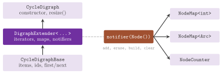

# A. Writing a graph, a map or a heap {#app-a}

We are concerned in this appendix with the classes that a user may add to the
library. These are typically a graph structure that computes its items from
some private data (an implicit graph, or a view of another data structure), a
map that computes its values on demand, an observer that follows the changes
of a graph, and a heap. Such a class is accepted by the algorithms as soon as
it conforms to the concept of its kind; also, most of the work is done by the
classes of `lemon/bits/`, which turn a small base class into a complete graph.
Section A.1 states the concepts as contracts, and section A.2 describes the
base class of a graph and the extenders that complete it. Section A.3 deals
with the alteration notifier through which a graph informs its maps, sections
A.4 and A.5 with the maps and the heaps, and section A.6 with the checking of
a new class. In the program of this appendix
(`manual/examples/A-cycle-digraph.cc`) we write a digraph, a map and an
observer, and we run `Dijkstra` on the first two.

## A.1 The concepts as contracts {#sec-a-1}

A concept class of `lemon/concepts/` (cf. [chapter
3](03-mental-model.md#ch-3)) lists what a generic algorithm may use, and hence
what a new class must provide. For a digraph this is `concepts::Digraph`,
i.e., the base, idable, iterable and mappable components of [chapter
4](04-graphs.md#ch-4), while an undirected graph conforms to `concepts::Graph`
and a bipartite one to `concepts::BpGraph`. A structure that can grow, shrink
or be cleared also conforms to the extendable, erasable and clearable
components. Each of them requires the alterable one, since a structure that
changes must notify its maps. However, the concepts state only the syntax;
some semantic requirements are written only in their documentation, and the
algorithms rely on them as well.

-   The identifiers of the items of one kind are distinct and immutable, and
they lie between 0 and `maxNodeId()` (or the other maxima). The maximum should
not be much larger than the number of items, since the standard maps allocate
one slot for each identifier up to it.
-   Each iterator visits each item exactly once and then becomes `INVALID`. In
an undirected graph `ArcIt` visits each of the two arcs of an edge once, and
`InArcIt` and `OutArcIt` visit the arcs of the incident edges.
-   The ends `u(e)` and `v(e)` do not change while the edge exists, and
`direct(e, true)` goes from `u(e)` to `v(e)`.

For a map the contracts are `concepts::ReadMap< K , V >`,
`concepts::WriteMap< K , V >`, `concepts::ReadWriteMap< K , V >` and
`concepts::ReferenceMap< K , V , R , CR >` of `lemon/concepts/maps.h`
([chapter 6](06-maps.md#ch-6)), and for a heap
`concepts::Heap< PR , IM , CMP >` of `lemon/concepts/heap.h` (section A.5).
Each concept class has a nested template `Constraints`, whose function
`constraints()` is the executable form of the contract that `checkConcept`
instantiates (section A.6).

## A.2 The base class and the extenders {#sec-a-2}

Most of the interface of a graph does not depend on how the graph is stored,
or depends on it only somewhat. Indeed, the iterators can be written once from
functions such as `first(Node &)` and `next(Node &)`, the standard maps need
only the identifiers and a notifier, and the ranges, `oppositeNode()`,
`baseNode()` and `runningNode()` follow from the iterators. Hence, the header
`lemon/bits/graph_extender.h` defines three class templates,
`DigraphExtender< Base >`, `GraphExtender< Base >` and
`BpGraphExtender< Base >`, which derive from a base class written by the user
and add this common part. All the structures of [chapter 4](04-graphs.md#ch-4)
are made in this way (e.g., `ListDigraph` derives from
`DigraphExtender< ListDigraphBase >`). So are the arc and edge sets, by
`ArcSetExtender` and `EdgeSetExtender` of `lemon/bits/edge_set_extender.h`,
and the adaptors of [chapter 5](05-adaptors.md#ch-5), by the extenders of
`lemon/bits/graph_adaptor_extender.h`.

*The base of a digraph.* A base class for `DigraphExtender` defines the
following members, which are those of `BaseDigraphComponent`,
`IDableDigraphComponent` and the low-level part of `IterableDigraphComponent`.

-   The handle types `Node` and `Arc`, with default and `Invalid`
   constructors,
`==`, `!=` and `<`.
-   The functions `source(a)` and `target(a)`.
-   The functions `first(Node &)`, `next(Node &)`, `first(Arc &)` and
`next(Arc &)`, which enumerate the items and set the handle to the invalid
value after the last one. Also, `firstOut(Arc &, Node)`, `nextOut(Arc &)`,
`firstIn(Arc &, Node)` and `nextIn(Arc &)` enumerate the arcs at a node.
-   The functions `id(Node)`, `id(Arc)`, `nodeFromId(int)`, `arcFromId(int)`,
`maxNodeId()` and `maxArcId()`.

If the structure can change, the base also has `addNode()`, `addArc(s, t)`,
`erase(Node)`, `erase(Arc)` and `clear()`, which modify the storage only,
since the extender adds the notifications. A static structure has instead
`build(g, nodeRef, arcRef)` and the tag `BuildTag`. Optionally, the tags
`NodeNumTag` and `ArcNumTag`, with `nodeNum()` and `arcNum()`, make the
counting of [chapter 4](04-graphs.md#ch-4) take $O(1)$ time, and `FindArcTag`,
with `findArc(s, t, prev)`, replaces the scan of `findArc()`.

*The extender.* On top of the functions above, `DigraphExtender< Base >`
defines `NodeIt`, `ArcIt`, `OutArcIt` and `InArcIt` (Algorithm A.1), with the
ranges `nodes()`, `arcs()`, `outArcs(v)` and `inArcs(v)`. It also defines
`baseNode()`, `runningNode()`, `oppositeNode()`, `maxId()` and `fromId()`, and
one `AlterationNotifier` for the nodes and one for the arcs, returned by
`notifier(Node())` and `notifier(Arc())`. Its map templates `NodeMap< V >` and
`ArcMap< V >` are `DefaultMap`s with the iterators of `MapExtender`
(cf. [chapter 6](06-maps.md#ch-6)). Finally, its functions `addNode()`,
`addArc()`, `erase()`, `clear()` and `build()` call those of the base and
notify the observers in the order of section A.3; in particular, `erase(Node)`
erases the arcs at the node first, and the base need not do it.

For an undirected graph, `GraphExtender< Base >` requires from the base the
type `Edge` as well, with `u(e)`, `v(e)`, `direction(a)`, `direct(e, bool)`,
`first(Edge &)`, `next(Edge &)`, `firstInc(Edge &, bool &, Node)`,
`nextInc(Edge &, bool &)`, `id(Edge)`, `edgeFromId()` and `maxEdgeId()`. In
return it defines the tag `UndirectedTag`, `EdgeIt`, `IncEdgeIt`, `edges()`,
`incEdges(v)`, `oppositeArc()`, `direct(e, node)`, a third notifier for the
edges and `EdgeMap< V >`, and its `addEdge()` notifies the new edge and its
two arcs. In the same way, `BpGraphExtender< Base >` adds the red and the blue
nodes, with their iterators, notifiers and maps.

<span id="alg-a-1"></span>**Algorithm A.1** (The arc iterators that
DigraphExtender derives from the base).

```
ArcIt(g):          g.first(a)
++a:               g.next(a)
OutArcIt(g, v):    g.firstOut(a, v)
++a:               g.nextOut(a)
a != INVALID:      Arc::operator!= of the base, against Arc(INVALID)
```

The program of this appendix writes the directed cycle on $n$ nodes in this
way. Its base class, `CycleDigraphBase`, stores only $n$, gives node $i$ and
arc $i$ the identifier $i$, and computes the arc $i$ as going from node $i$ to
node $(i+1)\bmod n$. Each node has one arc out and one arc in; hence,
`nextOut()` and `nextIn()` set the handle to the invalid value. Then
`CycleDigraph` derives from `DigraphExtender< CycleDigraphBase >`, and its
`resize(n)` notifies the maps that all the items were erased and that the new
ones were built, as `FullDigraph::resize()` does ([Figure
A.1](A-writing-graph-map.md#fig-a-1)). The program checks the digraph against
`concepts::Digraph` and runs `Dijkstra` on it, with no change to the
algorithm.

{#fig-a-1}

```cpp
--8<-- "examples/A-cycle-digraph.cc"
```

## A.3 The alteration notifier {#sec-a-3}

A graph informs the objects that depend on its items of each change through
one notifier for each kind of item. This is an object of the class
`AlterationNotifier< Container , Item >` of
`lemon/bits/alteration_notifier.h`, which keeps a list of observers, i.e., of
objects of classes derived from its nested class `ObserverBase`. An observer
is attached to a notifier by its constructor `ObserverBase( notifier )` or by
`attach( notifier )`, and it is detached by `detach()` or by its destructor;
`notifier()` and `attached()` give its notifier and its state. An observer
overrides six pure virtual functions, which the notifier calls.

-   `add(item)` and `add(items)`, after one item or a `std::vector` of items
has been added to the container.
-   `erase(item)` and `erase(items)`, before one item or several items are
erased from it.
-   `build()`, after the container has been built from empty, and `clear()`,
before all its items are erased.

A graph calls the functions `add()`, `erase()`, `build()` and `clear()` of its
notifier in a fixed order with respect to its storage. An item is added to the
storage first and notified afterwards, so that the observer can read it (e.g.,
its identifier), while an item to be erased is notified first and removed
afterwards. The notifier also lets an observer enumerate the current items by
`first(item)` and `next(item)`, and read their identifiers by `id(item)` and
the bound on them by `maxId()`. We remark that an observer must not trigger
another alteration of the same notifier, nor detach another observer, from
within these functions.

*Exceptions.* The calls of `add()` and `build()` go from the observer attached
first to the one attached last. If an observer throws, those already notified
receive `erase()` (or `clear()`) for the same items, and the exception is
propagated (Algorithm A.2); hence, a graph whose `addArc()` fails in one of
its maps (e.g., for lack of memory) leaves all its maps consistent. The calls
of `erase()` and `clear()` go from the last attached to the first, and they
must not throw, with one exception. An observer may throw `ImmediateDetach`,
after which the notifier detaches it and goes on with the others. The
`Snapshot` of a list graph uses it when an item older than the snapshot is
erased, and so do the `Smart` arc and edge sets when an erased node has arcs
in them ([chapter 4](04-graphs.md#ch-4)).

<span id="alg-a-2"></span>**Algorithm A.2** (Notifying an addition, with
rollback, and an erasure).

```
add(x):
 1  for each observer o, from the first attached to the last:
 2    try o.add(x)
 3    on an exception:  for each observer o' notified before o:
 4                        o'.erase(x)
 5                      rethrow the exception
erase(x):
 6  for each observer o, from the last attached to the first:
 7    try o.erase(x)
 8    on ImmediateDetach:  detach o and continue
```

*Thread safety and limits.* Attaching and detaching go through a lock. It is a
mutex of POSIX threads or of Windows when the library is configured with
`LEMON_USE_PTHREAD` or `LEMON_USE_WIN32_THREADS`, and an empty class
otherwise; thus, maps may be created and destroyed on one graph from several
threads, while the notifications are not locked. The header also remarks that
the notifications are not always complete. A reversal of an arc by
`reverseArc()` is not notified (the observers see neither an erasure nor an
addition), and therefore the degree maps `InDegMap` and `OutDegMap` of
[chapter 6](06-maps.md#ch-6), which observe the arcs, may become wrong after
it. Also, a filter adaptor of [chapter 5](05-adaptors.md#ch-5) cannot notify
the change of its filter map at all.

The program of section A.2 includes `NodeCounter`, an observer of the nodes of
a `ListDigraph` that counts them. Its constructor attaches it to
`g.notifier(ListDigraph::Node())` and calls `build()`, which counts the nodes
present by `first()` and `next()`. Afterwards, `add()` and `erase()` keep the
count, and the program checks it against `countNodes()` after an addition and
an erasure.

## A.4 Writing a map {#sec-a-4}

A map that an algorithm only reads is a class with the types `Key` and `Value`
and a constant `operator[]( const Key & )`, which returns a `Value` (or a
reference to one). A map that the algorithm writes also has
`set( const Key & , const Value & )`. No other member is needed; in fact, the
map need not store its values and need not know the graph, unless it computes
from it. It is passed by reference to the algorithm, which keeps a pointer to
it (and therefore requires it to outlive the algorithm). For instance, the
class `LengthByIndex` of the program of section A.2 gives each arc of
`CycleDigraph` the length $1+(i\bmod 3)$ from the identifier $i$ of the arc,
and `Dijkstra< CycleDigraph , LengthByIndex >` reads it in place of an arc
map. A map may derive from `MapBase< K , V >` of `lemon/maps.h`, which only
defines the two types. Also, a reference map defines the types `Reference` and
`ConstReference` and the tag `typedef True ReferenceMapTag`, by which
`MapTraits` (cf. [chapter 3](03-mental-model.md#ch-3)) recognizes it.

A map that stores a value for each item of a graph, and must therefore follow
its changes, is an observer of the notifier of that kind of item: its `add()`
and `erase()` make room for the new items and release the erased ones. The
standard maps of the extenders, `VectorMap` and `ArrayMap` (described in
[chapter 6](06-maps.md#ch-6)), are written in this way, and so are the degree
maps of `lemon/maps.h`, while `CrossRefMap` and `RangeIdMap` derive from a
standard map and extend its observer functions. A new graph structure obtains
the standard maps from its extender; it usually needs a specific map only for
a different storage (e.g., a map of the arcs of an implicit graph that stores
values only for some of them).

## A.5 Writing a heap {#sec-a-5}

The algorithms that keep a priority queue of nodes (`Dijkstra`,
`BidirDijkstra`, `AStar`, `MinCostArborescence` and several others of Part
III) take the type of their heap from their traits. A user may replace it by
the named template parameter `SetHeap< H , CR >` (cf. [chapter
3](03-mental-model.md#ch-3)), with a heap that conforms to
`concepts::Heap< PR , IM , CMP >`. The parameters of the concept are the type
`PR` of the priorities, the type `IM` of a read-write map from the items to
`int`, and the comparison functor `CMP`, by default `std::less< PR >`. Through
the map `IM`, called the cross reference map, the heap finds the place of an
item in $O(1)$ time, and its key type `IM::Key` is the type of the items. The
concept requires the following members, which one can compare with those of
the heaps of the library.

-   The types `Item`, `Prio`, `ItemIntMap` and `State`, the last one an
enumeration with `IN_HEAP` $=0$, `PRE_HEAP` $=-1$ and `POST_HEAP` $=-2$.
-   The constructors `Heap( IM & map )` and
`Heap( IM & map , const CMP & comp )`, and a copy constructor (the
`Constraints` of the concept copy a heap).
-   The functions `size()`, `empty()` and `clear()`, the last of which empties
the heap without touching the cross reference map.
-   The functions `push(i, p)` for an item not in the heap, `top()` and
`prio()` for the item of least priority and its priority, `pop()`, which
removes that item, and `erase(i)` for an item in the heap.
-   The query `heap[i]`, the priority of an item in the heap, and the
   functions
`set(i, p)`, which inserts the item or changes its priority, and
`decrease(i, p)` and `increase(i, p)`, whose precondition is that the new
priority is not larger (resp. smaller) than the old one.
-   The functions `state(i)`, which returns `PRE_HEAP` for an item that has
never been in the heap, `IN_HEAP` for one in it and `POST_HEAP` for one
removed, and `state(i, st)`, which sets the state of an item that is not in
the heap.

The cross reference map is owned by the caller and shared with the heap. It
must give `PRE_HEAP` for each item that may be pushed, and the heap typically
writes into it the position of each item in its storage (a nonnegative value)
and `POST_HEAP` after its removal. For instance, `Dijkstra::init()` calls
`clear()` on its heap and then sets the cross reference of each node to
`PRE_HEAP`, in $O(n)$ time. The implementations of the library, their costs,
and the test of all of them against the concept (`test/heap_test.cc`) are
given in [chapter 7](07-heaps.md#ch-7).

## A.6 Checking a new class {#sec-a-6}

A new class is checked at compile time by `checkConcept< Concept , T >()` of
`lemon/concept_check.h`, as the program of section A.2 does for `CycleDigraph`
(against `concepts::Digraph`) and for `LengthByIndex` (against
`concepts::ReadMap< CycleDigraph::Arc , int >`). The call instantiates the
function `constraints()` of the concept on the class, and a missing type or
function (or one with an incompatible signature) gives a compilation error at
that point. It usually costs nothing at run time, and it is empty when
`NDEBUG` is defined. A structure that offers more than the concept is also
checked against the components it adds, e.g.,
`checkConcept< concepts::ExtendableDigraphComponent<> , G >()` and the
erasable, clearable and alterable components, as `test/digraph_test.cc` does
for the structures of the library.

Since the concepts check the syntax only, the semantic requirements of section
A.1 are checked by running the class. In the tests, the header
`test/graph_test.h` has function templates that do it for any graph type, and
a test of a new structure may call them. Thus, `checkGraphNodeList(g, n)` and
`checkGraphArcList(g, m)` count the items visited by the iterators,
`checkGraphOutArcList(g, v, d)` and `checkGraphInArcList(g, v, d)` the arcs at
a node, and `checkGraphIncEdgeArcLists(g, v, d)` the incidences of an
undirected graph. Also, `checkNodeIds(g)` and `checkArcIds(g)` verify that the
identifiers are distinct and that `nodeFromId()` inverts them,
`checkArcDirections(g)` that the arcs of each edge are directed consistently,
and `checkGraphNodeMap(g)` and `checkGraphArcMap(g)` that a map has a value
for each item. Finally, an algorithm run on the new structure should give the
results known in closed form or computed on a copy of it into a `ListDigraph`
(by `digraphCopy()` of [chapter 4](04-graphs.md#ch-4)); the program of section
A.2, e.g., checks the distances of `Dijkstra` against their closed form.
